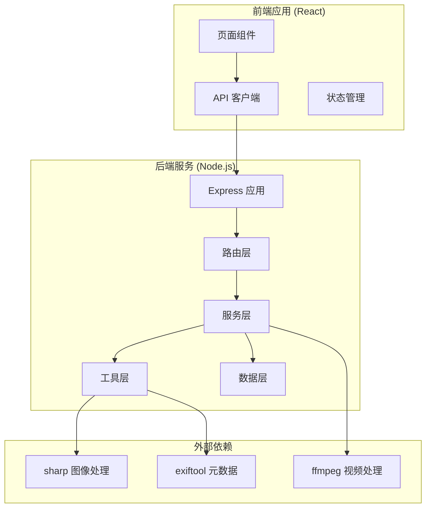
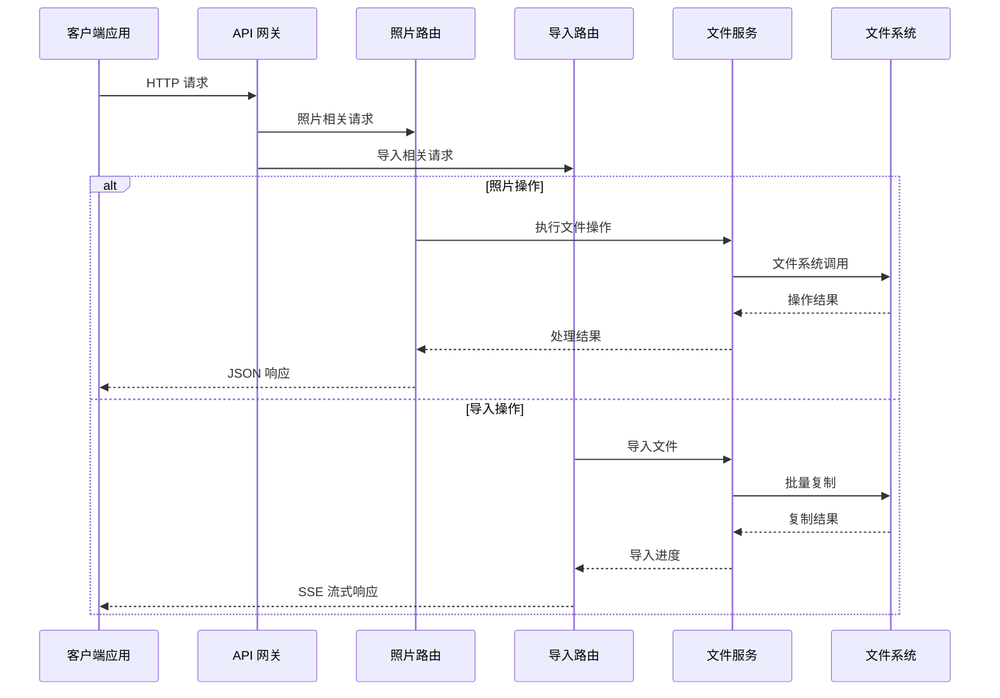
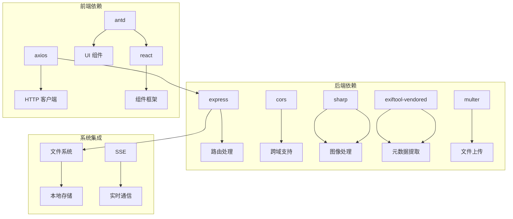

# API 接口文档

<cite>
**本文档引用的文件**
- [backend/src/app.js](file://backend/src/app.js)
- [backend/src/routes/photoRoutes.js](file://backend/src/routes/photoRoutes.js)
- [backend/src/routes/importRoutes.js](file://backend/src/routes/importRoutes.js)
- [backend/src/services/fileService.js](file://backend/src/services/fileService.js)
- [backend/src/utils/fileUtils.js](file://backend/src/utils/fileUtils.js)
- [backend/src/utils/rawThumbnail.js](file://backend/src/utils/rawThumbnail.js)
- [backend/data/repos.json](file://backend/data/repos.json)
- [config/repos.json](file://config/repos.json)
- [backend/package.json](file://backend/package.json)
- [frontend/src/api/index.js](file://frontend/src/api/index.js)
- [frontend/src/pages/ImportPage.jsx](file://frontend/src/pages/ImportPage.jsx)
- [frontend/src/pages/PhotoGallery.jsx](file://frontend/src/pages/PhotoGallery.jsx)
- [backend/RAW_THUMBNAIL_FIX.md](file://backend/RAW_THUMBNAIL_FIX.md)
</cite>

## 目录
1. [简介](#简介)
2. [项目结构](#项目结构)
3. [核心组件](#核心组件)
4. [架构概览](#架构概览)
5. [详细组件分析](#详细组件分析)
6. [依赖关系分析](#依赖关系分析)
7. [性能考虑](#性能考虑)
8. [故障排除指南](#故障排除指南)
9. [结论](#结论)
10. [附录](#附录)

## 简介

摄影管理项目是一个基于 Node.js 和 React 的现代化照片管理系统，提供了完整的照片导入、管理和浏览功能。该系统支持多格式照片处理（JPG、RAW、视频），具备智能导入算法、实时进度跟踪和高效的文件管理能力。

### 主要特性
- **多格式支持**：JPG、RAW（ARW、CR2、CR3、NEF、DNG等）、视频文件
- **智能导入**：增量导入、自动重命名、冲突检测
- **实时监控**：SSE进度跟踪、错误处理
- **高效管理**：批量操作、分类浏览、快速搜索
- **跨平台兼容**：支持Windows、macOS、Linux

## 项目结构



**图表来源**
- [backend/src/app.js:1-146](file://backend/src/app.js#L1-L146)
- [backend/src/routes/photoRoutes.js:1-739](file://backend/src/routes/photoRoutes.js#L1-L739)
- [backend/src/routes/importRoutes.js:1-627](file://backend/src/routes/importRoutes.js#L1-L627)

**章节来源**
- [backend/src/app.js:1-146](file://backend/src/app.js#L1-L146)
- [backend/package.json:1-30](file://backend/package.json#L1-L30)

## 核心组件

### 1. 应用架构

系统采用经典的三层架构模式：

- **表现层**：React 前端应用，提供用户界面和交互
- **业务逻辑层**：Express 路由和控制器，处理业务逻辑
- **数据访问层**：文件系统抽象，提供统一的文件操作接口

### 2. 核心服务

#### 文件服务 (FileService)
负责照片文件的导入、管理、查询和操作，支持多种文件格式和批量操作。

#### 路由服务
- **照片路由**：处理照片列表、预览、删除、导出等操作
- **导入路由**：处理存储卡导入、仓库管理等功能

#### 工具服务
- **文件工具**：文件扫描、复制、删除、重命名等基础操作
- **RAW 缩略图**：生成 RAW 文件缩略图，支持嵌入预览提取

**章节来源**
- [backend/src/services/fileService.js:1-443](file://backend/src/services/fileService.js#L1-L443)
- [backend/src/utils/fileUtils.js:1-167](file://backend/src/utils/fileUtils.js#L1-L167)
- [backend/src/utils/rawThumbnail.js:1-132](file://backend/src/utils/rawThumbnail.js#L1-L132)

## 架构概览



**图表来源**
- [backend/src/app.js:114-121](file://backend/src/app.js#L114-L121)
- [backend/src/routes/photoRoutes.js:68-92](file://backend/src/routes/photoRoutes.js#L68-L92)
- [backend/src/routes/importRoutes.js:82-182](file://backend/src/routes/importRoutes.js#L82-L182)

## 详细组件分析

### 照片管理 API

#### 1. 获取照片列表

**HTTP 方法**: GET  
**URL 模式**: `/api/photos`  
**请求参数**:
- `category` (可选): 照片分类，默认为 'jpg'
- `page` (可选): 页码，默认为 1
- `pageSize` (可选): 每页数量，默认为 50
- `sortBy` (可选): 排序字段，默认为 'modifiedTime'
- `sortOrder` (可选): 排序顺序，默认为 'desc'
- `repoId` (可选): 仓库ID

**响应格式**:
```json
{
  "success": true,
  "data": {
    "photos": [
      {
        "id": "base64编码的文件路径",
        "name": "文件名",
        "filename": "文件名(不含扩展)",
        "path": "完整文件路径",
        "relativePath": "相对仓库路径",
        "type": "文件类型",
        "extension": "扩展名",
        "size": "文件大小(字节)",
        "modifiedTime": "修改时间",
        "thumbnailUrl": "缩略图URL",
        "url": "原图URL"
      }
    ],
    "total": 100,
    "page": 1,
    "pageSize": 50
  }
}
```

**错误代码**:
- 500: 服务器内部错误

**章节来源**
- [backend/src/routes/photoRoutes.js:68-92](file://backend/src/routes/photoRoutes.js#L68-L92)
- [backend/src/services/fileService.js:169-224](file://backend/src/services/fileService.js#L169-L224)

#### 2. 获取存储信息

**HTTP 方法**: GET  
**URL 模式**: `/api/photos/storage-info`  
**请求参数**:
- `repoId` (可选): 仓库ID

**响应格式**:
```json
{
  "success": true,
  "data": {
    "jpg": {
      "count": 100,
      "size": 104857600,
      "sizeFormatted": "100.00 MB"
    },
    "raw": {
      "count": 50,
      "size": 52428800,
      "sizeFormatted": "50.00 MB"
    },
    "video": {
      "count": 25,
      "size": 26214400,
      "sizeFormatted": "25.00 MB"
    }
  }
}
```

**错误代码**:
- 500: 服务器内部错误

**章节来源**
- [backend/src/routes/photoRoutes.js:94-110](file://backend/src/routes/photoRoutes.js#L94-L110)
- [backend/src/services/fileService.js:336-363](file://backend/src/services/fileService.js#L336-L363)

#### 3. 删除照片

**HTTP 方法**: DELETE  
**URL 模式**: `/api/photos/:id`  
**路径参数**:
- `id`: 照片ID（base64编码的文件路径）

**查询参数**:
- `syncRaw` (可选): 是否同步删除RAW文件，默认为 true
- `repoId` (可选): 仓库ID

**响应格式**:
```json
{
  "success": true,
  "data": {
    "success": true,
    "deletedFiles": ["文件路径数组"]
  }
}
```

**错误代码**:
- 500: 服务器内部错误

**章节来源**
- [backend/src/routes/photoRoutes.js:130-149](file://backend/src/routes/photoRoutes.js#L130-L149)
- [backend/src/services/fileService.js:226-267](file://backend/src/services/fileService.js#L226-L267)

#### 4. 预览图片

**HTTP 方法**: GET  
**URL 模式**: `/api/photos/preview`  
**请求参数**:
- `path`: 文件路径（URL编码）

**响应**: 文件流（支持 Range 请求）

**错误代码**:
- 400: 参数错误
- 404: 文件不存在
- 500: 服务器内部错误

**章节来源**
- [backend/src/routes/photoRoutes.js:178-291](file://backend/src/routes/photoRoutes.js#L178-L291)

#### 5. 获取缩略图

**HTTP 方法**: GET  
**URL 模式**: `/api/photos/thumbnail`  
**请求参数**:
- `path`: 文件路径（URL编码）
- `width` (可选): 缩略图宽度，默认为 300
- `quality` (可选): 图片质量，默认为 80

**响应**: JPEG 图片流或 SVG 占位图

**错误代码**:
- 400: 参数错误
- 404: 文件不存在
- 500: 服务器内部错误

**章节来源**
- [backend/src/routes/photoRoutes.js:293-466](file://backend/src/routes/photoRoutes.js#L293-L466)
- [backend/src/utils/rawThumbnail.js:78-129](file://backend/src/utils/rawThumbnail.js#L78-L129)

#### 6. 批量导出照片

**HTTP 方法**: POST  
**URL 模式**: `/api/photos/batch-export`  
**请求体**:
```json
{
  "fileIds": ["文件ID数组"],
  "targetPath": "目标路径",
  "repoId": "仓库ID"
}
```

**响应格式**:
```json
{
  "success": true,
  "data": {
    "successCount": 10,
    "failedCount": 2,
    "skippedCount": 5,
    "details": {
      "success": [],
      "failed": [],
      "skipped": []
    }
  }
}
```

**错误代码**:
- 400: 参数错误
- 500: 服务器内部错误

**章节来源**
- [backend/src/routes/photoRoutes.js:642-736](file://backend/src/routes/photoRoutes.js#L642-L736)
- [backend/src/services/fileService.js:418-439](file://backend/src/services/fileService.js#L418-L439)

### 导入功能 API

#### 1. 从存储卡导入（实时进度）

**HTTP 方法**: GET  
**URL 模式**: `/api/import`  
**查询参数**:
- `sourcePath`: 存储卡路径
- `repoId`: 目标仓库ID
- `autoRename`: 是否自动重命名

**响应**: SSE 流式响应

**进度消息格式**:
```json
{
  "type": "progress",
  "data": {
    "total": 100,
    "processed": 10,
    "remaining": 90,
    "currentFile": "文件名",
    "estimatedTimeRemaining": 300,
    "percentage": 10
  }
}
```

**完成消息格式**:
```json
{
  "type": "complete",
  "data": {
    "jpgCount": 50,
    "rawCount": 25,
    "videoCount": 10,
    "errorCount": 2,
    "skippedCount": 5,
    "targetRepo": "仓库名称",
    "details": {}
  }
}
```

**错误代码**:
- 400: 参数错误
- 500: 服务器内部错误

**章节来源**
- [backend/src/routes/importRoutes.js:82-182](file://backend/src/routes/importRoutes.js#L82-L182)

#### 2. 获取默认导入路径

**HTTP 方法**: GET  
**URL 模式**: `/api/import/default-path`

**响应格式**:
```json
{
  "success": true,
  "data": {
    "defaultPath": "/Volumes"
  }
}
```

**错误代码**:
- 500: 服务器内部错误

**章节来源**
- [backend/src/routes/importRoutes.js:184-216](file://backend/src/routes/importRoutes.js#L184-L216)

#### 3. 仓库管理

**获取所有仓库**:
- **方法**: GET `/api/import/repos`
- **响应**: 仓库列表

**添加仓库**:
- **方法**: POST `/api/import/repos`
- **请求体**: `{name, path, isDefault}`
- **响应**: 新增仓库信息

**删除仓库**:
- **方法**: DELETE `/api/import/repos/:id`
- **路径参数**: `id`
- **响应**: 删除结果

**设置默认仓库**:
- **方法**: PUT `/api/import/repos/:id/default`
- **路径参数**: `id`
- **响应**: 设置结果

**章节来源**
- [backend/src/routes/importRoutes.js:218-340](file://backend/src/routes/importRoutes.js#L218-L340)

### 仓库管理 API

#### 1. 获取仓库列表

**HTTP 方法**: GET  
**URL 模式**: `/api/import/repos`

**响应格式**:
```json
{
  "success": true,
  "data": [
    {
      "id": "仓库ID",
      "name": "仓库名称",
      "path": "仓库路径",
      "isDefault": true
    }
  ]
}
```

**错误代码**:
- 500: 服务器内部错误

**章节来源**
- [backend/src/routes/importRoutes.js:218-232](file://backend/src/routes/importRoutes.js#L218-L232)

#### 2. 添加仓库

**HTTP 方法**: POST  
**URL 模式**: `/api/import/repos`

**请求体**:
```json
{
  "name": "仓库名称",
  "path": "仓库路径",
  "isDefault": false
}
```

**响应格式**:
```json
{
  "success": true,
  "data": {
    "id": "新仓库ID",
    "name": "仓库名称",
    "path": "仓库路径",
    "isDefault": false
  }
}
```

**错误代码**:
- 400: 参数错误
- 500: 服务器内部错误

**章节来源**
- [backend/src/routes/importRoutes.js:234-281](file://backend/src/routes/importRoutes.js#L234-L281)

#### 3. 删除仓库

**HTTP 方法**: DELETE  
**URL 模式**: `/api/import/repos/:id`

**响应格式**:
```json
{
  "success": true,
  "message": "删除成功"
}
```

**错误代码**:
- 404: 仓库不存在
- 500: 服务器内部错误

**章节来源**
- [backend/src/routes/importRoutes.js:283-316](file://backend/src/routes/importRoutes.js#L283-L316)

#### 4. 设置默认仓库

**HTTP 方法**: PUT  
**URL 模式**: `/api/import/repos/:id/default`

**响应格式**:
```json
{
  "success": true,
  "message": "设置成功"
}
```

**错误代码**:
- 500: 服务器内部错误

**章节来源**
- [backend/src/routes/importRoutes.js:318-340](file://backend/src/routes/importRoutes.js#L318-L340)

## 依赖关系分析



**图表来源**
- [backend/package.json:10-18](file://backend/package.json#L10-L18)
- [frontend/src/api/index.js:1-168](file://frontend/src/api/index.js#L1-168)

### 外部依赖

#### 核心依赖
- **express**: Web 应用框架
- **sharp**: 高性能图像处理库
- **exiftool-vendored**: RAW 文件元数据处理
- **cors**: 跨域资源共享

#### 前端依赖
- **axios**: HTTP 客户端库
- **antd**: Ant Design UI 组件库
- **react**: JavaScript 应用框架

**章节来源**
- [backend/package.json:10-29](file://backend/package.json#L10-L29)

## 性能考虑

### 1. 文件处理优化

#### 并发控制
- 导入操作使用并发限制（3个并发），避免内存溢出
- 批量操作采用异步处理，支持进度反馈

#### 缓存策略
- 缩略图缓存：1天有效期
- 静态文件缓存：1小时有效期
- 图像流式传输：避免大文件内存占用

### 2. 内存管理

#### 文件流处理
- 使用流式传输处理大文件
- 及时释放文件句柄和缓冲区
- 避免一次性加载整个文件到内存

#### 进度跟踪
- 实时计算剩余时间和处理进度
- 动态调整处理策略

### 3. 网络优化

#### SSE 连接
- 支持断线重连
- 5分钟超时保护
- 进度消息压缩

**章节来源**
- [backend/src/services/fileService.js:75-156](file://backend/src/services/fileService.js#L75-L156)
- [backend/src/routes/photoRoutes.js:226-280](file://backend/src/routes/photoRoutes.js#L226-L280)

## 故障排除指南

### 1. 常见错误及解决方案

#### RAW 缩略图生成失败
**问题**: RAW 文件无法生成缩略图  
**解决方案**:
- 确认 exiftool-vendored 包正确安装
- 检查 RAW 文件格式支持情况
- 验证文件权限和路径有效性

#### 导入进度异常
**问题**: 导入过程中断或进度停滞  
**解决方案**:
- 检查网络连接稳定性
- 验证目标存储空间充足
- 确认文件系统权限正确

#### 文件预览失败
**问题**: 照片或视频无法预览  
**解决方案**:
- 检查文件路径是否正确
- 验证文件权限设置
- 确认文件格式受支持

### 2. 调试工具

#### 后端调试
- 启用详细日志记录
- 监控内存使用情况
- 检查文件系统访问权限

#### 前端调试
- 使用浏览器开发者工具
- 检查网络请求状态
- 验证 API 响应格式

**章节来源**
- [backend/RAW_THUMBNAIL_FIX.md:1-100](file://backend/RAW_THUMBNAIL_FIX.md#L1-L100)

### 3. 性能监控

#### 关键指标
- **导入速度**: 文件大小/处理时间
- **内存使用**: 进程内存峰值
- **并发数**: 同时处理的文件数量
- **错误率**: 处理失败的文件比例

#### 监控建议
- 定期检查磁盘空间
- 监控 CPU 使用率
- 跟踪网络带宽使用

## 结论

摄影管理项目提供了一个完整、高效的照片管理解决方案。系统具有以下优势：

### 技术优势
- **模块化设计**: 清晰的分层架构，便于维护和扩展
- **高性能处理**: 优化的文件处理算法和内存管理
- **实时反馈**: SSE 进度跟踪，提升用户体验
- **跨平台兼容**: 支持多种操作系统和文件格式

### 功能特色
- **智能导入**: 增量导入、自动重命名、冲突检测
- **多格式支持**: JPG、RAW、视频文件的完整支持
- **批量操作**: 高效的批量删除、导出功能
- **仓库管理**: 灵活的多仓库配置和管理

### 未来改进方向
- 增强错误处理和恢复机制
- 优化大数据量处理性能
- 扩展更多文件格式支持
- 加强安全性和权限控制

## 附录

### 1. 客户端集成指南

#### 基础配置
```javascript
// 基础 API 客户端配置
const api = axios.create({
  baseURL: '/api',
  timeout: 30000
});
```

#### 照片 API 使用
```javascript
// 获取照片列表
const photos = await photoApi.getPhotos('jpg', {
  page: 1,
  pageSize: 50,
  sortBy: 'modifiedTime',
  sortOrder: 'desc'
});

// 删除照片
await photoApi.deletePhoto(photoId, true);

// 批量导出
await photoApi.batchExport(fileIds, targetPath);
```

#### 导入 API 使用
```javascript
// 设置进度回调
importApi.setProgressCallback((progress) => {
  console.log(`进度: ${progress.percentage}%`);
});

// 开始导入
await importApi.importFromCard(sourcePath, repoId, autoRename);
```

**章节来源**
- [frontend/src/api/index.js:1-168](file://frontend/src/api/index.js#L1-L168)
- [frontend/src/pages/ImportPage.jsx:212-260](file://frontend/src/pages/ImportPage.jsx#L212-L260)
- [frontend/src/pages/PhotoGallery.jsx:130-152](file://frontend/src/pages/PhotoGallery.jsx#L130-L152)

### 2. SDK 使用方法

#### 安装依赖
```bash
npm install axios
```

#### 基础使用
```javascript
import { photoApi, importApi } from './api';

// 照片管理
const photos = await photoApi.getPhotos('jpg');
await photoApi.deletePhoto(photoId);

// 导入功能
const importStream = await importApi.importFromCard(
  sourcePath, 
  repoId, 
  autoRename
);
```

### 3. 最佳实践建议

#### 性能优化
- 合理设置分页大小（建议 36-144 张）
- 使用增量导入避免重复处理
- 定期清理临时文件和缓存

#### 安全考虑
- 验证用户输入的文件路径
- 限制文件大小和数量
- 实施适当的权限控制

#### 错误处理
- 实现重试机制
- 提供详细的错误信息
- 记录操作日志

#### 监控和维护
- 定期检查磁盘空间
- 监控系统资源使用
- 及时更新依赖包