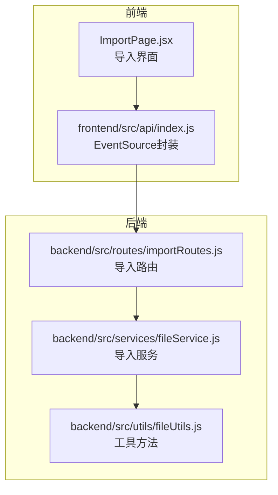
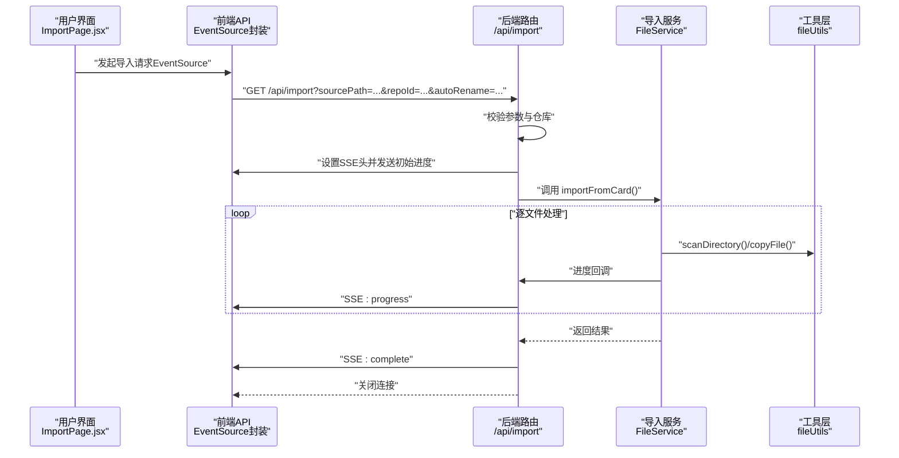
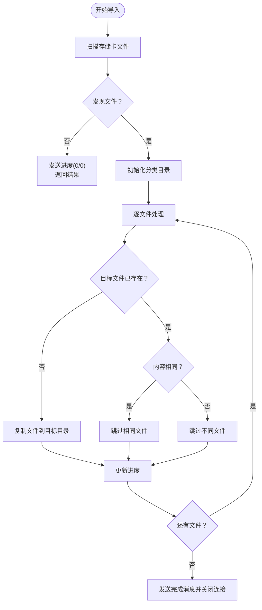
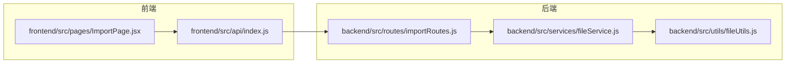

# 导入功能 API

<cite>
**本文引用的文件**
- [importRoutes.js](file://backend/src/routes/importRoutes.js)
- [fileService.js](file://backend/src/services/fileService.js)
- [fileUtils.js](file://backend/src/utils/fileUtils.js)
- [index.js](file://frontend/src/api/index.js)
- [ImportPage.jsx](file://frontend/src/pages/ImportPage.jsx)
- [repos.json](file://config/repos.json)
- [README.md](file://README.md)
</cite>

## 目录
1. [简介](#简介)
2. [项目结构](#项目结构)
3. [核心组件](#核心组件)
4. [架构总览](#架构总览)
5. [详细组件分析](#详细组件分析)
6. [依赖关系分析](#依赖关系分析)
7. [性能考量](#性能考量)
8. [故障排查指南](#故障排查指南)
9. [结论](#结论)
10. [附录](#附录)

## 简介
本文件为“导入功能”的完整 API 接口文档，涵盖：
- 存储卡导入端点（GET /api/import）
- 实时进度监控（SSE 事件流）
- 文件夹选择端点（GET /api/import/select-folder）
- 存储仓库管理端点（GET/POST/DELETE/PUT /api/import/repos）
- 默认导入路径查询端点（GET /api/import/default-path）

重点解释导入进度的实时推送机制、SSE 连接管理、导入状态跟踪与错误恢复策略，并提供导入流程的完整示例（存储卡检测、文件扫描、增量导入与冲突处理），以及性能优化、并发控制与用户体验最佳实践。

## 项目结构
导入功能由前后端协作完成：
- 后端：Express 路由负责接收请求、扫描文件、执行导入、通过 SSE 推送进度；FileService 负责具体文件复制与分类；fileUtils 提供扫描、复制、重命名等工具方法。
- 前端：ImportPage.jsx 提供导入界面与交互；frontend/src/api/index.js 封装 EventSource 进行 SSE 接收与进度回调。

图表来源
- [importRoutes.js:82-182](file://backend/src/routes/importRoutes.js#L82-L182)
- [fileService.js:23-167](file://backend/src/services/fileService.js#L23-L167)
- [fileUtils.js:22-100](file://backend/src/utils/fileUtils.js#L22-L100)
- [index.js:37-165](file://frontend/src/api/index.js#L37-L165)
- [ImportPage.jsx:212-260](file://frontend/src/pages/ImportPage.jsx#L212-L260)

章节来源
- [importRoutes.js:1-627](file://backend/src/routes/importRoutes.js#L1-L627)
- [fileService.js:1-443](file://backend/src/services/fileService.js#L1-L443)
- [fileUtils.js:1-167](file://backend/src/utils/fileUtils.js#L1-L167)
- [index.js:1-168](file://frontend/src/api/index.js#L1-L168)
- [ImportPage.jsx:1-820](file://frontend/src/pages/ImportPage.jsx#L1-L820)
- [README.md:1-233](file://README.md#L1-L233)

## 核心组件
- 后端路由层：处理导入请求、仓库管理、文件夹选择，设置 SSE 头并推送进度。
- 业务服务层：FileService 提供扫描、分类、复制、并发控制与进度计算。
- 工具层：fileUtils 提供扫描目录、复制文件、重命名、去重判断等。
- 前端 API 层：EventSource 封装，统一处理 SSE 连接、超时、错误与进度回调。
- 前端页面层：ImportPage.jsx 负责 UI、仓库选择、路径选择、进度展示与结果呈现。

章节来源
- [importRoutes.js:82-182](file://backend/src/routes/importRoutes.js#L82-L182)
- [fileService.js:23-167](file://backend/src/services/fileService.js#L23-L167)
- [fileUtils.js:22-100](file://backend/src/utils/fileUtils.js#L22-L100)
- [index.js:37-165](file://frontend/src/api/index.js#L37-L165)
- [ImportPage.jsx:45-260](file://frontend/src/pages/ImportPage.jsx#L45-L260)

## 架构总览
导入流程采用 SSE 实时推送，前端通过 EventSource 接收三类事件：progress（进度）、complete（完成）、error（错误）。后端在导入开始前发送初始进度消息，随后按文件处理进度持续推送，最后发送完成消息并关闭连接。

图表来源
- [importRoutes.js:82-182](file://backend/src/routes/importRoutes.js#L82-L182)
- [fileService.js:23-167](file://backend/src/services/fileService.js#L23-L167)
- [fileUtils.js:22-100](file://backend/src/utils/fileUtils.js#L22-L100)
- [index.js:37-165](file://frontend/src/api/index.js#L37-L165)

## 详细组件分析

### 端点定义与行为

- 端点一：从存储卡导入（SSE 实时进度）
  - 方法：GET
  - URL：/api/import
  - 查询参数：
    - sourcePath（必填）：存储卡根目录路径
    - repoId（可选）：目标仓库 ID，默认使用默认仓库
    - autoRename（可选）：是否启用自动重命名（true/false）
  - 响应格式（SSE）：
    - type: progress
      - data: { total, processed, remaining, currentFile, estimatedTimeRemaining, percentage }
    - type: complete
      - data: { jpgCount, rawCount, videoCount, errorCount, skippedCount, targetRepo, details }
    - type: error
      - data: { error: string }
  - 连接特性：
    - Content-Type: text/event-stream
    - Cache-Control: no-cache
    - Connection: keep-alive
    - Access-Control-Allow-Origin: *
    - 初始消息：立即发送一次进度（total=0, processed=0, remaining=0, percentage=0）
    - 超时：后端未显式设置超时，前端设置 5 分钟超时保护
  - 错误处理：
    - 参数缺失或仓库不存在时，发送 error 类型消息并关闭连接
    - 运行时异常捕获并发送 error 消息

- 端点二：默认导入路径
  - 方法：GET
  - URL：/api/import/default-path
  - 响应：{ success: boolean, data: { defaultPath: string } }

- 端点三：仓库管理
  - GET /api/import/repos：返回仓库列表
  - POST /api/import/repos：添加仓库（name, path, isDefault）
  - DELETE /api/import/repos/:id：删除仓库
  - PUT /api/import/repos/:id/default：设置默认仓库

- 端点四：文件夹选择（跨平台）
  - GET /api/import/select-folder
  - 行为：根据平台调用系统对话框（macOS 使用 osascript，Windows 使用 PowerShell，Linux 使用 zenity）
  - 返回：{ success: boolean, data?: { path: string }, error?: string }

章节来源
- [importRoutes.js:82-216](file://backend/src/routes/importRoutes.js#L82-L216)
- [importRoutes.js:218-340](file://backend/src/routes/importRoutes.js#L218-L340)
- [importRoutes.js:342-624](file://backend/src/routes/importRoutes.js#L342-L624)

### SSE 连接管理与事件类型
- 连接建立：
  - 前端使用 EventSource 打开 /api/import
  - 后端设置 SSE 头并发送初始进度
- 事件类型：
  - progress：实时进度，包含文件计数、剩余时间、当前文件名与百分比
  - complete：导入完成，包含各类统计与详情
  - error：发生错误，包含错误信息
- 超时与断线：
  - 前端设置 5 分钟超时，readyState=0 表示重连中，readyState=2 表示已关闭
  - 后端异常时发送 error 并关闭连接
- 进度回调：
  - 前端通过 setProgressCallback 注册回调，实时更新 UI

章节来源
- [index.js:37-165](file://frontend/src/api/index.js#L37-L165)
- [importRoutes.js:82-182](file://backend/src/routes/importRoutes.js#L82-L182)

### 导入流程与状态跟踪
- 存储卡检测与文件扫描：
  - 使用 scanDirectory 递归扫描 sourcePath 下的 JPG、RAW、视频文件
  - 跳过隐藏文件（如 ._ 开头）
- 增量导入与冲突处理：
  - 目标目录不存在则创建
  - 若目标文件已存在且内容相同则跳过（不覆盖）
  - 若目标文件存在但内容不同则跳过（不覆盖），记录原因
- 自动重命名：
  - 当 autoRename=true 时，将相对路径中的分隔符替换为下划线，避免同名冲突
- 并发控制：
  - 并发限制为 3 个文件，避免内存占用过高
- 进度计算：
  - 基于平均耗时估算剩余时间
  - 百分比 = processed/total × 100

图表来源
- [fileService.js:23-167](file://backend/src/services/fileService.js#L23-L167)
- [fileUtils.js:77-100](file://backend/src/utils/fileUtils.js#L77-L100)

章节来源
- [fileService.js:23-167](file://backend/src/services/fileService.js#L23-L167)
- [fileUtils.js:22-100](file://backend/src/utils/fileUtils.js#L22-L100)

### 前端集成与用户体验
- 导入页面：
  - 选择目标仓库、输入/选择存储卡路径、勾选自动重命名
  - 实时显示总文件数、已处理、剩余、预计剩余时间、当前文件名
  - 结果页汇总统计、跳过与错误详情
- 文件夹选择：
  - 跨平台对话框，支持取消与超时处理
- 仓库管理：
  - 新增、删除、设置默认仓库，支持路径选择

章节来源
- [ImportPage.jsx:45-260](file://frontend/src/pages/ImportPage.jsx#L45-L260)
- [index.js:148-165](file://frontend/src/api/index.js#L148-L165)
- [importRoutes.js:342-624](file://backend/src/routes/importRoutes.js#L342-L624)

## 依赖关系分析

图表来源
- [index.js:37-165](file://frontend/src/api/index.js#L37-L165)
- [ImportPage.jsx:45-260](file://frontend/src/pages/ImportPage.jsx#L45-L260)
- [importRoutes.js:82-182](file://backend/src/routes/importRoutes.js#L82-L182)
- [fileService.js:23-167](file://backend/src/services/fileService.js#L23-L167)
- [fileUtils.js:22-100](file://backend/src/utils/fileUtils.js#L22-L100)

章节来源
- [index.js:1-168](file://frontend/src/api/index.js#L1-L168)
- [ImportPage.jsx:1-820](file://frontend/src/pages/ImportPage.jsx#L1-L820)
- [importRoutes.js:1-627](file://backend/src/routes/importRoutes.js#L1-L627)
- [fileService.js:1-443](file://backend/src/services/fileService.js#L1-L443)
- [fileUtils.js:1-167](file://backend/src/utils/fileUtils.js#L1-L167)

## 性能考量
- 并发控制：限制同时处理的文件数为 3，避免内存峰值过高
- 增量导入：跳过已存在且内容相同的文件，减少 IO 与网络传输
- 进度估算：基于平均耗时估算剩余时间，提升用户体验
- 超时保护：前端 5 分钟超时，避免长时间占用连接
- 跨平台路径：自动适配不同系统路径分隔符，减少异常

章节来源
- [fileService.js:75-156](file://backend/src/services/fileService.js#L75-L156)
- [README.md:166-187](file://README.md#L166-L187)

## 故障排查指南
- 导入进度不更新
  - 检查浏览器控制台是否有 SSE 连接错误
  - 确认后端是否正确发送 SSE 消息（查看后端日志）
  - 检查网络连接是否稳定
  - 验证存储卡路径是否存在且可访问
- RAW 缩略图不显示
  - 确认 RAW 文件包含嵌入的 JPEG 预览（部分 RAW 文件可能没有）
  - 检查后端日志是否有 exiftool 相关错误
  - 验证依赖是否正确安装
- CORS 错误
  - 确认后端路由已设置 Access-Control-Allow-Origin
  - 重启后端服务
- 超时问题
  - 导入大量文件时可能触发 5 分钟超时
  - 可减少单次导入的文件数量
  - 或调整前端超时时间（当前为 300000ms）

章节来源
- [README.md:166-187](file://README.md#L166-L187)

## 结论
导入功能通过 SSE 实现实时进度推送，结合前端 EventSource 封装与后端并发控制、增量导入策略，提供了稳定高效的导入体验。仓库管理与文件夹选择增强了可用性，错误恢复与超时保护提升了健壮性。建议在大规模导入场景下合理设置并发与分批导入策略，以获得更优性能与稳定性。

## 附录

### API 端点一览
- GET /api/import
  - 查询参数：sourcePath（必填）、repoId（可选）、autoRename（可选）
  - 响应：SSE 事件（progress/complete/error）
- GET /api/import/default-path
  - 响应：{ success, data: { defaultPath } }
- GET /api/import/repos
  - 响应：{ success, data: repos[] }
- POST /api/import/repos
  - 请求体：{ name, path, isDefault }
  - 响应：{ success, data: repo }
- DELETE /api/import/repos/:id
  - 响应：{ success, message }
- PUT /api/import/repos/:id/default
  - 响应：{ success, message }
- GET /api/import/select-folder
  - 响应：{ success, data?: { path }, error?: string }

章节来源
- [importRoutes.js:82-340](file://backend/src/routes/importRoutes.js#L82-L340)
- [importRoutes.js:342-624](file://backend/src/routes/importRoutes.js#L342-L624)