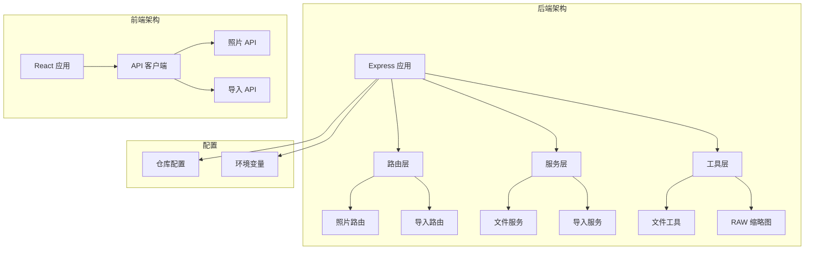
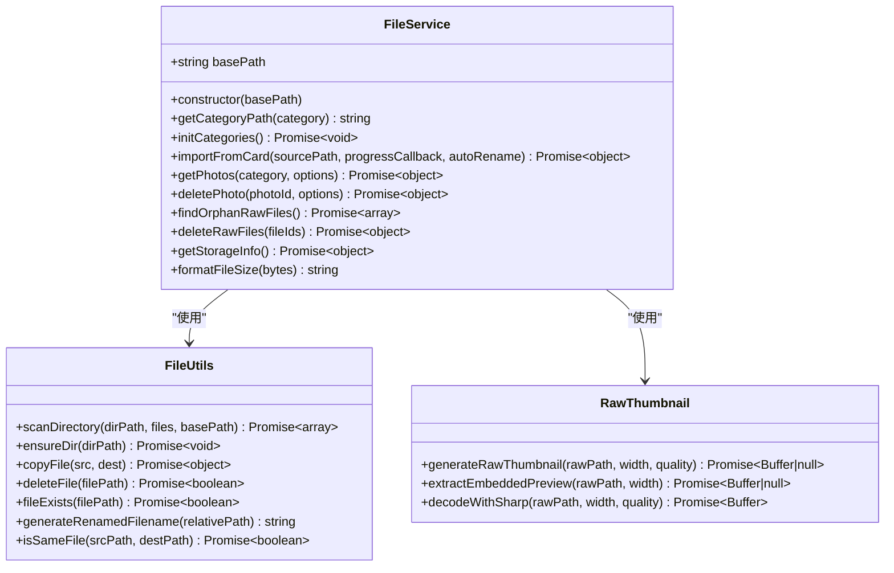
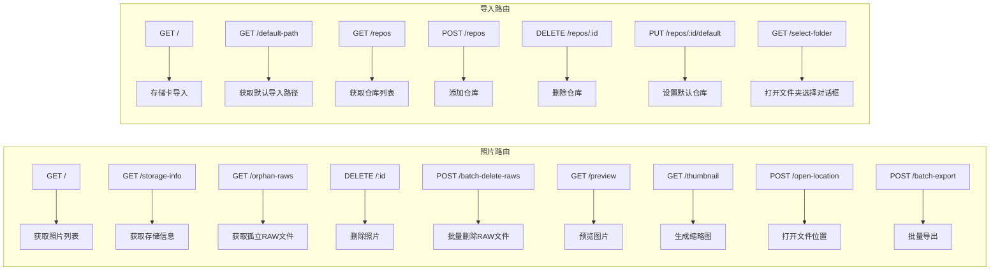
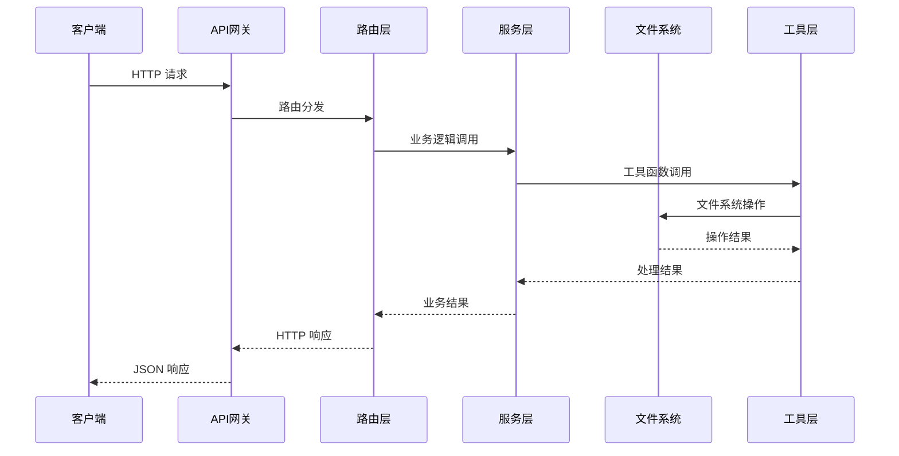
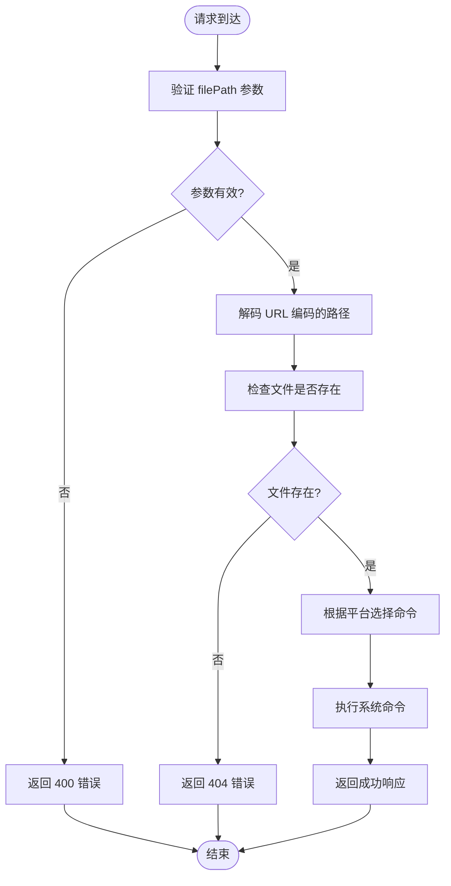
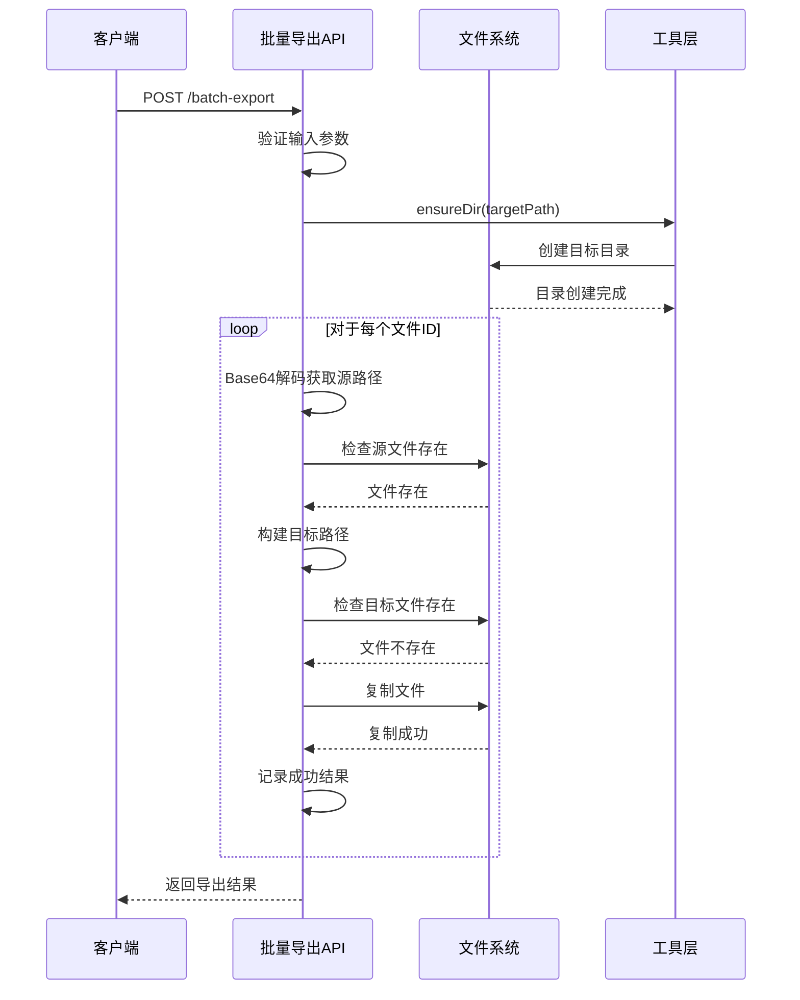
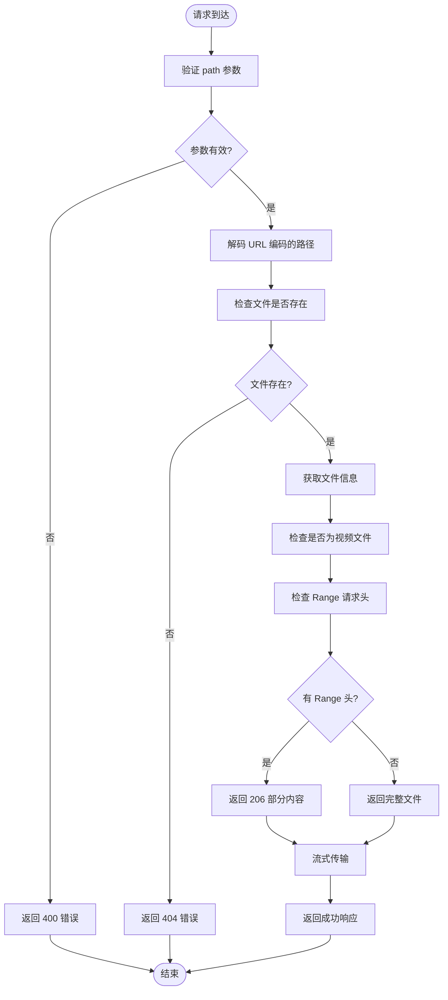
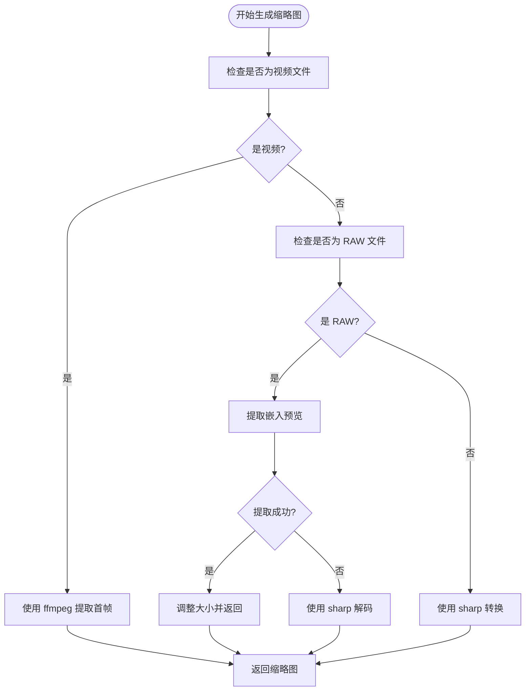
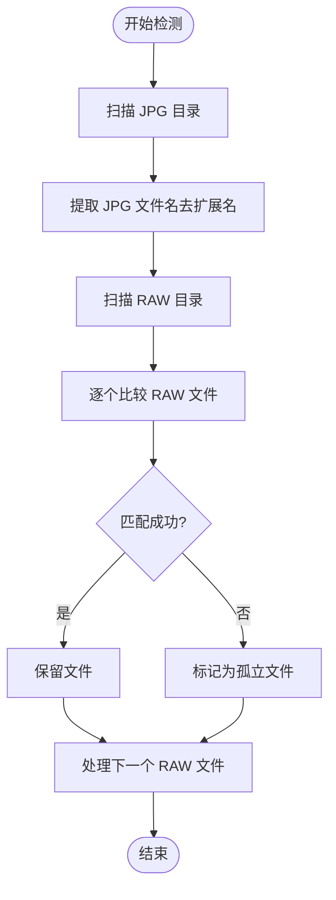
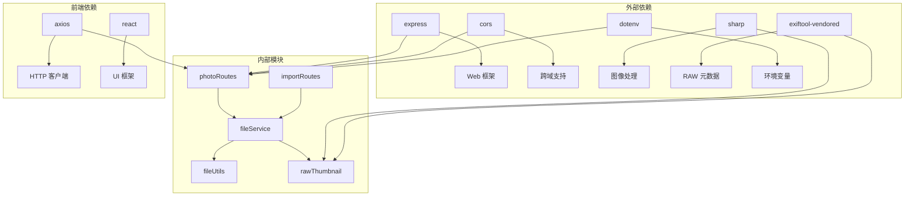

# 文件操作 API

<cite>
**本文档引用的文件**
- [photoRoutes.js](file://backend/src/routes/photoRoutes.js)
- [fileService.js](file://backend/src/services/fileService.js)
- [fileUtils.js](file://backend/src/utils/fileUtils.js)
- [rawThumbnail.js](file://backend/src/utils/rawThumbnail.js)
- [app.js](file://backend/src/app.js)
- [importRoutes.js](file://backend/src/routes/importRoutes.js)
- [index.js](file://frontend/src/api/index.js)
- [package.json](file://backend/package.json)
- [README.md](file://README.md)
</cite>

## 目录
1. [简介](#简介)
2. [项目结构](#项目结构)
3. [核心组件](#核心组件)
4. [架构概览](#架构概览)
5. [详细组件分析](#详细组件分析)
6. [依赖关系分析](#依赖关系分析)
7. [性能考虑](#性能考虑)
8. [故障排除指南](#故障排除指南)
9. [结论](#结论)

## 简介

本文档详细描述了照片管理系统的文件操作 API，涵盖文件位置打开、批量导出、文件系统操作等核心功能。系统支持跨平台文件系统操作，包括 Windows、macOS 和 Linux 平台的路径处理、权限管理和安全防护。

系统采用 Node.js + Express 架构，提供 RESTful API 接口，支持实时进度跟踪、错误处理和安全防护机制。主要功能包括：
- 文件位置打开（文件夹或文件）
- 批量导出照片（增量模式）
- 文件预览和缩略图生成
- 存储信息查询
- 孤立 RAW 文件管理
- 跨平台文件系统操作

## 项目结构



**图表来源**
- [app.js:1-146](file://backend/src/app.js#L1-L146)
- [photoRoutes.js:1-739](file://backend/src/routes/photoRoutes.js#L1-L739)
- [importRoutes.js:1-627](file://backend/src/routes/importRoutes.js#L1-L627)

**章节来源**
- [app.js:1-146](file://backend/src/app.js#L1-L146)
- [README.md:188-205](file://README.md#L188-L205)

## 核心组件

### 文件服务层 (FileService)

文件服务层是系统的核心业务逻辑组件，负责处理所有文件操作相关的业务逻辑：



**图表来源**
- [fileService.js:1-443](file://backend/src/services/fileService.js#L1-L443)
- [fileUtils.js:1-167](file://backend/src/utils/fileUtils.js#L1-L167)
- [rawThumbnail.js:1-132](file://backend/src/utils/rawThumbnail.js#L1-L132)

### 路由层 (Routes)

路由层负责处理 HTTP 请求和响应，提供 RESTful API 接口：



**图表来源**
- [photoRoutes.js:68-739](file://backend/src/routes/photoRoutes.js#L68-L739)
- [importRoutes.js:82-627](file://backend/src/routes/importRoutes.js#L82-L627)

**章节来源**
- [fileService.js:1-443](file://backend/src/services/fileService.js#L1-L443)
- [photoRoutes.js:1-739](file://backend/src/routes/photoRoutes.js#L1-L739)
- [importRoutes.js:1-627](file://backend/src/routes/importRoutes.js#L1-L627)

## 架构概览

系统采用分层架构设计，确保关注点分离和代码可维护性：



**图表来源**
- [app.js:114-121](file://backend/src/app.js#L114-L121)
- [photoRoutes.js:68-92](file://backend/src/routes/photoRoutes.js#L68-L92)
- [fileService.js:169-224](file://backend/src/services/fileService.js#L169-L224)

## 详细组件分析

### 文件位置打开 API

#### 端点定义
- **HTTP 方法**: POST
- **URL 模式**: `/api/photos/open-location`
- **请求参数**:
  - `filePath`: 必填，文件或文件夹的绝对路径
  - `mode`: 可选，默认值为 'folder'，可选值：'folder' | 'file'

#### 请求处理流程



**图表来源**
- [photoRoutes.js:575-640](file://backend/src/routes/photoRoutes.js#L575-L640)

#### 跨平台实现

系统支持三种主要操作系统的文件位置打开：

| 平台 | 模式 | 命令 |
|------|------|------|
| macOS | folder | `open "<folder_path>"` |
| macOS | file | `open "<file_path>"` |
| Windows | folder | `explorer "<folder_path>"` |
| Windows | file | `start "" "<file_path>"` |
| Linux | folder | `xdg-open "<folder_path>"` |
| Linux | file | `xdg-open "<file_path>"` |

**章节来源**
- [photoRoutes.js:575-640](file://backend/src/routes/photoRoutes.js#L575-L640)

### 批量导出 API

#### 端点定义
- **HTTP 方法**: POST
- **URL 模式**: `/api/photos/batch-export`
- **请求参数**:
  - `fileIds`: 必填，文件ID数组（Base64编码的路径）
  - `targetPath`: 必填，目标导出路径
  - `repoId`: 可选，仓库ID

#### 批量导出流程



**图表来源**
- [photoRoutes.js:642-736](file://backend/src/routes/photoRoutes.js#L642-L736)

#### 增量导出模式

系统采用增量导出模式，具有以下特性：

1. **文件存在性检查**: 导出前检查目标文件是否已存在
2. **自动跳过**: 已存在的文件会被跳过，避免重复导出
3. **错误恢复**: 单个文件导出失败不会影响其他文件
4. **进度跟踪**: 通过响应中的统计信息跟踪导出进度

#### 响应格式

```json
{
  "success": true,
  "data": {
    "successCount": 150,
    "failedCount": 5,
    "skippedCount": 25,
    "details": {
      "success": [
        {
          "id": "Base64编码的文件ID",
          "name": "文件名",
          "sourcePath": "源路径",
          "destPath": "目标路径"
        }
      ],
      "failed": [
        {
          "id": "Base64编码的文件ID",
          "reason": "错误原因"
        }
      ],
      "skipped": [
        {
          "id": "Base64编码的文件ID",
          "name": "文件名",
          "reason": "文件已存在"
        }
      ]
    }
  }
}
```

**章节来源**
- [photoRoutes.js:642-736](file://backend/src/routes/photoRoutes.js#L642-L736)

### 文件预览 API

#### 端点定义
- **HTTP 方法**: GET
- **URL 模式**: `/api/photos/preview`
- **请求参数**:
  - `path`: 必填，文件路径（URL编码）

#### 预览处理流程



**图表来源**
- [photoRoutes.js:178-291](file://backend/src/routes/photoRoutes.js#L178-L291)

#### 视频流式播放支持

系统支持视频文件的 Range 请求，实现流式播放：

1. **Range 头解析**: 解析客户端的 Range 请求头
2. **范围验证**: 验证请求范围的有效性
3. **部分响应**: 返回 206 状态码和部分内容
4. **缓存控制**: 设置适当的缓存头

**章节来源**
- [photoRoutes.js:178-291](file://backend/src/routes/photoRoutes.js#L178-L291)

### 缩略图生成 API

#### 端点定义
- **HTTP 方法**: GET
- **URL 模式**: `/api/photos/thumbnail`
- **请求参数**:
  - `path`: 必填，文件路径（URL编码）
  - `width`: 可选，默认值 300，缩略图宽度
  - `quality`: 可选，默认值 80，图像质量

#### 缩略图生成策略

系统采用三级降级策略生成缩略图：



**图表来源**
- [photoRoutes.js:293-466](file://backend/src/routes/photoRoutes.js#L293-L466)

#### RAW 文件处理

对于 RAW 文件，系统采用多层处理策略：

1. **嵌入预览提取**: 使用 exiftool-vendored 提取 RAW 文件中的 JPEG 预览
2. **直接解码**: 使用 sharp 直接解码 RAW 文件
3. **占位图生成**: 失败时生成 SVG 占位图

**章节来源**
- [photoRoutes.js:293-466](file://backend/src/routes/photoRoutes.js#L293-L466)

### 存储信息查询 API

#### 端点定义
- **HTTP 方法**: GET
- **URL 模式**: `/api/photos/storage-info`
- **请求参数**:
  - `repoId`: 可选，仓库ID

#### 存储信息结构

```json
{
  "jpg": {
    "count": 1500,
    "size": 2147483648,
    "sizeFormatted": "2.00 GB"
  },
  "raw": {
    "count": 800,
    "size": 1073741824,
    "sizeFormatted": "1.00 GB"
  },
  "video": {
    "count": 150,
    "size": 536870912,
    "sizeFormatted": "512.00 MB"
  }
}
```

**章节来源**
- [photoRoutes.js:94-110](file://backend/src/routes/photoRoutes.js#L94-L110)
- [fileService.js:336-363](file://backend/src/services/fileService.js#L336-L363)

### 孤立 RAW 文件管理 API

#### 端点定义
- **HTTP 方法**: GET
- **URL 模式**: `/api/photos/orphan-raws`
- **请求参数**:
  - `repoId`: 可选，仓库ID

#### 孤立文件检测逻辑

系统通过比较 RAW 文件名和 JPG 文件名来识别孤立 RAW 文件：



**图表来源**
- [fileService.js:269-306](file://backend/src/services/fileService.js#L269-L306)

**章节来源**
- [photoRoutes.js:112-128](file://backend/src/routes/photoRoutes.js#L112-L128)
- [fileService.js:269-306](file://backend/src/services/fileService.js#L269-L306)

## 依赖关系分析

### 核心依赖关系



**图表来源**
- [package.json:10-21](file://backend/package.json#L10-L21)
- [photoRoutes.js:1-6](file://backend/src/routes/photoRoutes.js#L1-L6)
- [importRoutes.js:1-8](file://backend/src/routes/importRoutes.js#L1-L8)

### 文件系统操作依赖

系统对文件系统的操作依赖于 Node.js 的 fs.promises 模块，提供了异步文件操作能力：

| 操作类型 | Node.js API | 用途 |
|----------|-------------|------|
| 文件存在性检查 | `fs.access()` | 验证文件是否存在 |
| 文件复制 | `fs.copyFile()` | 批量导出和导入 |
| 目录创建 | `fs.mkdir()` | 确保目标目录存在 |
| 文件删除 | `fs.unlink()` | 删除照片和 RAW 文件 |
| 文件统计 | `fs.stat()` | 获取文件信息 |
| 目录读取 | `fs.readdir()` | 扫描目录内容 |

**章节来源**
- [fileUtils.js:77-111](file://backend/src/utils/fileUtils.js#L77-L111)
- [fileService.js:24-167](file://backend/src/services/fileService.js#L24-L167)

## 性能考虑

### 并发控制

系统在导入过程中使用并发控制机制，限制同时处理的文件数量：

```javascript
// 最大并发数
const CONCURRENCY_LIMIT = 3;
const processingQueue = [];

// 并发控制循环
while (processingQueue.length >= CONCURRENCY_LIMIT) {
    await Promise.race(processingQueue);
}
```

这种设计避免了大量文件同时处理导致的内存溢出和系统资源耗尽。

### 流式传输

对于大文件的预览和导出，系统采用流式传输方式：

1. **文件流传输**: 使用 `fs.createReadStream()` 实现流式读取
2. **Range 请求支持**: 支持视频文件的分段下载
3. **内存优化**: 避免将整个文件加载到内存中

### 缓存策略

系统实现了多层次的缓存策略：

1. **缩略图缓存**: 生成的缩略图设置 24 小时缓存
2. **静态文件缓存**: 预览文件设置 1 小时缓存
3. **响应头优化**: 合理设置 Cache-Control 头

### 性能优化建议

1. **批量操作**: 使用批量导出 API 减少 HTTP 请求次数
2. **增量处理**: 利用增量模式避免重复处理已存在的文件
3. **并发控制**: 根据系统资源调整并发数量
4. **缓存利用**: 合理使用浏览器缓存减少服务器负载

## 故障排除指南

### 常见错误及解决方案

#### CORS 错误
- **症状**: 浏览器控制台出现跨域错误
- **原因**: CORS 配置不正确
- **解决方案**: 检查 `app.js` 中的 CORS 配置

#### 文件不存在错误
- **症状**: 返回 404 错误
- **原因**: 文件路径不正确或文件已被移动
- **解决方案**: 验证文件路径和文件存在性

#### 权限错误
- **症状**: 文件操作失败，返回权限不足错误
- **原因**: 用户权限不足
- **解决方案**: 检查文件和目录的读写权限

#### 超时错误
- **症状**: 导入或预览操作超时
- **原因**: 大文件处理时间过长
- **解决方案**: 增加超时时间或分批处理

### 日志监控

系统提供了详细的日志记录：

```javascript
// 请求日志
console.log(`${new Date().toISOString()} - ${req.method} ${req.url}`);

// 导入进度日志
console.log(`处理文件 ${processedFiles + 1}/${totalFiles}: ${file.name}`);

// 错误日志
console.error('未捕获的异常:', error);
```

**章节来源**
- [app.js:22-26](file://backend/src/app.js#L22-L26)
- [fileService.js:24-61](file://backend/src/services/fileService.js#L24-L61)
- [app.js:134-143](file://backend/src/app.js#L134-L143)

## 结论

本文档详细介绍了照片管理系统的文件操作 API，涵盖了从基础的文件位置打开到复杂的批量导出功能。系统采用分层架构设计，提供了良好的可维护性和扩展性。

### 主要特性总结

1. **跨平台兼容**: 支持 Windows、macOS 和 Linux 平台
2. **安全防护**: 包含路径验证和错误处理机制
3. **性能优化**: 采用流式传输和并发控制
4. **实时反馈**: 支持 SSE 实时进度跟踪
5. **错误恢复**: 增量模式和错误隔离机制

### 最佳实践建议

1. **路径处理**: 始终使用 URL 编码处理文件路径
2. **错误处理**: 实现完善的错误处理和用户反馈
3. **性能监控**: 监控系统资源使用情况
4. **安全考虑**: 实施适当的权限控制和路径验证
5. **用户体验**: 提供清晰的进度反馈和状态指示

系统为照片管理提供了完整的技术解决方案，能够满足专业用户的需求。