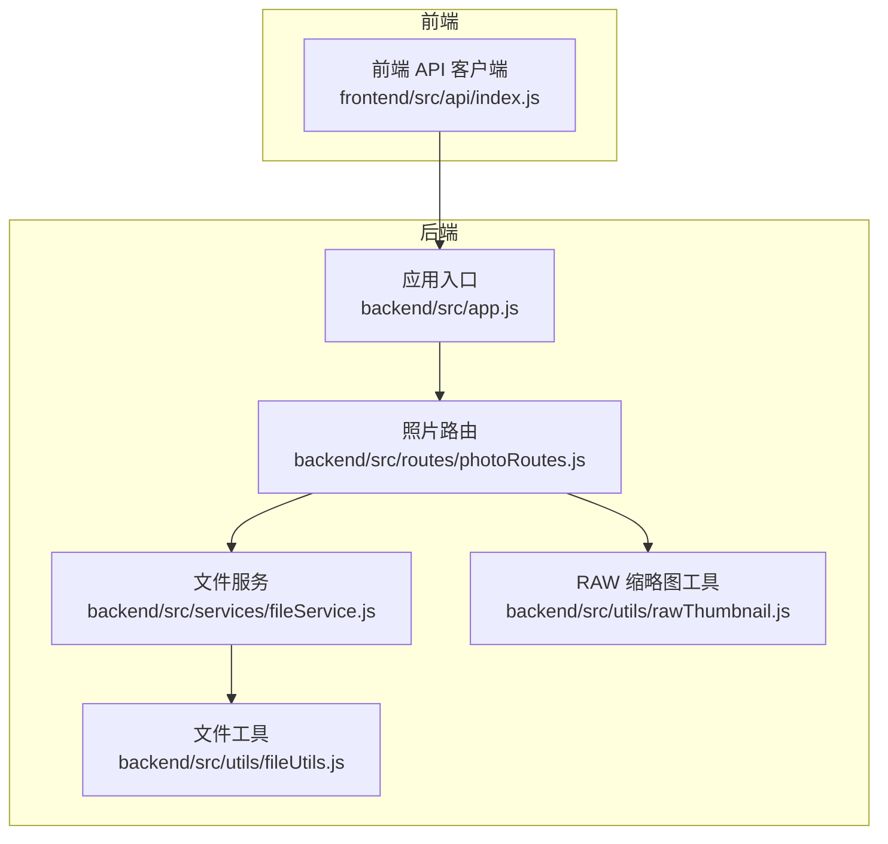
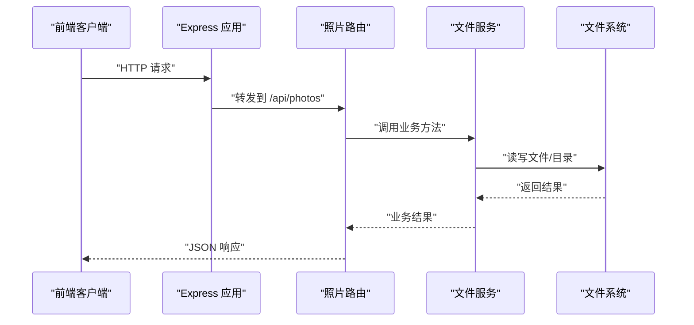
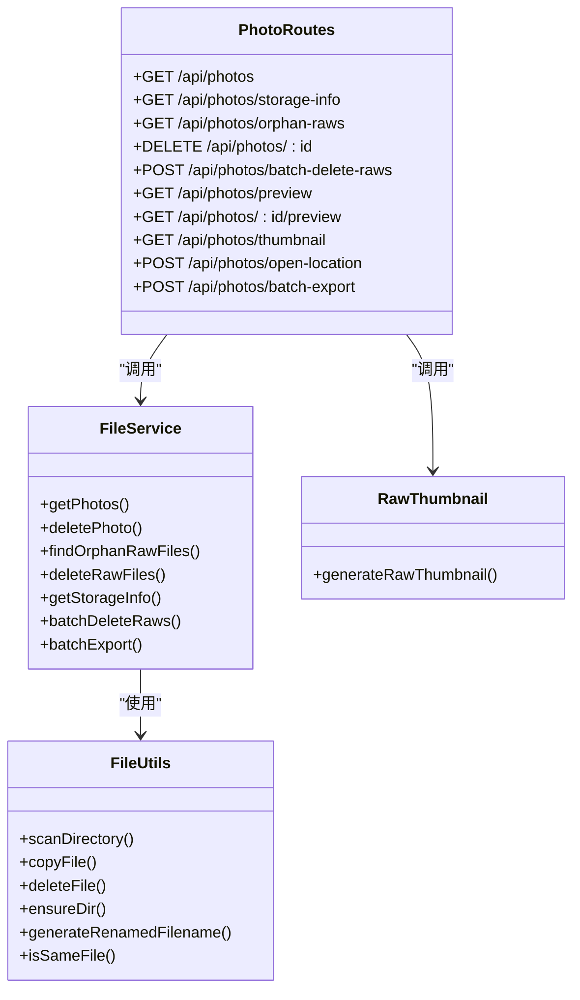

# 照片管理 API

<cite>
**本文档引用的文件**
- [photoRoutes.js](file://backend/src/routes/photoRoutes.js)
- [fileService.js](file://backend/src/services/fileService.js)
- [fileUtils.js](file://backend/src/utils/fileUtils.js)
- [rawThumbnail.js](file://backend/src/utils/rawThumbnail.js)
- [app.js](file://backend/src/app.js)
- [index.js](file://frontend/src/api/index.js)
- [repos.json](file://backend/data/repos.json)
- [package.json](file://backend/package.json)
</cite>

## 目录
1. [简介](#简介)
2. [项目结构](#项目结构)
3. [核心组件](#核心组件)
4. [架构总览](#架构总览)
5. [详细组件分析](#详细组件分析)
6. [依赖关系分析](#依赖关系分析)
7. [性能考量](#性能考量)
8. [故障排查指南](#故障排查指南)
9. [结论](#结论)
10. [附录](#附录)

## 简介
本文件为“照片管理”功能的 API 接口文档，涵盖以下核心能力：
- 获取照片列表（支持分页、排序、过滤）
- 删除照片（含同步删除 RAW）
- 查询存储信息
- 查找孤立 RAW 文件
- 预览与缩略图生成
- 批量删除 RAW 文件
- 批量导出照片
- 打开文件位置（跨平台）

文档详细说明每个端点的 HTTP 方法、URL 模式、查询参数/请求体参数、响应格式、错误码以及使用示例；并解释照片 ID 编码机制、文件路径处理与跨平台兼容性。

## 项目结构
后端采用 Express 框架，按职责划分为路由层、服务层与工具层：
- 路由层：定义 API 端点与参数校验
- 服务层：封装文件系统操作与业务逻辑
- 工具层：通用文件扫描、复制、删除、重命名等工具
- 前端：基于 axios 的 API 客户端封装

图表来源
- [app.js:114-116](file://backend/src/app.js#L114-L116)
- [photoRoutes.js:1-20](file://backend/src/routes/photoRoutes.js#L1-L20)
- [fileService.js:1-10](file://backend/src/services/fileService.js#L1-L10)
- [fileUtils.js:1-10](file://backend/src/utils/fileUtils.js#L1-L10)
- [rawThumbnail.js:1-5](file://backend/src/utils/rawThumbnail.js#L1-L5)

章节来源
- [app.js:114-116](file://backend/src/app.js#L114-L116)
- [photoRoutes.js:1-20](file://backend/src/routes/photoRoutes.js#L1-L20)

## 核心组件
- 路由层（photoRoutes.js）：定义照片管理相关 API，负责参数解析、仓库选择、错误处理与响应格式化。
- 服务层（fileService.js）：封装文件扫描、复制、删除、统计、RAW 同步删除等业务逻辑。
- 工具层（fileUtils.js）：提供文件类型识别、目录扫描、文件复制/删除、重命名等通用能力。
- RAW 缩略图工具（rawThumbnail.js）：从 RAW 文件提取嵌入预览图或使用 sharp 解码生成缩略图。
- 应用入口（app.js）：配置 CORS、静态文件服务、路由挂载与全局错误处理。

章节来源
- [photoRoutes.js:68-176](file://backend/src/routes/photoRoutes.js#L68-L176)
- [fileService.js:169-334](file://backend/src/services/fileService.js#L169-L334)
- [fileUtils.js:22-137](file://backend/src/utils/fileUtils.js#L22-L137)
- [rawThumbnail.js:78-129](file://backend/src/utils/rawThumbnail.js#L78-L129)
- [app.js:67-91](file://backend/src/app.js#L67-L91)

## 架构总览
后端通过 Express 提供 RESTful API，前端通过 axios 调用。静态文件通过 /uploads 提供，支持多仓库路径映射与跨平台默认路径。

图表来源
- [app.js:114-116](file://backend/src/app.js#L114-L116)
- [photoRoutes.js:68-176](file://backend/src/routes/photoRoutes.js#L68-L176)
- [fileService.js:169-334](file://backend/src/services/fileService.js#L169-L334)

## 详细组件分析

### 照片列表获取
- HTTP 方法：GET
- URL 模式：/api/photos
- 查询参数：
  - category：分类（默认 jpg）
  - page：页码（默认 1）
  - pageSize：每页数量（默认 50）
  - sortBy：排序字段（name/size/modifiedTime，默认 modifiedTime）
  - sortOrder：排序方向（asc/desc，默认 desc）
  - repoId：仓库 ID（可选）
- 响应格式：
  - success：布尔值
  - data.photos：照片数组，包含 id、name、filename、path、relativePath、type、extension、size、modifiedTime、thumbnailUrl、url
  - data.total/page/pageSize：分页信息
- 错误码：500（服务器内部错误），返回 { success: false, error: "..." }

请求示例
- 获取第一页，每页 50 张，按修改时间倒序，分类为 jpg
  - GET /api/photos?category=jpg&page=1&pageSize=50&sortBy=modifiedTime&sortOrder=desc

响应示例
- 包含 photos 数组与分页信息

章节来源
- [photoRoutes.js:68-92](file://backend/src/routes/photoRoutes.js#L68-L92)
- [fileService.js:169-224](file://backend/src/services/fileService.js#L169-L224)

### 存储信息查询
- HTTP 方法：GET
- URL 模式：/api/photos/storage-info
- 查询参数：
  - repoId：仓库 ID（可选）
- 响应格式：
  - success：布尔值
  - data：包含 jpg/raw/video 三类的统计信息（count、size、sizeFormatted）
- 错误码：500（服务器内部错误）

请求示例
- GET /api/photos/storage-info?repoId=1776616157248

章节来源
- [photoRoutes.js:94-110](file://backend/src/routes/photoRoutes.js#L94-L110)
- [fileService.js:336-363](file://backend/src/services/fileService.js#L336-L363)

### 孤立 RAW 文件查找
- HTTP 方法：GET
- URL 模式：/api/photos/orphan-raws
- 查询参数：
  - repoId：仓库 ID（可选）
- 响应格式：
  - success：布尔值
  - data：孤立 RAW 文件数组，包含 id/name/filename/path/relativePath/size/modifiedTime/url
- 错误码：500（服务器内部错误）

请求示例
- GET /api/photos/orphan-raws?repoId=default

章节来源
- [photoRoutes.js:112-128](file://backend/src/routes/photoRoutes.js#L112-L128)
- [fileService.js:269-306](file://backend/src/services/fileService.js#L269-L306)

### 删除照片
- HTTP 方法：DELETE
- URL 模式：/api/photos/:id
- 路径参数：
  - id：Base64 编码的文件绝对路径
- 查询参数：
  - syncRaw：是否同步删除对应 RAW（true/false，默认 true）
  - repoId：仓库 ID（可选）
- 响应格式：
  - success：布尔值
  - data.deletedFiles：被删除的文件路径数组
- 错误码：500（服务器内部错误）

请求示例
- 删除照片并同步删除 RAW
  - DELETE /api/photos/<Base64路径>?syncRaw=true&repoId=default
- 仅删除照片，不删除 RAW
  - DELETE /api/photos/<Base64路径>?syncRaw=false

章节来源
- [photoRoutes.js:130-149](file://backend/src/routes/photoRoutes.js#L130-L149)
- [fileService.js:226-267](file://backend/src/services/fileService.js#L226-L267)

### 批量删除 RAW 文件
- HTTP 方法：POST
- URL 模式：/api/photos/batch-delete-raws
- 请求体参数：
  - fileIds：RAW 文件 ID 数组（每个 ID 为 Base64 编码的文件绝对路径）
  - repoId：仓库 ID（可选）
- 响应格式：
  - success：布尔值
  - data：包含 success 与 failed 数组（每个元素含 id 与 reason）
- 错误码：400（参数错误）、500（服务器内部错误）

请求示例
- POST /api/photos/batch-delete-raws
  - Body: { fileIds: ["<Base64路径1>", "<Base64路径2>"], repoId: "default" }

章节来源
- [photoRoutes.js:151-176](file://backend/src/routes/photoRoutes.js#L151-L176)
- [fileService.js:308-334](file://backend/src/services/fileService.js#L308-L334)

### 预览图片（路径参数）
- HTTP 方法：GET
- URL 模式：/api/photos/preview?path=<文件路径>
- 查询参数：
  - path：URL 编码的文件绝对路径
- 响应格式：
  - 文件流（支持 Range 请求，用于视频流式播放）
  - 若文件不存在返回 404，错误返回 JSON { success: false, error: "..." }
- 错误码：400（缺少路径）、404（文件不存在）、416（Range 不满足）、500（读取失败）

请求示例
- GET /api/photos/preview?path=<URL编码的文件路径>

章节来源
- [photoRoutes.js:178-291](file://backend/src/routes/photoRoutes.js#L178-L291)

### 预览图片（Base64 ID）
- HTTP 方法：GET
- URL 模式：/api/photos/:id/preview
- 路径参数：
  - id：Base64 编码的文件绝对路径
- 响应格式：
  - 文件流（支持 Range 请求）
  - 错误返回 JSON { success: false, error: "..." }
- 错误码：404（文件不存在）、500（读取失败）

请求示例
- GET /api/photos/<Base64路径>/preview

章节来源
- [photoRoutes.js:468-571](file://backend/src/routes/photoRoutes.js#L468-L571)

### 缩略图生成
- HTTP 方法：GET
- URL 模式：/api/photos/thumbnail?path=<文件路径>&width=&quality=
- 查询参数：
  - path：URL 编码的文件绝对路径
  - width：缩略图宽度（默认 300）
  - quality：JPEG 质量（默认 80）
- 响应格式：
  - JPEG 图像（RAW 文件优先提取嵌入预览，否则使用 sharp 解码）
  - 占位图（SVG）作为降级方案
- 错误码：400（缺少路径）、404（文件不存在）、500（生成失败）

请求示例
- GET /api/photos/thumbnail?path=<URL编码的文件路径>&width=300&quality=80

章节来源
- [photoRoutes.js:293-466](file://backend/src/routes/photoRoutes.js#L293-L466)
- [rawThumbnail.js:78-129](file://backend/src/utils/rawThumbnail.js#L78-L129)

### 打开文件位置
- HTTP 方法：POST
- URL 模式：/api/photos/open-location
- 请求体参数：
  - filePath：URL 编码的文件绝对路径
  - mode：打开模式（folder 或 file，默认 folder）
- 响应格式：
  - 成功返回 { success: true, message: "已打开文件夹"/"已打开文件" }
  - 错误返回 JSON { success: false, error: "..." }
- 错误码：400（缺少路径）、404（文件不存在）、500（执行失败）

请求示例
- POST /api/photos/open-location
  - Body: { filePath: "<URL编码的文件路径>", mode: "file" }

章节来源
- [photoRoutes.js:575-640](file://backend/src/routes/photoRoutes.js#L575-L640)

### 批量导出照片
- HTTP 方法：POST
- URL 模式：/api/photos/batch-export
- 请求体参数：
  - fileIds：文件 ID 数组（每个 ID 为 Base64 编码的文件绝对路径）
  - targetPath：目标导出目录（URL 编码）
  - repoId：仓库 ID（可选）
- 响应格式：
  - success：布尔值
  - data：包含 successCount/failedCount/skippedCount/details
  - details.success/failed/skipped：分别记录成功/失败/跳过的条目
- 错误码：400（参数缺失）、500（服务器内部错误）

请求示例
- POST /api/photos/batch-export
  - Body: { fileIds: ["<Base64路径1>", "<Base64路径2>"], targetPath: "<URL编码的目标路径>", repoId: "default" }

章节来源
- [photoRoutes.js:642-736](file://backend/src/routes/photoRoutes.js#L642-L736)
- [fileService.js:665-718](file://backend/src/services/fileService.js#L665-L718)

### 照片 ID 编码机制
- ID 为文件绝对路径经 Base64 编码的结果，便于安全传输与反序列化。
- 路由层与服务层均对 ID 进行解码，获取真实文件路径。
- 前端 API 客户端提供生成预览 URL 的辅助方法。

章节来源
- [photoRoutes.js:181-181](file://backend/src/routes/photoRoutes.js#L181-L181)
- [fileService.js:187-187](file://backend/src/services/fileService.js#L187-L187)
- [index.js:25-26](file://frontend/src/api/index.js#L25-L26)

### 文件路径处理与跨平台兼容性
- 默认照片路径根据操作系统自动确定：
  - Windows：用户图片目录
  - macOS：用户图片目录
  - Linux：用户主目录
- 静态文件服务通过 /uploads 提供，支持通过 repo 参数切换仓库路径。
- 路径编码：查询参数使用 URL 编码，确保跨平台传输安全。
- 文件存在性检查：在读取/删除/预览前进行存在性验证，避免异常。

章节来源
- [app.js:93-112](file://backend/src/app.js#L93-L112)
- [app.js:67-91](file://backend/src/app.js#L67-L91)
- [photoRoutes.js:190-196](file://backend/src/routes/photoRoutes.js#L190-L196)
- [photoRoutes.js:470-477](file://backend/src/routes/photoRoutes.js#L470-L477)

## 依赖关系分析

图表来源
- [photoRoutes.js:68-176](file://backend/src/routes/photoRoutes.js#L68-L176)
- [fileService.js:169-439](file://backend/src/services/fileService.js#L169-L439)
- [fileUtils.js:22-137](file://backend/src/utils/fileUtils.js#L22-L137)
- [rawThumbnail.js:78-129](file://backend/src/utils/rawThumbnail.js#L78-L129)

章节来源
- [photoRoutes.js:68-176](file://backend/src/routes/photoRoutes.js#L68-L176)
- [fileService.js:169-439](file://backend/src/services/fileService.js#L169-L439)
- [fileUtils.js:22-137](file://backend/src/utils/fileUtils.js#L22-L137)
- [rawThumbnail.js:78-129](file://backend/src/utils/rawThumbnail.js#L78-L129)

## 性能考量
- 分页与排序：列表接口支持分页与排序，避免一次性加载大量数据。
- 并发控制：导入流程限制并发度，防止内存溢出。
- 流式传输：预览与缩略图生成使用流式读取，降低内存占用。
- 缓存：缩略图与预览设置缓存头，减少重复请求。
- RAW 缩略图三级降级：优先提取嵌入预览，其次使用 sharp 解码，最后返回占位图，保证可用性。

章节来源
- [fileService.js:75-156](file://backend/src/services/fileService.js#L75-L156)
- [photoRoutes.js:226-280](file://backend/src/routes/photoRoutes.js#L226-L280)
- [photoRoutes.js:428-458](file://backend/src/routes/photoRoutes.js#L428-L458)
- [rawThumbnail.js:78-129](file://backend/src/utils/rawThumbnail.js#L78-L129)

## 故障排查指南
- 404 文件不存在
  - 检查路径是否正确编码，确认文件是否存在。
  - 对于 /uploads 静态服务，确认仓库路径配置有效。
- 500 服务器内部错误
  - 查看后端日志，关注文件系统权限、磁盘空间与依赖安装情况。
  - 特别注意 RAW 缩略图生成依赖 exiftool-vendored 与 sharp。
- Range 不满足（416）
  - 检查 Range 请求头范围是否合法。
- 跨平台问题
  - 确认路径分隔符与大小写敏感性，避免路径拼接错误。
- 仓库配置
  - 确认 repos.json 中仓库路径有效，必要时使用 AUTO 自动推断。

章节来源
- [photoRoutes.js:194-201](file://backend/src/routes/photoRoutes.js#L194-L201)
- [photoRoutes.js:516-522](file://backend/src/routes/photoRoutes.js#L516-L522)
- [app.js:82-90](file://backend/src/app.js#L82-L90)
- [repos.json:1-8](file://backend/data/repos.json#L1-L8)

## 结论
本 API 提供了完整的照片管理能力，涵盖列表、删除、存储统计、RAW 管理、预览与导出等功能。通过 Base64 编码的 ID、URL 编码的路径与多仓库支持，实现了跨平台与多环境的稳定运行。建议在生产环境中结合缓存与监控，进一步提升用户体验与系统稳定性。

## 附录

### 常见操作示例（请求/响应）
- 获取照片列表
  - GET /api/photos?category=jpg&page=1&pageSize=50&sortBy=modifiedTime&sortOrder=desc
- 删除照片并同步删除 RAW
  - DELETE /api/photos/<Base64路径>?syncRaw=true&repoId=default
- 批量删除 RAW 文件
  - POST /api/photos/batch-delete-raws
    - Body: { fileIds: ["<Base64路径1>", "<Base64路径2>"], repoId: "default" }
- 预览图片
  - GET /api/photos/preview?path=<URL编码的文件路径>
- 缩略图生成
  - GET /api/photos/thumbnail?path=<URL编码的文件路径>&width=300&quality=80
- 打开文件位置
  - POST /api/photos/open-location
    - Body: { filePath: "<URL编码的文件路径>", mode: "file" }
- 批量导出照片
  - POST /api/photos/batch-export
    - Body: { fileIds: ["<Base64路径1>", "<Base64路径2>"], targetPath: "<URL编码的目标路径>", repoId: "default" }

### 依赖与环境
- 依赖项（部分）
  - express、cors、sharp、exiftool-vendored
- 环境变量
  - PHOTO_BASE_PATH：自定义默认照片路径
  - DATA_DIR：数据目录（持久化 repos.json）
  - PORT：服务端口（默认 3001）

章节来源
- [package.json:10-18](file://backend/package.json#L10-L18)
- [app.js:28-36](file://backend/src/app.js#L28-L36)
- [app.js:93-112](file://backend/src/app.js#L93-L112)