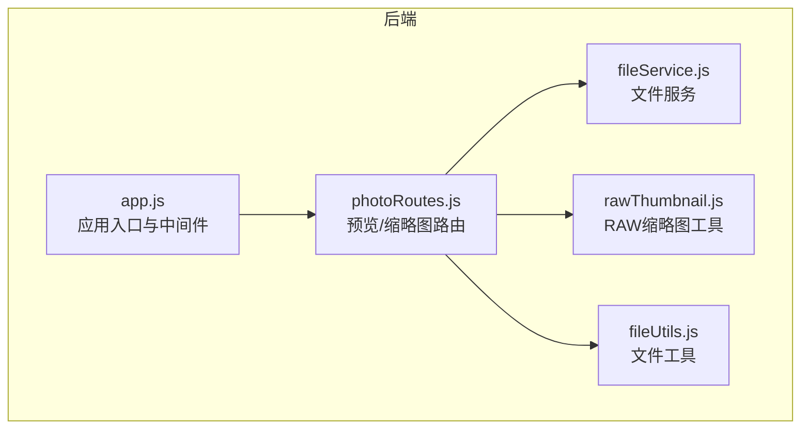
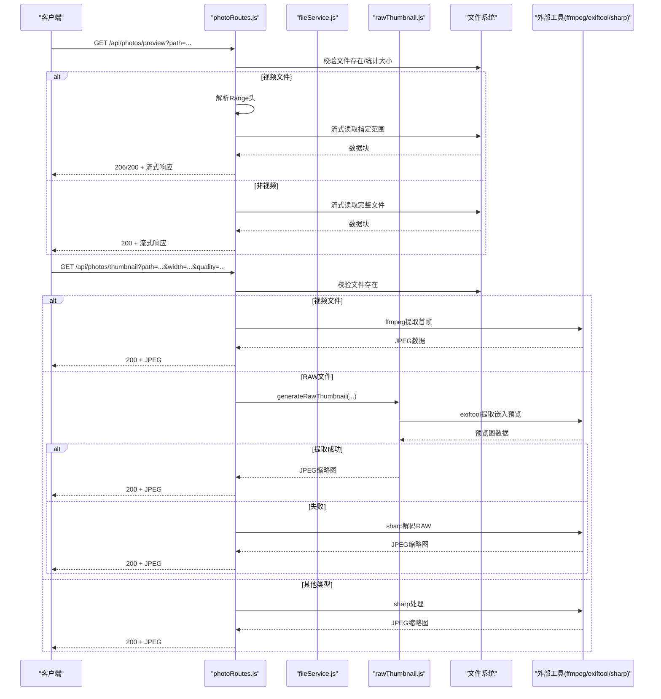
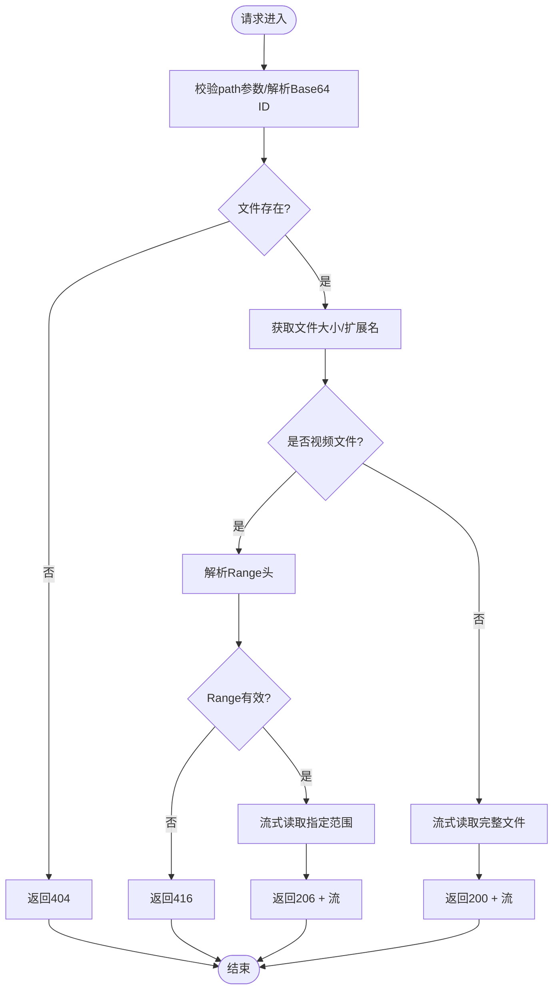
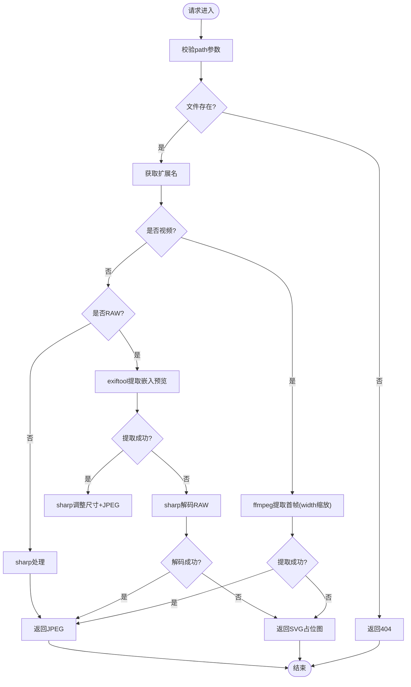
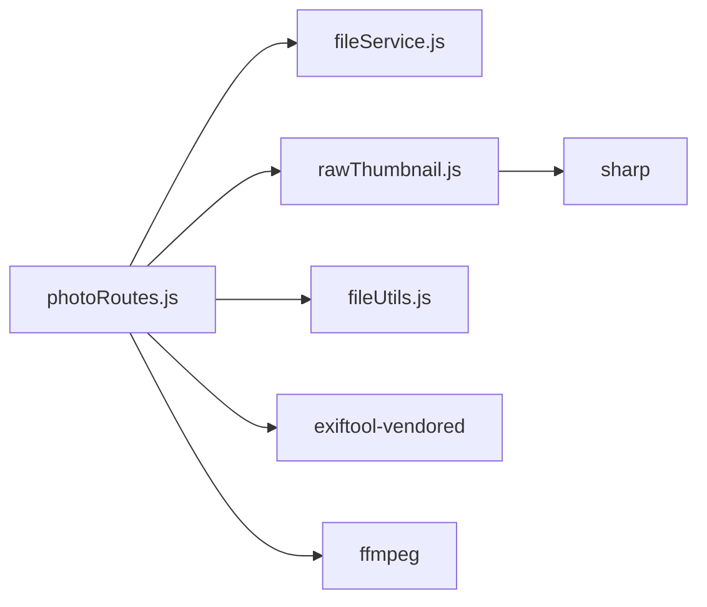

# 预览与缩略图 API

<cite>
**本文引用的文件**
- [photoRoutes.js](file://backend/src/routes/photoRoutes.js)
- [fileService.js](file://backend/src/services/fileService.js)
- [rawThumbnail.js](file://backend/src/utils/rawThumbnail.js)
- [fileUtils.js](file://backend/src/utils/fileUtils.js)
- [app.js](file://backend/src/app.js)
- [package.json](file://backend/package.json)
- [repos.json](file://backend/data/repos.json)
</cite>

## 目录
1. [简介](#简介)
2. [项目结构](#项目结构)
3. [核心组件](#核心组件)
4. [架构总览](#架构总览)
5. [详细组件分析](#详细组件分析)
6. [依赖关系分析](#依赖关系分析)
7. [性能考量](#性能考量)
8. [故障排查指南](#故障排查指南)
9. [结论](#结论)
10. [附录](#附录)

## 简介
本文件为“预览与缩略图”功能的完整 API 接口文档，涵盖照片预览接口与缩略图生成接口的设计与实现细节。重点说明：
- 预览接口支持路径参数与查询参数两种调用方式，并对视频文件提供 Range 请求支持，实现流式播放与断点续传。
- 缩略图接口支持动态生成，针对不同文件类型采用差异化策略：视频首帧提取、RAW 文件嵌入预览/解码、普通图片使用图像处理库。
- 提供缓存策略、错误处理与性能优化建议，帮助前端高效集成与稳定运行。

## 项目结构
后端采用 Express 框架，路由集中在 photoRoutes.js，业务逻辑封装在 FileService，工具类位于 utils 目录，应用入口在 app.js。预览与缩略图功能主要分布在 photoRoutes.js 中。

图表来源
- [app.js:114-116](file://backend/src/app.js#L114-L116)
- [photoRoutes.js:1-10](file://backend/src/routes/photoRoutes.js#L1-L10)
- [fileService.js:1-10](file://backend/src/services/fileService.js#L1-L10)
- [rawThumbnail.js:1-5](file://backend/src/utils/rawThumbnail.js#L1-L5)
- [fileUtils.js:1-10](file://backend/src/utils/fileUtils.js#L1-L10)

章节来源
- [app.js:114-116](file://backend/src/app.js#L114-L116)
- [photoRoutes.js:1-10](file://backend/src/routes/photoRoutes.js#L1-L10)

## 核心组件
- 预览接口：支持路径参数与 Base64 ID 两种方式；对视频文件启用 Range 请求，实现流式传输与断点续传。
- 缩略图接口：根据文件类型动态生成缩略图；对视频提取首帧，对 RAW 优先提取嵌入预览，否则使用图像库解码；对其他类型使用统一的图像处理流程。
- 文件服务：负责文件扫描、分类、删除、统计等基础能力，为预览与缩略图提供数据支撑。
- RAW 缩略图工具：实现三阶段降级策略（嵌入预览 -> 图像库解码 -> 占位图），提升成功率与鲁棒性。

章节来源
- [photoRoutes.js:178-291](file://backend/src/routes/photoRoutes.js#L178-L291)
- [photoRoutes.js:293-466](file://backend/src/routes/photoRoutes.js#L293-L466)
- [fileService.js:169-224](file://backend/src/services/fileService.js#L169-L224)
- [rawThumbnail.js:78-129](file://backend/src/utils/rawThumbnail.js#L78-L129)

## 架构总览
预览与缩略图的调用链路如下：
- 客户端请求 -> Express 路由 -> 文件服务/工具类 -> 文件系统/外部工具（如 ffmpeg/exiftool/sharp）
- 对于视频：优先 Range 流式传输；若无 Range，则全量流式传输。
- 对于缩略图：按类型分流，RAW 优先走嵌入预览，否则走图像库；失败则返回占位图。

图表来源
- [photoRoutes.js:178-291](file://backend/src/routes/photoRoutes.js#L178-L291)
- [photoRoutes.js:293-466](file://backend/src/routes/photoRoutes.js#L293-L466)
- [rawThumbnail.js:78-129](file://backend/src/utils/rawThumbnail.js#L78-L129)

## 详细组件分析

### 预览接口（照片原图）
- HTTP 方法与 URL
  - GET /api/photos/preview
  - GET /api/photos/:id/preview
- 路径参数
  - :id：Base64 编码的文件绝对路径
- 查询参数
  - path：文件绝对路径（URL 编码）
  - repoId：可选，指定仓库 ID（用于多仓库场景）
- 处理逻辑
  - 校验路径参数与文件存在性
  - 识别扩展名，判断是否为视频文件
  - 对视频文件支持 Range 请求，解析 Range 头并返回 206 Partial Content；非视频或无 Range 时返回完整文件流
  - 设置合适的 Content-Type、Accept-Ranges、Cache-Control
- 响应格式
  - 视频：二进制流（MIME 类型依据扩展名）
  - 其他：二进制流（Content-Type 由文件类型决定）
- 缓存策略
  - 预览接口对完整文件设置 Cache-Control: public, max-age=3600（1 小时）

图表来源
- [photoRoutes.js:178-291](file://backend/src/routes/photoRoutes.js#L178-L291)

章节来源
- [photoRoutes.js:178-291](file://backend/src/routes/photoRoutes.js#L178-L291)

### 缩略图接口（动态生成）
- HTTP 方法与 URL
  - GET /api/photos/thumbnail
- 查询参数
  - path：文件绝对路径（URL 编码）
  - width：缩略图宽度，默认 300
  - quality：JPEG 质量，默认 80
- 处理逻辑
  - 校验路径参数与文件存在性
  - 视频文件：使用 ffmpeg 提取首帧，按 width 缩放，输出 JPEG
  - RAW 文件：优先使用 exiftool 提取嵌入预览图（JpgFromRaw/PreviewImage/ThumbnailImage），若失败则使用 sharp 解码；均失败则返回占位图
  - 其他类型：使用 sharp resize + JPEG 编码
- 响应格式
  - 成功：image/jpeg 或 image/svg+xml（占位图）
  - 失败：JSON 错误对象
- 缓存策略
  - 缩略图接口设置 Cache-Control: public, max-age=86400（1 天）

图表来源
- [photoRoutes.js:293-466](file://backend/src/routes/photoRoutes.js#L293-L466)
- [rawThumbnail.js:78-129](file://backend/src/utils/rawThumbnail.js#L78-L129)

章节来源
- [photoRoutes.js:293-466](file://backend/src/routes/photoRoutes.js#L293-L466)
- [rawThumbnail.js:78-129](file://backend/src/utils/rawThumbnail.js#L78-L129)

### 文件服务与工具类
- 文件服务
  - 提供照片列表、删除、统计、孤立 RAW 查找等能力
  - 生成缩略图与预览 URL（用于前端展示）
- 工具类
  - 文件类型识别、目录扫描、复制/删除、重命名等
  - RAW 缩略图生成的三阶段降级策略

章节来源
- [fileService.js:169-224](file://backend/src/services/fileService.js#L169-L224)
- [fileUtils.js:11-20](file://backend/src/utils/fileUtils.js#L11-L20)
- [rawThumbnail.js:78-129](file://backend/src/utils/rawThumbnail.js#L78-L129)

## 依赖关系分析
- 外部依赖
  - ffmpeg：视频首帧提取
  - exiftool-vendored：RAW 嵌入预览提取
  - sharp：图像解码与缩放
- 内部模块
  - photoRoutes 依赖 fileService 与 rawThumbnail
  - rawThumbnail 依赖 sharp 与 exiftool-vendored
  - fileService 依赖 fileUtils

图表来源
- [photoRoutes.js:1-10](file://backend/src/routes/photoRoutes.js#L1-L10)
- [rawThumbnail.js:1-5](file://backend/src/utils/rawThumbnail.js#L1-L5)
- [package.json:10-18](file://backend/package.json#L10-L18)

章节来源
- [package.json:10-18](file://backend/package.json#L10-L18)

## 性能考量
- 流式传输
  - 预览接口对大文件采用流式读取，避免一次性加载到内存，降低内存峰值。
- 分段下载（视频）
  - Range 请求支持断点续传，提升视频播放体验与网络效率。
- 缩略图缓存
  - 缩略图设置较长缓存时间（1 天），减少重复生成与网络传输。
- RAW 处理降级
  - 三阶段策略优先使用嵌入预览，失败再使用解码，最后回退占位图，兼顾成功率与性能。
- 并发控制
  - 导入流程中限制并发度，避免内存溢出（虽非预览/缩略图直接相关，但体现整体性能设计思路）。

章节来源
- [photoRoutes.js:226-280](file://backend/src/routes/photoRoutes.js#L226-L280)
- [photoRoutes.js:322-393](file://backend/src/routes/photoRoutes.js#L322-L393)
- [rawThumbnail.js:78-129](file://backend/src/utils/rawThumbnail.js#L78-L129)
- [fileService.js:75-156](file://backend/src/services/fileService.js#L75-L156)

## 故障排查指南
- 预览接口常见问题
  - 400 缺少 path 参数：确认查询参数正确传递
  - 404 文件不存在：确认路径编码与实际文件一致
  - 416 Range 不满足：检查 Range 起止值是否超出文件大小
  - 500 文件读取失败：检查文件权限与磁盘空间
- 缩略图接口常见问题
  - ffmpeg 未安装或不可用：确保系统已安装 ffmpeg，或调整为使用占位图策略
  - exiftool 无法提取嵌入预览：部分 RAW 文件无嵌入预览，将自动降级至解码
  - sharp 不支持的格式：返回 SVG 占位图，提示文件类型
- 通用建议
  - 前端应缓存缩略图 URL，减少重复请求
  - 对视频预览优先使用 Range，提升播放稳定性
  - 多仓库场景下，通过 repoId 指定仓库根路径

章节来源
- [photoRoutes.js:183-290](file://backend/src/routes/photoRoutes.js#L183-L290)
- [photoRoutes.js:298-465](file://backend/src/routes/photoRoutes.js#L298-L465)
- [rawThumbnail.js:108-128](file://backend/src/utils/rawThumbnail.js#L108-L128)

## 结论
预览与缩略图 API 通过清晰的路由设计与多策略处理，实现了对多种文件类型的高效支持。视频文件的 Range 支持与 RAW 文件的三阶段降级策略，显著提升了用户体验与系统鲁棒性。配合合理的缓存策略与流式传输，能够在保证性能的同时提供稳定的预览与缩略图服务。

## 附录

### API 定义与参数说明

- 预览接口
  - 方法：GET
  - URL：/api/photos/preview
  - 查询参数：
    - path：文件绝对路径（URL 编码）
    - repoId：可选，仓库 ID
  - 响应：
    - 视频：二进制流（支持 Range）
    - 其他：二进制流
  - 缓存：Cache-Control: public, max-age=3600

- 预览接口（Base64 ID）
  - 方法：GET
  - URL：/api/photos/:id/preview
  - 路径参数：
    - id：Base64 编码的文件绝对路径
  - 响应：
    - 视频：二进制流（支持 Range）
    - 其他：二进制流
  - 缓存：Cache-Control: public, max-age=3600

- 缩略图接口
  - 方法：GET
  - URL：/api/photos/thumbnail
  - 查询参数：
    - path：文件绝对路径（URL 编码）
    - width：缩略图宽度，默认 300
    - quality：JPEG 质量，默认 80
  - 响应：
    - 成功：image/jpeg
    - 失败：image/svg+xml（占位图）
  - 缓存：Cache-Control: public, max-age=86400

章节来源
- [photoRoutes.js:178-291](file://backend/src/routes/photoRoutes.js#L178-L291)
- [photoRoutes.js:293-466](file://backend/src/routes/photoRoutes.js#L293-L466)

### 不同文件类型的处理示例
- JPG/JPEG：直接使用 sharp 生成缩略图，返回 JPEG
- RAW：优先提取嵌入预览，失败则解码生成，最终失败返回 SVG 占位图
- 视频：使用 ffmpeg 提取首帧作为缩略图，或通过 Range 流式播放

章节来源
- [photoRoutes.js:322-393](file://backend/src/routes/photoRoutes.js#L322-L393)
- [rawThumbnail.js:108-129](file://backend/src/utils/rawThumbnail.js#L108-L129)