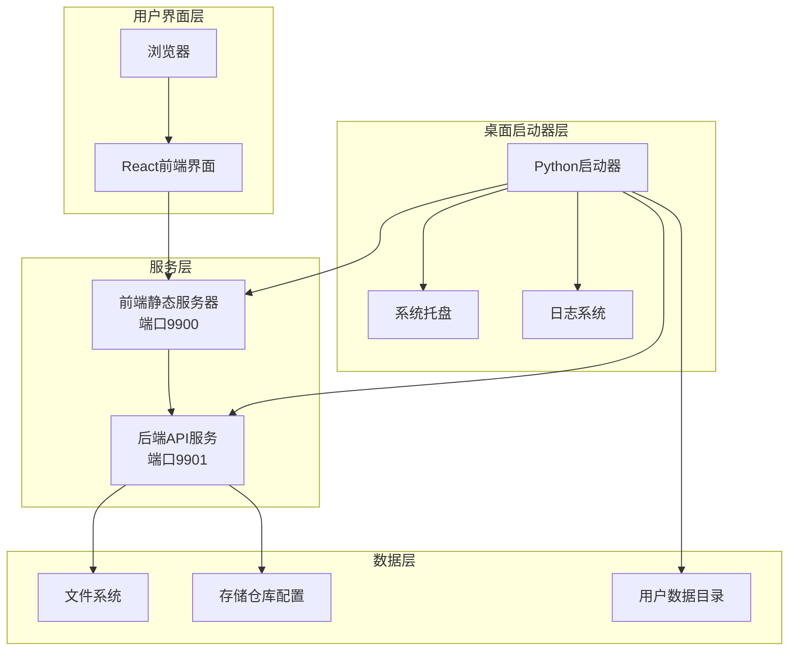
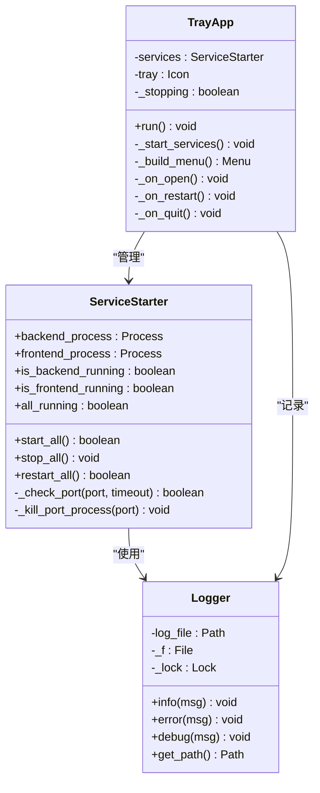
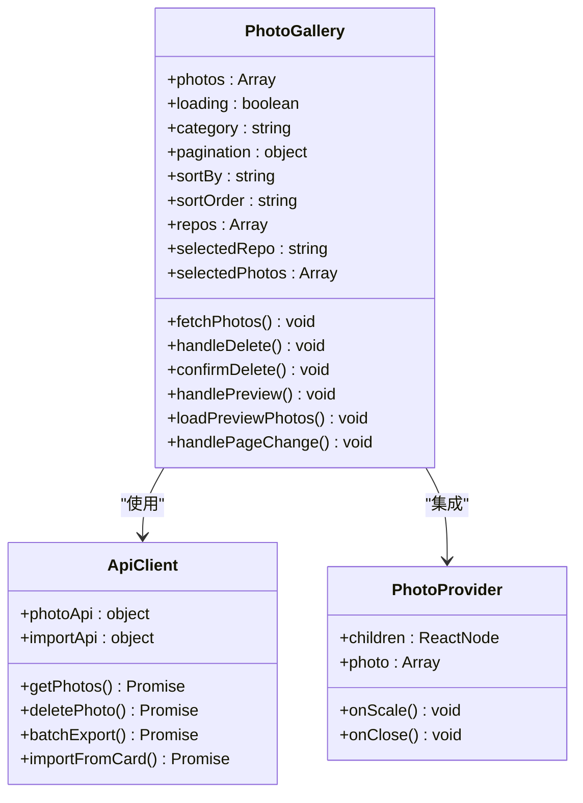
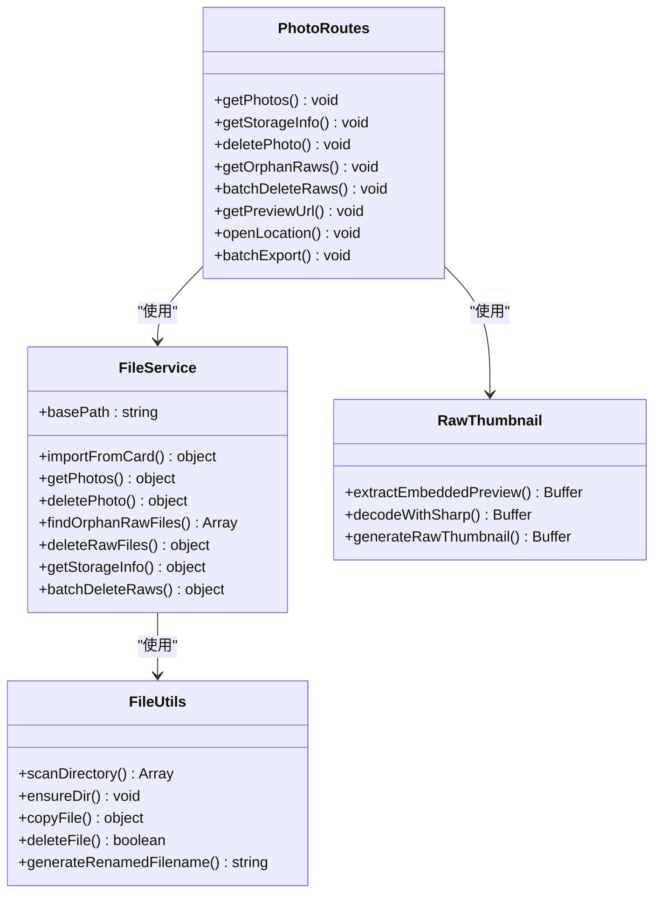
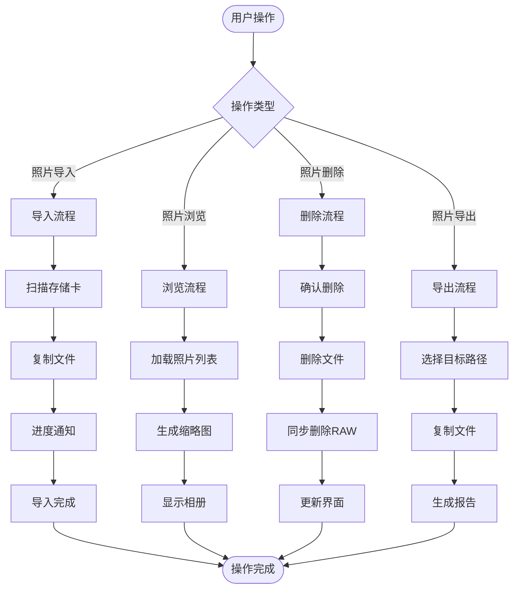

# 开发指南

<cite>
**本文档引用的文件**
- [README.md](file://README.md)
- [backend/package.json](file://backend/package.json)
- [frontend/package.json](file://frontend/package.json)
- [backend/src/app.js](file://backend/src/app.js)
- [frontend-server.js](file://frontend-server.js)
- [launcher.py](file://launcher.py)
- [backend/src/routes/photoRoutes.js](file://backend/src/routes/photoRoutes.js)
- [backend/src/services/fileService.js](file://backend/src/services/fileService.js)
- [backend/src/utils/fileUtils.js](file://backend/src/utils/fileUtils.js)
- [backend/src/utils/rawThumbnail.js](file://backend/src/utils/rawThumbnail.js)
- [backend/data/repos.json](file://backend/data/repos.json)
- [frontend/vite.config.js](file://frontend/vite.config.js)
- [frontend/eslint.config.js](file://frontend/eslint.config.js)
- [frontend/src/api/index.js](file://frontend/src/api/index.js)
- [frontend/src/App.jsx](file://frontend/src/App.jsx)
- [frontend/src/pages/PhotoGallery.jsx](file://frontend/src/pages/PhotoGallery.jsx)
- [frontend/src/main.jsx](file://frontend/src/main.jsx)
</cite>

## 目录
1. [简介](#简介)
2. [项目结构](#项目结构)
3. [核心组件](#核心组件)
4. [架构概览](#架构概览)
5. [详细组件分析](#详细组件分析)
6. [依赖分析](#依赖分析)
7. [性能考虑](#性能考虑)
8. [故障排除指南](#故障排除指南)
9. [结论](#结论)
10. [附录](#附录)

## 简介
本项目是一个跨平台的摄影管理应用，采用桌面端启动器 + 前后端分离的架构设计。项目支持多存储仓库管理、照片导入、RAW文件处理、缩略图生成、视频流式播放等功能。系统通过Python桌面启动器统一管理前后端服务，提供稳定的用户体验。

## 项目结构
项目采用模块化的目录组织方式，主要分为以下几部分：

```mermaid
graph TB
subgraph "项目根目录"
Root[项目根目录]
Backend[backend/] 后端服务
Frontend[frontend/] 前端应用
Electron[electron/] Electron资源
Config[config/] 配置文件
Build[build/] 构建产物
Vibe[vibe_images/] 图像资源
end
subgraph "后端服务"
Backend --> App[src/app.js]
Backend --> Routes[routes/]
Backend --> Services[services/]
Backend --> Utils[utils/]
Backend --> Data[data/]
Backend --> Package[package.json]
end
subgraph "前端应用"
Frontend --> Src[src/]
Frontend --> Public[public/]
Frontend --> Config[package.json]
Frontend --> Vite[vite.config.js]
Frontend --> ESLint[eslint.config.js]
end
```

**图表来源**
- [backend/src/app.js:1-146](file://backend/src/app.js#L1-L146)
- [frontend/package.json:1-33](file://frontend/package.json#L1-L33)

**章节来源**
- [README.md:1-3](file://README.md#L1-L3)
- [backend/package.json:1-30](file://backend/package.json#L1-L30)
- [frontend/package.json:1-33](file://frontend/package.json#L1-L33)

## 核心组件
项目的核心组件包括桌面启动器、前后端服务以及文件管理系统：

### 桌面启动器 (launcher.py)
桌面启动器采用Python实现，提供以下核心功能：
- 单实例检测和保护
- 前后端服务的统一启动和管理
- 端口占用清理和冲突解决
- 系统托盘集成
- 日志记录和错误处理

### 前端应用 (React + Vite)
前端采用现代化的React技术栈，具备以下特性：
- 响应式设计和Ant Design组件库
- 实时照片管理界面
- 支持多仓库切换
- 批量操作功能
- 视频流式播放支持

### 后端服务 (Node.js + Express)
后端提供RESTful API服务，核心功能包括：
- 照片文件管理
- RAW文件处理
- 缩略图生成
- 存储仓库管理
- 导入进度跟踪

**章节来源**
- [launcher.py:1-513](file://launcher.py#L1-L513)
- [frontend/src/App.jsx:1-41](file://frontend/src/App.jsx#L1-L41)
- [backend/src/app.js:1-146](file://backend/src/app.js#L1-L146)

## 架构概览
系统采用三层架构设计，通过桌面启动器统一管理服务生命周期：



**图表来源**
- [launcher.py:41-43](file://launcher.py#L41-L43)
- [frontend-server.js:15-16](file://frontend-server.js#L15-L16)
- [backend/src/app.js:11-11](file://backend/src/app.js#L11-L11)
- [backend/data/repos.json:1-8](file://backend/data/repos.json#L1-L8)

## 详细组件分析

### 桌面启动器组件分析
桌面启动器实现了复杂的多进程管理机制：



**图表来源**
- [launcher.py:141-384](file://launcher.py#L141-L384)
- [launcher.py:406-483](file://launcher.py#L406-L483)
- [launcher.py:87-118](file://launcher.py#L87-L118)

**章节来源**
- [launcher.py:141-384](file://launcher.py#L141-L384)
- [launcher.py:406-483](file://launcher.py#L406-L483)

### 前端组件架构
前端采用模块化的设计模式，主要组件包括：



**图表来源**
- [frontend/src/pages/PhotoGallery.jsx:43-800](file://frontend/src/pages/PhotoGallery.jsx#L43-L800)
- [frontend/src/api/index.js:1-168](file://frontend/src/api/index.js#L1-L168)

**章节来源**
- [frontend/src/pages/PhotoGallery.jsx:1-944](file://frontend/src/pages/PhotoGallery.jsx#L1-L944)
- [frontend/src/api/index.js:1-168](file://frontend/src/api/index.js#L1-L168)

### 后端服务组件分析
后端服务采用Express框架，实现了完整的照片管理API：



**图表来源**
- [backend/src/services/fileService.js:5-443](file://backend/src/services/fileService.js#L5-L443)
- [backend/src/routes/photoRoutes.js:1-739](file://backend/src/routes/photoRoutes.js#L1-L739)
- [backend/src/utils/fileUtils.js:1-167](file://backend/src/utils/fileUtils.js#L1-L167)
- [backend/src/utils/rawThumbnail.js:1-132](file://backend/src/utils/rawThumbnail.js#L1-L132)

**章节来源**
- [backend/src/services/fileService.js:1-443](file://backend/src/services/fileService.js#L1-L443)
- [backend/src/routes/photoRoutes.js:1-739](file://backend/src/routes/photoRoutes.js#L1-L739)

### 数据流处理流程
系统的关键数据处理流程如下：



**图表来源**
- [backend/src/services/fileService.js:24-167](file://backend/src/services/fileService.js#L24-L167)
- [backend/src/routes/photoRoutes.js:68-176](file://backend/src/routes/photoRoutes.js#L68-L176)

**章节来源**
- [backend/src/services/fileService.js:24-167](file://backend/src/services/fileService.js#L24-L167)
- [backend/src/routes/photoRoutes.js:68-176](file://backend/src/routes/photoRoutes.js#L68-L176)

## 依赖分析

### 前端依赖关系
前端项目采用现代化的依赖管理策略：

```mermaid
graph TB
subgraph "前端依赖树"
React[react@^19.2.4]
ReactDOM[react-dom@^19.2.4]
Axios[axios@^1.15.0]
Antd[antd@^6.3.5]
Router[react-router-dom@^7.14.1]
PhotoView[react-photo-view@^1.2.7]
Vite[vite@^8.0.4]
ESLint[eslint@^9.39.4]
Typescript[@types/react@^19.2.14]
React --> ReactDOM
React --> Router
React --> PhotoView
Antd --> React
Antd --> ReactDOM
end
```

**图表来源**
- [frontend/package.json:12-31](file://frontend/package.json#L12-L31)

### 后端依赖关系
后端服务专注于核心功能的实现：

```mermaid
graph TB
subgraph "后端依赖树"
Express[express@^4.18.2]
Sharp[sharp@^0.34.5]
Multer[multer@^1.4.5-lts.1]
ExifTool[exiftool-vendored@^35.17.0]
DotEnv[dotenv@^16.3.1]
Cors[cors@^2.8.5]
Nodemon[nodemon@^3.0.1]
Express --> Sharp
Express --> Multer
Express --> ExifTool
Express --> DotEnv
Express --> Cors
end
```

**图表来源**
- [backend/package.json:10-21](file://backend/package.json#L10-L21)

**章节来源**
- [frontend/package.json:1-33](file://frontend/package.json#L1-L33)
- [backend/package.json:1-30](file://backend/package.json#L1-L30)

## 性能考虑
系统在多个层面进行了性能优化：

### 文件处理优化
- **并发控制**: 导入过程中限制同时处理的文件数量，避免内存溢出
- **流式传输**: 大文件采用流式读取，减少内存占用
- **缓存策略**: 缩略图和静态资源设置合理的缓存头

### 网络通信优化
- **代理配置**: 前端通过Vite代理API请求，减少CORS问题
- **SSE支持**: 导入进度采用Server-Sent Events实时推送
- **Range请求**: 视频文件支持断点续传

### 前端性能优化
- **虚拟滚动**: 大列表采用虚拟滚动提升渲染性能
- **懒加载**: 图片缩略图按需加载
- **状态管理**: 合理的状态分割和更新策略

## 故障排除指南

### 启动器常见问题
1. **端口占用冲突**
   - 现象: 启动器提示端口已被占用
   - 解决: 启动器会自动清理占用端口的进程
   - 预防: 确保9900和9901端口未被其他程序占用

2. **Node.js环境问题**
   - 现象: 启动器找不到Node.js
   - 解决: 手动安装Node.js或在PATH中添加Node.js路径

### 前端开发问题
1. **代理配置失效**
   - 现象: API请求无法转发到后端
   - 解决: 检查vite.config.js中的代理配置
   - 预防: 确保后端服务端口(9901)正确配置

2. **热重载问题**
   - 现象: 修改代码后页面不自动刷新
   - 解决: 检查Vite配置和网络连接

### 后端服务问题
1. **文件权限错误**
   - 现象: 无法读取或写入照片文件
   - 解决: 检查存储仓库路径的访问权限
   - 预防: 使用管理员权限运行或调整文件权限

2. **缩略图生成失败**
   - 现象: RAW文件缩略图显示占位符
   - 解决: 检查exiftool和sharp的安装情况
   - 预防: 确保系统支持的图像格式

**章节来源**
- [launcher.py:175-199](file://launcher.py#L175-L199)
- [frontend-server.js:124-133](file://frontend-server.js#L124-L133)
- [backend/src/utils/rawThumbnail.js:78-132](file://backend/src/utils/rawThumbnail.js#L78-L132)

## 结论
本摄影管理项目采用成熟的前后端分离架构，通过Python桌面启动器实现了服务的统一管理。项目具有良好的可扩展性和维护性，支持多存储仓库管理、RAW文件处理等高级功能。建议开发者遵循本文档的开发规范和最佳实践，在保证功能完整性的同时提升系统的稳定性和性能。

## 附录

### 开发环境搭建步骤
1. **Node.js环境**
   - 安装Node.js 16.x或更高版本
   - 验证安装: `node --version`
   - 安装依赖: `npm install`

2. **Python环境**
   - 安装Python 3.7或更高版本
   - 安装依赖: `pip install -r requirements.txt`

3. **IDE配置**
   - 推荐使用VS Code
   - 安装ESLint和Prettier插件
   - 配置Python虚拟环境

### 代码规范
1. **JavaScript/React规范**
   - 使用ESLint进行代码检查
   - 遵循Airbnb代码风格
   - 组件命名采用帕斯卡命名法

2. **Python规范**
   - 使用PEP8代码风格
   - 函数和类使用下划线命名法
   - 添加必要的类型注解

3. **文件命名**
   - 组件文件使用.jsx扩展名
   - 配置文件使用.js扩展名
   - 样式文件使用.css扩展名

### Git工作流程
1. **分支管理**
   - `main`: 主分支，发布版本
   - `develop`: 开发分支，最新功能
   - `feature/*`: 功能开发分支
   - `hotfix/*`: 紧急修复分支

2. **提交规范**
   - `feat: 新增功能`
   - `fix: 修复bug`
   - `docs: 文档更新`
   - `style: 代码格式调整`
   - `refactor: 代码重构`

3. **合并策略**
   - 使用Pull Request进行代码审查
   - 确保测试通过后再合并
   - 保持提交历史整洁

### 测试策略
1. **单元测试**
   - 使用Jest进行JavaScript测试
   - 覆盖核心业务逻辑
   - 测试边界条件和异常情况

2. **集成测试**
   - 测试API接口功能
   - 验证文件处理流程
   - 检查数据库操作

3. **端到端测试**
   - 使用Cypress进行UI测试
   - 模拟真实用户操作
   - 验证完整业务流程

### 代码质量保证
1. **代码审查**
   - Pull Request必须经过至少一次审查
   - 关注代码质量和安全性
   - 确保文档完整

2. **持续集成**
   - 自动化测试流程
   - 代码质量检查
   - 构建和部署自动化

3. **监控和日志**
   - 实施应用性能监控
   - 记录关键业务指标
   - 建立告警机制