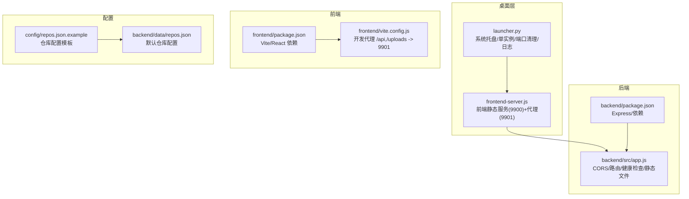
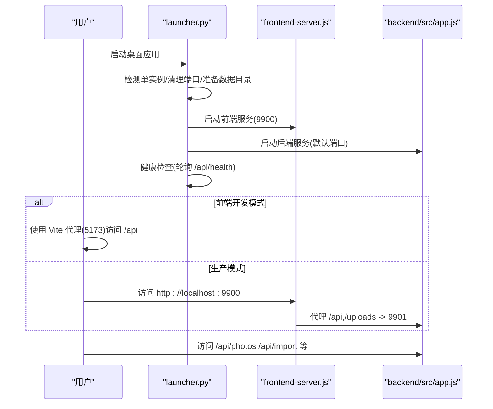
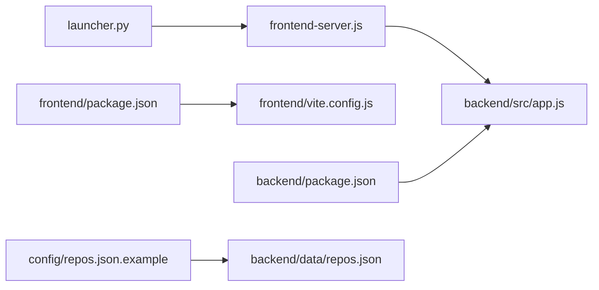

# 快速开始

<cite>
**本文引用的文件**
- [README.md](file://README.md)
- [launcher.py](file://launcher.py)
- [frontend-server.js](file://frontend-server.js)
- [backend/src/app.js](file://backend/src/app.js)
- [backend/package.json](file://backend/package.json)
- [frontend/package.json](file://frontend/package.json)
- [frontend/vite.config.js](file://frontend/vite.config.js)
- [config/repos.json.example](file://config/repos.json.example)
- [backend/data/repos.json](file://backend/data/repos.json)
- [build.bat](file://build.bat)
- [SSE_TROUBLESHOOTING.md](file://SSE_TROUBLESHOOTING.md)
- [IMPORT_PROGRESS_TEST.md](file://IMPORT_PROGRESS_TEST.md)
- [backend/RAW_THUMBNAIL_FIX.md](file://backend/RAW_THUMBNAIL_FIX.md)
</cite>

## 目录
1. [简介](#简介)
2. [项目结构](#项目结构)
3. [核心组件](#核心组件)
4. [架构总览](#架构总览)
5. [详细组件分析](#详细组件分析)
6. [依赖关系分析](#依赖关系分析)
7. [性能与运行模式](#性能与运行模式)
8. [故障排查指南](#故障排查指南)
9. [结论](#结论)
10. [附录](#附录)

## 简介
本指南面向首次接触“摄影管理”项目的用户，帮助你在 Windows、macOS、Linux 上快速完成环境准备、安装与首次运行。项目采用桌面启动器（Python + PyInstaller）整合前后端服务，前端通过 Vite 开发服务器或静态代理访问后端 API，后端基于 Express 提供照片导入、缩略图与仓库管理能力。

## 项目结构
项目采用多模块组织方式：
- Electron/桌面层：打包与系统托盘入口（Python 启动器）
- 前端：React + Vite，开发时通过本地代理访问后端
- 后端：Express，提供 API 与静态资源服务
- 配置：仓库配置文件模板与示例
- 构建：批处理脚本一键构建可执行文件

图表来源
- [launcher.py:1-513](file://launcher.py#L1-L513)
- [frontend-server.js:1-139](file://frontend-server.js#L1-L139)
- [backend/src/app.js:1-146](file://backend/src/app.js#L1-L146)
- [frontend/package.json:1-33](file://frontend/package.json#L1-L33)
- [frontend/vite.config.js:1-21](file://frontend/vite.config.js#L1-L21)
- [config/repos.json.example:1-17](file://config/repos.json.example#L1-L17)
- [backend/data/repos.json:1-8](file://backend/data/repos.json#L1-L8)

章节来源
- [README.md:1-3](file://README.md#L1-L3)
- [launcher.py:1-513](file://launcher.py#L1-L513)
- [frontend-server.js:1-139](file://frontend-server.js#L1-L139)
- [backend/src/app.js:1-146](file://backend/src/app.js#L1-L146)
- [frontend/package.json:1-33](file://frontend/package.json#L1-L33)
- [frontend/vite.config.js:1-21](file://frontend/vite.config.js#L1-L21)
- [config/repos.json.example:1-17](file://config/repos.json.example#L1-L17)
- [backend/data/repos.json:1-8](file://backend/data/repos.json#L1-L8)

## 核心组件
- 桌面启动器（Python）
  - 单实例互斥、端口占用清理、前后端并行启动、健康检查、日志与托盘菜单
- 前端静态服务器（Node.js）
  - 提供前端构建产物服务，代理 /api 与 /uploads 到后端
- 后端服务（Node.js + Express）
  - CORS、静态文件服务、健康检查、照片导入与仓库配置
- 前端开发服务器（Vite）
  - 本地代理到后端，便于开发调试
- 仓库配置
  - 示例模板与默认配置，支持跨平台默认路径

章节来源
- [launcher.py:140-384](file://launcher.py#L140-L384)
- [frontend-server.js:63-84](file://frontend-server.js#L63-L84)
- [backend/src/app.js:10-121](file://backend/src/app.js#L10-L121)
- [frontend/vite.config.js:7-19](file://frontend/vite.config.js#L7-L19)
- [config/repos.json.example:1-17](file://config/repos.json.example#L1-L17)
- [backend/data/repos.json:1-8](file://backend/data/repos.json#L1-L8)

## 架构总览
下图展示桌面启动器如何协调前端静态服务器与后端 API 服务，并通过 Vite 开发代理进行本地联调。

图表来源
- [launcher.py:200-353](file://launcher.py#L200-L353)
- [frontend-server.js:86-122](file://frontend-server.js#L86-L122)
- [backend/src/app.js:114-121](file://backend/src/app.js#L114-L121)
- [frontend/vite.config.js:7-19](file://frontend/vite.config.js#L7-L19)

## 详细组件分析

### 环境要求与兼容性
- Node.js
  - 后端与前端均使用 Node.js 运行时；桌面启动器会检测并使用系统 Node 可执行文件
- Python
  - 桌面启动器为 Python 脚本；若需构建可执行文件，需安装 PyInstaller（脚本中调用）
- 操作系统
  - Windows：支持系统托盘、端口占用清理、单实例互斥
  - macOS/Linux：支持用户数据目录、日志与基础功能；端口清理依赖 Windows 的 netstat/taskkill
- 依赖
  - 后端依赖：Express、CORS、Multer、Sharp、ExifTool 等
  - 前端依赖：React、Ant Design、Axios、React Router 等

章节来源
- [launcher.py:64-71](file://launcher.py#L64-L71)
- [backend/package.json:10-21](file://backend/package.json#L10-L21)
- [frontend/package.json:12-31](file://frontend/package.json#L12-L31)

### 安装与首次运行（Windows）
- 步骤
  1) 安装 Node.js（桌面启动器会检测并使用）
  2) 安装 Python（用于构建可执行文件时）
  3) 克隆仓库到本地
  4) 运行构建脚本以生成桌面可执行文件
     - 执行 build.bat，依次完成：前端构建、后端依赖安装、打包 exe
  5) 运行生成的桌面程序（例如 CameraPhotoManager.exe）
  6) 打开系统托盘菜单，访问主页面或查看日志
- 注意事项
  - 若端口 9900/9901 被占用，启动器会尝试清理；如失败请手动释放
  - 首次运行会自动在用户数据目录生成仓库配置文件

章节来源
- [build.bat:1-43](file://build.bat#L1-L43)
- [launcher.py:245-249](file://launcher.py#L245-L249)
- [launcher.py:226-233](file://launcher.py#L226-L233)

### 安装与首次运行（macOS/Linux）
- 步骤
  1) 安装 Node.js 与 Python
  2) 克隆仓库
  3) 进入 frontend 目录，安装依赖并启动开发服务器
  4) 进入 backend 目录，安装依赖并启动后端服务
  5) 在浏览器访问前端开发地址（默认 5173），通过代理访问后端 API
- 注意事项
  - 端口占用清理仅在 Windows 生效；macOS/Linux 需手动释放端口
  - 如需生产模式，可使用前端静态服务器代理到后端

章节来源
- [frontend/package.json:6-11](file://frontend/package.json#L6-L11)
- [frontend/vite.config.js:7-19](file://frontend/vite.config.js#L7-L19)
- [backend/src/app.js:10-11](file://backend/src/app.js#L10-L11)

### 启动方式（开发模式 vs 生产模式）
- 开发模式（Vite）
  - 前端：在 frontend 目录执行开发服务器，自动代理 /api 与 /uploads 到后端
  - 后端：在 backend 目录执行启动脚本
- 生产模式（桌面启动器）
  - 启动器同时启动前端静态服务器（9900）与后端（默认端口），并通过健康检查确认服务就绪
  - 托盘菜单提供打开页面、查看日志、重启服务、退出

章节来源
- [frontend/vite.config.js:7-19](file://frontend/vite.config.js#L7-L19)
- [launcher.py:200-353](file://launcher.py#L200-L353)
- [frontend-server.js:86-122](file://frontend-server.js#L86-L122)

### 仓库配置与数据目录
- 配置文件
  - 示例模板：config/repos.json.example
  - 默认配置：backend/data/repos.json
- 数据目录
  - 后端通过 DATA_DIR 环境变量指向用户数据目录；首次运行会复制模板到该目录
- 跨平台默认路径
  - Windows/macOS/Linux 分别指向用户 Pictures 下的“相机照片”目录

章节来源
- [config/repos.json.example:1-17](file://config/repos.json.example#L1-L17)
- [backend/data/repos.json:1-8](file://backend/data/repos.json#L1-L8)
- [backend/src/app.js:28-36](file://backend/src/app.js#L28-L36)
- [backend/src/app.js:38-65](file://backend/src/app.js#L38-L65)
- [backend/src/app.js:93-112](file://backend/src/app.js#L93-L112)

### RAW 缩略图功能
- 问题与修复
  - 原因：错误的 exiftool 调用方式与 API 使用错误
  - 修复：使用 exiftool-vendored 的 Node.js API，直接返回 Buffer
- 验证
  - 访问照片库页面，切换到 RAW 分类，查看是否显示缩略图
  - 如仍显示占位图，检查后端控制台日志

章节来源
- [backend/RAW_THUMBNAIL_FIX.md:1-100](file://backend/RAW_THUMBNAIL_FIX.md#L1-L100)

## 依赖关系分析
- 组件耦合
  - launcher.py 作为编排者，依赖 Node.js 可执行文件与用户数据目录
  - frontend-server.js 依赖后端端口与前端构建产物
  - backend/src/app.js 依赖仓库配置与数据目录
- 外部依赖
  - 后端：Express、CORS、Multer、Sharp、ExifTool
  - 前端：React、Ant Design、Axios、React Router

图表来源
- [launcher.py:200-353](file://launcher.py#L200-L353)
- [frontend-server.js:86-122](file://frontend-server.js#L86-L122)
- [backend/src/app.js:10-121](file://backend/src/app.js#L10-L121)
- [frontend/package.json:1-33](file://frontend/package.json#L1-L33)
- [frontend/vite.config.js:1-21](file://frontend/vite.config.js#L1-L21)
- [config/repos.json.example:1-17](file://config/repos.json.example#L1-L17)
- [backend/data/repos.json:1-8](file://backend/data/repos.json#L1-L8)

章节来源
- [backend/package.json:10-21](file://backend/package.json#L10-L21)
- [frontend/package.json:12-31](file://frontend/package.json#L12-L31)

## 性能与运行模式
- 生产模式优势
  - 单一可执行文件，减少环境依赖；内置端口清理与健康检查
- 开发模式优势
  - Vite 热更新与代理，便于调试 API 与前端交互
- 性能建议
  - 使用后端静态文件服务提供图片，避免前端重复下载
  - 对于大量 RAW 文件，建议分批导入并监控磁盘写入性能

[本节为通用建议，不涉及特定文件分析]

## 故障排查指南
- 启动失败
  - 检查 Node.js 是否安装并可执行
  - 查看桌面启动器日志文件，定位后端/前端进程退出码
- 端口占用
  - Windows：启动器会尝试清理；macOS/Linux：请手动释放端口 9900/9901
- CORS 与 SSE
  - SSE 连接中断常见于 CORS 配置不当或错误响应格式
  - 建议按文档修正后端 CORS 配置，并确保错误响应遵循 SSE 格式
- 导入超时
  - 导入超时时间已延长至 5 分钟；如仍失败，检查磁盘空间与网络稳定性
- RAW 缩略图不显示
  - 确认后端服务运行，访问 RAW 页面查看日志；按修复说明验证 exiftool-vendored 使用

章节来源
- [launcher.py:278-292](file://launcher.py#L278-L292)
- [launcher.py:312-321](file://launcher.py#L312-L321)
- [SSE_TROUBLESHOOTING.md:60-120](file://SSE_TROUBLESHOOTING.md#L60-L120)
- [SSE_TROUBLESHOOTING.md:148-200](file://SSE_TROUBLESHOOTING.md#L148-L200)
- [IMPORT_PROGRESS_TEST.md:66-72](file://IMPORT_PROGRESS_TEST.md#L66-L72)
- [backend/RAW_THUMBNAIL_FIX.md:74-86](file://backend/RAW_THUMBNAIL_FIX.md#L74-L86)

## 结论
通过本指南，你可以在 Windows/macOS/Linux 上完成环境准备、安装与首次运行。推荐优先使用桌面启动器进入生产模式体验完整功能；开发阶段可使用 Vite 代理快速调试。遇到问题时，结合日志与本指南的排查步骤可快速定位并解决。

[本节为总结性内容，不涉及特定文件分析]

## 附录

### 快速命令清单
- Windows
  - 构建：双击 build.bat 或在仓库根目录执行
  - 运行：启动生成的桌面程序
- macOS/Linux
  - 前端开发：在 frontend 目录执行开发服务器
  - 后端开发：在 backend 目录执行启动脚本
  - 生产模式：使用桌面启动器（如已构建）

章节来源
- [build.bat:1-43](file://build.bat#L1-L43)
- [frontend/package.json:6-11](file://frontend/package.json#L6-L11)
- [backend/package.json:6-8](file://backend/package.json#L6-L8)