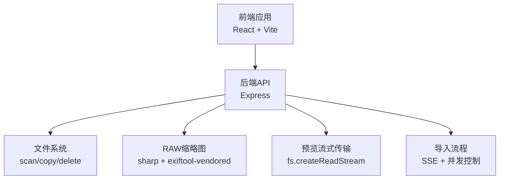
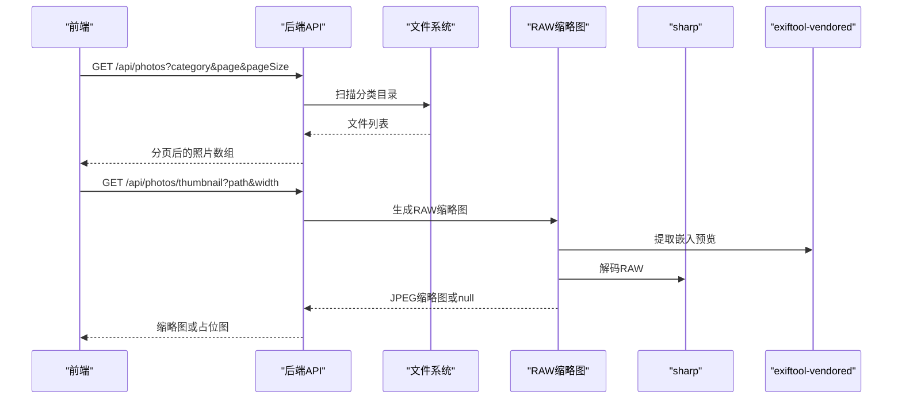
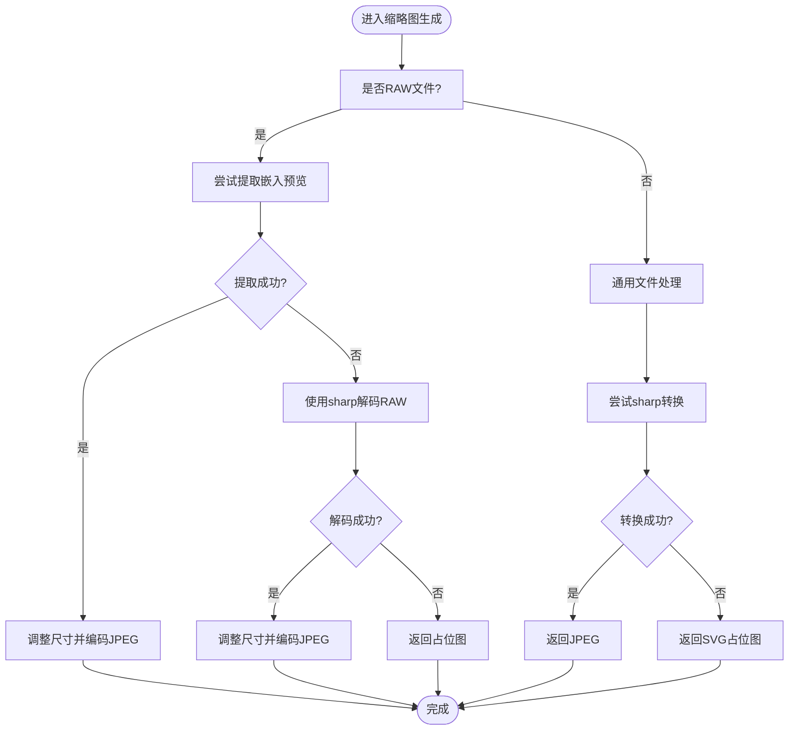
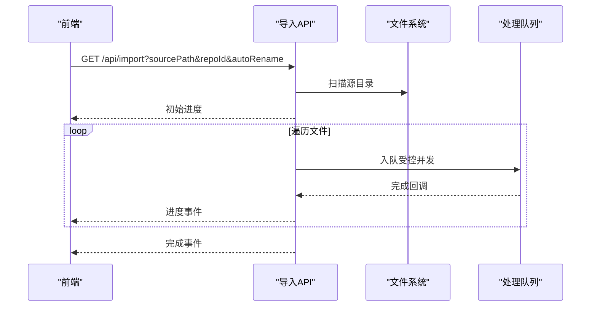
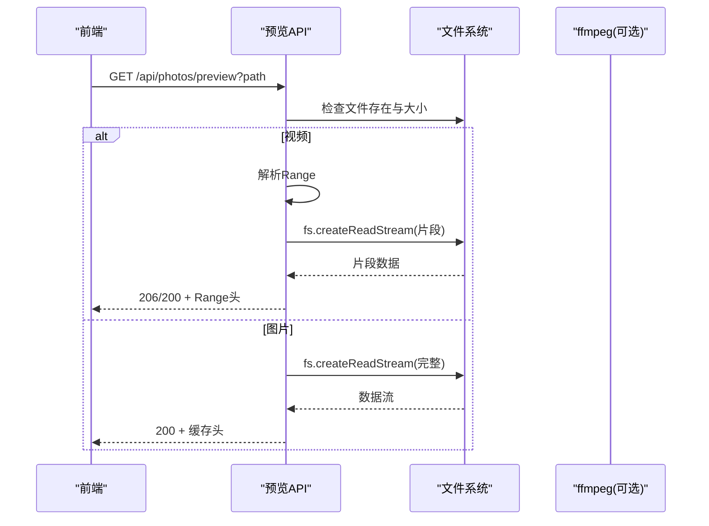
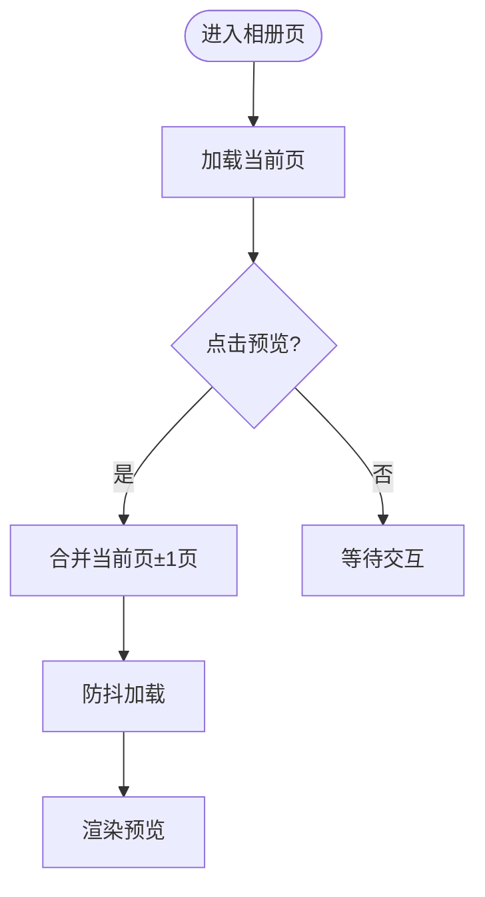
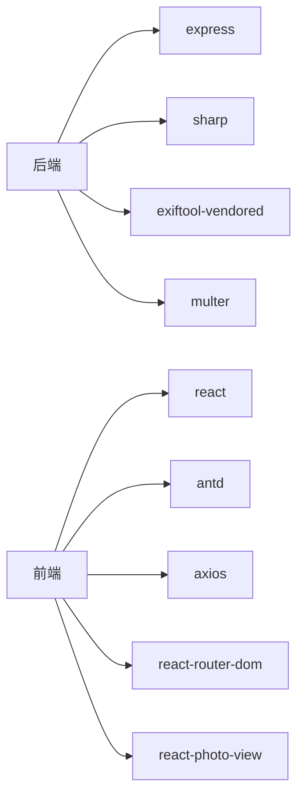

# 性能优化

<cite>
**本文引用的文件**
- [backend/src/app.js](file://backend/src/app.js)
- [backend/src/utils/rawThumbnail.js](file://backend/src/utils/rawThumbnail.js)
- [backend/src/services/fileService.js](file://backend/src/services/fileService.js)
- [backend/src/route/photoRoutes.js](file://backend/src/route/photoRoutes.js)
- [backend/src/route/importRoutes.js](file://backend/src/route/importRoutes.js)
- [backend/src/utils/fileUtils.js](file://backend/src/utils/fileUtils.js)
- [backend/RAW_THUMBNAIL_FIX.md](file://backend/RAW_THUMBNAIL_FIX.md)
- [backend/test-thumbnail.js](file://backend/test-thumbnail.js)
- [backend/test-raw-preview.js](file://backend/test-raw-preview.js)
- [backend/package.json](file://backend/package.json)
- [frontend/src/pages/PhotoGallery.jsx](file://frontend/src/pages/PhotoGallery.jsx)
- [frontend/vite.config.js](file://frontend/vite.config.js)
- [frontend/package.json](file://frontend/package.json)
</cite>

## 目录
1. [简介](#简介)
2. [项目结构](#项目结构)
3. [核心组件](#核心组件)
4. [架构总览](#架构总览)
5. [详细组件分析](#详细组件分析)
6. [依赖关系分析](#依赖关系分析)
7. [性能考量](#性能考量)
8. [故障排除指南](#故障排除指南)
9. [结论](#结论)
10. [附录](#附录)

## 简介
本指南面向摄影管理项目的性能优化，聚焦以下方面：
- 图像处理与RAW文件处理的性能瓶颈与优化策略（含缓存、异步与资源管理）
- 前端组件渲染优化（虚拟滚动、懒加载、预览与缩略图策略）
- 后端并发与I/O优化（导入、缩略图生成、预览流式传输）
- 数据库查询优化（当前项目未内置数据库，本节提供通用实践）
- 性能监控与基准测试（指标定义、工具使用、调优流程）

## 项目结构
项目采用前后端分离架构：
- 后端基于Express，提供照片列表、缩略图、预览、导入、删除等API
- 前端基于React + Vite，提供相册浏览、批量操作、仓库选择等功能
- RAW缩略图生成依赖sharp与exiftool-vendored，预览视频采用ffmpeg提取首帧

图表来源
- [backend/src/app.js:10-146](file://backend/src/app.js#L10-146)
- [backend/src/route/photoRoutes.js:1-739](file://backend/src/route/photoRoutes.js#L1-L739)
- [backend/src/route/importRoutes.js:1-627](file://backend/src/route/importRoutes.js#L1-L627)
- [backend/src/utils/rawThumbnail.js:1-132](file://backend/src/utils/rawThumbnail.js#L1-L132)
- [backend/src/utils/fileUtils.js:1-167](file://backend/src/utils/fileUtils.js#L1-L167)

章节来源
- [backend/src/app.js:10-146](file://backend/src/app.js#L10-146)
- [frontend/vite.config.js:1-21](file://frontend/vite.config.js#L1-L21)

## 核心组件
- Express应用与中间件：CORS、日志、静态文件服务、健康检查、全局异常处理
- 文件服务：扫描目录、分类目录初始化、导入（并发控制）、删除、统计
- 缩略图与预览：RAW三段降级策略、视频首帧提取、通用缩略图生成、流式传输
- 导入流程：SSE进度推送、并发控制、增量导入
- 前端相册页：分页、排序、批量操作、预览跨页加载

章节来源
- [backend/src/app.js:10-146](file://backend/src/app.js#L10-146)
- [backend/src/services/fileService.js:1-443](file://backend/src/services/fileService.js#L1-L443)
- [backend/src/route/photoRoutes.js:1-739](file://backend/src/route/photoRoutes.js#L1-L739)
- [backend/src/route/importRoutes.js:1-627](file://backend/src/route/importRoutes.js#L1-L627)
- [frontend/src/pages/PhotoGallery.jsx:1-936](file://frontend/src/pages/PhotoGallery.jsx#L1-L936)

## 架构总览
后端API负责：
- 相册数据：按分类、分页、排序返回照片列表
- 缩略图：优先提取RAW嵌入预览，其次解码RAW，最后回退占位图
- 预览：视频使用Range请求与流式传输；图片使用流式传输
- 导入：SSE推送进度，限制并发，增量复制

图表来源
- [backend/src/route/photoRoutes.js:69-92](file://backend/src/route/photoRoutes.js#L69-L92)
- [backend/src/route/photoRoutes.js:294-466](file://backend/src/route/photoRoutes.js#L294-L466)
- [backend/src/utils/rawThumbnail.js:78-129](file://backend/src/utils/rawThumbnail.js#L78-L129)

## 详细组件分析

### 图像处理与RAW缩略图生成
- 三层降级策略：嵌入预览 → RAW解码 → 占位图
- 嵌入预览提取：exiftool-vendored API直接返回Buffer，避免命令行开销
- RAW解码：sharp按宽高缩放并压缩为JPEG
- 缓存：缩略图与预览响应设置Cache-Control，减少重复请求

图表来源
- [backend/src/utils/rawThumbnail.js:78-129](file://backend/src/utils/rawThumbnail.js#L78-L129)
- [backend/src/route/photoRoutes.js:395-425](file://backend/src/route/photoRoutes.js#L395-L425)
- [backend/src/route/photoRoutes.js:427-458](file://backend/src/route/photoRoutes.js#L427-L458)

章节来源
- [backend/src/utils/rawThumbnail.js:1-132](file://backend/src/utils/rawThumbnail.js#L1-L132)
- [backend/src/route/photoRoutes.js:294-466](file://backend/src/route/photoRoutes.js#L294-L466)
- [backend/RAW_THUMBNAIL_FIX.md:1-100](file://backend/RAW_THUMBNAIL_FIX.md#L1-L100)

### 导入流程与并发控制
- SSE进度推送：GET /api/import 支持SSE，边处理边推送
- 并发控制：固定队列长度（CONCURRENCY_LIMIT），避免内存峰值
- 增量导入：同名文件比较大小与修改时间，相同则跳过

图表来源
- [backend/src/route/importRoutes.js:82-182](file://backend/src/route/importRoutes.js#L82-L182)
- [backend/src/services/fileService.js:75-167](file://backend/src/services/fileService.js#L75-L167)
- [backend/src/utils/fileUtils.js:77-100](file://backend/src/utils/fileUtils.js#L77-L100)

章节来源
- [backend/src/route/importRoutes.js:1-627](file://backend/src/route/importRoutes.js#L1-L627)
- [backend/src/services/fileService.js:1-443](file://backend/src/services/fileService.js#L1-L443)
- [backend/src/utils/fileUtils.js:1-167](file://backend/src/utils/fileUtils.js#L1-L167)

### 预览与流式传输
- 视频：Range请求解析，仅读取所需片段，避免全量加载
- 图片：fs.createReadStream流式传输，设置Accept-Ranges与缓存头
- RAW预览：若生成失败，回退至占位图

图表来源
- [backend/src/route/photoRoutes.js:178-291](file://backend/src/route/photoRoutes.js#L178-L291)
- [backend/src/route/photoRoutes.js:468-571](file://backend/src/route/photoRoutes.js#L468-L571)

章节来源
- [backend/src/route/photoRoutes.js:178-291](file://backend/src/route/photoRoutes.js#L178-L291)
- [backend/src/route/photoRoutes.js:468-571](file://backend/src/route/photoRoutes.js#L468-L571)

### 前端渲染优化与懒加载
- 分页与跨页预览：相册页按页加载，预览时按需加载相邻页
- 防抖与去重：跨页加载使用防抖与去重，避免重复请求
- 图片懒加载：缩略图占位与错误回退，避免阻塞渲染
- 预览组件：PhotoView提供平滑预览体验

图表来源
- [frontend/src/pages/PhotoGallery.jsx:105-131](file://frontend/src/pages/PhotoGallery.jsx#L105-L131)
- [frontend/src/pages/PhotoGallery.jsx:174-223](file://frontend/src/pages/PhotoGallery.jsx#L174-L223)
- [frontend/src/pages/PhotoGallery.jsx:246-308](file://frontend/src/pages/PhotoGallery.jsx#L246-L308)

章节来源
- [frontend/src/pages/PhotoGallery.jsx:1-936](file://frontend/src/pages/PhotoGallery.jsx#L1-L936)

## 依赖关系分析
- 后端依赖：express、cors、sharp、exiftool-vendored、multer
- 前端依赖：react、react-dom、antd、axios、react-router-dom、react-photo-view
- 开发依赖：vite、@vitejs/plugin-react、eslint等

图表来源
- [backend/package.json:10-18](file://backend/package.json#L10-L18)
- [frontend/package.json:12-19](file://frontend/package.json#L12-L19)

章节来源
- [backend/package.json:1-30](file://backend/package.json#L1-L30)
- [frontend/package.json:1-33](file://frontend/package.json#L1-L33)

## 性能考量

### 图像处理与内存管理
- RAW缩略图生成
  - 优先使用嵌入预览，避免大文件解码
  - exiftool-vendored使用Node.js API，避免命令行进程开销
  - sharp按需缩放与压缩，控制JPEG质量与尺寸
- 预览与缩略图
  - 设置Cache-Control，减少重复生成
  - 对于大图与视频，使用流式传输避免内存峰值
- 内存与并发
  - 导入阶段固定并发上限，避免内存暴涨
  - 使用Promise队列与清理机制，及时释放已完成任务

章节来源
- [backend/src/utils/rawThumbnail.js:1-132](file://backend/src/utils/rawThumbnail.js#L1-L132)
- [backend/src/route/photoRoutes.js:294-466](file://backend/src/route/photoRoutes.js#L294-L466)
- [backend/src/services/fileService.js:75-167](file://backend/src/services/fileService.js#L75-L167)

### 前端渲染与交互
- 虚拟滚动与懒加载
  - 采用分页与跨页预览，避免一次性渲染过多节点
  - 预览时按需加载相邻页，结合防抖降低请求频率
- 图片占位与错误回退
  - 缩略图加载失败时使用SVG占位，避免布局抖动
- 组件更新与重渲染
  - 使用useCallback稳定回调，减少子组件重渲染
  - 选择器与排序状态局部更新，避免全量刷新

章节来源
- [frontend/src/pages/PhotoGallery.jsx:105-131](file://frontend/src/pages/PhotoGallery.jsx#L105-L131)
- [frontend/src/pages/PhotoGallery.jsx:174-223](file://frontend/src/pages/PhotoGallery.jsx#L174-L223)
- [frontend/src/pages/PhotoGallery.jsx:246-308](file://frontend/src/pages/PhotoGallery.jsx#L246-L308)

### 数据库查询优化（通用实践）
- 当前项目未内置数据库，以下为通用优化建议：
  - 索引设计：对高频查询字段（如时间戳、类型、仓库ID）建立复合索引
  - 查询计划：使用EXPLAIN分析慢查询，避免SELECT *
  - 连接池：合理设置最大连接数、空闲超时与重试策略
  - 分页与排序：避免OFFSET过大，使用基于游标（cursor-based）分页
  - 缓存：热点数据放入Redis，设置合理TTL与失效策略

### 性能监控与基准测试
- 指标定义
  - 后端：请求延迟（p50/p95/p99）、吞吐量（req/sec）、错误率、CPU/内存占用
  - 前端：首屏渲染时间、首字节时间（TTFB）、交互延迟、内存峰值
- 工具使用
  - 后端：PM2/进程监控、apdex、Prometheus/Grafana
  - 前端：Chrome DevTools、Lighthouse、WebPageTest
- 基准测试
  - 导入：模拟N个RAW/JPG/视频文件，测量总耗时与并发下的稳定性
  - 缩略图：批量生成不同尺寸缩略图，记录平均耗时与内存峰值
  - 预览：视频Range请求与图片流式传输的带宽与延迟

### 实用技巧与最佳实践
- 后端
  - 固定并发上限，避免IO密集型任务阻塞事件循环
  - 使用流式传输处理大文件，设置合理的超时与缓冲区
  - 对外暴露健康检查端点，便于容器编排与负载均衡
- 前端
  - 图片懒加载与骨架屏，提升感知性能
  - 预览组件按需加载，避免预加载全部资源
  - 使用HTTP缓存与CDN，加速静态资源分发

## 故障排除指南

### RAW缩略图生成问题
- 症状：缩略图显示占位图
- 排查要点
  - 检查RAW文件是否存在与可访问
  - 确认嵌入预览标签是否存在（JpgFromRaw/PreviewImage/ThumbnailImage）
  - 验证sharp是否支持该RAW格式
- 参考修复文档与测试脚本
  - [RAW_THUMBNAIL_FIX.md:1-100](file://backend/RAW_THUMBNAIL_FIX.md#L1-L100)
  - [test-thumbnail.js:1-32](file://backend/test-thumbnail.js#L1-L32)
  - [test-raw-preview.js:1-69](file://backend/test-raw-preview.js#L1-L69)

章节来源
- [backend/RAW_THUMBNAIL_FIX.md:1-100](file://backend/RAW_THUMBNAIL_FIX.md#L1-L100)
- [backend/test-thumbnail.js:1-32](file://backend/test-thumbnail.js#L1-L32)
- [backend/test-raw-preview.js:1-69](file://backend/test-raw-preview.js#L1-L69)

### 导入进度与SSE
- 症状：进度不更新或中断
- 排查要点
  - 确认SSE头部设置正确（text/event-stream）
  - 检查并发队列是否被阻塞
  - 核对源路径与目标路径权限

章节来源
- [backend/src/route/importRoutes.js:82-182](file://backend/src/route/importRoutes.js#L82-L182)
- [backend/src/services/fileService.js:75-167](file://backend/src/services/fileService.js#L75-L167)

### 预览与视频播放
- 症状：视频无法播放或卡顿
- 排查要点
  - Range请求解析是否正确
  - 流式传输是否设置Accept-Ranges与Content-Range
  - ffmpeg是否可用，必要时回退至占位图

章节来源
- [backend/src/route/photoRoutes.js:226-291](file://backend/src/route/photoRoutes.js#L226-L291)
- [backend/src/route/photoRoutes.js:322-393](file://backend/src/route/photoRoutes.js#L322-L393)

### 前端相册渲染卡顿
- 症状：滚动卡顿、预览切换慢
- 排查要点
  - 是否一次性渲染过多卡片
  - 跨页预览是否频繁触发请求
  - 图片占位与错误回退是否导致重绘

章节来源
- [frontend/src/pages/PhotoGallery.jsx:590-800](file://frontend/src/pages/PhotoGallery.jsx#L590-L800)

## 结论
本项目在图像处理、导入并发与预览传输方面已具备良好的基础。通过：
- 优先提取嵌入预览与缓存策略，显著降低RAW解码成本
- 导入阶段的并发控制与增量复制，保障稳定性
- 流式传输与Range请求，优化大文件与视频体验
- 前端分页与跨页预览，缓解渲染压力

建议持续关注指标与基准测试，结合业务增长逐步引入数据库索引优化、连接池与CDN缓存，进一步提升整体性能。

## 附录
- 开发与构建
  - 前端开发服务器端口与代理配置见 [vite.config.js:1-21](file://frontend/vite.config.js#L1-L21)
  - 依赖安装与脚本见 [backend/package.json:1-30](file://backend/package.json#L1-L30) 与 [frontend/package.json:1-33](file://frontend/package.json#L1-L33)