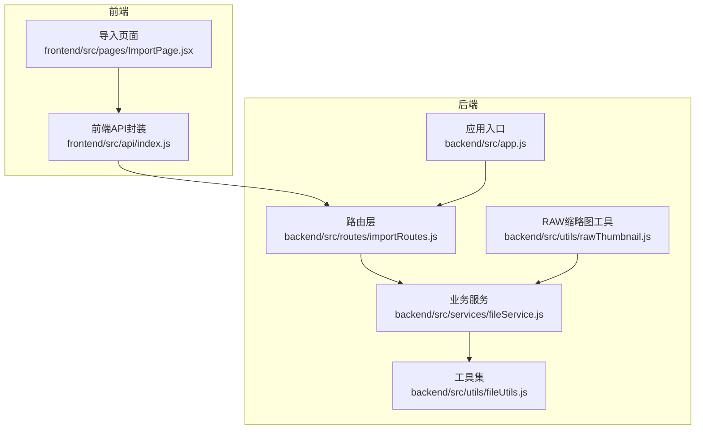
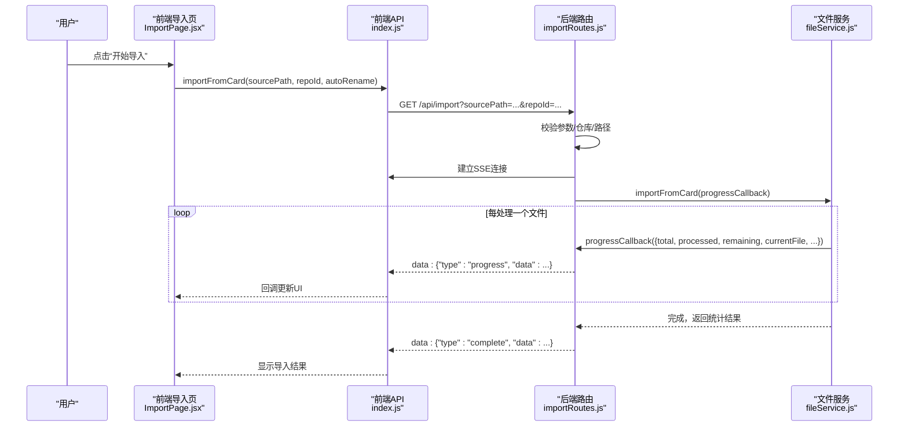
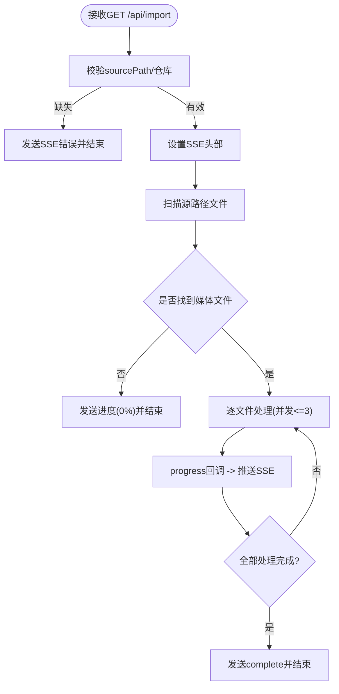
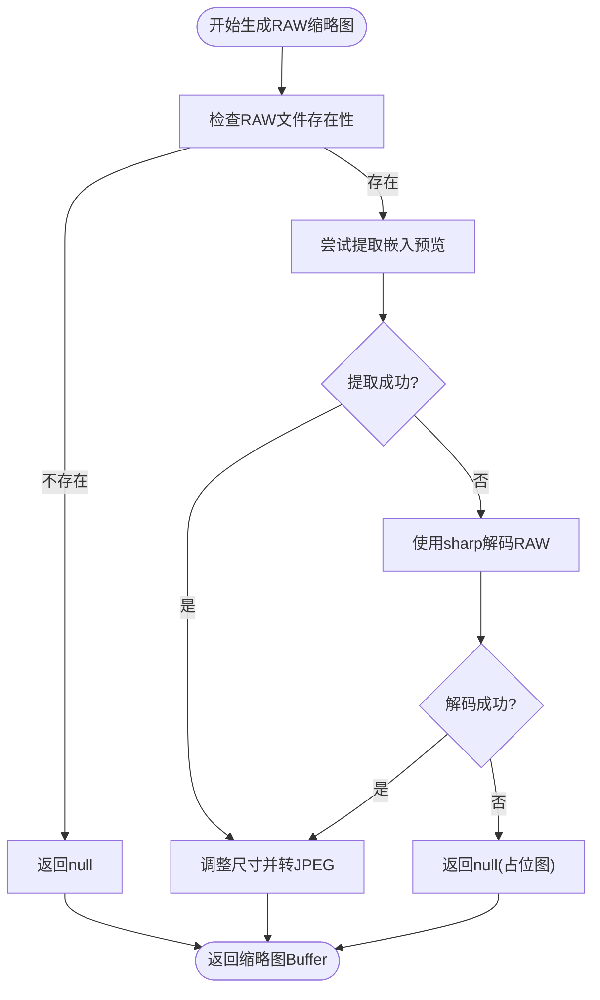
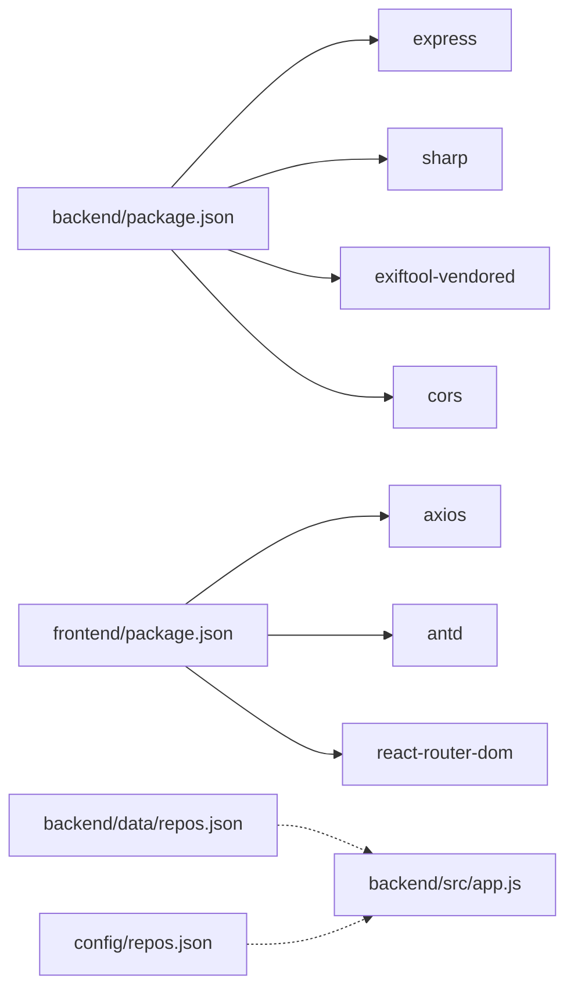

# 故障排除

<cite>
**本文引用的文件**
- [README.md](file://README.md)
- [backend/src/app.js](file://backend/src/app.js)
- [backend/src/routes/importRoutes.js](file://backend/src/routes/importRoutes.js)
- [backend/src/services/fileService.js](file://backend/src/services/fileService.js)
- [backend/src/utils/fileUtils.js](file://backend/src/utils/fileUtils.js)
- [backend/src/utils/rawThumbnail.js](file://backend/src/utils/rawThumbnail.js)
- [backend/data/repos.json](file://backend/data/repos.json)
- [config/repos.json](file://config/repos.json)
- [frontend/src/pages/ImportPage.jsx](file://frontend/src/pages/ImportPage.jsx)
- [frontend/src/api/index.js](file://frontend/src/api/index.js)
- [SSE_TROUBLESHOOTING.md](file://SSE_TROUBLESHOOTING.md)
- [IMPORT_PROGRESS_TEST.md](file://IMPORT_PROGRESS_TEST.md)
- [RAW_THUMBNAIL_FIX.md](file://RAW_THUMBNAIL_FIX.md)
- [backend/package.json](file://backend/package.json)
- [frontend/package.json](file://frontend/package.json)
- [backend/test-raw-preview.js](file://backend/test-raw-preview.js)
- [backend/test-thumbnail.js](file://backend/test-thumbnail.js)
</cite>

## 目录
1. [简介](#简介)
2. [项目结构](#项目结构)
3. [核心组件](#核心组件)
4. [架构总览](#架构总览)
5. [详细组件分析](#详细组件分析)
6. [依赖关系分析](#依赖关系分析)
7. [性能考量](#性能考量)
8. [故障排除指南](#故障排除指南)
9. [结论](#结论)
10. [附录](#附录)

## 简介
本指南面向技术支持与高级用户，系统化梳理摄影管理项目在导入功能、RAW 文件处理、实时进度监控与跨平台兼容方面的常见问题与排障流程。文档结合后端 Express 服务、前端 React 应用以及专用工具脚本，提供日志分析技巧、错误代码解读、调试工具使用方法，并给出性能识别与优化建议。

## 项目结构
项目采用前后端分离架构：
- 后端（Node.js + Express）：提供导入、照片浏览、RAW 缩略图等 API；负责文件扫描、复制、进度推送与仓库配置管理。
- 前端（React + Ant Design）：提供导入页面、相册浏览、仓库管理与进度展示。
- 配置与数据：仓库配置文件位于后端 data 目录与 config 目录，分别用于默认与示例配置。

图表来源
- [backend/src/app.js:1-146](file://backend/src/app.js#L1-L146)
- [backend/src/routes/importRoutes.js:1-627](file://backend/src/routes/importRoutes.js#L1-L627)
- [backend/src/services/fileService.js:1-443](file://backend/src/services/fileService.js#L1-L443)
- [backend/src/utils/fileUtils.js:1-167](file://backend/src/utils/fileUtils.js#L1-L167)
- [backend/src/utils/rawThumbnail.js:1-132](file://backend/src/utils/rawThumbnail.js#L1-L132)
- [frontend/src/api/index.js:1-168](file://frontend/src/api/index.js#L1-L168)
- [frontend/src/pages/ImportPage.jsx:1-820](file://frontend/src/pages/ImportPage.jsx#L1-L820)

章节来源
- [backend/src/app.js:1-146](file://backend/src/app.js#L1-L146)
- [frontend/src/pages/ImportPage.jsx:1-820](file://frontend/src/pages/ImportPage.jsx#L1-L820)

## 核心组件
- 后端应用与中间件：统一 CORS、日志中间件、健康检查、全局异常与未处理 Promise 拒绝捕获。
- 导入路由：支持 GET SSE 实时进度、仓库管理、文件夹选择（跨平台）、默认导入路径获取。
- 文件服务：扫描目录、分类创建、并发复制、进度回调、统计结果。
- 工具集：文件类型判断、目录扫描、复制/删除、重命名策略、同文件判定。
- RAW 缩略图：三段降级策略（嵌入预览 → exiftool-vendored API → sharp 解码 → 占位图）。
- 前端 API：EventSource 实时进度、超时控制、错误处理与回调绑定。
- 前端导入页：UI 步骤、进度统计、结果汇总、仓库管理与文件夹选择。

章节来源
- [backend/src/app.js:1-146](file://backend/src/app.js#L1-L146)
- [backend/src/routes/importRoutes.js:1-627](file://backend/src/routes/importRoutes.js#L1-L627)
- [backend/src/services/fileService.js:1-443](file://backend/src/services/fileService.js#L1-L443)
- [backend/src/utils/fileUtils.js:1-167](file://backend/src/utils/fileUtils.js#L1-L167)
- [backend/src/utils/rawThumbnail.js:1-132](file://backend/src/utils/rawThumbnail.js#L1-L132)
- [frontend/src/api/index.js:1-168](file://frontend/src/api/index.js#L1-L168)
- [frontend/src/pages/ImportPage.jsx:1-820](file://frontend/src/pages/ImportPage.jsx#L1-L820)

## 架构总览
导入流程采用 SSE 推送进度，前端通过 EventSource 接收实时消息，后端在导入期间持续发送 progress 事件，结束后发送 complete 或 error 事件。文件复制采用并发控制，避免内存与磁盘压力过大。

图表来源
- [frontend/src/pages/ImportPage.jsx:212-260](file://frontend/src/pages/ImportPage.jsx#L212-L260)
- [frontend/src/api/index.js:39-141](file://frontend/src/api/index.js#L39-L141)
- [backend/src/routes/importRoutes.js:82-182](file://backend/src/routes/importRoutes.js#L82-L182)
- [backend/src/services/fileService.js:23-167](file://backend/src/services/fileService.js#L23-L167)

## 详细组件分析

### 导入路由与SSE实现
- GET /api/import：建立 SSE，发送初始进度，调用 FileService.importFromCard，实时推送 progress，结束后发送 complete 或 error。
- 跨平台文件夹选择：macOS 使用 osascript，Windows 使用 PowerShell，Linux 使用 zenity；均带超时与用户取消处理。
- 默认导入路径：根据平台返回默认挂载点或用户目录。

图表来源
- [backend/src/routes/importRoutes.js:82-182](file://backend/src/routes/importRoutes.js#L82-L182)
- [backend/src/services/fileService.js:23-167](file://backend/src/services/fileService.js#L23-L167)

章节来源
- [backend/src/routes/importRoutes.js:1-627](file://backend/src/routes/importRoutes.js#L1-L627)
- [backend/src/services/fileService.js:1-443](file://backend/src/services/fileService.js#L1-L443)

### 文件服务与并发控制
- 分类目录初始化：确保 jpg/raw/video 三个子目录存在。
- 并发复制：最多3个任务并行，避免内存与IO压力；每个任务完成后更新进度。
- 增量导入：若目标文件存在且内容相同则跳过，不同则不覆盖。
- 重命名策略：当启用 autoRename 时，将相对路径中的分隔符转换为下划线，避免同名冲突。

章节来源
- [backend/src/services/fileService.js:1-443](file://backend/src/services/fileService.js#L1-L443)
- [backend/src/utils/fileUtils.js:1-167](file://backend/src/utils/fileUtils.js#L1-L167)

### RAW 缩略图生成（三段降级）
- 降级策略：
  1) 尝试从 RAW 中提取嵌入预览（JpgFromRaw/PreviewImage/ThumbnailImage）；
  2) 若失败，使用 sharp 直接解码 RAW；
  3) 若仍失败，返回 null，由调用方生成占位图。
- 依赖与修复：使用 exiftool-vendored 的 Node.js API，避免命令行与路径错误。

图表来源
- [backend/src/utils/rawThumbnail.js:78-132](file://backend/src/utils/rawThumbnail.js#L78-L132)

章节来源
- [backend/src/utils/rawThumbnail.js:1-132](file://backend/src/utils/rawThumbnail.js#L1-L132)
- [RAW_THUMBNAIL_FIX.md:1-100](file://RAW_THUMBNAIL_FIX.md#L1-L100)

### 前端导入页面与进度展示
- 步骤化 UI：选择路径 → 导入中 → 完成。
- 实时进度：总文件数、已处理、剩余、预计剩余时间、当前文件名、进度条百分比。
- 结果汇总：各类文件数量、跳过/错误统计、详情列表。
- 仓库管理：增删改默认仓库、路径选择。

章节来源
- [frontend/src/pages/ImportPage.jsx:1-820](file://frontend/src/pages/ImportPage.jsx#L1-L820)

### 前端API与SSE客户端
- EventSource：构建完整URL，监听 open/message/error，区分 progress/complete/error。
- 超时控制：5分钟超时，避免长时间占用连接。
- 进度回调：将 progress 事件透传给导入页，驱动UI更新。

章节来源
- [frontend/src/api/index.js:1-168](file://frontend/src/api/index.js#L1-L168)

## 依赖关系分析
- 后端依赖：Express、CORS、dotenv、sharp、exiftool-vendored、multer、dialog 等。
- 前端依赖：React、Ant Design、Axios、react-router-dom 等。
- 配置文件：后端 data/repos.json 与 config/repos.json 提供仓库配置示例。

图表来源
- [backend/package.json:1-30](file://backend/package.json#L1-L30)
- [frontend/package.json:1-33](file://frontend/package.json#L1-L33)
- [backend/data/repos.json:1-8](file://backend/data/repos.json#L1-L8)
- [config/repos.json:1-20](file://config/repos.json#L1-L20)

章节来源
- [backend/package.json:1-30](file://backend/package.json#L1-L30)
- [frontend/package.json:1-33](file://frontend/package.json#L1-L33)
- [backend/data/repos.json:1-8](file://backend/data/repos.json#L1-L8)
- [config/repos.json:1-20](file://config/repos.json#L1-L20)

## 性能考量
- 并发控制：导入复制最大并发为3，避免磁盘与内存压力过大。
- 进度计算：基于平均处理速度估算剩余时间，首个文件后才具备参考值。
- SSE 优势：相比轮询显著降低服务器负载，提升实时性。
- RAW 处理：优先提取嵌入预览，其次使用 sharp 解码，最后占位图，兼顾速度与兼容性。
- 超时保护：前端5分钟超时，防止长时间占用连接。

章节来源
- [backend/src/services/fileService.js:75-167](file://backend/src/services/fileService.js#L75-L167)
- [frontend/src/api/index.js:113-121](file://frontend/src/api/index.js#L113-L121)
- [backend/src/utils/rawThumbnail.js:78-132](file://backend/src/utils/rawThumbnail.js#L78-L132)

## 故障排除指南

### 通用排障流程
- 确认后端服务已启动并监听端口，查看控制台日志。
- 打开浏览器开发者工具，检查 Network 标签中 SSE 请求状态与响应。
- 在导入页查看进度与错误提示，结合后端日志定位问题。
- 如遇超时，检查文件数量与大小、磁盘写入性能与网络状况。

章节来源
- [SSE_TROUBLESHOOTING.md:60-260](file://SSE_TROUBLESHOOTING.md#L60-L260)
- [IMPORT_PROGRESS_TEST.md:24-138](file://IMPORT_PROGRESS_TEST.md#L24-L138)

### 导入功能异常
- 症状：点击“开始导入”无响应或立即报错。
- 可能原因：
  - 未选择存储卡路径或仓库。
  - 源路径不存在或不可访问。
  - 目标仓库路径无写权限。
  - 后端未正确接收请求（CORS/路由问题）。
- 解决步骤：
  - 在导入页确认已选择仓库与路径，必要时使用“选择文件夹”按钮。
  - 在后端日志中确认“开始导入，源路径: ...”与“目标仓库: ...”日志。
  - 使用 curl 测试 SSE 接口，验证返回格式与状态。
  - 检查目标路径权限，确保可写。

章节来源
- [frontend/src/pages/ImportPage.jsx:212-260](file://frontend/src/pages/ImportPage.jsx#L212-L260)
- [backend/src/routes/importRoutes.js:82-182](file://backend/src/routes/importRoutes.js#L82-L182)
- [SSE_TROUBLESHOOTING.md:104-147](file://SSE_TROUBLESHOOTING.md#L104-L147)

### 实时进度监控问题（SSE）
- 症状：连接建立后无进度消息、连接中断、或浏览器报 CORS 错误。
- 可能原因：
  - CORS 配置不当。
  - 错误响应未使用 SSE 格式。
  - EventSource URL 使用相对路径。
  - 前端 onerror 误判正常关闭。
- 解决步骤：
  - 确认后端 CORS 配置支持 SSE。
  - 确保错误与完成消息均使用 data: 格式。
  - 使用完整 URL（window.location.origin + /api/import）。
  - 在前端对 readyState 与已接收消息进行状态检查。

章节来源
- [SSE_TROUBLESHOOTING.md:1-260](file://SSE_TROUBLESHOOTING.md#L1-L260)
- [backend/src/app.js:14-18](file://backend/src/app.js#L14-L18)
- [backend/src/routes/importRoutes.js:89-114](file://backend/src/routes/importRoutes.js#L89-L114)
- [frontend/src/api/index.js:42-111](file://frontend/src/api/index.js#L42-L111)

### RAW 文件处理失败
- 症状：RAW 缩略图显示占位图，或导入后 RAW 文件无法预览。
- 可能原因：
  - exiftool-vendored 调用方式错误（命令行 vs Node.js API）。
  - 未正确使用 extractBinaryTagToBuffer。
  - RAW 文件无嵌入预览或损坏。
- 解决步骤：
  - 使用测试脚本独立验证 RAW 预览提取与缩略图生成。
  - 检查后端日志中的异常堆栈与文件大小信息。
  - 若无嵌入预览，确认 sharp 解码路径可用。

章节来源
- [RAW_THUMBNAIL_FIX.md:1-100](file://RAW_THUMBNAIL_FIX.md#L1-L100)
- [backend/src/utils/rawThumbnail.js:78-132](file://backend/src/utils/rawThumbnail.js#L78-L132)
- [backend/test-raw-preview.js:1-69](file://backend/test-raw-preview.js#L1-L69)
- [backend/test-thumbnail.js:1-32](file://backend/test-thumbnail.js#L1-L32)

### 跨平台兼容性问题
- macOS：使用 osascript 打开文件夹选择，注意用户取消与超时处理。
- Windows：使用 PowerShell 脚本，注意 UTF8 BOM、临时文件清理与权限。
- Linux：使用 zenity，需确保已安装。
- 解决步骤：
  - 在各平台分别测试文件夹选择与导入路径。
  - 检查后端日志中的平台分支与错误码。
  - 对于 Windows，确认 PowerShell 执行策略与安全策略允许脚本运行。

章节来源
- [backend/src/routes/importRoutes.js:343-624](file://backend/src/routes/importRoutes.js#L343-L624)

### 日志分析技巧与错误解读
- 后端日志：
  - “开始导入，源路径: ...”、“目标仓库: ...”、“发送进度: X%”、“导入完成，结果: ...”。
  - 未看到上述日志，通常表示请求未到达后端或路径参数缺失。
- 前端日志：
  - “开始 SSE 连接: ...”、“SSE 连接已建立”、“收到 SSE 消息: progress/complete”。
  - onerror 中 readyState 与 hasError/completeData 状态检查可避免误判。
- 错误代码与含义：
  - CORS 错误：检查后端 CORS 配置。
  - “连接中断”：网络不稳定或后端异常。
  - “导入超时（5分钟）”：文件过多或磁盘写入慢。
  - “用户取消选择”：平台选择对话框被取消或超时。

章节来源
- [SSE_TROUBLESHOOTING.md:62-119](file://SSE_TROUBLESHOOTING.md#L62-L119)
- [frontend/src/api/index.js:87-111](file://frontend/src/api/index.js#L87-L111)

### 调试工具使用方法
- curl 测试 SSE：
  - curl -N "http://localhost:3001/api/import?sourcePath=...&repoId=..."
- Node 独立测试：
  - 使用 test-raw-preview.js 与 test-thumbnail.js 验证 RAW 预览与缩略图生成。
- 前端调试：
  - 在 ImportPage.jsx 与 index.js 中添加 console.log，观察参数与进度回调。

章节来源
- [SSE_TROUBLESHOOTING.md:104-119](file://SSE_TROUBLESHOOTING.md#L104-L119)
- [backend/test-raw-preview.js:1-69](file://backend/test-raw-preview.js#L1-L69)
- [backend/test-thumbnail.js:1-32](file://backend/test-thumbnail.js#L1-L32)

### 性能问题识别与优化
- 识别：
  - 导入缓慢：检查磁盘写入速度、文件数量与大小、并发是否受限。
  - CPU 占用高：关注 sharp 与 exiftool-vendored 的使用，避免频繁解码。
  - 内存泄漏：检查前端 EventSource 生命周期与回调清理，确保超时与错误时正确 close。
- 优化：
  - 适当降低并发（当前为3），或分批导入。
  - 对大文件启用 autoRename，减少跳过与重试。
  - 使用占位图与懒加载，减少首屏渲染压力。

章节来源
- [backend/src/services/fileService.js:75-167](file://backend/src/services/fileService.js#L75-L167)
- [frontend/src/api/index.js:113-141](file://frontend/src/api/index.js#L113-L141)

### 客户支持最佳实践
- 引导用户提供：
  - 后端完整日志（含“开始导入/发送进度/导入完成”片段）。
  - 前端控制台输出（SSE 连接与消息）。
  - Network 标签中的请求详情与响应。
  - 操作系统与浏览器版本。
- 快速验证清单：
  - 是否选择了有效仓库与路径。
  - 是否使用了完整 URL 进行 SSE 连接。
  - 是否存在足够磁盘空间与写权限。
  - 是否遇到超时或网络中断。

章节来源
- [SSE_TROUBLESHOOTING.md:253-260](file://SSE_TROUBLESHOOTING.md#L253-L260)

## 结论
通过明确的排障流程、日志分析技巧与工具链配合，大多数导入与 RAW 处理问题可在短时间内定位与修复。建议在生产环境中持续监控 SSE 连接稳定性、磁盘写入性能与 RAW 处理耗时，并根据用户反馈迭代优化并发策略与 UI 体验。

## 附录

### 常见问题与解决方案速查
- CORS 错误：检查后端 CORS 配置，确保支持 SSE。
- 连接立即关闭：检查源路径、目标路径权限与后端异常日志。
- 进度不更新：确认前端 EventSource 正常接收 progress 消息。
- 超时：减少单次导入文件数量或检查磁盘性能。
- RAW 缩略图失败：验证嵌入预览提取与 sharp 解码路径。

章节来源
- [SSE_TROUBLESHOOTING.md:148-200](file://SSE_TROUBLESHOOTING.md#L148-L200)
- [RAW_THUMBNAIL_FIX.md:74-100](file://RAW_THUMBNAIL_FIX.md#L74-L100)