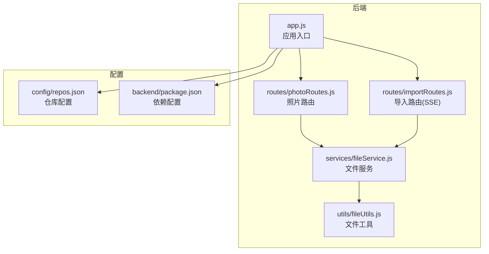
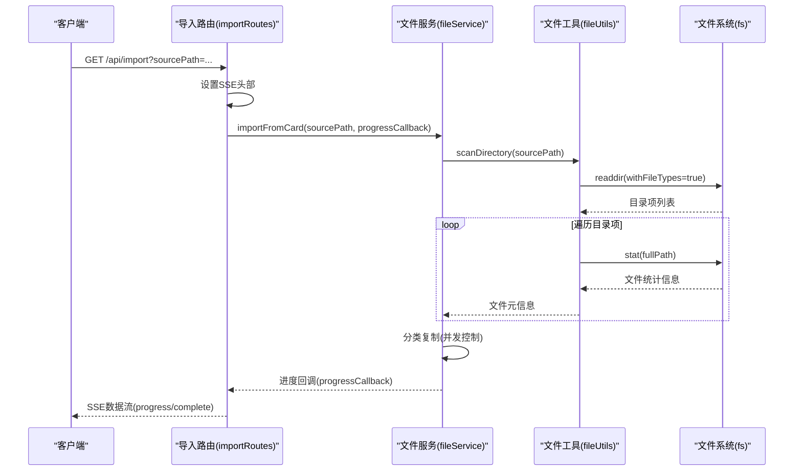
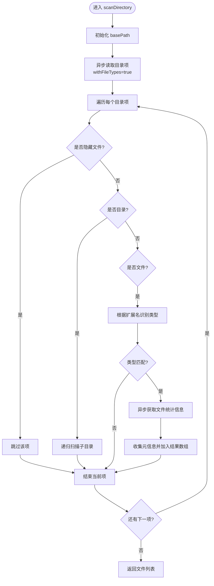
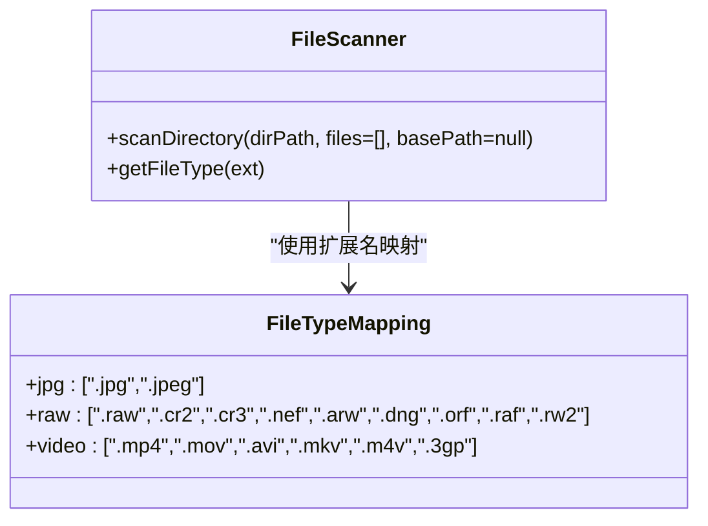
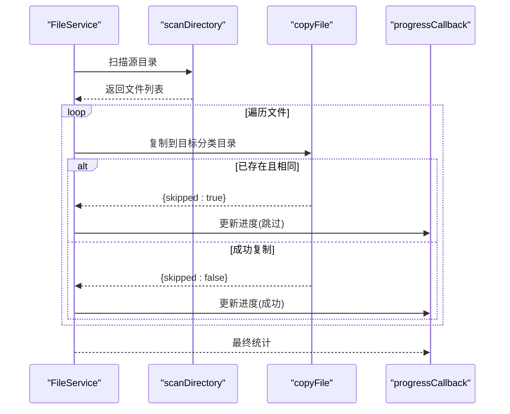
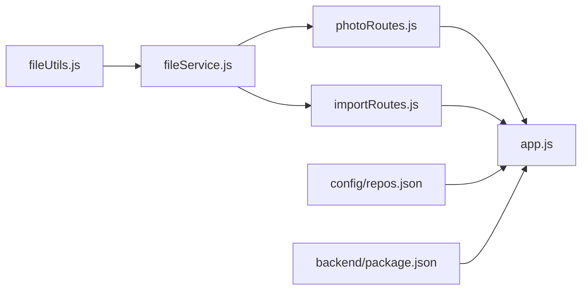

# 文件扫描与枚举

<cite>
**本文引用的文件**
- [fileUtils.js](file://backend/src/utils/fileUtils.js)
- [fileService.js](file://backend/src/services/fileService.js)
- [photoRoutes.js](file://backend/src/routes/photoRoutes.js)
- [importRoutes.js](file://backend/src/routes/importRoutes.js)
- [app.js](file://backend/src/app.js)
- [repos.json](file://config/repos.json)
- [package.json](file://backend/package.json)
- [README.md](file://README.md)
- [IMPORT_PROGRESS_TEST.md](file://IMPORT_PROGRESS_TEST.md)
- [test-thumbnail.js](file://backend/test-thumbnail.js)
</cite>

## 目录
1. [简介](#简介)
2. [项目结构](#项目结构)
3. [核心组件](#核心组件)
4. [架构概览](#架构概览)
5. [详细组件分析](#详细组件分析)
6. [依赖关系分析](#依赖关系分析)
7. [性能考量](#性能考量)
8. [故障排除指南](#故障排除指南)
9. [结论](#结论)
10. [附录](#附录)

## 简介
本文件针对摄影管理项目的“文件扫描与枚举”功能进行深入技术文档编写，重点解释：
- 递归目录扫描算法的实现原理，包括异步文件系统操作、目录遍历策略与性能优化技巧
- 文件类型识别机制，涵盖 JPG/JPEG、RAW、视频等格式的扩展名匹配规则
- 相对路径计算、文件统计信息收集与隐藏文件过滤逻辑
- 扫描过程中的错误处理策略、异常情况处理与调试方法
- 实际代码示例展示如何使用 scanDirectory 函数进行高效文件枚举

本项目采用 Node.js + Express 构建后端服务，前端通过 SSE 接收导入进度，后端通过工具模块提供统一的文件扫描与处理能力。

**章节来源**
- [README.md:1-3](file://README.md#L1-L3)

## 项目结构
后端主要由以下模块组成：
- 工具层：fileUtils.js 提供文件扫描、类型识别、文件复制、删除、重命名等通用能力
- 业务层：fileService.js 提供照片导入、分类、查询、删除、统计等业务逻辑
- 路由层：photoRoutes.js 与 importRoutes.js 提供 REST API 与 SSE 接口
- 应用入口：app.js 配置 CORS、静态文件服务、全局错误处理与监听端口
- 配置：config/repos.json 定义存储仓库；backend/package.json 管理依赖

**图表来源**
- [app.js:1-146](file://backend/src/app.js#L1-L146)
- [photoRoutes.js:1-739](file://backend/src/routes/photoRoutes.js#L1-L739)
- [importRoutes.js:1-627](file://backend/src/routes/importRoutes.js#L1-L627)
- [fileService.js:1-443](file://backend/src/services/fileService.js#L1-L443)
- [fileUtils.js:1-167](file://backend/src/utils/fileUtils.js#L1-L167)
- [repos.json:1-20](file://config/repos.json#L1-L20)
- [package.json:1-30](file://backend/package.json#L1-L30)

**章节来源**
- [app.js:1-146](file://backend/src/app.js#L1-L146)
- [photoRoutes.js:1-739](file://backend/src/routes/photoRoutes.js#L1-L739)
- [importRoutes.js:1-627](file://backend/src/routes/importRoutes.js#L1-L627)
- [fileService.js:1-443](file://backend/src/services/fileService.js#L1-L443)
- [fileUtils.js:1-167](file://backend/src/utils/fileUtils.js#L1-L167)
- [repos.json:1-20](file://config/repos.json#L1-L20)
- [package.json:1-30](file://backend/package.json#L1-L30)

## 核心组件
- 文件扫描与类型识别：fileUtils.js 提供 scanDirectory 递归扫描与 getFileType 扩展名匹配
- 文件服务：fileService.js 负责导入流程、分类复制、进度回调、统计与查询
- 路由接口：photoRoutes.js 提供照片列表、缩略图、预览、删除等接口；importRoutes.js 提供导入进度推送（SSE）
- 应用入口：app.js 配置静态文件服务、CORS、健康检查与全局错误处理

关键职责划分：
- scanDirectory：异步遍历目录树，过滤隐藏文件，识别类型，收集元信息
- getFileType：基于扩展名映射判断文件类型
- importFromCard：扫描源目录，按类型分类复制到目标仓库，支持并发与进度回调
- getPhotos：按分类读取文件并排序分页返回
- SSE 导入：通过 text/event-stream 实时推送进度

**章节来源**
- [fileUtils.js:22-66](file://backend/src/utils/fileUtils.js#L22-L66)
- [fileUtils.js:11-20](file://backend/src/utils/fileUtils.js#L11-L20)
- [fileService.js:24-167](file://backend/src/services/fileService.js#L24-L167)
- [photoRoutes.js:68-92](file://backend/src/routes/photoRoutes.js#L68-L92)
- [importRoutes.js:82-182](file://backend/src/routes/importRoutes.js#L82-L182)
- [app.js:67-91](file://backend/src/app.js#L67-L91)

## 架构概览
后端采用分层架构：路由层负责请求接入与协议适配（SSE），服务层封装业务逻辑，工具层提供通用能力。文件扫描贯穿导入与查询两大场景，保证一致的类型识别与元信息收集。

**图表来源**
- [importRoutes.js:82-182](file://backend/src/routes/importRoutes.js#L82-L182)
- [fileService.js:24-167](file://backend/src/services/fileService.js#L24-L167)
- [fileUtils.js:22-66](file://backend/src/utils/fileUtils.js#L22-L66)

## 详细组件分析

### 递归目录扫描算法（scanDirectory）
- 异步遍历：使用 withFileTypes 选项直接获取目录项类型，避免额外 stat 调用
- 隐藏文件过滤：跳过以特定前缀开头的隐藏文件（macOS 资源派生文件）
- 类型识别：通过扩展名映射判断 JPG/JPEG、RAW、视频类型
- 元信息收集：收集文件名、绝对路径、相对路径、类型、扩展名、大小、修改时间
- 错误处理：捕获异常并记录，保证扫描过程不中断

**图表来源**
- [fileUtils.js:22-66](file://backend/src/utils/fileUtils.js#L22-L66)

**章节来源**
- [fileUtils.js:22-66](file://backend/src/utils/fileUtils.js#L22-L66)

### 文件类型识别机制
- 扩展名映射：JPG/JPEG、RAW（含多种厂商格式）、视频（MP4/MOV/AVI/MKV/M4V/3GP）
- 匹配策略：统一转为小写后进行精确匹配，返回类型字符串
- 用途：在扫描阶段快速筛选媒体文件，避免后续不必要的处理

**图表来源**
- [fileUtils.js:4-20](file://backend/src/utils/fileUtils.js#L4-L20)
- [fileUtils.js:22-66](file://backend/src/utils/fileUtils.js#L22-L66)

**章节来源**
- [fileUtils.js:4-20](file://backend/src/utils/fileUtils.js#L4-L20)

### 相对路径计算与隐藏文件过滤
- 相对路径：以首次调用时的 basePath 为基准，使用 path.relative 计算
- 隐藏文件：过滤以特定前缀开头的隐藏文件，避免资源派生文件干扰
- 作用：保证路径一致性与扫描结果纯净

**章节来源**
- [fileUtils.js:26-28](file://backend/src/utils/fileUtils.js#L26-L28)
- [fileUtils.js:33-36](file://backend/src/utils/fileUtils.js#L33-L36)
- [fileUtils.js:52](file://backend/src/utils/fileUtils.js#L52)

### 文件统计信息收集
- 字段：文件名、绝对路径、相对路径、类型、扩展名、大小、修改时间
- 来源：fs.stat 异步获取，包含文件大小与最后修改时间
- 用途：导入时用于去重比较，查询时用于排序与分页

**章节来源**
- [fileUtils.js:47-57](file://backend/src/utils/fileUtils.js#L47-L57)

### 导入流程中的并发控制与进度回调
- 并发控制：限制同时处理的任务数，避免内存占用过高
- 进度回调：每处理一个文件更新进度，计算剩余时间与百分比
- 结果聚合：统计成功、跳过、错误数量，区分类型

**图表来源**
- [fileService.js:24-167](file://backend/src/services/fileService.js#L24-L167)
- [fileUtils.js:77-100](file://backend/src/utils/fileUtils.js#L77-L100)

**章节来源**
- [fileService.js:24-167](file://backend/src/services/fileService.js#L24-L167)

### 查询与统计接口
- getPhotos：按分类读取文件，支持分页、排序（名称/大小/时间）
- getStorageInfo：统计各分类文件数量与总大小
- findOrphanRawFiles：查找无对应 JPG 的 RAW 文件

**章节来源**
- [fileService.js:169-224](file://backend/src/services/fileService.js#L169-L224)
- [fileService.js:336-363](file://backend/src/services/fileService.js#L336-L363)
- [fileService.js:269-306](file://backend/src/services/fileService.js#L269-L306)

### SSE 导入进度推送
- 使用 text/event-stream 协议推送进度与最终结果
- 前端通过 EventSource 接收，实时更新 UI
- 超时保护：前端设置较长超时时间，适应大文件导入

**章节来源**
- [importRoutes.js:82-182](file://backend/src/routes/importRoutes.js#L82-L182)
- [IMPORT_PROGRESS_TEST.md:1-138](file://IMPORT_PROGRESS_TEST.md#L1-L138)

## 依赖关系分析
- fileService 依赖 fileUtils 的扫描、复制、删除、重命名等能力
- photoRoutes 与 importRoutes 依赖 FileService 提供的业务能力
- app.js 作为入口，挂载路由并提供静态文件服务与错误处理
- 配置文件 repos.json 与 package.json 提供仓库配置与依赖声明

**图表来源**
- [fileUtils.js:155-167](file://backend/src/utils/fileUtils.js#L155-L167)
- [fileService.js:1-8](file://backend/src/services/fileService.js#L1-L8)
- [photoRoutes.js:1-6](file://backend/src/routes/photoRoutes.js#L1-L6)
- [importRoutes.js:1-9](file://backend/src/routes/importRoutes.js#L1-L9)
- [app.js:1-11](file://backend/src/app.js#L1-L11)
- [repos.json:1-20](file://config/repos.json#L1-L20)
- [package.json:1-30](file://backend/package.json#L1-L30)

**章节来源**
- [fileUtils.js:155-167](file://backend/src/utils/fileUtils.js#L155-L167)
- [fileService.js:1-8](file://backend/src/services/fileService.js#L1-L8)
- [photoRoutes.js:1-6](file://backend/src/routes/photoRoutes.js#L1-L6)
- [importRoutes.js:1-9](file://backend/src/routes/importRoutes.js#L1-L9)
- [app.js:1-11](file://backend/src/app.js#L1-L11)
- [repos.json:1-20](file://config/repos.json#L1-L20)
- [package.json:1-30](file://backend/package.json#L1-L30)

## 性能考量
- 异步 I/O：使用 fs.promises 与 withFileTypes，避免阻塞事件循环
- 并发控制：导入阶段限制并发任务数，防止内存峰值过高
- 流式传输：预览与缩略图生成采用流式读取与缓冲，降低内存占用
- 预估时间：基于平均处理速度估算剩余时间，提升用户体验
- 路径缓存：相对路径计算仅在需要时进行，避免重复计算

**章节来源**
- [fileUtils.js:30](file://backend/src/utils/fileUtils.js#L30)
- [fileService.js:75-156](file://backend/src/services/fileService.js#L75-L156)
- [photoRoutes.js:226-280](file://backend/src/routes/photoRoutes.js#L226-L280)
- [photoRoutes.js:428-458](file://backend/src/routes/photoRoutes.js#L428-L458)

## 故障排除指南
- 扫描失败：检查目录权限与路径有效性，查看控制台错误日志
- 导入超时：确认前端超时设置与网络稳定性，必要时延长超时时间
- 进度不更新：检查浏览器 EventSource 支持与网络连接，确认后端 SSE 头部设置
- 文件不存在：确认路径解码与仓库配置，检查静态文件服务路径
- RAW 缩略图生成失败：检查外部依赖与权限，回退到占位图策略

**章节来源**
- [fileUtils.js:61-63](file://backend/src/utils/fileUtils.js#L61-L63)
- [importRoutes.js:177-181](file://backend/src/routes/importRoutes.js#L177-L181)
- [photoRoutes.js:281-290](file://backend/src/routes/photoRoutes.js#L281-L290)
- [photoRoutes.js:377-391](file://backend/src/routes/photoRoutes.js#L377-L391)

## 结论
本项目通过统一的文件扫描与类型识别机制，结合异步 I/O 与并发控制，在导入与查询场景中实现了高效稳定的文件枚举。SSE 进度推送进一步提升了用户体验。建议在生产环境中持续监控日志与性能指标，针对大文件与高并发场景进行容量规划与优化。

## 附录

### 如何使用 scanDirectory 进行高效文件枚举
- 基本用法：调用 scanDirectory(sourcePath) 返回包含元信息的文件数组
- 典型流程：先扫描源目录，再按类型分类复制到目标仓库，最后统计与查询
- 注意事项：确保目录存在与权限正确，合理设置并发与超时

**章节来源**
- [fileUtils.js:22-66](file://backend/src/utils/fileUtils.js#L22-L66)
- [fileService.js:24-167](file://backend/src/services/fileService.js#L24-L167)

### 示例：导入进度测试
- 后端启动后，前端通过 SSE 接收进度消息，验证总文件数、已处理、剩余、预计时间与百分比
- 大文件导入场景需关注超时设置与网络稳定性

**章节来源**
- [IMPORT_PROGRESS_TEST.md:1-138](file://IMPORT_PROGRESS_TEST.md#L1-L138)

### RAW 缩略图生成测试
- 使用测试脚本验证 RAW 缩略图生成流程，失败时回退到占位图策略

**章节来源**
- [test-thumbnail.js:1-32](file://backend/test-thumbnail.js#L1-L32)