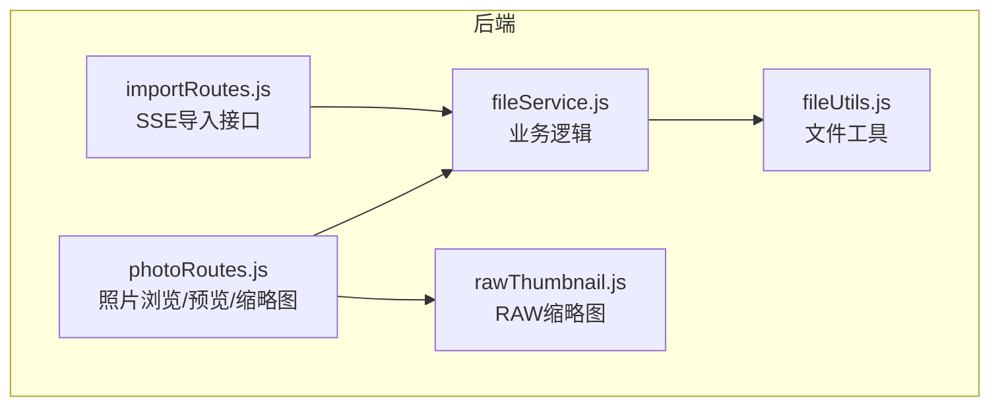
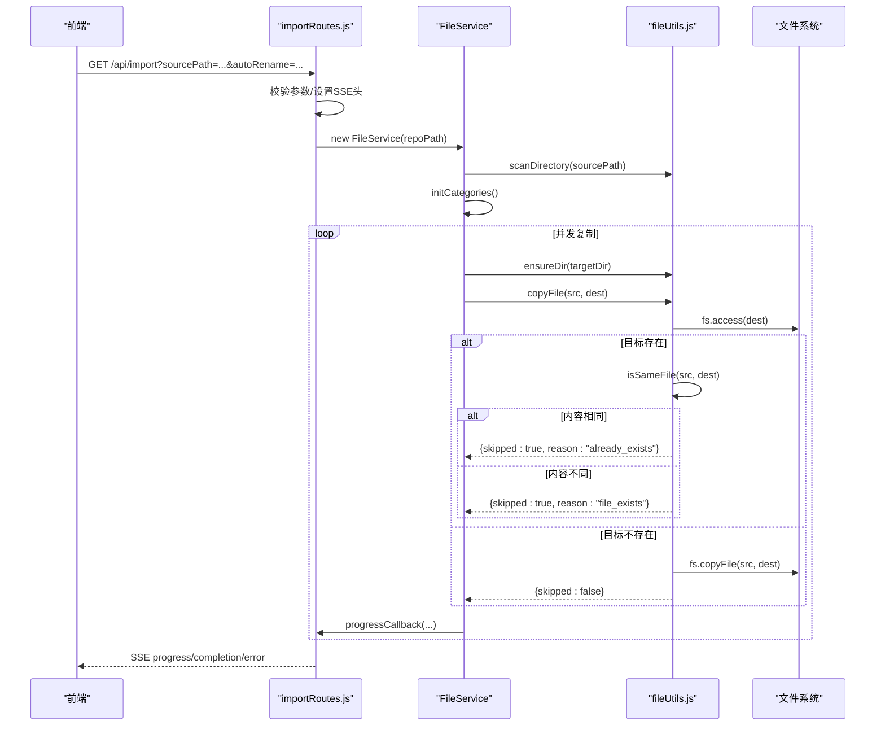
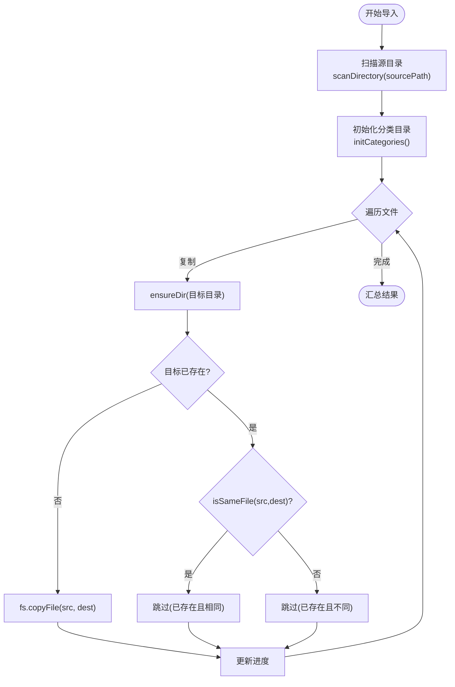
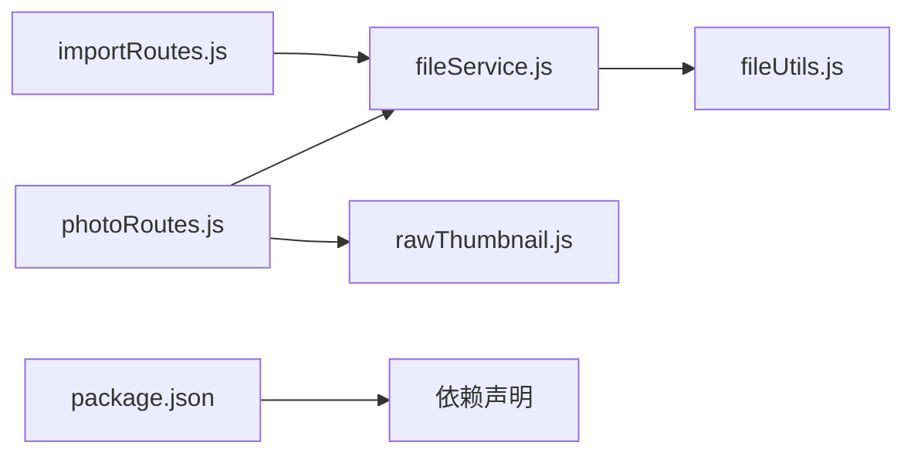

# 文件操作

<cite>
**本文引用的文件**
- [fileService.js](file://backend/src/services/fileService.js)
- [fileUtils.js](file://backend/src/utils/fileUtils.js)
- [importRoutes.js](file://backend/src/routes/importRoutes.js)
- [photoRoutes.js](file://backend/src/routes/photoRoutes.js)
- [rawThumbnail.js](file://backend/src/utils/rawThumbnail.js)
- [package.json](file://backend/package.json)
- [README.md](file://README.md)
</cite>

## 目录
1. [简介](#简介)
2. [项目结构](#项目结构)
3. [核心组件](#核心组件)
4. [架构总览](#架构总览)
5. [详细组件分析](#详细组件分析)
6. [依赖关系分析](#依赖关系分析)
7. [性能考量](#性能考量)
8. [故障排查指南](#故障排查指南)
9. [结论](#结论)
10. [附录](#附录)

## 简介
本文件聚焦于摄影管理项目的“文件操作”能力，围绕以下主题展开：
- 文件复制、删除、存在性检查与文件比较的实现机制
- 增量导入的复制策略：文件存在性检查、同名文件比较、覆盖决策逻辑
- 目录创建 ensureDir 机制、路径规范化处理与权限管理
- 错误处理策略、并发安全考虑与性能优化技巧
- 实际使用场景与异常处理建议

## 项目结构
后端采用“服务层 + 工具层 + 路由层”的分层设计：
- 路由层负责接收请求、解析参数、组装SSE响应
- 服务层封装业务逻辑（如导入、删除、查询）
- 工具层提供通用文件操作与RAW缩略图生成

图表来源
- [importRoutes.js:82-182](file://backend/src/routes/importRoutes.js#L82-L182)
- [photoRoutes.js:68-291](file://backend/src/routes/photoRoutes.js#L68-L291)
- [fileService.js:5-443](file://backend/src/services/fileService.js#L5-L443)
- [fileUtils.js:1-167](file://backend/src/utils/fileUtils.js#L1-L167)
- [rawThumbnail.js:1-132](file://backend/src/utils/rawThumbnail.js#L1-L132)

章节来源
- [importRoutes.js:1-627](file://backend/src/routes/importRoutes.js#L1-L627)
- [photoRoutes.js:1-739](file://backend/src/routes/photoRoutes.js#L1-L739)
- [fileService.js:1-443](file://backend/src/services/fileService.js#L1-L443)
- [fileUtils.js:1-167](file://backend/src/utils/fileUtils.js#L1-L167)
- [rawThumbnail.js:1-132](file://backend/src/utils/rawThumbnail.js#L1-L132)

## 核心组件
- FileService：提供导入、删除、查询、统计等核心文件操作能力
- fileUtils：提供扫描目录、复制、删除、存在性检查、比较、重命名等通用文件工具
- importRoutes：SSE导入接口，支持进度推送与超时保护
- photoRoutes：照片浏览、预览、缩略图生成、批量导出等
- rawThumbnail：RAW文件嵌入预览提取与降级策略

章节来源
- [fileService.js:5-443](file://backend/src/services/fileService.js#L5-L443)
- [fileUtils.js:1-167](file://backend/src/utils/fileUtils.js#L1-L167)
- [importRoutes.js:82-182](file://backend/src/routes/importRoutes.js#L82-L182)
- [photoRoutes.js:68-291](file://backend/src/routes/photoRoutes.js#L68-L291)
- [rawThumbnail.js:78-129](file://backend/src/utils/rawThumbnail.js#L78-L129)

## 架构总览
下图展示了“SSE导入”到“文件复制”的端到端流程，以及与工具层的交互。

图表来源
- [importRoutes.js:82-182](file://backend/src/routes/importRoutes.js#L82-L182)
- [fileService.js:23-167](file://backend/src/services/fileService.js#L23-L167)
- [fileUtils.js:77-100](file://backend/src/utils/fileUtils.js#L77-L100)

## 详细组件分析

### 文件复制与增量导入策略
- 增量导入：仅当目标文件不存在时复制；若目标存在则进行“同名文件比较”，根据比较结果决定跳过或报错
- 并发控制：限制同时处理的任务数，避免内存占用过高
- 进度上报：通过SSE向前端推送实时进度

图表来源
- [fileService.js:23-167](file://backend/src/services/fileService.js#L23-L167)
- [fileUtils.js:77-100](file://backend/src/utils/fileUtils.js#L77-L100)
- [fileUtils.js:139-153](file://backend/src/utils/fileUtils.js#L139-L153)

章节来源
- [fileService.js:23-167](file://backend/src/services/fileService.js#L23-L167)
- [fileUtils.js:77-100](file://backend/src/utils/fileUtils.js#L77-L100)
- [fileUtils.js:139-153](file://backend/src/utils/fileUtils.js#L139-L153)

### 目录创建 ensureDir 机制
- 若目标目录不存在，则递归创建
- 与复制流程结合：在复制前先确保目标目录存在

章节来源
- [fileUtils.js:68-75](file://backend/src/utils/fileUtils.js#L68-L75)
- [fileUtils.js:77-79](file://backend/src/utils/fileUtils.js#L77-L79)

### 路径规范化与重命名
- 路径规范化：使用 path.join 与 path.relative，避免跨平台路径问题
- 重命名策略：将相对路径中的分隔符替换为安全字符，避免非法文件名

章节来源
- [fileService.js:94-96](file://backend/src/services/fileService.js#L94-L96)
- [fileUtils.js:128-137](file://backend/src/utils/fileUtils.js#L128-L137)

### 文件存在性检查与文件比较
- 存在性检查：fs.access 包裹在 try/catch 中，统一返回布尔值
- 文件比较：基于文件大小与修改时间一致性判断

章节来源
- [fileUtils.js:118-126](file://backend/src/utils/fileUtils.js#L118-L126)
- [fileUtils.js:139-153](file://backend/src/utils/fileUtils.js#L139-L153)

### 删除操作与同步删除
- 删除单个文件：先校验存在性，再执行删除
- 同步删除：对JPG文件，按约定扩展名查找并删除对应RAW文件

章节来源
- [fileService.js:226-267](file://backend/src/services/fileService.js#L226-L267)
- [fileService.js:248-261](file://backend/src/services/fileService.js#L248-L261)

### 批量导出与增量模式
- 批量导出：逐个检查源文件存在性与目标文件存在性，采用“已存在则跳过”的增量策略

章节来源
- [photoRoutes.js:642-736](file://backend/src/routes/photoRoutes.js#L642-L736)

### RAW缩略图生成策略
- 三级降级：优先提取嵌入预览 -> 使用sharp解码 -> 占位图
- 对于不支持的格式，回退到SVG占位图

章节来源
- [rawThumbnail.js:78-129](file://backend/src/utils/rawThumbnail.js#L78-L129)
- [photoRoutes.js:395-466](file://backend/src/routes/photoRoutes.js#L395-L466)

## 依赖关系分析
- FileService 依赖 fileUtils 的扫描、复制、删除、存在性检查、比较、重命名等方法
- importRoutes 与 photoRoutes 分别注入 FileService 与 rawThumbnail
- 依赖声明集中在 package.json

图表来源
- [fileService.js:1-3](file://backend/src/services/fileService.js#L1-L3)
- [importRoutes.js:1-8](file://backend/src/routes/importRoutes.js#L1-L8)
- [photoRoutes.js:1-5](file://backend/src/routes/photoRoutes.js#L1-L5)
- [rawThumbnail.js:1-4](file://backend/src/utils/rawThumbnail.js#L1-L4)
- [package.json:10-18](file://backend/package.json#L10-L18)

章节来源
- [fileService.js:1-3](file://backend/src/services/fileService.js#L1-L3)
- [importRoutes.js:1-8](file://backend/src/routes/importRoutes.js#L1-L8)
- [photoRoutes.js:1-5](file://backend/src/routes/photoRoutes.js#L1-L5)
- [rawThumbnail.js:1-4](file://backend/src/utils/rawThumbnail.js#L1-L4)
- [package.json:10-18](file://backend/package.json#L10-L18)

## 性能考量
- 并发控制：导入时限制同时处理的任务数，避免内存峰值过高
- 流式传输：预览与缩略图生成采用流式读取，避免一次性加载大文件
- 增量策略：仅复制新文件，跳过已存在文件，减少IO与网络压力
- 超时保护：SSE连接具备超时保护，适合大文件导入场景

章节来源
- [fileService.js:75-88](file://backend/src/services/fileService.js#L75-L88)
- [photoRoutes.js:226-280](file://backend/src/routes/photoRoutes.js#L226-L280)
- [README.md:16-17](file://README.md#L16-L17)

## 故障排查指南
- 导入进度不更新
  - 检查SSE连接与前端EventSource
  - 确认后端SSE消息发送正常
- RAW缩略图不显示
  - 确认RAW文件包含嵌入预览
  - 检查exiftool依赖安装与可用性
- CORS错误
  - 确认后端CORS配置
- 超时问题
  - 大量文件导入可能触发超时，建议分批导入或调整前端超时设置

章节来源
- [README.md:166-187](file://README.md#L166-L187)

## 结论
本项目通过清晰的分层设计与稳健的文件工具函数，实现了可靠的增量导入、安全的删除与存在性检查、高效的路径规范化与重命名策略，并在SSE与流式传输的支持下，提供了良好的用户体验。遵循本文档的错误处理与性能优化建议，可在复杂场景中保持系统的稳定性与可维护性。

## 附录
- 使用场景与最佳实践
  - 增量导入：启用 autoRename 时，建议保留原始目录层级，便于后续定位
  - 同步删除：开启 syncRaw 时，确保JPG与RAW命名一致，避免误删
  - 批量导出：目标路径应预先存在，或允许自动创建
  - 权限管理：确保后端进程对源与目标目录具有读写权限
  - 并发安全：导入与删除操作建议串行化关键路径，避免竞态条件