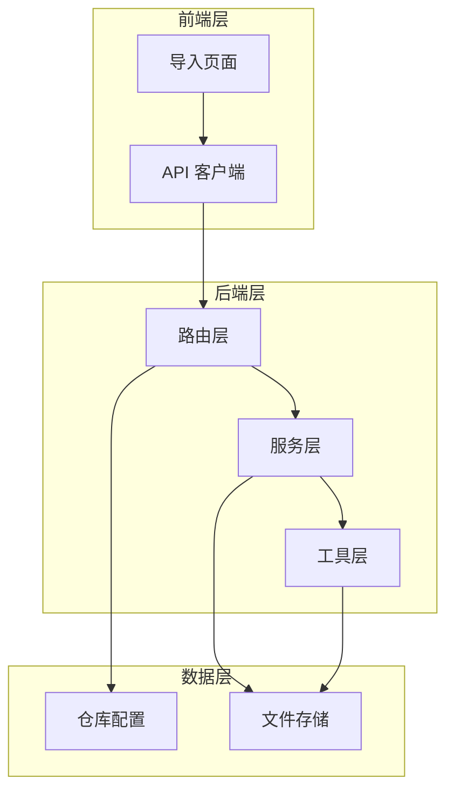
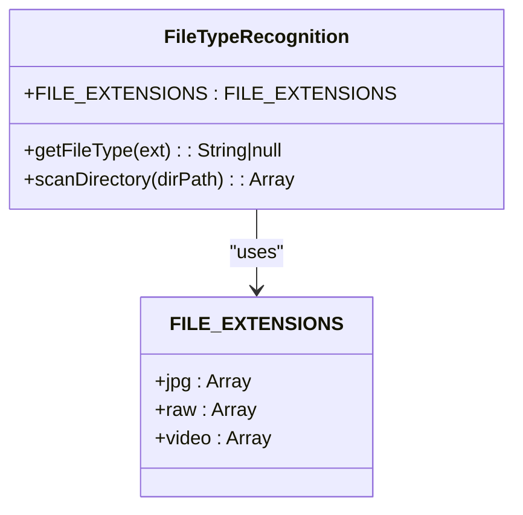
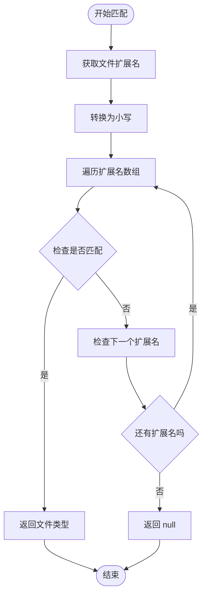
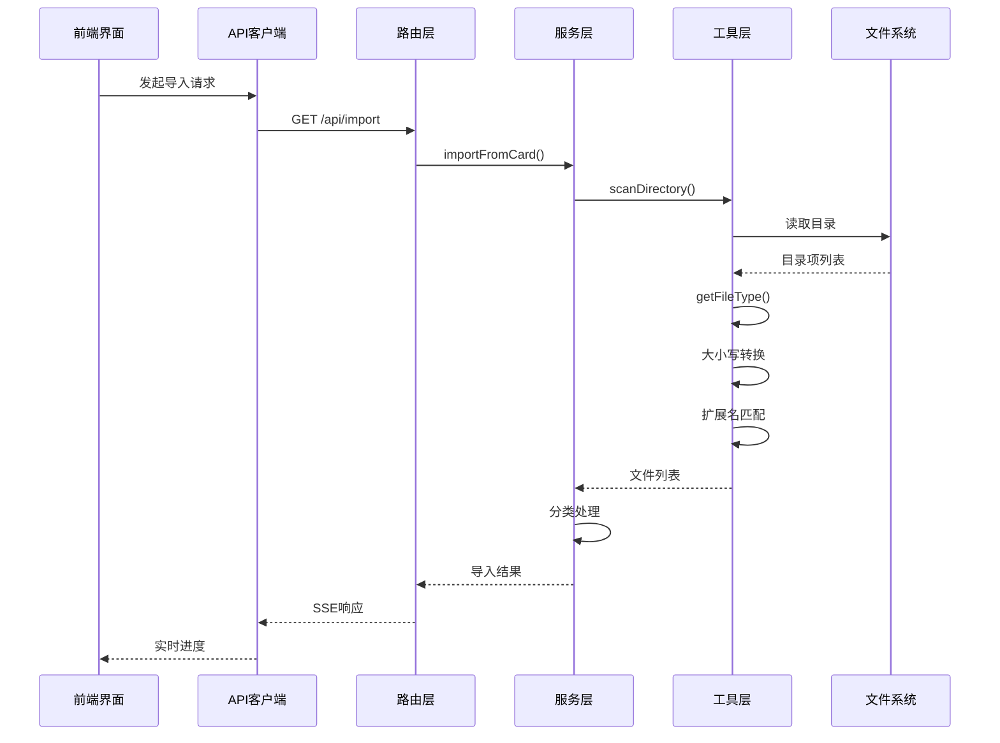

# 文件类型识别

<cite>
**本文档引用的文件**
- [fileUtils.js](file://backend/src/utils/fileUtils.js)
- [fileService.js](file://backend/src/services/fileService.js)
- [importRoutes.js](file://backend/src/routes/importRoutes.js)
- [ImportPage.jsx](file://frontend/src/pages/ImportPage.jsx)
- [index.js](file://frontend/src/api/index.js)
- [repos.json](file://backend/data/repos.json)
- [package.json](file://backend/package.json)
</cite>

## 目录
1. [简介](#简介)
2. [项目结构](#项目结构)
3. [核心组件](#核心组件)
4. [架构概览](#架构概览)
5. [详细组件分析](#详细组件分析)
6. [依赖关系分析](#依赖关系分析)
7. [性能考虑](#性能考虑)
8. [故障排除指南](#故障排除指南)
9. [结论](#结论)
10. [附录](#附录)

## 简介

摄影管理项目的文件类型识别系统是一个关键的基础设施组件，负责准确识别和分类各种摄影相关的文件格式。该系统支持多种图像格式（JPG/JPEG、RAW格式）和视频格式，为后续的导入、管理和展示流程提供基础支撑。

系统的核心功能包括：
- 支持的文件格式识别（JPG/JPEG、RAW格式、视频格式）
- 扩展名匹配算法（大小写不敏感）
- 类型分类逻辑
- 新格式添加机制
- 向后兼容性保证

## 项目结构

该项目采用前后端分离的架构设计，文件类型识别系统主要位于后端的工具模块中：

**图表来源**
- [fileUtils.js:1-167](file://backend/src/utils/fileUtils.js#L1-L167)
- [fileService.js:1-443](file://backend/src/services/fileService.js#L1-L443)
- [importRoutes.js:1-627](file://backend/src/routes/importRoutes.js#L1-L627)

**章节来源**
- [fileUtils.js:1-167](file://backend/src/utils/fileUtils.js#L1-L167)
- [fileService.js:1-443](file://backend/src/services/fileService.js#L1-L443)
- [importRoutes.js:1-627](file://backend/src/routes/importRoutes.js#L1-L627)

## 核心组件

### 文件扩展名定义

系统使用集中式的扩展名定义来管理支持的文件格式：

**图表来源**
- [fileUtils.js:4-20](file://backend/src/utils/fileUtils.js#L4-L20)

系统支持的文件格式包括：
- **JPG/JPEG格式**: `.jpg`, `.jpeg`
- **RAW格式**: `.raw`, `.cr2`, `.cr3`, `.nef`, `.arw`, `.dng`, `.orf`, `.raf`, `.rw2`
- **视频格式**: `.mp4`, `.mov`, `.avi`, `.mkv`, `.m4v`, `.3gp`

**章节来源**
- [fileUtils.js:4-9](file://backend/src/utils/fileUtils.js#L4-L9)

### 扩展名匹配算法

扩展名匹配算法实现了大小写不敏感的文件类型识别：

**图表来源**
- [fileUtils.js:12-20](file://backend/src/utils/fileUtils.js#L12-L20)

**章节来源**
- [fileUtils.js:12-20](file://backend/src/utils/fileUtils.js#L12-L20)

## 架构概览

文件类型识别系统在整个应用架构中的位置和交互关系：

**图表来源**
- [importRoutes.js:82-182](file://backend/src/routes/importRoutes.js#L82-L182)
- [fileService.js:23-167](file://backend/src/services/fileService.js#L23-L167)
- [fileUtils.js:22-66](file://backend/src/utils/fileUtils.js#L22-L66)

## 详细组件分析

### 工具层组件

#### 文件类型识别器

文件类型识别器是系统的核心组件，负责将文件扩展名映射到相应的文件类型：

**章节来源**
- [fileUtils.js:12-20](file://backend/src/utils/fileUtils.js#L12-L20)

#### 目录扫描器

目录扫描器实现了递归扫描功能，能够遍历整个目录树并识别支持的文件类型：

**章节来源**
- [fileUtils.js:22-66](file://backend/src/utils/fileUtils.js#L22-L66)

### 服务层组件

#### 文件服务

文件服务整合了文件类型识别功能，提供了完整的导入流程管理：

**章节来源**
- [fileService.js:23-167](file://backend/src/services/fileService.js#L23-L167)

#### 孤立RAW文件检测

系统还提供了专门的功能来检测没有对应JPG文件的RAW文件：

**章节来源**
- [fileService.js:374-416](file://backend/src/services/fileService.js#L374-L416)

### 路由层组件

#### 导入路由

导入路由处理了完整的导入流程，包括SSE实时进度反馈：

**章节来源**
- [importRoutes.js:82-182](file://backend/src/routes/importRoutes.js#L82-L182)

### 前端集成

#### 导入页面

前端导入页面通过EventSource实现了与后端的实时通信：

**章节来源**
- [ImportPage.jsx:212-260](file://frontend/src/pages/ImportPage.jsx#L212-L260)

## 依赖关系分析

文件类型识别系统的主要依赖关系：

**图表来源**
- [fileUtils.js:1-3](file://backend/src/utils/fileUtils.js#L1-L3)
- [fileService.js:1-3](file://backend/src/services/fileService.js#L1-L3)
- [importRoutes.js:1-8](file://backend/src/routes/importRoutes.js#L1-L8)
- [index.js:1-6](file://frontend/src/api/index.js#L1-L6)

**章节来源**
- [package.json:10-18](file://backend/package.json#L10-L18)

## 性能考虑

### 扫描性能优化

系统采用了多项性能优化策略：

1. **并发控制**: 导入过程中限制同时处理的文件数量，避免内存溢出
2. **增量导入**: 已存在的文件不会被覆盖，减少不必要的IO操作
3. **异步处理**: 全面使用Promise和async/await模式
4. **缓存机制**: 文件类型识别结果在内存中缓存

### 内存管理

- 使用流式处理避免大文件加载到内存
- 及时清理Promise队列中的已完成任务
- 合理的错误处理避免内存泄漏

## 故障排除指南

### 常见问题及解决方案

#### 文件类型识别失败

**症状**: 某些文件没有被正确识别
**原因**: 扩展名不在支持列表中
**解决方案**: 检查扩展名是否正确，必要时更新支持列表

#### 大小写问题

**症状**: 大写的扩展名文件未被识别
**原因**: 扩展名大小写不匹配
**解决方案**: 系统已自动转换为小写，无需额外处理

#### 导入性能问题

**症状**: 大量文件导入时内存占用过高
**解决方案**: 系统已限制并发数量，可等待处理完成

**章节来源**
- [fileUtils.js:12-20](file://backend/src/utils/fileUtils.js#L12-L20)
- [fileService.js:75-88](file://backend/src/services/fileService.js#L75-L88)

## 结论

摄影管理项目的文件类型识别系统设计合理，具有以下特点：

1. **模块化设计**: 清晰的职责分离，便于维护和扩展
2. **大小写不敏感**: 自动处理扩展名大小写问题
3. **类型分类明确**: 支持JPG、RAW、视频三种主要类型
4. **性能优化**: 并发控制和增量导入机制
5. **前后端集成**: 完整的导入流程和实时进度反馈

系统为后续的功能扩展奠定了良好的基础，特别是对于新格式的添加和现有功能的改进。

## 附录

### 支持的文件格式列表

| 类型 | 支持的扩展名 | 示例 |
|------|-------------|------|
| JPG/JPEG | `.jpg`, `.jpeg` | `photo.jpg`, `image.jpeg` |
| RAW | `.raw`, `.cr2`, `.cr3`, `.nef`, `.arw`, `.dng`, `.orf`, `.raf`, `.rw2` | `IMG_001.CR2`, `DSCN001.NEF` |
| 视频 | `.mp4`, `.mov`, `.avi`, `.mkv`, `.m4v`, `.3gp` | `video.mp4`, `movie.mov` |

### 新格式添加指南

添加新格式的步骤：

1. **更新扩展名定义**: 在`FILE_EXTENSIONS`对象中添加新的扩展名
2. **测试验证**: 确认新格式能够被正确识别
3. **功能测试**: 验证导入和分类功能正常工作
4. **向后兼容**: 确保不影响现有功能

### 扩展名更新流程

### 实际应用场景

1. **导入流程**: 存储卡照片导入时的格式识别
2. **分类管理**: 按类型组织和管理照片文件
3. **批量操作**: 支持批量删除和导出功能
4. **孤岛检测**: 识别没有对应JPG的RAW文件