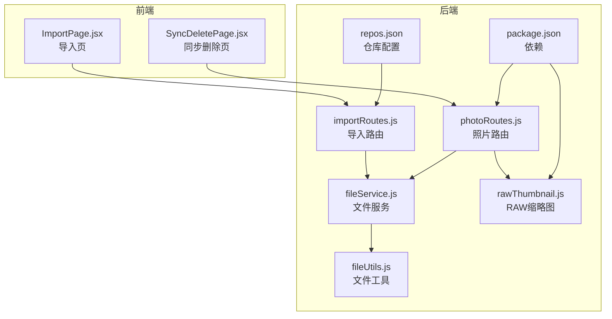
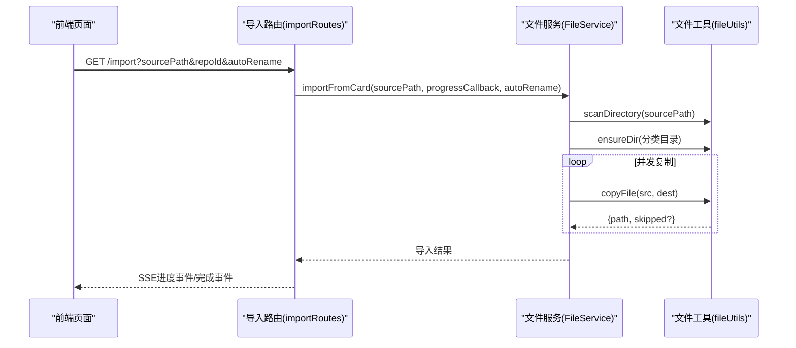
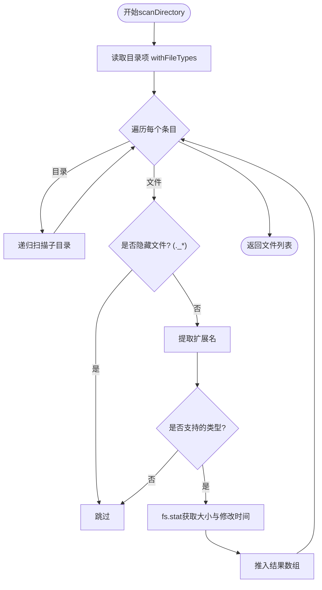
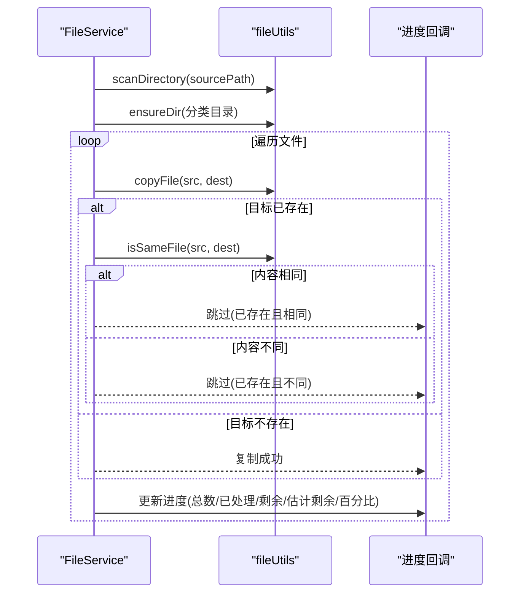
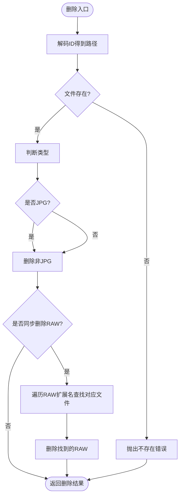
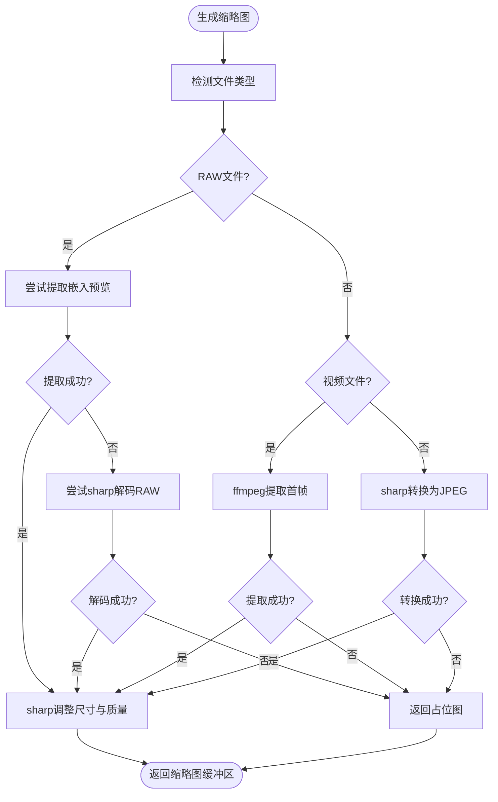
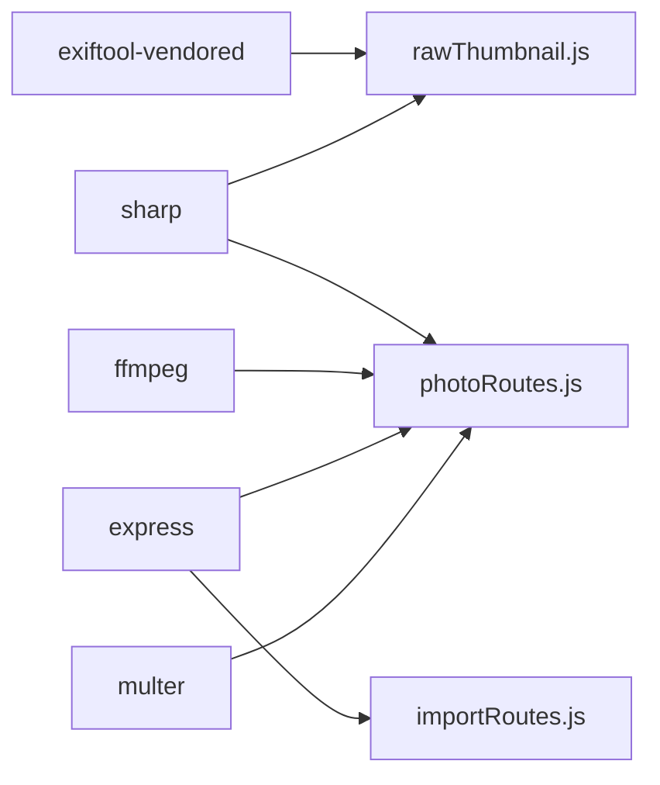

# 文件系统操作

<cite>
**本文引用的文件**
- [fileService.js](file://backend/src/services/fileService.js)
- [fileUtils.js](file://backend/src/utils/fileUtils.js)
- [rawThumbnail.js](file://backend/src/utils/rawThumbnail.js)
- [photoRoutes.js](file://backend/src/routes/photoRoutes.js)
- [importRoutes.js](file://backend/src/routes/importRoutes.js)
- [package.json](file://backend/package.json)
- [repos.json](file://backend/data/repos.json)
- [test-thumbnail.js](file://backend/test-thumbnail.js)
- [test-raw-preview.js](file://backend/test-raw-preview.js)
- [RAW_THUMBNAIL_FIX.md](file://backend/RAW_THUMBNAIL_FIX.md)
- [ImportPage.jsx](file://frontend/src/pages/ImportPage.jsx)
- [SyncDeletePage.jsx](file://frontend/src/pages/SyncDeletePage.jsx)
</cite>

## 目录
1. [简介](#简介)
2. [项目结构](#项目结构)
3. [核心组件](#核心组件)
4. [架构总览](#架构总览)
5. [详细组件分析](#详细组件分析)
6. [依赖关系分析](#依赖关系分析)
7. [性能考量](#性能考量)
8. [故障排查指南](#故障排查指南)
9. [结论](#结论)
10. [附录](#附录)

## 简介
本文件系统操作文档聚焦于摄影管理项目中的文件系统能力，涵盖文件扫描与枚举、复制与移动（导入）、删除与同步删除、文件类型识别与RAW处理、缩略图生成策略、跨平台差异处理、路径规范化与权限管理、性能优化与并发策略、错误恢复机制、文件系统监控与增量同步、冲突解决以及最佳实践与安全考虑。文档基于后端Node.js服务与前端React界面的实际实现，提供代码级映射与可视化说明，帮助开发者快速理解与扩展系统。

## 项目结构
后端采用模块化组织：
- 服务层：负责业务逻辑（文件导入、照片列表、删除、统计等）
- 工具层：通用文件系统工具（扫描、复制、删除、重命名、类型判断等）
- 路由层：HTTP接口（导入、照片浏览、缩略图、视频预览、仓库管理等）
- 配置与测试：仓库配置、RAW缩略图修复说明、独立测试脚本

图表来源
- [fileService.js:1-443](file://backend/src/services/fileService.js#L1-L443)
- [fileUtils.js:1-167](file://backend/src/utils/fileUtils.js#L1-L167)
- [rawThumbnail.js:1-132](file://backend/src/utils/rawThumbnail.js#L1-L132)
- [photoRoutes.js:1-739](file://backend/src/routes/photoRoutes.js#L1-L739)
- [importRoutes.js:1-627](file://backend/src/routes/importRoutes.js#L1-L627)
- [package.json:1-30](file://backend/package.json#L1-L30)
- [repos.json:1-8](file://backend/data/repos.json#L1-L8)

章节来源
- [fileService.js:1-443](file://backend/src/services/fileService.js#L1-L443)
- [fileUtils.js:1-167](file://backend/src/utils/fileUtils.js#L1-L167)
- [rawThumbnail.js:1-132](file://backend/src/utils/rawThumbnail.js#L1-L132)
- [photoRoutes.js:1-739](file://backend/src/routes/photoRoutes.js#L1-L739)
- [importRoutes.js:1-627](file://backend/src/routes/importRoutes.js#L1-L627)
- [package.json:1-30](file://backend/package.json#L1-L30)
- [repos.json:1-8](file://backend/data/repos.json#L1-L8)

## 核心组件
- 文件服务（FileService）：封装导入、枚举、删除、统计、孤儿RAW检测等核心能力；支持并发控制与进度回调。
- 文件工具（fileUtils）：提供扫描目录、复制文件（增量不覆盖）、删除文件、类型识别、路径规范化、重命名等基础能力。
- RAW缩略图（rawThumbnail）：三阶段降级策略（嵌入预览→解码→占位图），结合exiftool-vendored与sharp。
- 路由（photoRoutes/importRoutes）：提供SSE导入进度、照片列表、缩略图、视频预览、批量导出、仓库管理等接口。
- 前端页面：导入页（SSE进度展示、仓库选择、自动重命名）、同步删除页（孤儿RAW检测与批量删除）。

章节来源
- [fileService.js:5-443](file://backend/src/services/fileService.js#L5-L443)
- [fileUtils.js:11-167](file://backend/src/utils/fileUtils.js#L11-L167)
- [rawThumbnail.js:7-132](file://backend/src/utils/rawThumbnail.js#L7-L132)
- [photoRoutes.js:68-739](file://backend/src/routes/photoRoutes.js#L68-L739)
- [importRoutes.js:82-627](file://backend/src/routes/importRoutes.js#L82-L627)
- [ImportPage.jsx:1-820](file://frontend/src/pages/ImportPage.jsx#L1-L820)
- [SyncDeletePage.jsx:1-384](file://frontend/src/pages/SyncDeletePage.jsx#L1-L384)

## 架构总览
系统通过Express路由接收请求，调用FileService执行业务逻辑；FileService依赖fileUtils进行文件系统操作；照片缩略图生成通过rawThumbnail对RAW文件进行三阶段降级策略，并在photoRoutes中统一对外提供缩略图与视频预览接口。

图表来源
- [importRoutes.js:82-182](file://backend/src/routes/importRoutes.js#L82-L182)
- [fileService.js:24-167](file://backend/src/services/fileService.js#L24-L167)
- [fileUtils.js:23-100](file://backend/src/utils/fileUtils.js#L23-L100)

章节来源
- [importRoutes.js:82-182](file://backend/src/routes/importRoutes.js#L82-L182)
- [fileService.js:24-167](file://backend/src/services/fileService.js#L24-L167)
- [fileUtils.js:23-100](file://backend/src/utils/fileUtils.js#L23-L100)

## 详细组件分析

### 文件扫描与枚举
- 递归扫描：遍历目录树，过滤隐藏文件（macOS资源派生文件前缀），仅收集支持的扩展名。
- 类型识别：基于扩展名映射表判断类型（jpg/raw/video）。
- 结果结构：包含文件名、绝对路径、相对路径、类型、扩展名、大小、修改时间等字段。
- 异常处理：捕获目录读取异常并记录日志，保证扫描过程健壮性。

图表来源
- [fileUtils.js:23-66](file://backend/src/utils/fileUtils.js#L23-L66)

章节来源
- [fileUtils.js:23-66](file://backend/src/utils/fileUtils.js#L23-L66)

### 文件类型识别与扩展名映射
- 支持扩展名集合：jpg/jpeg、raw/cr2/cr3/nef/arw/dng/orf/raf/rw2、mp4/mov/avi/mkv/m4v/3gp等。
- 识别逻辑：将扩展名转小写后匹配映射表，返回类型字符串或null。
- 用途：用于扫描过滤、分类目录、缩略图生成分支选择。

章节来源
- [fileUtils.js:5-20](file://backend/src/utils/fileUtils.js#L5-L20)

### 复制与移动（导入）：增量导入与并发控制
- 增量导入策略：若目标文件已存在且内容相同则跳过；若目标存在但内容不同则不覆盖，返回跳过状态。
- 并发控制：限制同时处理的任务数量（CONCURRENCY_LIMIT），避免内存峰值与IO拥塞。
- 进度回调：实时计算平均耗时与剩余时间，向客户端推送SSE事件。
- 自动重命名：将相对路径中的分隔符替换为下划线，避免同名冲突。

图表来源
- [fileService.js:24-167](file://backend/src/services/fileService.js#L24-L167)
- [fileUtils.js:78-100](file://backend/src/utils/fileUtils.js#L78-L100)
- [fileUtils.js:140-153](file://backend/src/utils/fileUtils.js#L140-L153)

章节来源
- [fileService.js:24-167](file://backend/src/services/fileService.js#L24-L167)
- [fileUtils.js:78-100](file://backend/src/utils/fileUtils.js#L78-L100)
- [fileUtils.js:140-153](file://backend/src/utils/fileUtils.js#L140-L153)

### 删除与同步删除
- 单文件删除：校验文件存在性，删除主文件。
- 同步删除：当删除JPG时，同步查找并删除对应RAW文件（多种扩展名）。
- 批量删除：接收文件ID列表，逐个删除并汇总结果。
- 孤儿RAW检测：扫描RAW目录，对比JPG目录的文件名（去扩展名），找出没有对应JPG的RAW。

图表来源
- [fileService.js:227-267](file://backend/src/services/fileService.js#L227-L267)
- [fileService.js:309-334](file://backend/src/services/fileService.js#L309-L334)
- [fileService.js:269-306](file://backend/src/services/fileService.js#L269-L306)

章节来源
- [fileService.js:227-267](file://backend/src/services/fileService.js#L227-L267)
- [fileService.js:309-334](file://backend/src/services/fileService.js#L309-L334)
- [fileService.js:269-306](file://backend/src/services/fileService.js#L269-L306)

### 缩略图生成策略：RAW三阶段降级
- 嵌入预览提取：优先尝试JpgFromRaw/PreviewImage/ThumbnailImage标签，验证JPEG头部有效性，再用sharp调整尺寸与质量。
- 解码策略：若无嵌入预览，则使用sharp直接解码RAW生成缩略图。
- 占位图回退：若两种策略均失败，调用方生成SVG占位图。
- 视频缩略图：使用ffmpeg提取首帧，失败时返回SVG占位图。
- 其他格式：使用sharp统一转换为JPEG，失败时返回SVG占位图。

图表来源
- [rawThumbnail.js:7-132](file://backend/src/utils/rawThumbnail.js#L7-L132)
- [photoRoutes.js:294-466](file://backend/src/routes/photoRoutes.js#L294-L466)

章节来源
- [rawThumbnail.js:7-132](file://backend/src/utils/rawThumbnail.js#L7-L132)
- [photoRoutes.js:294-466](file://backend/src/routes/photoRoutes.js#L294-L466)

### 跨平台文件系统操作与路径规范化
- 默认路径：根据平台自动选择用户图片目录（Windows/macOS/Linux）。
- 文件夹选择：通过后端接口调用系统原生对话框（osascript/PowerShell/zenity），返回用户选择的路径。
- 路径规范化：使用path模块进行拼接与相对路径计算，避免平台差异导致的路径问题。
- 权限与可见性：忽略macOS隐藏文件（._*），避免资源派生文件干扰扫描。

章节来源
- [photoRoutes.js:47-66](file://backend/src/routes/photoRoutes.js#L47-L66)
- [importRoutes.js:342-624](file://backend/src/routes/importRoutes.js#L342-L624)
- [fileUtils.js:33-36](file://backend/src/utils/fileUtils.js#L33-L36)

### 文件系统监控、增量同步与冲突解决
- 增量导入：通过“已存在且内容相同则跳过”、“已存在但内容不同则不覆盖”的策略，避免覆盖与重复导入。
- 冲突解决：当目标文件存在但内容不同时，返回跳过状态并记录原因，不进行覆盖。
- 监控与通知：导入过程通过SSE向前端推送实时进度，便于用户感知与中断。
- 孤儿检测：定期扫描RAW目录，对比JPG目录，识别无对应JPG的RAW文件，支持批量清理。

章节来源
- [fileService.js:24-167](file://backend/src/services/fileService.js#L24-L167)
- [fileService.js:269-306](file://backend/src/services/fileService.js#L269-L306)
- [importRoutes.js:82-182](file://backend/src/routes/importRoutes.js#L82-L182)

### API与路由设计
- 导入接口：GET /import，SSE流推送进度；支持repoId与autoRename参数。
- 照片接口：GET /photos，分页、排序、仓库选择；提供缩略图与预览URL。
- 缩略图接口：GET /photos/thumbnail，支持RAW三阶段降级与视频首帧提取。
- 批量导出：POST /photos/batch-export，增量模式复制到目标路径。
- 仓库管理：GET/POST/DELETE/PUT /import/repos，支持默认仓库设置与路径校验。

章节来源
- [importRoutes.js:82-216](file://backend/src/routes/importRoutes.js#L82-L216)
- [photoRoutes.js:68-176](file://backend/src/routes/photoRoutes.js#L68-L176)
- [photoRoutes.js:294-466](file://backend/src/routes/photoRoutes.js#L294-L466)
- [photoRoutes.js:642-736](file://backend/src/routes/photoRoutes.js#L642-L736)

## 依赖关系分析
- 依赖组件：
  - exiftool-vendored：用于RAW嵌入预览提取，避免命令行开销与跨平台差异。
  - sharp：用于图像解码、缩放与编码，支持多格式RAW与常见图片格式。
  - express：提供REST接口与SSE支持。
  - multer：用于文件上传场景（在当前功能中主要用于照片浏览与缩略图生成）。
- 外部工具：
  - ffmpeg：视频首帧提取（缩略图）。
  - 系统对话框：osascript（macOS）、PowerShell（Windows）、zenity（Linux）。

图表来源
- [package.json:10-18](file://backend/package.json#L10-L18)
- [rawThumbnail.js:1-5](file://backend/src/utils/rawThumbnail.js#L1-L5)
- [photoRoutes.js:323-337](file://backend/src/routes/photoRoutes.js#L323-L337)

章节来源
- [package.json:10-18](file://backend/package.json#L10-L18)
- [rawThumbnail.js:1-5](file://backend/src/utils/rawThumbnail.js#L1-L5)
- [photoRoutes.js:323-337](file://backend/src/routes/photoRoutes.js#L323-L337)

## 性能考量
- 并发控制：导入时限制同时处理的任务数量，避免内存峰值与磁盘IO拥塞。
- 流式传输：预览与缩略图生成使用流式读取与管道输出，避免一次性加载大文件到内存。
- 缓存策略：缩略图与视频响应设置Cache-Control，减少重复请求。
- 降级策略：RAW缩略图三阶段降级，提升成功率与用户体验。
- 路径与类型判断：使用扩展名映射与stat缓存，减少重复IO。

章节来源
- [fileService.js:75-156](file://backend/src/services/fileService.js#L75-L156)
- [photoRoutes.js:226-280](file://backend/src/routes/photoRoutes.js#L226-L280)
- [photoRoutes.js:294-466](file://backend/src/routes/photoRoutes.js#L294-L466)

## 故障排查指南
- RAW缩略图失败：
  - 检查exiftool-vendored安装与版本，确认API调用正确（extractBinaryTagToBuffer）。
  - 使用测试脚本验证：参考测试脚本与修复说明。
- 视频缩略图失败：
  - 检查ffmpeg是否安装与可用，确认权限与路径。
- 导入进度异常：
  - 确认SSE连接正常，检查后端日志与progressCallback调用频率。
- 文件不存在或权限不足：
  - 校验路径存在性与访问权限，必要时提升权限或更换目录。

章节来源
- [RAW_THUMBNAIL_FIX.md:1-100](file://backend/RAW_THUMBNAIL_FIX.md#L1-L100)
- [test-thumbnail.js:1-32](file://backend/test-thumbnail.js#L1-L32)
- [test-raw-preview.js:1-69](file://backend/test-raw-preview.js#L1-L69)
- [importRoutes.js:141-176](file://backend/src/routes/importRoutes.js#L141-L176)
- [photoRoutes.js:323-392](file://backend/src/routes/photoRoutes.js#L323-L392)

## 结论
本系统围绕文件扫描、增量导入、删除与同步删除、RAW缩略图生成与视频预览构建了完整的文件系统能力。通过并发控制、流式传输、降级策略与SSE进度反馈，实现了高性能与良好的用户体验。建议在生产环境中持续关注依赖版本、外部工具可用性与权限配置，并结合仓库管理与孤儿文件检测机制，进一步完善文件生命周期管理。

## 附录
- 仓库配置：支持多仓库、默认仓库设置、路径校验与自动创建。
- 前端集成：导入页与同步删除页分别对接导入与RAW清理功能，提供直观的交互与结果反馈。

章节来源
- [repos.json:1-8](file://backend/data/repos.json#L1-L8)
- [importRoutes.js:218-340](file://backend/src/routes/importRoutes.js#L218-L340)
- [ImportPage.jsx:1-820](file://frontend/src/pages/ImportPage.jsx#L1-L820)
- [SyncDeletePage.jsx:1-384](file://frontend/src/pages/SyncDeletePage.jsx#L1-L384)