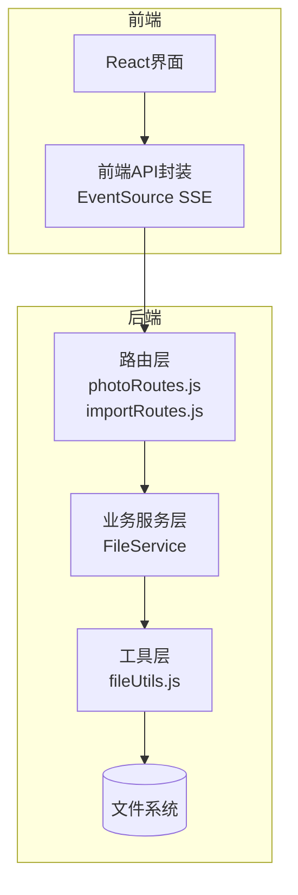
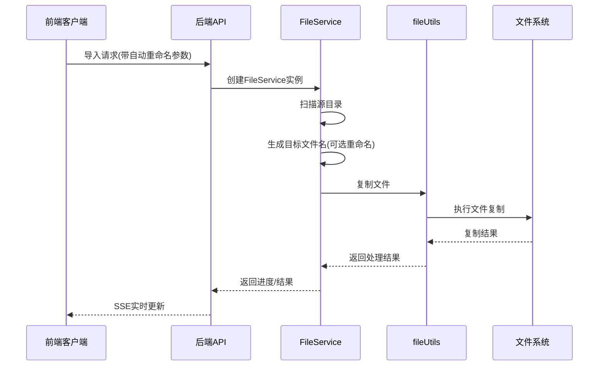
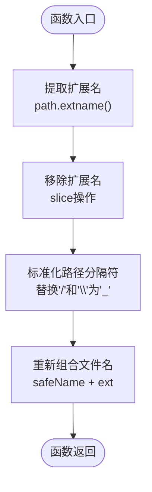
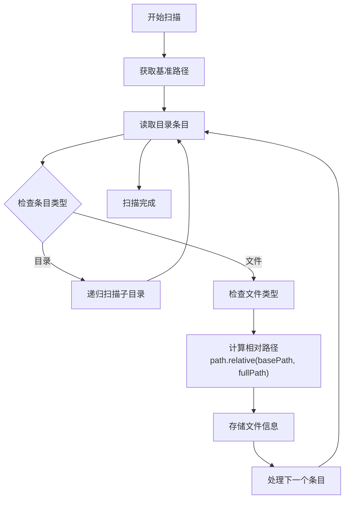
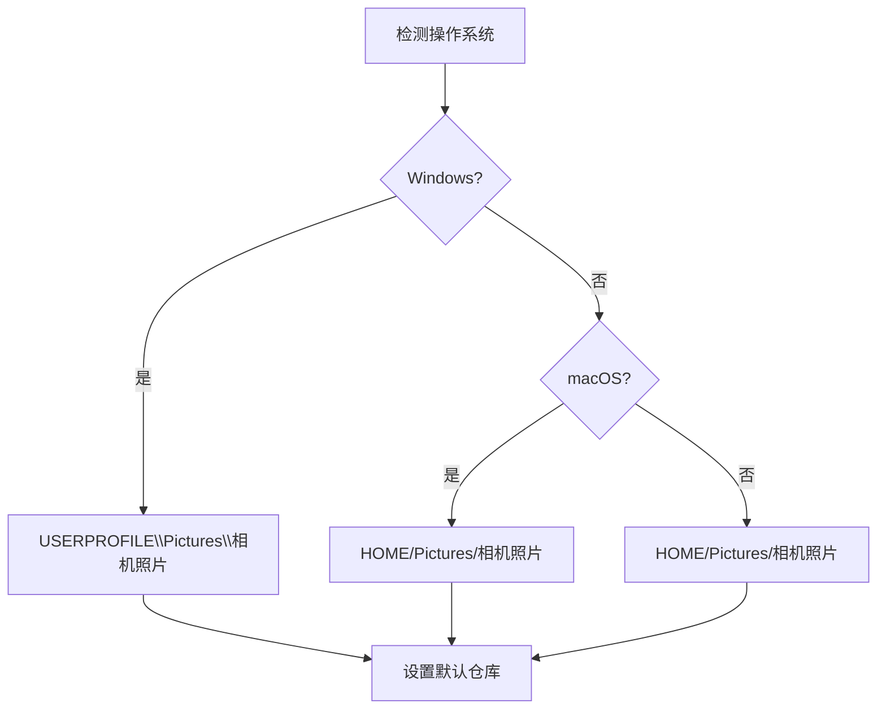
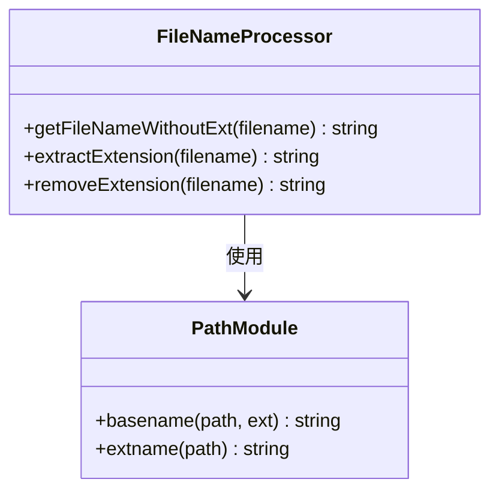
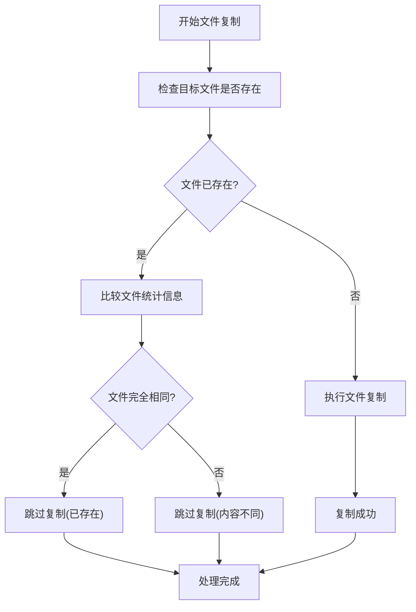
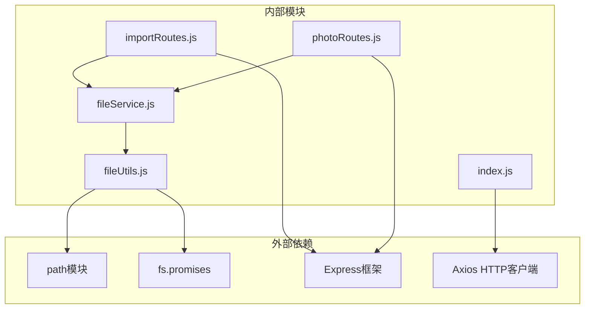

# 路径处理与重命名

<cite>
**本文档引用的文件**
- [fileUtils.js](file://backend/src/utils/fileUtils.js)
- [fileService.js](file://backend/src/services/fileService.js)
- [photoRoutes.js](file://backend/src/routes/photoRoutes.js)
- [importRoutes.js](file://backend/src/routes/importRoutes.js)
- [index.js](file://frontend/src/api/index.js)
- [repos.json](file://backend/data/repos.json)
</cite>

## 目录
1. [简介](#简介)
2. [项目结构](#项目结构)
3. [核心组件](#核心组件)
4. [架构概览](#架构概览)
5. [详细组件分析](#详细组件分析)
6. [依赖关系分析](#依赖关系分析)
7. [性能考量](#性能考量)
8. [故障排除指南](#故障排除指南)
9. [结论](#结论)
10. [附录](#附录)

## 简介
本文件专注于摄影管理项目中的路径处理与重命名功能，深入解释相对路径计算、绝对路径转换和跨平台路径兼容性处理。重点阐述 `generateRenamedFilename` 函数的实现原理，包括路径分隔符标准化、特殊字符处理和文件名安全化策略。同时涵盖文件名去扩展名处理、路径安全性检查和重名文件避免机制，并提供最佳实践、平台差异处理和国际化支持考虑。

## 项目结构
该项目采用前后端分离架构，后端使用 Node.js + Express 提供文件管理和导入功能，前端使用 React 提供用户界面。路径处理功能主要集中在后端工具模块和业务服务层。

**图表来源**
- [index.js:1-168](file://frontend/src/api/index.js#L1-L168)
- [photoRoutes.js:1-739](file://backend/src/routes/photoRoutes.js#L1-L739)
- [importRoutes.js:1-627](file://backend/src/routes/importRoutes.js#L1-L627)
- [fileService.js:1-443](file://backend/src/services/fileService.js#L1-L443)
- [fileUtils.js:1-167](file://backend/src/utils/fileUtils.js#L1-L167)

**章节来源**
- [photoRoutes.js:1-739](file://backend/src/routes/photoRoutes.js#L1-L739)
- [importRoutes.js:1-627](file://backend/src/routes/importRoutes.js#L1-L627)
- [fileService.js:1-443](file://backend/src/services/fileService.js#L1-L443)
- [fileUtils.js:1-167](file://backend/src/utils/fileUtils.js#L1-L167)

## 核心组件
本节详细介绍与路径处理和重命名相关的核心组件及其职责。

### 路径工具模块 (fileUtils.js)
负责基础的文件系统操作和路径处理功能：
- 目录扫描和文件枚举
- 文件复制、删除和存在性检查
- 文件类型识别和扩展名处理
- 跨平台路径安全化处理

### 文件服务类 (fileService.js)
封装具体的业务逻辑：
- 存储卡导入流程管理
- 分类目录初始化
- 并发文件处理控制
- 进度报告和错误处理

### 路由层 (photoRoutes.js, importRoutes.js)
提供REST API接口：
- 文件浏览、删除、导出等操作
- 存储仓库管理
- 实时导入进度跟踪（SSE）

**章节来源**
- [fileUtils.js:1-167](file://backend/src/utils/fileUtils.js#L1-L167)
- [fileService.js:1-443](file://backend/src/services/fileService.js#L1-L443)
- [photoRoutes.js:1-739](file://backend/src/routes/photoRoutes.js#L1-L739)
- [importRoutes.js:1-627](file://backend/src/routes/importRoutes.js#L1-L627)

## 架构概览
系统采用分层架构设计，各层职责清晰分离：

**图表来源**
- [importRoutes.js:82-182](file://backend/src/routes/importRoutes.js#L82-L182)
- [fileService.js:23-167](file://backend/src/services/fileService.js#L23-L167)
- [fileUtils.js:77-100](file://backend/src/utils/fileUtils.js#L77-L100)

## 详细组件分析

### generateRenamedFilename 函数深度解析
这是路径处理的核心函数，负责将相对路径转换为安全的文件名。

#### 实现原理
函数接收相对路径作为输入，通过以下步骤进行处理：

1. **扩展名提取**：使用 `path.extname()` 获取文件扩展名
2. **去扩展名处理**：从原始路径中移除扩展名部分
3. **路径分隔符标准化**：将所有路径分隔符（`/` 和 `\`）替换为下划线（`_`）
4. **安全化输出**：将标准化后的文件名与原始扩展名组合

#### 安全性策略
- **路径注入防护**：通过替换所有路径分隔符，防止路径遍历攻击
- **文件系统兼容性**：避免在不同操作系统中使用不被支持的字符
- **文件名长度控制**：通过去除路径层级，保持文件名简洁

#### 复杂度分析
- 时间复杂度：O(n)，其中 n 为相对路径长度
- 空间复杂度：O(n)，用于存储处理后的字符串

**图表来源**
- [fileUtils.js:128-137](file://backend/src/utils/fileUtils.js#L128-L137)

**章节来源**
- [fileUtils.js:128-137](file://backend/src/utils/fileUtils.js#L128-L137)
- [fileService.js:94-96](file://backend/src/services/fileService.js#L94-L96)

### 相对路径计算机制
系统通过 `path.relative()` 实现相对路径计算：

**图表来源**
- [fileUtils.js:23-66](file://backend/src/utils/fileUtils.js#L23-L66)

**章节来源**
- [fileUtils.js:23-66](file://backend/src/utils/fileUtils.js#L23-L66)

### 跨平台路径兼容性处理
系统通过多种方式确保跨平台兼容性：

#### 平台特定的默认路径

**图表来源**
- [importRoutes.js:61-80](file://backend/src/routes/importRoutes.js#L61-L80)
- [photoRoutes.js:47-66](file://backend/src/routes/photoRoutes.js#L47-L66)

#### 路径分隔符处理
- 统一使用 `path.join()` 进行路径拼接
- 在文件名生成时将所有分隔符标准化为下划线
- 使用 `path.relative()` 计算相对路径

**章节来源**
- [importRoutes.js:61-80](file://backend/src/routes/importRoutes.js#L61-L80)
- [photoRoutes.js:47-66](file://backend/src/routes/photoRoutes.js#L47-L66)
- [fileUtils.js:128-137](file://backend/src/utils/fileUtils.js#L128-L137)

### 文件名去扩展名处理
系统提供了专门的函数来处理文件名去扩展名：

**图表来源**
- [fileUtils.js:113-116](file://backend/src/utils/fileUtils.js#L113-L116)

**章节来源**
- [fileUtils.js:113-116](file://backend/src/utils/fileUtils.js#L113-L116)

### 重名文件避免机制
系统实现了多层重名文件避免策略：

#### 增量导入策略

**图表来源**
- [fileUtils.js:77-100](file://backend/src/utils/fileUtils.js#L77-L100)
- [fileUtils.js:139-153](file://backend/src/utils/fileUtils.js#L139-L153)

**章节来源**
- [fileUtils.js:77-100](file://backend/src/utils/fileUtils.js#L77-L100)
- [fileUtils.js:139-153](file://backend/src/utils/fileUtils.js#L139-L153)

### 并发控制与性能优化
系统采用并发控制机制处理大量文件导入：

#### 并发限制策略
- 最大并发数：3个文件同时处理
- 使用Promise队列管理处理流程
- 自动清理已完成的Promise

**章节来源**
- [fileService.js:75-156](file://backend/src/services/fileService.js#L75-L156)

## 依赖关系分析

**图表来源**
- [fileUtils.js:1-3](file://backend/src/utils/fileUtils.js#L1-L3)
- [fileService.js:1-4](file://backend/src/services/fileService.js#L1-L4)
- [importRoutes.js:1-9](file://backend/src/routes/importRoutes.js#L1-L9)
- [photoRoutes.js:1-6](file://backend/src/routes/photoRoutes.js#L1-L6)
- [index.js:1-6](file://frontend/src/api/index.js#L1-L6)

**章节来源**
- [fileUtils.js:1-167](file://backend/src/utils/fileUtils.js#L1-L167)
- [fileService.js:1-443](file://backend/src/services/fileService.js#L1-L443)
- [importRoutes.js:1-627](file://backend/src/routes/importRoutes.js#L1-L627)
- [photoRoutes.js:1-739](file://backend/src/routes/photoRoutes.js#L1-L739)

## 性能考量
基于代码分析，系统在性能方面采用了多项优化策略：

### I/O性能优化
- **流式文件传输**：使用 `fs.createReadStream()` 进行大文件传输，避免内存占用
- **并发控制**：限制同时处理的文件数量，防止内存溢出
- **增量导入**：跳过已存在的文件，减少不必要的I/O操作

### 内存管理
- **异步文件操作**：使用 `fs.promises` API，避免阻塞主线程
- **Promise队列**：智能管理处理队列，及时清理已完成的任务
- **流式处理**：视频文件使用Range请求，支持分段传输

### 缓存策略
- **缩略图缓存**：设置合理的缓存头，减少重复生成
- **静态资源缓存**：为图片和视频设置适当的缓存策略

## 故障排除指南

### 常见问题及解决方案

#### 路径权限问题
**症状**：文件复制失败，返回权限错误
**原因**：目标目录无写权限或文件被占用
**解决方案**：
- 检查目标目录权限设置
- 确认目标文件未被其他程序占用
- 使用管理员权限运行应用

#### 跨平台兼容性问题
**症状**：在不同操作系统上出现路径解析错误
**原因**：路径分隔符不一致或大小写敏感问题
**解决方案**：
- 使用 `path.join()` 和 `path.relative()` 统一处理路径
- 在文件名生成时进行安全化处理
- 避免直接使用硬编码的路径分隔符

#### SSE连接问题
**症状**：导入进度无法实时显示
**原因**：网络连接中断或服务器配置问题
**解决方案**：
- 检查防火墙设置
- 验证服务器SSE配置
- 确认客户端EventSource支持

**章节来源**
- [importRoutes.js:82-182](file://backend/src/routes/importRoutes.js#L82-L182)
- [index.js:39-141](file://frontend/src/api/index.js#L39-L141)

## 结论
摄影管理项目的路径处理与重命名功能展现了良好的工程实践，通过以下关键特性确保了系统的可靠性：

1. **安全性优先**：通过路径分隔符标准化和文件名安全化策略，有效防止路径注入攻击
2. **跨平台兼容**：统一的路径处理机制和平台特定的默认路径配置
3. **性能优化**：并发控制、流式处理和缓存策略的综合运用
4. **错误处理**：完善的异常捕获和错误恢复机制

这些设计原则为类似的照片管理应用提供了优秀的参考模板。

## 附录

### 最佳实践建议
1. **路径处理**：始终使用 `path` 模块进行路径操作，避免手动字符串拼接
2. **安全检查**：在处理用户提供的路径时，进行严格的合法性验证
3. **错误处理**：为所有异步操作提供适当的错误处理和回退机制
4. **性能监控**：定期监控文件操作的性能指标，及时发现瓶颈

### 国际化支持考虑
- 文件名编码：使用UTF-8编码处理多语言字符
- 日期格式：统一使用ISO 8601格式存储时间戳
- 错误消息：提供多语言错误提示支持

### 实际应用场景
1. **存储卡导入**：支持自动重命名避免文件冲突
2. **批量导出**：增量模式避免重复文件传输
3. **跨平台同步**：统一的路径处理确保不同系统间的兼容性