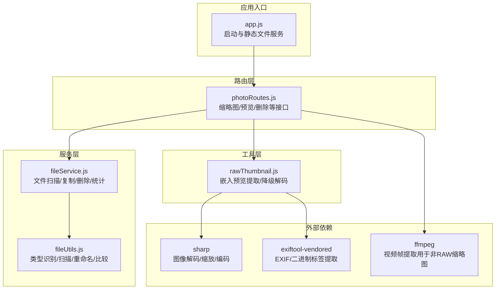
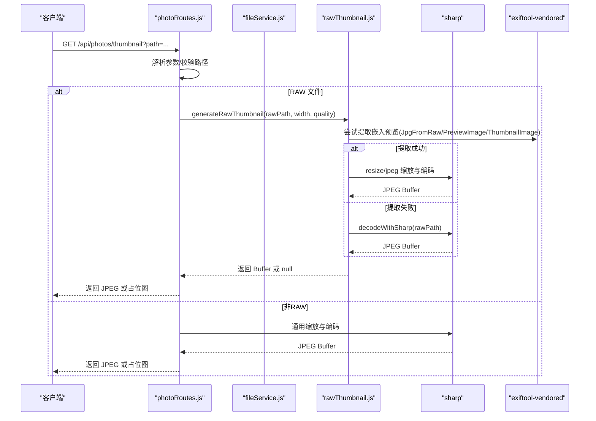
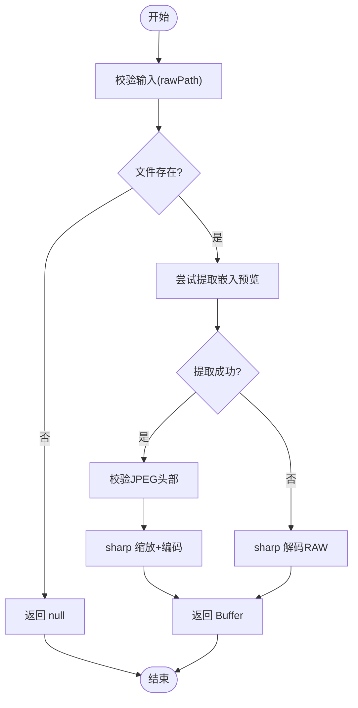
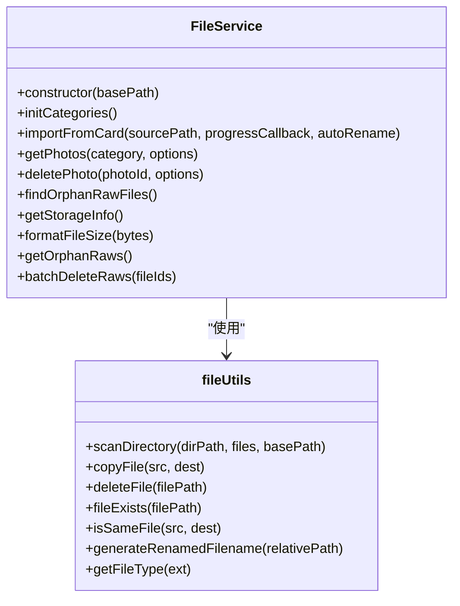
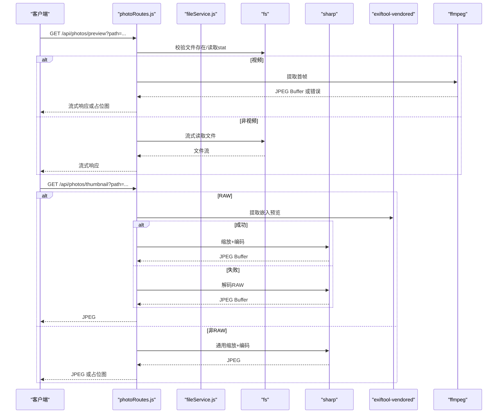
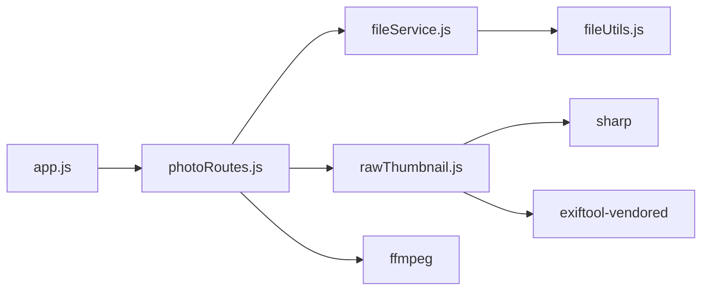

# RAW 文件处理模块

<cite>
**本文引用的文件**
- [backend/src/utils/rawThumbnail.js](file://backend/src/utils/rawThumbnail.js)
- [backend/src/utils/fileUtils.js](file://backend/src/utils/fileUtils.js)
- [backend/src/services/fileService.js](file://backend/src/services/fileService.js)
- [backend/src/routes/photoRoutes.js](file://backend/src/routes/photoRoutes.js)
- [backend/src/app.js](file://backend/src/app.js)
- [backend/package.json](file://backend/package.json)
- [backend/data/repos.json](file://backend/data/repos.json)
</cite>

## 目录
1. [简介](#简介)
2. [项目结构](#项目结构)
3. [核心组件](#核心组件)
4. [架构总览](#架构总览)
5. [详细组件分析](#详细组件分析)
6. [依赖分析](#依赖分析)
7. [性能考虑](#性能考虑)
8. [故障排除指南](#故障排除指南)
9. [结论](#结论)
10. [附录](#附录)

## 简介
本文件面向“RAW 文件处理模块”的专业文档，围绕以下主题展开：
- RAW 文件识别机制与跨平台支持
- 嵌入预览提取技术与缩略图生成策略
- RAW 与 JPG 的关联关系与同步删除机制
- RAW 文件预览的系统命令调用与文件关联
- EXIF 元数据读取与处理流程
- 性能优化与内存管理策略
- 常见 RAW 格式支持与故障排除

## 项目结构
本模块位于后端工程的 utils、services、routes 层，配合应用入口与依赖配置共同构成完整的 RAW 处理链路。

图表来源
- [backend/src/app.js:67-91](file://backend/src/app.js#L67-L91)
- [backend/src/routes/photoRoutes.js:293-466](file://backend/src/routes/photoRoutes.js#L293-L466)
- [backend/src/services/fileService.js:1-443](file://backend/src/services/fileService.js#L1-L443)
- [backend/src/utils/fileUtils.js:1-167](file://backend/src/utils/fileUtils.js#L1-L167)
- [backend/src/utils/rawThumbnail.js:1-132](file://backend/src/utils/rawThumbnail.js#L1-L132)
- [backend/package.json:10-17](file://backend/package.json#L10-L17)

章节来源
- [backend/src/app.js:1-146](file://backend/src/app.js#L1-L146)
- [backend/src/routes/photoRoutes.js:1-739](file://backend/src/routes/photoRoutes.js#L1-L739)
- [backend/src/services/fileService.js:1-443](file://backend/src/services/fileService.js#L1-L443)
- [backend/src/utils/fileUtils.js:1-167](file://backend/src/utils/fileUtils.js#L1-L167)
- [backend/src/utils/rawThumbnail.js:1-132](file://backend/src/utils/rawThumbnail.js#L1-L132)
- [backend/package.json:1-30](file://backend/package.json#L1-L30)

## 核心组件
- RAW 缩略图生成器：负责从 RAW 文件提取嵌入预览，若失败则使用 sharp 解码，最终统一输出 JPEG 缩略图。
- 文件工具集：提供文件类型识别、目录扫描、复制/删除、重命名与同文件判断等基础能力。
- 文件服务：封装导入、查询、删除、统计、孤立 RAW 检测等业务操作，并支持跨仓库与跨平台路径解析。
- 路由接口：提供缩略图生成、原图预览、删除、批量导出、打开文件位置等接口；对 RAW 采用专用生成策略。
- 应用入口：统一 CORS、日志、静态文件服务与健康检查；根据仓库配置动态提供上传目录。

章节来源
- [backend/src/utils/rawThumbnail.js:64-132](file://backend/src/utils/rawThumbnail.js#L64-L132)
- [backend/src/utils/fileUtils.js:4-20](file://backend/src/utils/fileUtils.js#L4-L20)
- [backend/src/services/fileService.js:24-167](file://backend/src/services/fileService.js#L24-L167)
- [backend/src/routes/photoRoutes.js:293-466](file://backend/src/routes/photoRoutes.js#L293-L466)
- [backend/src/app.js:67-91](file://backend/src/app.js#L67-L91)

## 架构总览
RAW 处理的关键流程如下：
- 路由层接收缩略图请求，解析路径与参数
- 对于 RAW 文件，优先调用嵌入预览提取函数；若失败则回退至 sharp 解码
- 对于非 RAW 或生成失败的情况，使用通用的 sharp 转换或占位图
- 返回 JPEG 缩略图或 SVG 占位图，带缓存头

图表来源
- [backend/src/routes/photoRoutes.js:395-466](file://backend/src/routes/photoRoutes.js#L395-L466)
- [backend/src/utils/rawThumbnail.js:7-132](file://backend/src/utils/rawThumbnail.js#L7-L132)
- [backend/src/utils/rawThumbnail.js:64-76](file://backend/src/utils/rawThumbnail.js#L64-L76)

## 详细组件分析

### RAW 缩略图生成器（rawThumbnail.js）
- 嵌入预览提取
  - 尝试多种预览标签（如 JpgFromRaw、PreviewImage、ThumbnailImage），提取二进制数据
  - 校验数据起始字节以确认为有效 JPEG
  - 使用 sharp 对提取的 JPEG 进行缩放与编码，返回 Buffer
- 降级解码
  - 若无嵌入预览，则直接使用 sharp 解码 RAW 文件并生成缩略图
- 错误处理
  - 对每个步骤进行 try/catch，记录日志并返回 null，便于上层决定占位图策略

图表来源
- [backend/src/utils/rawThumbnail.js:7-132](file://backend/src/utils/rawThumbnail.js#L7-L132)

章节来源
- [backend/src/utils/rawThumbnail.js:6-61](file://backend/src/utils/rawThumbnail.js#L6-L61)
- [backend/src/utils/rawThumbnail.js:63-76](file://backend/src/utils/rawThumbnail.js#L63-L76)
- [backend/src/utils/rawThumbnail.js:78-132](file://backend/src/utils/rawThumbnail.js#L78-L132)

### 文件工具集（fileUtils.js）
- 文件类型识别
  - 定义 JPG、RAW、视频等扩展名集合，按扩展名映射类型
- 目录扫描
  - 递归遍历目录，过滤隐藏文件，收集文件元信息（名称、路径、大小、修改时间等）
- 文件操作
  - 复制（增量导入，不覆盖相同文件）、删除、存在性检查、同文件判断（基于大小与修改时间）
- 重命名
  - 将相对路径中的分隔符替换为下划线，生成安全的重命名文件名

章节来源
- [backend/src/utils/fileUtils.js:4-20](file://backend/src/utils/fileUtils.js#L4-L20)
- [backend/src/utils/fileUtils.js:22-66](file://backend/src/utils/fileUtils.js#L22-L66)
- [backend/src/utils/fileUtils.js:77-100](file://backend/src/utils/fileUtils.js#L77-L100)
- [backend/src/utils/fileUtils.js:102-111](file://backend/src/utils/fileUtils.js#L102-L111)
- [backend/src/utils/fileUtils.js:118-126](file://backend/src/utils/fileUtils.js#L118-L126)
- [backend/src/utils/fileUtils.js:139-153](file://backend/src/utils/fileUtils.js#L139-L153)
- [backend/src/utils/fileUtils.js:128-137](file://backend/src/utils/fileUtils.js#L128-L137)

### 文件服务（fileService.js）
- 分类目录初始化与导入
  - 初始化 jpg/raw/video 三类目录，支持并发控制（限制同时处理任务数）避免内存溢出
- 照片列表与排序
  - 读取指定分类下的文件，生成包含缩略图与原图 URL 的列表，支持分页与多字段排序
- 删除与同步删除
  - 删除主文件；当删除 JPG 且开启同步删除时，会查找并删除同名 RAW 文件（遍历常见 RAW 扩展）
- 孤立 RAW 检测
  - 通过对比 JPG 与 RAW 的文件名（去扩展名、小写）判断孤立 RAW
- 存储统计
  - 统计各分类文件数量与总大小

图表来源
- [backend/src/services/fileService.js:5-443](file://backend/src/services/fileService.js#L5-L443)
- [backend/src/utils/fileUtils.js:1-167](file://backend/src/utils/fileUtils.js#L1-L167)

章节来源
- [backend/src/services/fileService.js:16-21](file://backend/src/services/fileService.js#L16-L21)
- [backend/src/services/fileService.js:24-167](file://backend/src/services/fileService.js#L24-L167)
- [backend/src/services/fileService.js:226-267](file://backend/src/services/fileService.js#L226-L267)
- [backend/src/services/fileService.js:269-306](file://backend/src/services/fileService.js#L269-L306)
- [backend/src/services/fileService.js:336-372](file://backend/src/services/fileService.js#L336-L372)
- [backend/src/services/fileService.js:374-416](file://backend/src/services/fileService.js#L374-L416)
- [backend/src/services/fileService.js:418-439](file://backend/src/services/fileService.js#L418-L439)

### 路由接口（photoRoutes.js）
- 缩略图接口
  - 对 RAW 文件：调用 rawThumbnail.generateRawThumbnail，成功返回 JPEG，失败返回占位图
  - 对非 RAW 文件：使用 sharp 生成缩略图，失败返回占位图
- 预览接口
  - 支持 Range 请求，视频使用 ffmpeg 提取首帧；普通文件使用流式传输
- 删除接口
  - 支持同步删除 RAW（当删除 JPG 时）
- 打开位置
  - 跨平台执行 open/explorer/xdg-open 打开文件或文件夹

图表来源
- [backend/src/routes/photoRoutes.js:178-291](file://backend/src/routes/photoRoutes.js#L178-L291)
- [backend/src/routes/photoRoutes.js:293-466](file://backend/src/routes/photoRoutes.js#L293-L466)

章节来源
- [backend/src/routes/photoRoutes.js:178-291](file://backend/src/routes/photoRoutes.js#L178-L291)
- [backend/src/routes/photoRoutes.js:293-466](file://backend/src/routes/photoRoutes.js#L293-L466)
- [backend/src/routes/photoRoutes.js:575-640](file://backend/src/routes/photoRoutes.js#L575-L640)

### 应用入口（app.js）
- 静态文件服务
  - 根据仓库配置动态提供 /uploads 下的文件，支持跨平台默认路径
- 跨仓库与默认路径
  - 通过环境变量与配置文件决定仓库根路径
- 健康检查与全局错误处理
  - 提供 /api/health；捕获未处理异常与拒绝，避免服务崩溃

章节来源
- [backend/src/app.js:67-91](file://backend/src/app.js#L67-L91)
- [backend/src/app.js:93-112](file://backend/src/app.js#L93-L112)
- [backend/src/app.js:118-146](file://backend/src/app.js#L118-L146)

## 依赖分析
- 外部依赖
  - sharp：图像解码、缩放、编码
  - exiftool-vendored：EXIF 元数据与二进制标签提取
  - ffmpeg：视频首帧提取（非 RAW 缩略图场景）
- 内部依赖
  - routes 依赖 services 与 utils
  - services 依赖 utils
  - app.js 提供静态文件服务与仓库配置

图表来源
- [backend/src/routes/photoRoutes.js:293-466](file://backend/src/routes/photoRoutes.js#L293-L466)
- [backend/src/services/fileService.js:1-443](file://backend/src/services/fileService.js#L1-L443)
- [backend/src/utils/fileUtils.js:1-167](file://backend/src/utils/fileUtils.js#L1-L167)
- [backend/src/utils/rawThumbnail.js:1-132](file://backend/src/utils/rawThumbnail.js#L1-L132)
- [backend/src/app.js:1-146](file://backend/src/app.js#L1-L146)
- [backend/package.json:10-17](file://backend/package.json#L10-L17)

章节来源
- [backend/package.json:10-17](file://backend/package.json#L10-L17)

## 性能考虑
- 并发控制
  - 导入阶段限制并发任务数，避免内存峰值过高
- 流式传输
  - 预览与缩略图生成均采用流式读取或 Buffer 输出，避免一次性加载大文件
- 缓存头
  - 缩略图接口设置 Cache-Control，减少重复请求
- 降级策略
  - RAW 生成采用三级降级（嵌入预览 → 解码RAW → 占位图），保证可用性
- 内存管理
  - 仅在必要时构建 Buffer，及时释放中间对象，避免长时间持有大对象

章节来源
- [backend/src/services/fileService.js:75-156](file://backend/src/services/fileService.js#L75-L156)
- [backend/src/routes/photoRoutes.js:264-280](file://backend/src/routes/photoRoutes.js#L264-L280)
- [backend/src/routes/photoRoutes.js:404-425](file://backend/src/routes/photoRoutes.js#L404-L425)
- [backend/src/utils/rawThumbnail.js:78-132](file://backend/src/utils/rawThumbnail.js#L78-L132)

## 故障排除指南
- 缩略图为空或占位图
  - 检查 RAW 文件是否存在与可访问
  - 确认嵌入预览标签是否存在，必要时回退至解码模式
  - 若解码失败，确认 sharp 支持该 RAW 格式
- 删除 JPG 后未同步删除 RAW
  - 确认同步删除开关已启用
  - 检查 RAW 扩展名是否在支持列表内
- 预览视频失败
  - 检查 ffmpeg 是否安装并可执行
  - 查看 stderr 日志定位问题
- 跨平台路径问题
  - 确认仓库路径配置正确，必要时使用默认路径
  - 检查静态文件服务是否指向有效目录

章节来源
- [backend/src/utils/rawThumbnail.js:108-128](file://backend/src/utils/rawThumbnail.js#L108-L128)
- [backend/src/services/fileService.js:248-261](file://backend/src/services/fileService.js#L248-L261)
- [backend/src/routes/photoRoutes.js:322-393](file://backend/src/routes/photoRoutes.js#L322-L393)
- [backend/src/app.js:67-91](file://backend/src/app.js#L67-L91)

## 结论
本模块通过“嵌入预览优先 + 降级解码”的策略，结合流式传输与缓存优化，实现了对主流 RAW 格式的稳定缩略图生成；配合文件工具与服务层，提供了完善的导入、删除、统计与孤立文件检测能力。在跨平台方面，通过仓库配置与默认路径策略，确保在 Windows/macOS/Linux 上均可稳定运行。

## 附录

### RAW 格式支持与识别
- 支持的 RAW 扩展名集合由工具层定义，涵盖 ARW、CR2/CR3、NEF、DNG、ORF、RAF、RW2、RAW 等
- 路由层在生成缩略图时对这些扩展名进行识别并触发专用生成流程

章节来源
- [backend/src/utils/fileUtils.js:5-8](file://backend/src/utils/fileUtils.js#L5-L8)
- [backend/src/routes/photoRoutes.js:396-397](file://backend/src/routes/photoRoutes.js#L396-L397)

### EXIF 元数据读取与处理
- 嵌入预览提取使用 exiftool-vendored 的二进制标签提取能力
- 元数据读取与验证流程在缩略图生成过程中完成，确保返回有效 JPEG

章节来源
- [backend/src/utils/rawThumbnail.js:17-52](file://backend/src/utils/rawThumbnail.js#L17-L52)
- [backend/package.json:14](file://backend/package.json#L14)

### 跨平台路径与仓库配置
- 默认路径根据平台自动选择用户图片目录
- 仓库配置文件支持多仓库与默认仓库标识，动态提供静态文件服务

章节来源
- [backend/src/app.js:46-65](file://backend/src/app.js#L46-L65)
- [backend/src/app.js:93-112](file://backend/src/app.js#L93-L112)
- [backend/data/repos.json:1-8](file://backend/data/repos.json#L1-L8)