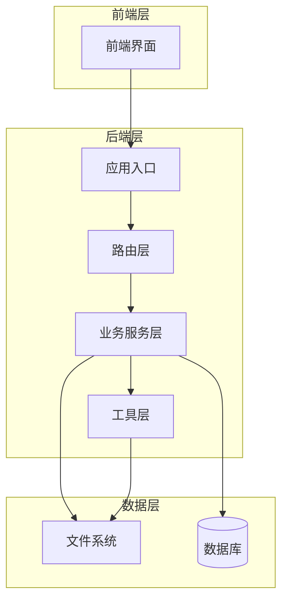
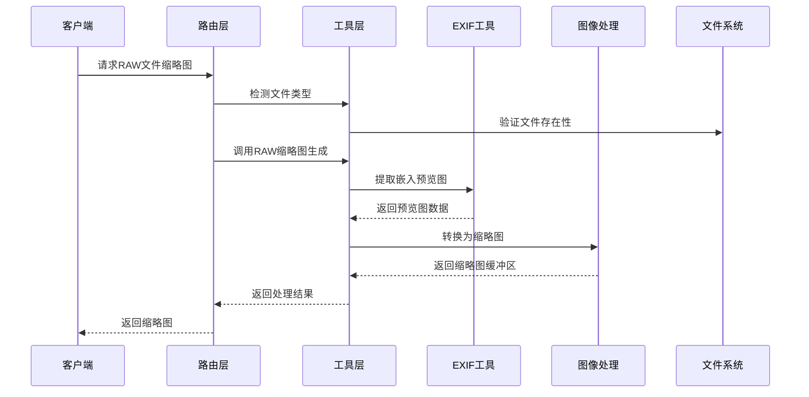
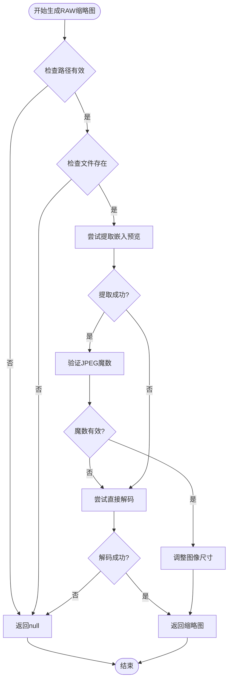
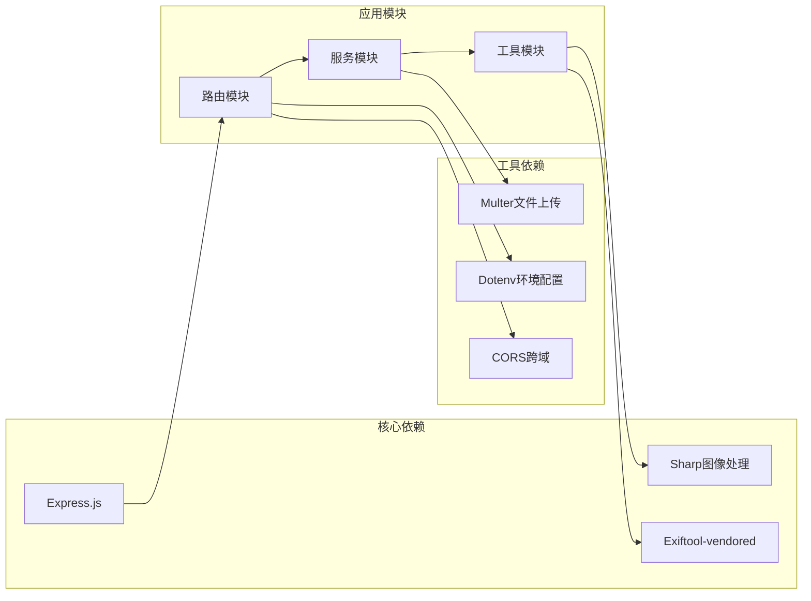

# RAW文件识别与检测

<cite>
**本文档引用的文件**
- [fileUtils.js](file://backend/src/utils/fileUtils.js)
- [rawThumbnail.js](file://backend/src/utils/rawThumbnail.js)
- [fileService.js](file://backend/src/services/fileService.js)
- [photoRoutes.js](file://backend/src/routes/photoRoutes.js)
- [app.js](file://backend/src/app.js)
- [package.json](file://backend/package.json)
- [repos.json](file://backend/data/repos.json)
</cite>

## 目录
1. [简介](#简介)
2. [项目结构](#项目结构)
3. [核心组件](#核心组件)
4. [架构概览](#架构概览)
5. [详细组件分析](#详细组件分析)
6. [依赖关系分析](#依赖关系分析)
7. [性能考虑](#性能考虑)
8. [故障排除指南](#故障排除指南)
9. [结论](#结论)

## 简介

本项目实现了完整的RAW文件识别与检测功能，支持多种相机厂商的RAW格式。系统通过文件扩展名判断和文件头验证相结合的方式，确保准确识别各种RAW格式文件，并提供高效的缩略图生成和RAW-JPG配对检测功能。

## 项目结构

项目采用模块化的架构设计，主要分为以下几个层次：

**图表来源**
- [app.js:1-146](file://backend/src/app.js#L1-L146)
- [photoRoutes.js:1-739](file://backend/src/routes/photoRoutes.js#L1-L739)

**章节来源**
- [app.js:1-146](file://backend/src/app.js#L1-L146)
- [package.json:1-30](file://backend/package.json#L1-L30)

## 核心组件

### 文件类型识别系统

系统实现了基于扩展名的文件类型识别机制，支持以下文件类型：

| 文件类型 | 支持的扩展名 |
|---------|-------------|
| JPG/JPEG | .jpg, .jpeg |
| RAW | .raw, .cr2, .cr3, .nef, .arw, .dng, .orf, .raf, .rw2 |
| 视频 | .mp4, .mov, .avi, .mkv, .m4v, .3gp |

### RAW文件检测算法

系统采用双重验证机制确保RAW文件识别的准确性：

1. **扩展名验证**：通过预定义的扩展名映射表进行快速识别
2. **文件头验证**：通过EXIF工具提取嵌入预览图进行二次确认

**章节来源**
- [fileUtils.js:4-20](file://backend/src/utils/fileUtils.js#L4-L20)
- [fileUtils.js:43-58](file://backend/src/utils/fileUtils.js#L43-L58)

## 架构概览

系统采用三层架构设计，每层职责明确，耦合度低：

**图表来源**
- [photoRoutes.js:395-425](file://backend/src/routes/photoRoutes.js#L395-L425)
- [rawThumbnail.js:78-129](file://backend/src/utils/rawThumbnail.js#L78-L129)

## 详细组件分析

### 文件工具模块 (fileUtils.js)

文件工具模块提供了基础的文件操作功能，包括：

#### 文件类型识别函数
- `getFileType(ext)`: 根据文件扩展名返回文件类型
- 支持快速扩展名匹配，时间复杂度O(n)，其中n为扩展名数量

#### 目录扫描功能
- `scanDirectory(dirPath)`: 递归扫描目录，支持隐藏文件过滤
- 实现了异步文件系统操作，避免阻塞主线程

#### 文件操作工具
- `copyFile(src, dest)`: 增量导入，避免重复覆盖
- `isSameFile(srcPath, destPath)`: 基于文件大小和修改时间的文件比较

**章节来源**
- [fileUtils.js:11-66](file://backend/src/utils/fileUtils.js#L11-L66)
- [fileUtils.js:77-153](file://backend/src/utils/fileUtils.js#L77-L153)

### RAW缩略图生成模块 (rawThumbnail.js)

RAW缩略图生成模块实现了三级降级策略：

#### 一级降级：嵌入预览提取
- 使用EXIF工具提取RAW文件中的嵌入预览图
- 支持多个预览图标签：JpgFromRaw、PreviewImage、ThumbnailImage
- 验证JPEG魔数（0xFFD8）确保数据有效性

#### 二级降级：直接解码
- 使用Sharp库直接解码RAW文件
- 自动调整图像尺寸和质量参数

#### 三级降级：占位图生成
- 当所有方法都失败时，返回SVG占位图

**图表来源**
- [rawThumbnail.js:78-129](file://backend/src/utils/rawThumbnail.js#L78-L129)

**章节来源**
- [rawThumbnail.js:6-61](file://backend/src/utils/rawThumbnail.js#L6-L61)
- [rawThumbnail.js:78-131](file://backend/src/utils/rawThumbnail.js#L78-L131)

### 文件服务模块 (fileService.js)

文件服务模块提供了完整的文件管理功能：

#### 导入功能
- 支持并发控制，限制同时处理的文件数量
- 实现增量导入，避免重复文件覆盖
- 提供详细的进度报告和错误处理

#### RAW-JPG配对检测
- `findOrphanRawFiles()`: 查找没有对应JPG的RAW文件
- `deletePhoto()`: 支持同步删除RAW文件
- 基于文件名（不含扩展名）进行配对判断

#### 存储管理
- `getStorageInfo()`: 统计各类型文件的数量和总大小
- 支持格式化文件大小显示

**章节来源**
- [fileService.js:23-167](file://backend/src/services/fileService.js#L23-L167)
- [fileService.js:269-306](file://backend/src/services/fileService.js#L269-L306)
- [fileService.js:374-416](file://backend/src/services/fileService.js#L374-L416)

### 路由处理模块 (photoRoutes.js)

路由处理模块负责HTTP请求的处理：

#### 缩略图生成路由
- `/api/photos/thumbnail`：通用缩略图生成接口
- 特殊处理RAW文件的三级降级策略
- 支持缓存控制和错误处理

#### 预览功能
- `/api/photos/:id/preview`：原始文件预览
- 支持视频文件的Range请求
- 流式传输避免内存溢出

**章节来源**
- [photoRoutes.js:395-458](file://backend/src/routes/photoRoutes.js#L395-L458)
- [photoRoutes.js:468-571](file://backend/src/routes/photoRoutes.js#L468-L571)

## 依赖关系分析

系统依赖关系清晰，主要外部依赖包括：

**图表来源**
- [package.json:10-18](file://backend/package.json#L10-L18)

**章节来源**
- [package.json:10-18](file://backend/package.json#L10-L18)

## 性能考虑

### 并发控制策略

系统实现了多层并发控制机制：

1. **导入并发限制**：同时最多处理3个文件，避免内存溢出
2. **文件扫描优化**：异步文件系统操作，非阻塞I/O
3. **缓存机制**：
   - 缩略图缓存：public, max-age=86400（24小时）
   - 占位图缓存：public, max-age=86400（24小时）
   - 视频文件缓存：public, max-age=3600（1小时）

### 内存优化

- **流式传输**：视频和大文件使用流式传输，避免一次性加载到内存
- **渐进式处理**：RAW文件采用三级降级策略，优先使用内存效率高的方法
- **文件存在性检查**：在处理前先验证文件存在性，避免不必要的处理

### 算法复杂度分析

- **文件类型识别**：O(n) - n为扩展名数量（固定常数）
- **目录扫描**：O(m) - m为文件总数
- **RAW文件处理**：最坏情况O(k) - k为文件大小，实际受降级策略影响

## 故障排除指南

### 常见RAW格式兼容性问题

#### EXIF工具问题
- **症状**：嵌入预览提取失败
- **解决方案**：检查exiftool-vendored安装，验证文件权限
- **日志定位**：查看extractEmbeddedPreview函数的错误输出

#### Sharp解码失败
- **症状**：直接解码RAW文件失败
- **解决方案**：更新Sharp版本，检查RAW文件完整性
- **日志定位**：decodeWithSharp函数的异常信息

#### 文件权限问题
- **症状**：文件无法访问或读取
- **解决方案**：检查文件权限，确保应用程序有读取权限
- **日志定位**：fs.access和fs.stat调用的错误信息

### 性能优化建议

#### 缓存策略
- 启用浏览器缓存减少重复请求
- 使用CDN加速静态资源访问
- 实施适当的缓存失效策略

#### 监控和调试
- 启用详细的日志记录
- 实施性能监控指标
- 定期检查磁盘空间和内存使用情况

**章节来源**
- [rawThumbnail.js:56-60](file://backend/src/utils/rawThumbnail.js#L56-L60)
- [photoRoutes.js:442-458](file://backend/src/routes/photoRoutes.js#L442-L458)

## 结论

本项目实现了完整的RAW文件识别与检测功能，具有以下特点：

1. **准确性高**：结合扩展名验证和文件头验证，确保识别准确性
2. **性能优秀**：采用多层降级策略和并发控制，优化处理性能
3. **兼容性强**：支持主流相机厂商的RAW格式
4. **可维护性好**：模块化设计，职责分离清晰

通过合理的架构设计和优化策略，系统能够高效处理大量RAW文件，为用户提供流畅的照片管理体验。建议在生产环境中配合适当的缓存策略和监控机制，进一步提升系统的稳定性和性能表现。