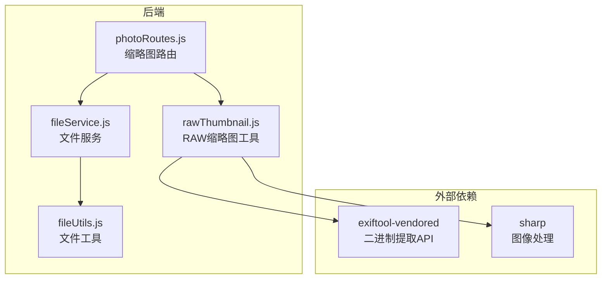
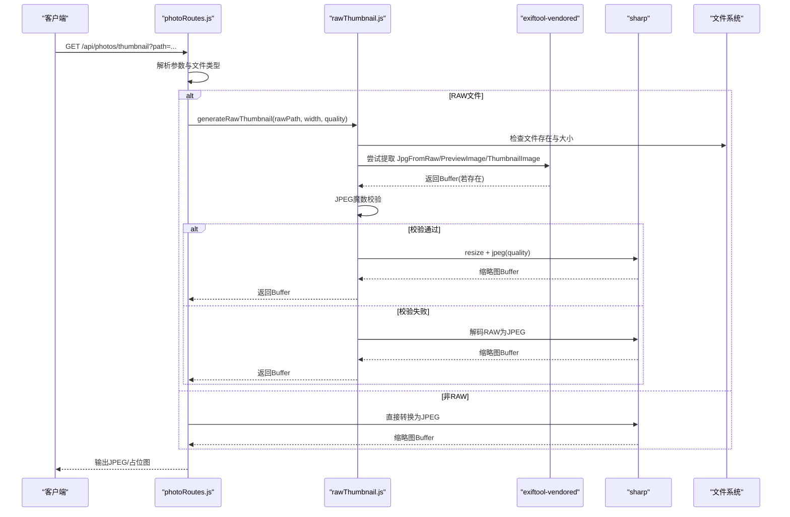
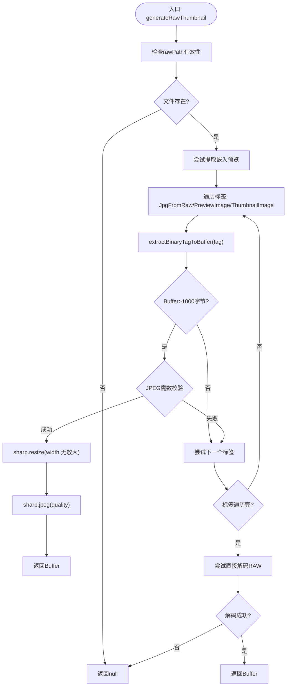
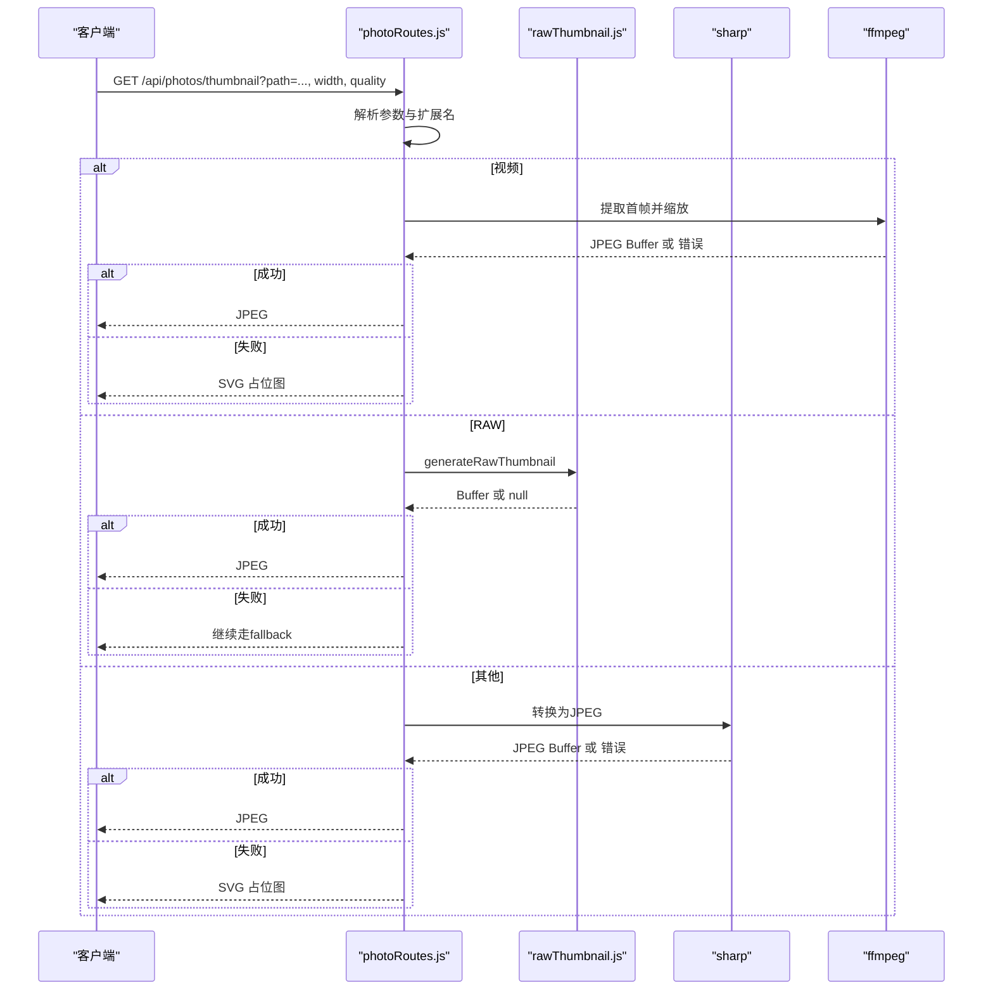
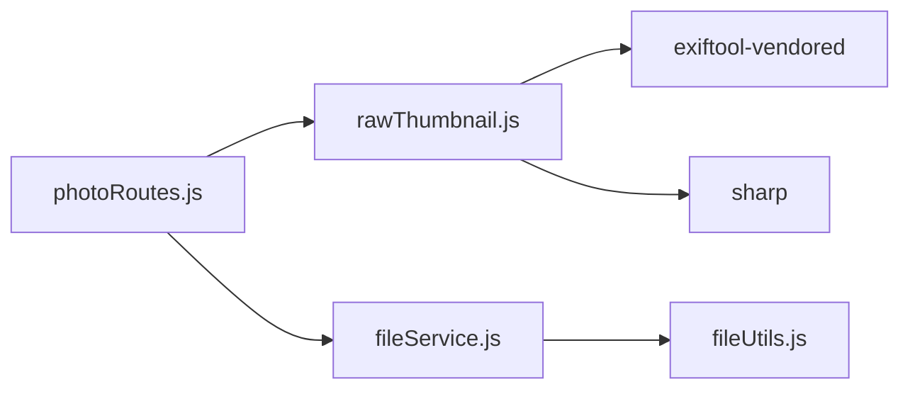

# 嵌入预览提取技术

<cite>
**本文引用的文件**
- [rawThumbnail.js](file://backend/src/utils/rawThumbnail.js)
- [photoRoutes.js](file://backend/src/routes/photoRoutes.js)
- [fileService.js](file://backend/src/services/fileService.js)
- [fileUtils.js](file://backend/src/utils/fileUtils.js)
- [package.json](file://backend/package.json)
- [README.md](file://README.md)
</cite>

## 目录
1. [引言](#引言)
2. [项目结构](#项目结构)
3. [核心组件](#核心组件)
4. [架构概览](#架构概览)
5. [详细组件分析](#详细组件分析)
6. [依赖关系分析](#依赖关系分析)
7. [性能考量](#性能考量)
8. [故障排除指南](#故障排除指南)
9. [结论](#结论)
10. [附录](#附录)

## 引言
本文件面向需要在照片管理系统中实现“从RAW文件提取嵌入JPEG预览图”的工程师与技术文档读者，系统性阐述以下主题：
- EXIF标签的使用：JpgFromRaw、PreviewImage、ThumbnailImage
- 不同相机厂商RAW文件中嵌入预览的差异与兼容性处理
- 二进制数据提取流程：exiftool-vendored API与Buffer处理
- 预览图验证机制：JPEG魔数检查与数据完整性验证
- 预览提取失败的故障排除与三级降级策略
- 预览图质量优化与尺寸调整的技术实现

## 项目结构
后端采用Express框架，缩略图生成位于路由层，核心逻辑封装在工具模块中，文件扫描与分类在服务层实现。与嵌入预览提取直接相关的模块如下：
- 路由层：提供缩略图接口，识别RAW文件并调用工具模块
- 工具层：封装RAW嵌入预览提取、降级策略与质量调整
- 服务层：提供文件扫描、分类与RAW文件查找能力
- 依赖声明：exiftool-vendored与sharp

图表来源
- [photoRoutes.js:294-466](file://backend/src/routes/photoRoutes.js#L294-L466)
- [rawThumbnail.js:1-132](file://backend/src/utils/rawThumbnail.js#L1-L132)
- [fileService.js:1-443](file://backend/src/services/fileService.js#L1-L443)
- [fileUtils.js:1-167](file://backend/src/utils/fileUtils.js#L1-L167)

章节来源
- [photoRoutes.js:294-466](file://backend/src/routes/photoRoutes.js#L294-L466)
- [rawThumbnail.js:1-132](file://backend/src/utils/rawThumbnail.js#L1-L132)
- [fileService.js:1-443](file://backend/src/services/fileService.js#L1-L443)
- [fileUtils.js:1-167](file://backend/src/utils/fileUtils.js#L1-L167)
- [package.json:10-17](file://backend/package.json#L10-L17)

## 核心组件
- RAW嵌入预览提取与降级策略：封装在工具模块中，优先尝试从RAW文件提取嵌入JPEG，否则回退到直接解码RAW，最后返回空值供上层生成占位图
- 缩略图路由：根据文件类型选择不同的生成策略；对RAW文件调用工具模块，其他类型使用sharp进行转换
- 文件服务与工具：提供RAW文件扫描、分类、RAW-RAW同步删除、孤立RAW查找等能力，支撑预览生成的前置条件

章节来源
- [rawThumbnail.js:78-129](file://backend/src/utils/rawThumbnail.js#L78-L129)
- [photoRoutes.js:395-425](file://backend/src/routes/photoRoutes.js#L395-L425)
- [fileService.js:269-306](file://backend/src/services/fileService.js#L269-L306)

## 架构概览
下图展示从HTTP请求到最终输出缩略图的关键流程，重点体现RAW嵌入预览提取与降级策略：

图表来源
- [photoRoutes.js:294-466](file://backend/src/routes/photoRoutes.js#L294-L466)
- [rawThumbnail.js:7-61](file://backend/src/utils/rawThumbnail.js#L7-L61)
- [rawThumbnail.js:64-76](file://backend/src/utils/rawThumbnail.js#L64-L76)

## 详细组件分析

### 组件A：RAW嵌入预览提取与降级策略
- 功能要点
  - 优先尝试多个EXIF标签：JpgFromRaw、PreviewImage、ThumbnailImage
  - 使用exiftool-vendored的extractBinaryTagToBuffer API提取二进制数据到Buffer
  - 对Buffer进行JPEG魔数校验（前两个字节）
  - 若校验通过，使用sharp按指定宽度无放大缩放并以固定质量编码为JPEG
  - 若标签不存在或数据无效，回退到直接解码RAW文件
  - 若仍失败，返回null，由调用方生成占位图

图表来源
- [rawThumbnail.js:7-61](file://backend/src/utils/rawThumbnail.js#L7-L61)
- [rawThumbnail.js:64-76](file://backend/src/utils/rawThumbnail.js#L64-L76)
- [rawThumbnail.js:78-129](file://backend/src/utils/rawThumbnail.js#L78-L129)

章节来源
- [rawThumbnail.js:7-61](file://backend/src/utils/rawThumbnail.js#L7-L61)
- [rawThumbnail.js:64-76](file://backend/src/utils/rawThumbnail.js#L64-L76)
- [rawThumbnail.js:78-129](file://backend/src/utils/rawThumbnail.js#L78-L129)

### 组件B：缩略图路由与类型分发
- 功能要点
  - 识别视频与RAW文件，分别采用不同策略
  - 对RAW文件：调用generateRawThumbnail，成功则直接输出JPEG，失败则进入占位图逻辑
  - 对非RAW文件：使用sharp进行转换，失败则输出SVG占位图
  - 对视频文件：使用ffmpeg提取首帧，失败则输出SVG占位图

图表来源
- [photoRoutes.js:294-466](file://backend/src/routes/photoRoutes.js#L294-L466)

章节来源
- [photoRoutes.js:294-466](file://backend/src/routes/photoRoutes.js#L294-L466)

### 组件C：文件服务与RAW相关能力
- 功能要点
  - 分类扫描：支持jpg、raw、video三类，RAW扩展名集合覆盖主流厂商格式
  - RAW-RAW同步删除：当删除JPG时，同步查找并删除对应RAW文件
  - 孤立RAW查找：基于文件名去扩展名匹配，找出没有对应JPG的RAW文件
  - 存储信息统计：按类别统计文件数量与总大小

章节来源
- [fileService.js:169-224](file://backend/src/services/fileService.js#L169-L224)
- [fileService.js:269-306](file://backend/src/services/fileService.js#L269-L306)
- [fileService.js:336-363](file://backend/src/services/fileService.js#L336-L363)
- [fileUtils.js:4-9](file://backend/src/utils/fileUtils.js#L4-L9)

## 依赖关系分析
- 外部依赖
  - exiftool-vendored：提供二进制标签提取API，用于从RAW文件中提取嵌入JPEG
  - sharp：提供图像解码、缩放与编码能力，用于生成缩略图
- 内部依赖
  - 路由层依赖工具层与服务层
  - 工具层依赖文件系统与外部库
  - 服务层依赖工具层进行文件扫描与分类

图表来源
- [photoRoutes.js:294-466](file://backend/src/routes/photoRoutes.js#L294-L466)
- [rawThumbnail.js:1-6](file://backend/src/utils/rawThumbnail.js#L1-L6)
- [fileService.js:1-4](file://backend/src/services/fileService.js#L1-L4)
- [fileUtils.js:1-3](file://backend/src/utils/fileUtils.js#L1-L3)
- [package.json:14-17](file://backend/package.json#L14-L17)

章节来源
- [package.json:10-17](file://backend/package.json#L10-L17)
- [rawThumbnail.js:1-6](file://backend/src/utils/rawThumbnail.js#L1-L6)
- [photoRoutes.js:294-466](file://backend/src/routes/photoRoutes.js#L294-L466)

## 性能考量
- 并发与内存
  - 导入流程采用并发限制，避免内存溢出；缩略图生成在路由层按需处理，避免批量阻塞
- 缩放策略
  - 使用withoutEnlargement避免放大导致的画质劣化
  - 固定质量参数平衡体积与清晰度
- I/O优化
  - 路由层对视频使用流式传输，避免一次性加载大文件
  - RAW缩略图生成优先使用嵌入预览，避免对大RAW文件进行全量解码

章节来源
- [fileService.js:75-88](file://backend/src/services/fileService.js#L75-L88)
- [photoRoutes.js:264-280](file://backend/src/routes/photoRoutes.js#L264-L280)
- [rawThumbnail.js:34-37](file://backend/src/utils/rawThumbnail.js#L34-L37)

## 故障排除指南
- 常见问题与定位
  - RAW文件无嵌入预览：检查相机/软件是否写入了嵌入JPEG；确认标签顺序与可用性
  - exiftool-vendored安装或权限问题：确认依赖安装与平台兼容性
  - sharp解码失败：确认RAW格式受支持；检查文件损坏
  - ffmpeg提取视频帧失败：确认ffmpeg可用与路径正确
- 降级策略
  - 三级降级：嵌入预览→直接解码RAW→占位图
  - 占位图：SVG占位图提供统一的视觉反馈
- 日志与调试
  - 关注路由与工具模块的日志输出，定位具体失败阶段

章节来源
- [README.md:166-187](file://README.md#L166-L187)
- [rawThumbnail.js:108-128](file://backend/src/utils/rawThumbnail.js#L108-L128)
- [photoRoutes.js:395-425](file://backend/src/routes/photoRoutes.js#L395-L425)

## 结论
本系统通过三层降级策略与严格的预览验证机制，在保证兼容性的前提下，最大化利用RAW文件中的嵌入JPEG预览，显著降低缩略图生成成本并提升用户体验。对于缺失嵌入预览的RAW文件，系统能够优雅降级至直接解码，并在必要时提供占位图，确保界面一致性与稳定性。

## 附录

### EXIF标签与厂商差异
- 标签族
  - JpgFromRaw：部分相机/软件直接写入的JPEG预览
  - PreviewImage：常见于部分厂商RAW中
  - ThumbnailImage：常见于部分厂商RAW中
- 兼容性处理
  - 通过顺序尝试与严格校验，适配不同厂商的嵌入预览写入策略
  - 对标签不存在或数据过小的情况，快速回退到解码RAW

章节来源
- [rawThumbnail.js:16-52](file://backend/src/utils/rawThumbnail.js#L16-L52)

### 二进制提取与Buffer处理
- API使用
  - 使用exiftool-vendored的extractBinaryTagToBuffer，直接将二进制数据提取到内存Buffer
- 数据校验
  - 通过JPEG魔数（0xFFD8）快速判断数据有效性
  - 对Buffer大小进行阈值过滤，避免无效片段

章节来源
- [rawThumbnail.js:23-43](file://backend/src/utils/rawThumbnail.js#L23-L43)

### 预览图质量与尺寸优化
- 尺寸调整
  - 以宽度为基准，保持宽高比不变
  - 使用withoutEnlargement避免放大
- 质量控制
  - 固定JPEG质量参数，兼顾体积与清晰度
- 缓存策略
  - 设置合理的Cache-Control头，减少重复请求

章节来源
- [rawThumbnail.js:34-37](file://backend/src/utils/rawThumbnail.js#L34-L37)
- [photoRoutes.js:409-414](file://backend/src/routes/photoRoutes.js#L409-L414)