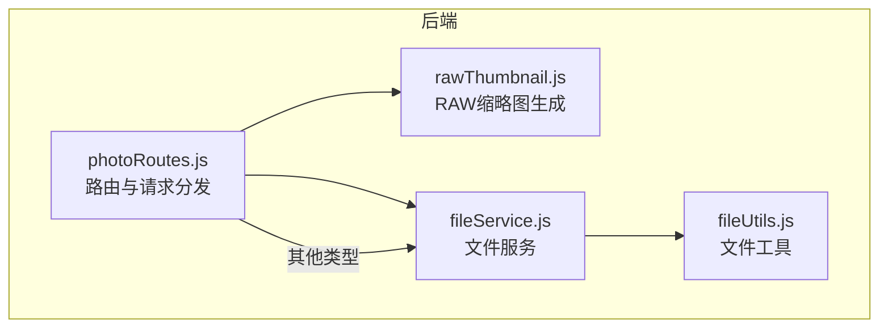
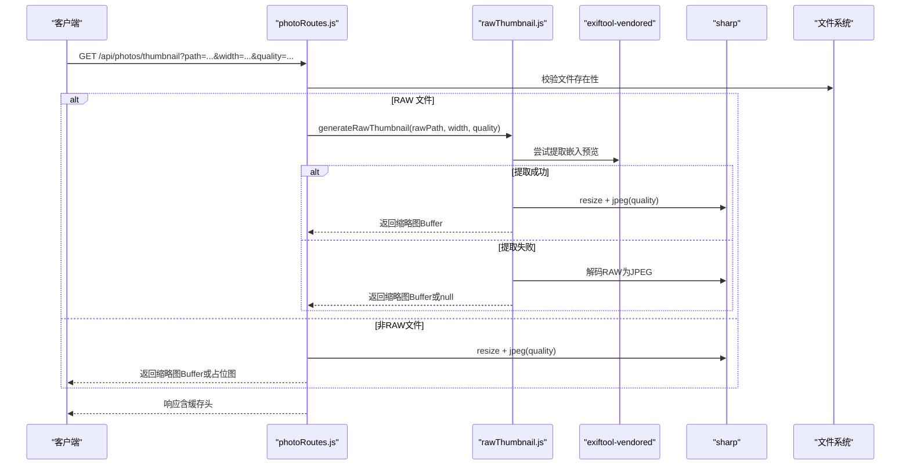
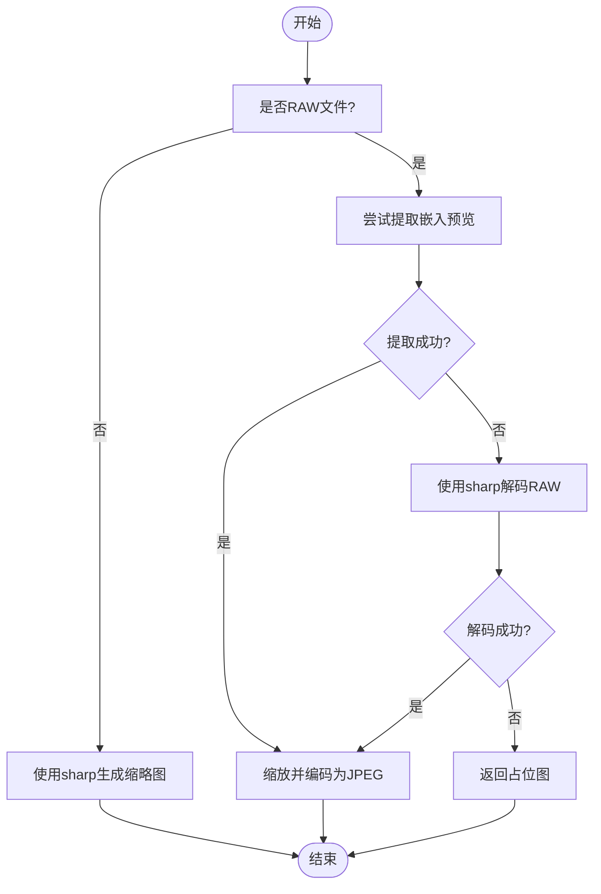
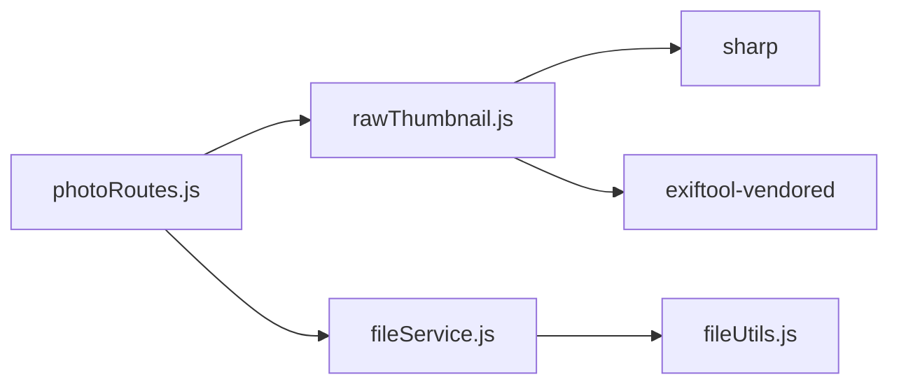

# 缩略图生成策略

<cite>
**本文引用的文件**
- [rawThumbnail.js](file://backend/src/utils/rawThumbnail.js)
- [photoRoutes.js](file://backend/src/routes/photoRoutes.js)
- [fileService.js](file://backend/src/services/fileService.js)
- [fileUtils.js](file://backend/src/utils/fileUtils.js)
- [package.json](file://backend/package.json)
- [README.md](file://README.md)
</cite>

## 目录
1. [引言](#引言)
2. [项目结构](#项目结构)
3. [核心组件](#核心组件)
4. [架构总览](#架构总览)
5. [详细组件分析](#详细组件分析)
6. [依赖关系分析](#依赖关系分析)
7. [性能考量](#性能考量)
8. [故障排查指南](#故障排查指南)
9. [结论](#结论)
10. [附录](#附录)

## 引言
本文件围绕 RAW 文件缩略图生成策略进行系统化梳理，重点阐述三级降级策略：
- 第一级：嵌入预览提取（优先使用 RAW 中的 JPEG 预览）
- 第二级：sharp 解码（直接解码 RAW 原始数据）
- 第三级：占位图生成（失败回退）

文档还涵盖缩略图尺寸控制、质量参数调节、内存优化策略、多分辨率生成逻辑、缓存机制、错误处理与回退方案，以及性能监控与优化建议，帮助读者在不同场景下做出合理选择并获得最佳体验。

## 项目结构
后端采用 Node.js + Express 架构，缩略图生成相关代码主要分布在以下模块：
- 路由层：负责接收请求、解析参数、分发到具体生成逻辑
- 服务层：提供文件扫描、分类、存储信息等基础能力
- 工具层：封装文件操作、RAW 缩略图生成等通用方法
- 依赖：sharp 用于图像处理，exiftool-vendored 用于提取嵌入预览

图表来源
- [photoRoutes.js:293-466](file://backend/src/routes/photoRoutes.js#L293-L466)
- [rawThumbnail.js:1-132](file://backend/src/utils/rawThumbnail.js#L1-L132)
- [fileService.js:1-443](file://backend/src/services/fileService.js#L1-L443)
- [fileUtils.js:1-167](file://backend/src/utils/fileUtils.js#L1-L167)

章节来源
- [README.md:145-158](file://README.md#L145-L158)
- [package.json:10-17](file://backend/package.json#L10-L17)

## 核心组件
- 路由层（photoRoutes.js）
  - 提供 /api/photos/thumbnail 接口，支持 width、quality 参数
  - 对 RAW 文件走专用生成流程；对视频走 ffmpeg 提取首帧；对其他格式走 sharp
  - 对生成失败的情况统一返回占位图
- RAW 缩略图工具（rawThumbnail.js）
  - 三级降级策略：嵌入预览 → sharp 解码 → 占位图
  - 嵌入预览提取支持多个标签，具备有效性校验
  - sharp 解码支持尺寸与质量参数
- 文件服务与工具（fileService.js、fileUtils.js）
  - 提供文件扫描、复制、删除、存储统计等能力
  - 为缩略图生成提供前置的文件存在性与类型判断

章节来源
- [photoRoutes.js:293-466](file://backend/src/routes/photoRoutes.js#L293-L466)
- [rawThumbnail.js:6-132](file://backend/src/utils/rawThumbnail.js#L6-L132)
- [fileService.js:1-443](file://backend/src/services/fileService.js#L1-L443)
- [fileUtils.js:1-167](file://backend/src/utils/fileUtils.js#L1-L167)

## 架构总览
缩略图生成的整体流程如下：

图表来源
- [photoRoutes.js:395-466](file://backend/src/routes/photoRoutes.js#L395-L466)
- [rawThumbnail.js:78-132](file://backend/src/utils/rawThumbnail.js#L78-L132)

## 详细组件分析

### 1. 三级降级策略详解
- 第一级：嵌入预览提取
  - 使用 exiftool-vendored 的二进制标签提取 API，尝试多个标签（如 JpgFromRaw、PreviewImage、ThumbnailImage）
  - 对提取到的二进制数据进行有效性校验（检查起始字节），确认为有效 JPEG 后再进行缩放与编码
  - 优点：无需解码 RAW，速度快、内存占用低
  - 适用：大多数现代相机的 RAW 文件包含嵌入预览
- 第二级：sharp 解码
  - 直接使用 sharp 解码 RAW 原始数据，按指定 width 进行缩放，并以指定 quality 编码为 JPEG
  - 优点：覆盖面广，几乎支持所有 RAW 格式
  - 代价：需要解码 RAW，CPU 与内存消耗较高
- 第三级：占位图生成
  - 当 RAW 生成失败或不可用时，由调用方返回 SVG 占位图
  - 优点：保证可用性，用户体验一致

图表来源
- [rawThumbnail.js:78-132](file://backend/src/utils/rawThumbnail.js#L78-L132)
- [photoRoutes.js:395-466](file://backend/src/routes/photoRoutes.js#L395-L466)

章节来源
- [rawThumbnail.js:6-132](file://backend/src/utils/rawThumbnail.js#L6-L132)
- [photoRoutes.js:395-466](file://backend/src/routes/photoRoutes.js#L395-L466)

### 2. 缩略图尺寸控制与质量参数
- 尺寸控制
  - 通过 width 参数控制缩略图宽度，保持宽高比不变（height 由比例自动生成）
  - sharp 的 resize 选项 withoutEnlargement=true，避免放大导致的模糊
- 质量参数
  - 嵌入预览阶段：固定质量参数
  - RAW 解码阶段：使用传入的 quality 参数
  - 非 RAW 文件：同样使用传入的 quality 参数
- 多分辨率生成
  - 通过调整 width 参数即可生成不同分辨率的缩略图
  - 调用方可按需选择 width，以平衡清晰度与体积

章节来源
- [rawThumbnail.js:34-36](file://backend/src/utils/rawThumbnail.js#L34-L36)
- [rawThumbnail.js:66-68](file://backend/src/utils/rawThumbnail.js#L66-L68)
- [photoRoutes.js:296-296](file://backend/src/routes/photoRoutes.js#L296-L296)

### 3. 内存优化策略
- 嵌入预览提取
  - 直接从 EXIF 中提取二进制数据，避免加载完整 RAW 文件
  - 仅在数据有效时进一步处理，减少不必要的内存分配
- RAW 解码
  - 使用 sharp 的流式处理能力，避免一次性将大图载入内存
  - withoutEnlargement 限制放大，降低解码复杂度
- 占位图
  - 生成 SVG 占位图，体积极小，不引入额外内存压力

章节来源
- [rawThumbnail.js:16-51](file://backend/src/utils/rawThumbnail.js#L16-L51)
- [rawThumbnail.js:64-76](file://backend/src/utils/rawThumbnail.js#L64-L76)

### 4. 缓存机制
- 缩略图响应头
  - 设置 Cache-Control: public, max-age=86400，缓存 1 天
  - 适用于静态缩略图，减少重复请求的计算与 I/O
- 视频缩略图
  - 同样设置缓存头，避免频繁调用 ffmpeg
- 注意
  - 若缩略图生成失败，返回占位图也带有缓存头，确保一致性

章节来源
- [photoRoutes.js:410-413](file://backend/src/routes/photoRoutes.js#L410-L413)
- [photoRoutes.js:436-439](file://backend/src/routes/photoRoutes.js#L436-L439)
- [photoRoutes.js:355-356](file://backend/src/routes/photoRoutes.js#L355-L356)
- [photoRoutes.js:387-388](file://backend/src/routes/photoRoutes.js#L387-L388)

### 5. 错误处理与回退方案
- 嵌入预览提取失败
  - 尝试多个标签，逐个失败则继续
  - 数据无效（非 JPEG）时跳过，进入下一级
- RAW 解码失败
  - 记录错误并返回 null，由调用方生成占位图
- 其他格式失败
  - 使用 sharp 失败时，返回通用占位图（SVG）
- 回退链路
  - 嵌入预览失败 → RAW 解码失败 → 占位图

章节来源
- [rawThumbnail.js:16-60](file://backend/src/utils/rawThumbnail.js#L16-L60)
- [rawThumbnail.js:118-128](file://backend/src/utils/rawThumbnail.js#L118-L128)
- [photoRoutes.js:420-458](file://backend/src/routes/photoRoutes.js#L420-L458)

### 6. 性能对比与质量评估
- 嵌入预览提取
  - 时间复杂度：近似 O(1)，取决于 EXIF 读取与 JPEG 解码
  - 内存占用：低，仅处理预览数据
  - 质量：受原始预览质量影响，通常清晰度有限
- RAW 解码（sharp）
  - 时间复杂度：与 RAW 像素规模成正比，CPU 密集型
  - 内存占用：中高，需解码完整 RAW
  - 质量：更高，可充分利用 RAW 的细节与色彩信息
- 占位图
  - 时间复杂度：O(1)
  - 内存占用：极低
  - 质量：不可替代，仅用于兜底

章节来源
- [rawThumbnail.js:6-61](file://backend/src/utils/rawThumbnail.js#L6-L61)
- [rawThumbnail.js:63-76](file://backend/src/utils/rawThumbnail.js#L63-L76)

### 7. 与路由层的集成
- 路由层根据文件类型分流：
  - RAW：调用 generateRawThumbnail，若返回 null 则回退占位图
  - 视频：调用 ffmpeg 提取首帧，失败时返回视频占位图
  - 其他：直接使用 sharp 生成 JPEG
- 参数透传：width、quality 由路由层解析并传入生成函数

章节来源
- [photoRoutes.js:395-466](file://backend/src/routes/photoRoutes.js#L395-L466)

## 依赖关系分析
- 关键依赖
  - sharp：图像处理（缩放、编码）
  - exiftool-vendored：RAW 元数据与嵌入预览提取
- 模块耦合
  - photoRoutes.js 依赖 rawThumbnail.js（RAW 专用）
  - rawThumbnail.js 依赖 sharp 与 exiftool-vendored
  - fileService.js 与 fileUtils.js 提供文件基础设施，间接支撑缩略图生成

图表来源
- [photoRoutes.js:293-466](file://backend/src/routes/photoRoutes.js#L293-L466)
- [rawThumbnail.js:1-132](file://backend/src/utils/rawThumbnail.js#L1-L132)
- [fileService.js:1-443](file://backend/src/services/fileService.js#L1-L443)
- [fileUtils.js:1-167](file://backend/src/utils/fileUtils.js#L1-L167)
- [package.json:10-17](file://backend/package.json#L10-L17)

章节来源
- [package.json:10-17](file://backend/package.json#L10-L17)

## 性能考量
- CPU 与内存
  - 优先使用嵌入预览提取，显著降低 CPU 与内存压力
  - 对于大量 RAW 文件，建议在路由层增加并发控制与限流，避免瞬时峰值
- I/O 与缓存
  - 合理利用 Cache-Control，减少重复生成
  - 对于高频访问的缩略图，可在网关或 CDN 层做缓存
- 参数调优
  - width 与 quality 的权衡：较小 width 与较低 quality 可降低体积与处理时间
  - withoutEnlargement 保证不放大，避免不必要的计算
- 日志与监控
  - 建议在 generateRawThumbnail 与 photoRoutes 的关键节点输出耗时指标
  - 对失败率与回退次数进行统计，辅助容量规划与策略调整

[本节为通用性能建议，不直接分析具体文件]

## 故障排查指南
- 常见问题
  - RAW 缩略图为空：确认 RAW 是否包含嵌入预览；检查 exiftool-vendored 安装与权限
  - 解码失败：检查 sharp 依赖与系统环境；确认 RAW 格式受支持
  - 占位图出现：确认 width、quality 参数是否合理；检查路由层回退逻辑
- 定位步骤
  - 查看后端日志：关注嵌入预览提取与解码过程的日志
  - 验证文件存在性与可读性
  - 尝试单独调用 generateRawThumbnail，观察返回值与错误信息
- 相关参考
  - README 中关于 RAW 缩略图生成的技术细节与故障排除说明

章节来源
- [README.md:174-178](file://README.md#L174-L178)
- [rawThumbnail.js:108-128](file://backend/src/utils/rawThumbnail.js#L108-L128)
- [photoRoutes.js:417-425](file://backend/src/routes/photoRoutes.js#L417-L425)

## 结论
本项目的 RAW 缩略图生成策略以“嵌入预览优先、RAW 解码兜底、占位图保用”为核心，兼顾了性能、质量与稳定性。通过参数化控制（width、quality）、合理的缓存策略与完善的错误回退，能够在不同设备与场景下提供一致的用户体验。建议在生产环境中结合监控指标持续优化参数与并发策略，以获得更佳的吞吐与延迟表现。

[本节为总结性内容，不直接分析具体文件]

## 附录
- 关键实现路径
  - 嵌入预览提取：[extractEmbeddedPreview:7-61](file://backend/src/utils/rawThumbnail.js#L7-L61)
  - RAW 解码：[decodeWithSharp:63-76](file://backend/src/utils/rawThumbnail.js#L63-L76)
  - 三级降级入口：[generateRawThumbnail:78-132](file://backend/src/utils/rawThumbnail.js#L78-L132)
  - 路由层分发与回退：[photoRoutes.js:395-466](file://backend/src/routes/photoRoutes.js#L395-L466)
- 依赖声明
  - [package.json:10-17](file://backend/package.json#L10-L17)