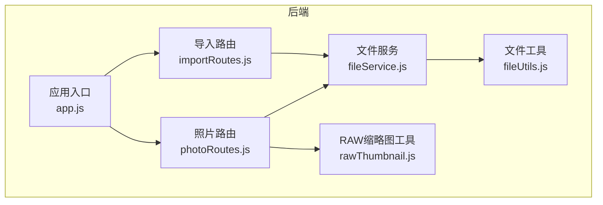
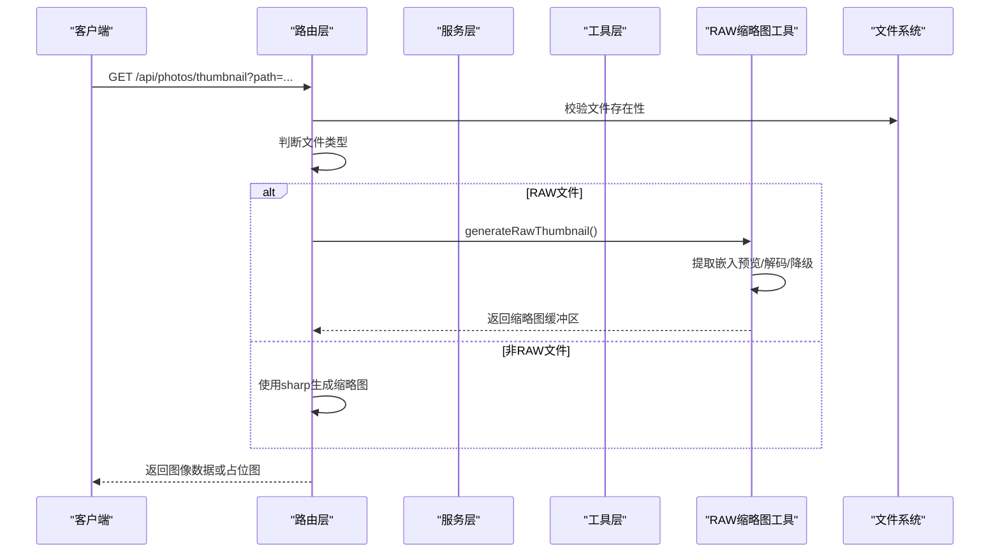
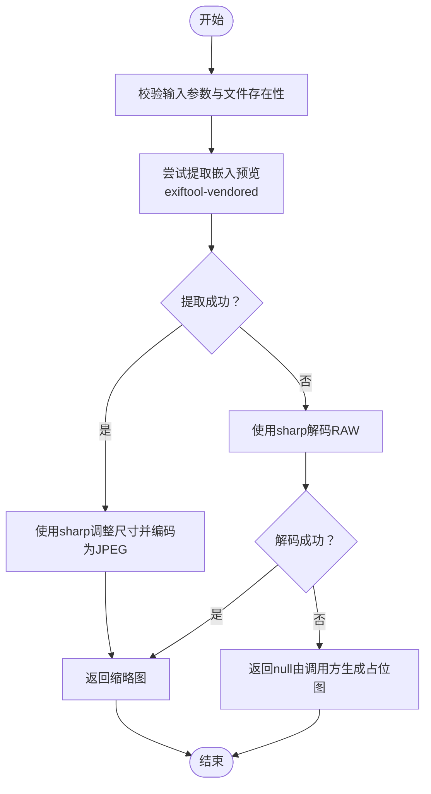
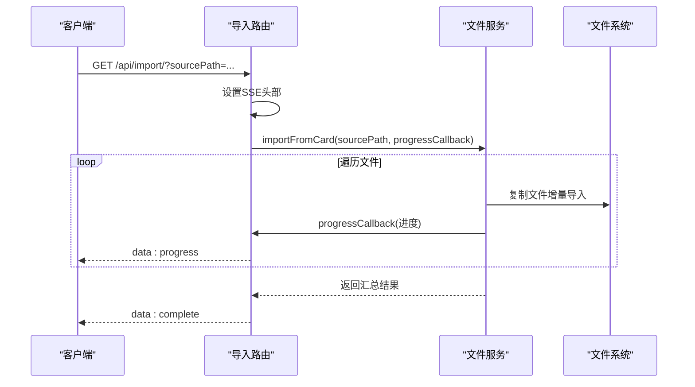
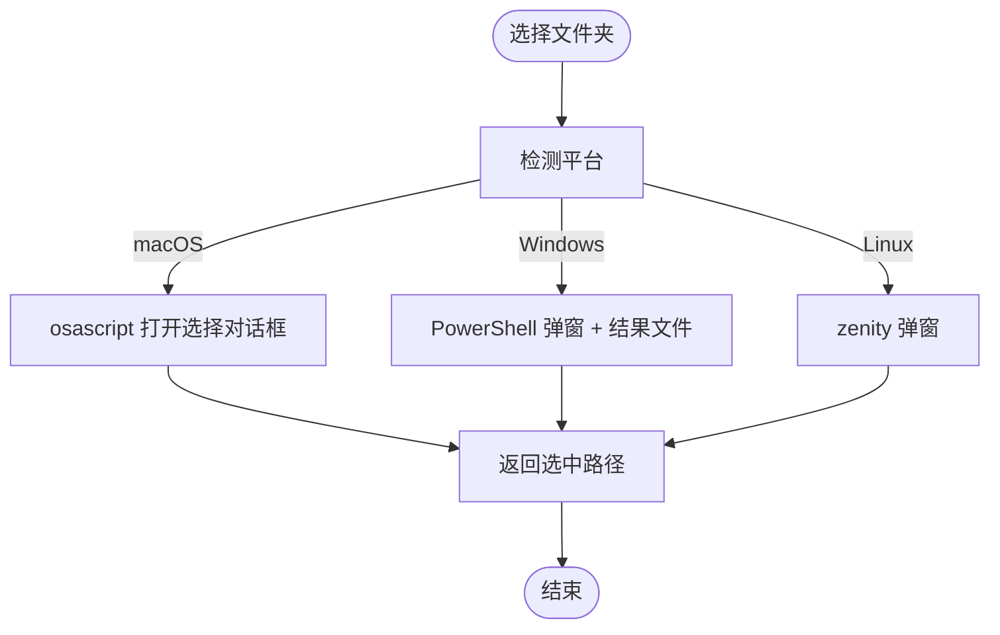
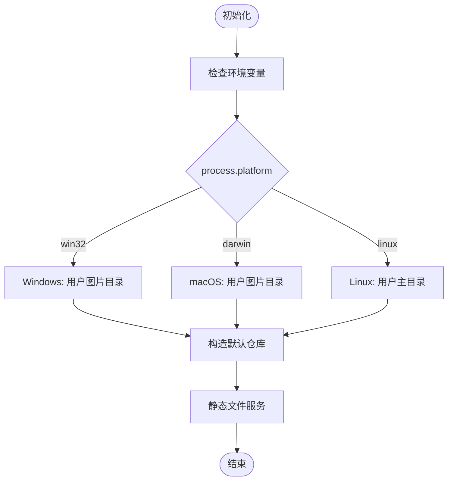
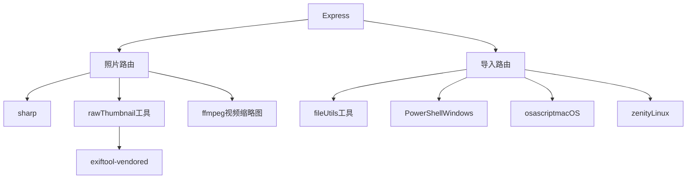

# 跨平台兼容性处理

<cite>
**本文引用的文件**
- [README.md](file://README.md)
- [backend/src/utils/rawThumbnail.js](file://backend/src/utils/rawThumbnail.js)
- [backend/src/utils/fileUtils.js](file://backend/src/utils/fileUtils.js)
- [backend/src/services/fileService.js](file://backend/src/services/fileService.js)
- [backend/src/routes/photoRoutes.js](file://backend/src/routes/photoRoutes.js)
- [backend/src/routes/importRoutes.js](file://backend/src/routes/importRoutes.js)
- [backend/src/app.js](file://backend/src/app.js)
- [backend/package.json](file://backend/package.json)
- [backend/data/repos.json](file://backend/data/repos.json)
</cite>

## 目录
1. [引言](#引言)
2. [项目结构](#项目结构)
3. [核心组件](#核心组件)
4. [架构概览](#架构概览)
5. [详细组件分析](#详细组件分析)
6. [依赖分析](#依赖分析)
7. [性能考虑](#性能考虑)
8. [故障排除指南](#故障排除指南)
9. [结论](#结论)
10. [附录](#附录)

## 引言
本文件面向跨平台兼容性处理，聚焦于RAW文件处理在Windows、macOS、Linux平台上的差异与适配策略。项目采用Node.js + Express后端，结合sharp库与exiftool-vendored实现RAW文件嵌入预览提取与缩略图生成，并通过平台特定的文件路径处理、权限管理、命令调用与错误处理策略，确保在三大主流操作系统上的一致行为与稳定性。

## 项目结构
后端采用模块化设计：
- 路由层：处理HTTP请求与SSE事件推送
- 服务层：封装业务逻辑（导入、文件操作、RAW缩略图生成）
- 工具层：提供文件扫描、复制、删除、路径处理等通用能力
- 应用入口：统一中间件、静态文件服务、健康检查与全局错误处理

图表来源
- [backend/src/app.js:1-146](file://backend/src/app.js#L1-L146)
- [backend/src/routes/photoRoutes.js:1-739](file://backend/src/routes/photoRoutes.js#L1-L739)
- [backend/src/routes/importRoutes.js:1-627](file://backend/src/routes/importRoutes.js#L1-L627)
- [backend/src/services/fileService.js:1-443](file://backend/src/services/fileService.js#L1-L443)
- [backend/src/utils/fileUtils.js:1-167](file://backend/src/utils/fileUtils.js#L1-L167)
- [backend/src/utils/rawThumbnail.js:1-132](file://backend/src/utils/rawThumbnail.js#L1-L132)

章节来源
- [backend/src/app.js:1-146](file://backend/src/app.js#L1-L146)
- [backend/src/routes/photoRoutes.js:1-739](file://backend/src/routes/photoRoutes.js#L1-L739)
- [backend/src/routes/importRoutes.js:1-627](file://backend/src/routes/importRoutes.js#L1-L627)
- [backend/src/services/fileService.js:1-443](file://backend/src/services/fileService.js#L1-L443)
- [backend/src/utils/fileUtils.js:1-167](file://backend/src/utils/fileUtils.js#L1-L167)
- [backend/src/utils/rawThumbnail.js:1-132](file://backend/src/utils/rawThumbnail.js#L1-L132)

## 核心组件
- 跨平台路径与默认仓库解析：根据process.platform自动确定默认照片目录，支持Windows、macOS、Linux三类平台。
- RAW缩略图生成：优先尝试从RAW文件提取嵌入JPEG预览，其次使用sharp解码，最后回退到占位图。
- 文件导入与进度推送：基于SSE实时推送导入进度，支持并发控制与错误处理。
- 平台特定交互：文件夹选择对话框分别针对macOS（osascript）、Windows（PowerShell）、Linux（zenity）实现。
- 错误处理与日志：统一的请求日志中间件、全局未捕获异常与未处理Promise拒绝处理、路由级错误响应。

章节来源
- [backend/src/app.js:46-112](file://backend/src/app.js#L46-L112)
- [backend/src/routes/photoRoutes.js:48-66](file://backend/src/routes/photoRoutes.js#L48-L66)
- [backend/src/utils/rawThumbnail.js:78-129](file://backend/src/utils/rawThumbnail.js#L78-L129)
- [backend/src/routes/importRoutes.js:342-624](file://backend/src/routes/importRoutes.js#L342-L624)
- [backend/src/app.js:123-143](file://backend/src/app.js#L123-L143)

## 架构概览
后端通过Express提供REST API与SSE事件，路由层根据请求类型调用服务层或工具层；服务层协调文件系统操作与RAW缩略图生成；工具层提供跨平台路径与文件操作能力；应用入口负责中间件、静态文件服务与全局错误处理。

图表来源
- [backend/src/routes/photoRoutes.js:294-466](file://backend/src/routes/photoRoutes.js#L294-L466)
- [backend/src/utils/rawThumbnail.js:78-129](file://backend/src/utils/rawThumbnail.js#L78-L129)

章节来源
- [backend/src/routes/photoRoutes.js:294-466](file://backend/src/routes/photoRoutes.js#L294-L466)
- [backend/src/utils/rawThumbnail.js:78-129](file://backend/src/utils/rawThumbnail.js#L78-L129)

## 详细组件分析

### RAW缩略图生成组件（跨平台）
该组件实现了三层降级策略：
1) 尝试从RAW文件提取嵌入JPEG预览（exiftool-vendored）
2) 使用sharp直接解码RAW文件
3) 回退到占位图

图表来源
- [backend/src/utils/rawThumbnail.js:78-129](file://backend/src/utils/rawThumbnail.js#L78-L129)

章节来源
- [backend/src/utils/rawThumbnail.js:1-132](file://backend/src/utils/rawThumbnail.js#L1-L132)

### 文件导入与进度推送（跨平台）
导入流程通过SSE向客户端实时推送进度，支持并发控制与错误处理：
- 并发限制：最多同时处理3个文件，避免内存溢出
- 进度计算：基于平均耗时估算剩余时间
- 错误处理：捕获单文件错误并记录，不影响整体流程

图表来源
- [backend/src/routes/importRoutes.js:82-182](file://backend/src/routes/importRoutes.js#L82-L182)
- [backend/src/services/fileService.js:24-167](file://backend/src/services/fileService.js#L24-L167)

章节来源
- [backend/src/routes/importRoutes.js:82-182](file://backend/src/routes/importRoutes.js#L82-L182)
- [backend/src/services/fileService.js:24-167](file://backend/src/services/fileService.js#L24-L167)

### 平台特定的文件夹选择对话框
- macOS：使用osascript调用AppleScript，spawn方式执行，支持超时控制
- Windows：生成临时PowerShell脚本，使用System.Windows.Forms弹出文件夹选择对话框，UTF8编码写入结果文件
- Linux：使用zenity命令行工具弹出文件夹选择对话框

图表来源
- [backend/src/routes/importRoutes.js:342-624](file://backend/src/routes/importRoutes.js#L342-L624)

章节来源
- [backend/src/routes/importRoutes.js:342-624](file://backend/src/routes/importRoutes.js#L342-L624)

### 跨平台路径与默认仓库解析
- 默认照片路径：根据process.platform自动选择用户图片目录或主目录
- 静态文件服务：支持多仓库路径，按repo参数动态提供文件
- 环境变量：支持PHOTO_BASE_PATH、DEFAULT_IMPORT_PATH、DATA_DIR等

图表来源
- [backend/src/app.js:46-112](file://backend/src/app.js#L46-L112)
- [backend/src/routes/photoRoutes.js:48-66](file://backend/src/routes/photoRoutes.js#L48-L66)

章节来源
- [backend/src/app.js:46-112](file://backend/src/app.js#L46-L112)
- [backend/src/routes/photoRoutes.js:48-66](file://backend/src/routes/photoRoutes.js#L48-L66)

## 依赖分析
- 核心依赖：sharp（图像处理）、exiftool-vendored（RAW元数据与嵌入预览提取）、express（Web框架）、cors（跨域）、multer（文件上传）
- 平台特定命令：ffmpeg（视频缩略图）、PowerShell（Windows文件夹选择）、osascript（macOS文件夹选择）、zenity（Linux文件夹选择）

图表来源
- [backend/package.json:10-21](file://backend/package.json#L10-L21)
- [backend/src/routes/photoRoutes.js:323-392](file://backend/src/routes/photoRoutes.js#L323-L392)
- [backend/src/routes/importRoutes.js:410-606](file://backend/src/routes/importRoutes.js#L410-L606)

章节来源
- [backend/package.json:10-21](file://backend/package.json#L10-L21)
- [backend/src/routes/photoRoutes.js:323-392](file://backend/src/routes/photoRoutes.js#L323-L392)
- [backend/src/routes/importRoutes.js:410-606](file://backend/src/routes/importRoutes.js#L410-L606)

## 性能考虑
- 并发控制：导入时限制同时处理的文件数，避免内存峰值过高
- 流式传输：预览与缩略图生成使用流式读取，避免一次性加载大文件到内存
- 缓存策略：缩略图设置Cache-Control头，提升重复访问性能
- 降级策略：RAW缩略图生成采用三层降级，保证在不同环境下均有可用结果
- 资源管理：SSE连接设置超时保护，防止长时间占用资源

章节来源
- [backend/src/services/fileService.js:75-156](file://backend/src/services/fileService.js#L75-L156)
- [backend/src/routes/photoRoutes.js:264-280](file://backend/src/routes/photoRoutes.js#L264-L280)
- [backend/src/utils/rawThumbnail.js:78-129](file://backend/src/utils/rawThumbnail.js#L78-L129)

## 故障排除指南
- RAW缩略图不显示
  - 确认RAW文件包含嵌入JPEG预览
  - 检查exiftool-vendored依赖安装情况
  - 查看后端日志中的异常堆栈
- 视频缩略图失败
  - 确认系统已安装ffmpeg
  - 检查ffmpeg执行权限与路径
- 文件夹选择对话框失败
  - macOS：确认系统允许AppleScript运行
  - Windows：确认PowerShell执行策略允许脚本运行
  - Linux：确认已安装zenity
- CORS错误
  - 检查后端CORS配置
  - 确认前端与后端端口一致
- 超时问题
  - 减少单次导入文件数量
  - 调整前端超时时间配置

章节来源
- [README.md:166-187](file://README.md#L166-L187)
- [backend/src/routes/photoRoutes.js:377-391](file://backend/src/routes/photoRoutes.js#L377-L391)
- [backend/src/routes/importRoutes.js:545-586](file://backend/src/routes/importRoutes.js#L545-L586)

## 结论
本项目通过明确的平台识别、路径适配与命令调用策略，在Windows、macOS、Linux三大平台上实现了RAW文件处理的跨平台一致性。借助三层降级的缩略图生成策略、SSE实时进度推送与严格的错误处理机制，系统在不同平台环境下均能提供稳定可靠的用户体验。建议在部署时根据目标平台安装相应的系统依赖，并通过环境变量进行路径与行为定制。

## 附录

### 平台特定安装与配置要求
- Windows
  - 系统依赖：无额外依赖（文件夹选择通过PowerShell）
  - Node.js：推荐v16+
  - 依赖安装：npm install
- macOS
  - 系统依赖：osascript（系统自带）
  - Node.js：推荐v16+
  - 依赖安装：npm install
- Linux
  - 系统依赖：zenity（sudo apt install zenity）
  - Node.js：推荐v16+
  - 依赖安装：npm install

章节来源
- [README.md:46-57](file://README.md#L46-L57)
- [backend/src/routes/importRoutes.js:587-606](file://backend/src/routes/importRoutes.js#L587-L606)

### 平台特定的文件路径处理与权限管理
- 默认路径：根据process.platform自动选择用户图片目录或主目录
- 权限管理：导入与文件操作遵循Node.js fs模块权限模型，确保目标目录存在且可写
- 路径安全：使用path模块进行路径拼接，避免路径遍历攻击

章节来源
- [backend/src/app.js:46-112](file://backend/src/app.js#L46-L112)
- [backend/src/utils/fileUtils.js:23-66](file://backend/src/utils/fileUtils.js#L23-L66)

### 平台特定的错误处理与日志记录策略
- 请求日志：统一中间件记录请求方法与URL
- 全局异常：未捕获异常与未处理Promise拒绝记录到日志，保持服务运行
- 路由级错误：SSE与API路由均提供结构化错误响应
- 平台特定错误：PowerShell脚本执行错误、osascript执行错误、zenity调用失败均有针对性处理

章节来源
- [backend/src/app.js:22-26](file://backend/src/app.js#L22-L26)
- [backend/src/app.js:133-143](file://backend/src/app.js#L133-L143)
- [backend/src/routes/photoRoutes.js:281-290](file://backend/src/routes/photoRoutes.js#L281-L290)
- [backend/src/routes/importRoutes.js:545-586](file://backend/src/routes/importRoutes.js#L545-L586)

### 跨平台测试方法与兼容性验证流程
- 测试矩阵：在Windows、macOS、Linux三台机器上分别验证导入、缩略图生成、SSE进度推送功能
- 兼容性验证：检查RAW文件嵌入预览提取成功率、占位图回退行为、平台特定命令调用
- 性能验证：对比不同平台下的导入速度、内存占用与CPU使用率
- 回归测试：每次更新后重新验证三大平台的核心功能

章节来源
- [README.md:160-165](file://README.md#L160-L165)