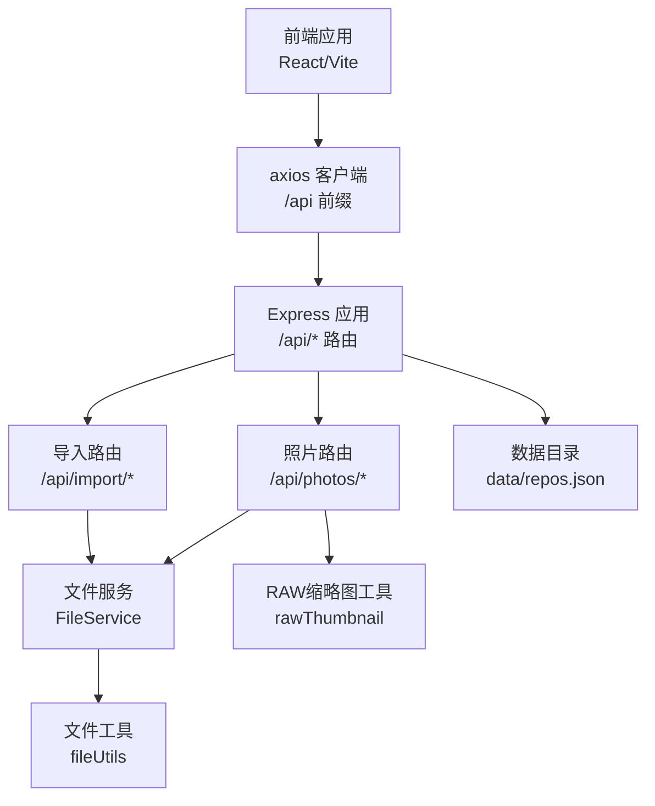
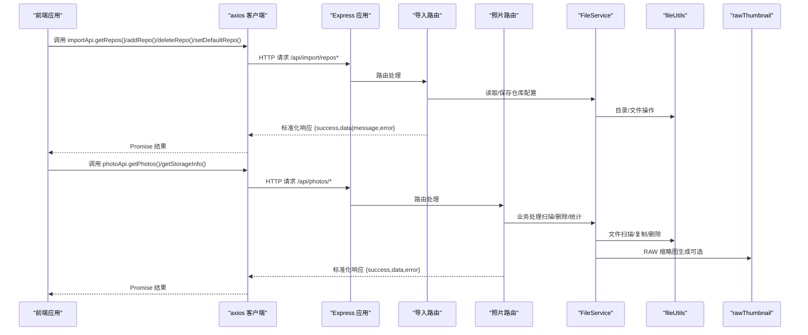
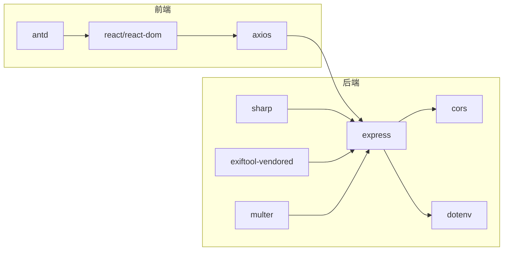

# 仓库API集成

<cite>
**本文引用的文件**
- [backend/src/app.js](file://backend/src/app.js)
- [frontend/src/api/index.js](file://frontend/src/api/index.js)
- [backend/src/routes/photoRoutes.js](file://backend/src/routes/photoRoutes.js)
- [backend/src/routes/importRoutes.js](file://backend/src/routes/importRoutes.js)
- [backend/src/services/fileService.js](file://backend/src/services/fileService.js)
- [backend/src/utils/fileUtils.js](file://backend/src/utils/fileUtils.js)
- [backend/src/utils/rawThumbnail.js](file://backend/src/utils/rawThumbnail.js)
- [backend/data/repos.json](file://backend/data/repos.json)
- [config/repos.json](file://config/repos.json)
- [backend/package.json](file://backend/package.json)
- [frontend/package.json](file://frontend/package.json)
</cite>

## 目录
1. [简介](#简介)
2. [项目结构](#项目结构)
3. [核心组件](#核心组件)
4. [架构总览](#架构总览)
5. [详细组件分析](#详细组件分析)
6. [依赖分析](#依赖分析)
7. [性能考虑](#性能考虑)
8. [故障排查指南](#故障排查指南)
9. [结论](#结论)
10. [附录](#附录)

## 简介
本文件系统性梳理了 Photo Manager 项目中“仓库API”的集成设计与实现，重点覆盖以下方面：
- 前端API调用与后端路由的集成关系
- 仓库管理相关接口：getRepos、addRepo、deleteRepo、setDefaultRepo 的实现细节
- 请求参数验证、错误处理与响应格式标准化
- 后端与前端的通信模型（含SSE）
- 安全验证与权限控制现状与建议
- 使用示例与最佳实践
- 性能优化与缓存策略
- API版本管理与向后兼容性

## 项目结构
该项目采用前后端分离架构：
- 前端基于 React/Vite，通过 axios 与后端 /api 前缀对接
- 后端基于 Express，提供 /api/photos 与 /api/import 两条路由域
- 仓库配置位于后端 data 目录下的 repos.json，支持默认仓库与多仓库管理
- Electron 主进程与渲染器进程未在本次分析范围内发现直接的 IPC 通信代码，因此本节不涉及具体 IPC 实现细节

图表来源
- [backend/src/app.js:114-116](file://backend/src/app.js#L114-L116)
- [frontend/src/api/index.js:3](file://frontend/src/api/index.js#L3-L6)
- [backend/src/routes/photoRoutes.js:1-2](file://backend/src/routes/photoRoutes.js#L1-L2)
- [backend/src/routes/importRoutes.js:1-2](file://backend/src/routes/importRoutes.js#L1-L2)
- [backend/src/services/fileService.js:1-8](file://backend/src/services/fileService.js#L1-L8)
- [backend/src/utils/fileUtils.js:1-3](file://backend/src/utils/fileUtils.js#L1-L3)
- [backend/src/utils/rawThumbnail.js:1-4](file://backend/src/utils/rawThumbnail.js#L1-L4)

章节来源
- [backend/src/app.js:114-116](file://backend/src/app.js#L114-L116)
- [frontend/src/api/index.js:3](file://frontend/src/api/index.js#L3-L6)

## 核心组件
- 前端 axios 客户端：统一配置 baseURL 为 /api，并封装照片与导入相关 API
- Express 应用：启用 CORS、JSON 解析、静态文件服务、健康检查与全局错误处理
- 路由层：照片路由与导入路由分别处理照片浏览、存储信息、RAW 管理、导入流程等
- 服务层：FileService 封装文件扫描、复制、删除、RAW 同步删除、统计等业务逻辑
- 工具层：fileUtils 提供扫描、复制、删除、重命名等通用能力；rawThumbnail 提供 RAW 缩略图生成策略

章节来源
- [frontend/src/api/index.js:1-168](file://frontend/src/api/index.js#L1-L168)
- [backend/src/app.js:1-146](file://backend/src/app.js#L1-L146)
- [backend/src/routes/photoRoutes.js:1-739](file://backend/src/routes/photoRoutes.js#L1-L739)
- [backend/src/routes/importRoutes.js:1-627](file://backend/src/routes/importRoutes.js#L1-L627)
- [backend/src/services/fileService.js:1-443](file://backend/src/services/fileService.js#L1-L443)
- [backend/src/utils/fileUtils.js:1-167](file://backend/src/utils/fileUtils.js#L1-L167)
- [backend/src/utils/rawThumbnail.js:1-132](file://backend/src/utils/rawThumbnail.js#L1-L132)

## 架构总览
下图展示了从前端调用到后端路由、服务与文件系统的整体交互：

图表来源
- [frontend/src/api/index.js:151-161](file://frontend/src/api/index.js#L151-L161)
- [backend/src/routes/importRoutes.js:218-340](file://backend/src/routes/importRoutes.js#L218-L340)
- [backend/src/routes/photoRoutes.js:68-92](file://backend/src/routes/photoRoutes.js#L68-L92)
- [backend/src/services/fileService.js:169-224](file://backend/src/services/fileService.js#L169-L224)
- [backend/src/utils/fileUtils.js:22-66](file://backend/src/utils/fileUtils.js#L22-L66)
- [backend/src/utils/rawThumbnail.js:78-129](file://backend/src/utils/rawThumbnail.js#L78-L129)

## 详细组件分析

### 前端 API 客户端
- 统一基础路径：/api
- 照片相关 API：getPhotos、getStorageInfo、getOrphanRaws、deletePhoto、batchDeleteRaws、getPreviewUrl、openLocation、batchExport
- 导入相关 API：importFromCard（使用 SSE）、getDefaultPath、getRepos、addRepo、deleteRepo、setDefaultRepo、selectFolder
- 导入流程采用 EventSource 实时接收进度与结果，支持超时与错误处理

章节来源
- [frontend/src/api/index.js:1-168](file://frontend/src/api/index.js#L1-L168)

### 后端 Express 应用
- 中间件：CORS（允许凭证与多种方法）、JSON 解析、请求日志
- 静态文件服务：/uploads 动态路由，根据 repo 参数切换不同仓库路径
- 健康检查：/api/health
- 全局错误处理：捕获未处理异常与 Promise 拒绝，避免服务崩溃

章节来源
- [backend/src/app.js:13-26](file://backend/src/app.js#L13-L26)
- [backend/src/app.js:67-91](file://backend/src/app.js#L67-L91)
- [backend/src/app.js:118-127](file://backend/src/app.js#L118-L127)
- [backend/src/app.js:133-143](file://backend/src/app.js#L133-L143)

### 导入路由（/api/import）
- 仓库管理接口
  - GET /repos：列出仓库
  - POST /repos：新增仓库（校验必填字段、自动创建目录、默认仓库互斥）
  - DELETE /repos/:id：删除仓库（若删除默认仓库则重新设定默认）
  - PUT /repos/:id/default：设置默认仓库
- 导入流程
  - GET /：SSE 实时进度，支持 autoRename 参数，进度回调通过 SSE 推送
- 文件夹选择
  - GET /select-folder：跨平台打开系统文件夹选择对话框（macOS 使用 osascript，Windows 使用 PowerShell，Linux 使用 zenity）

章节来源
- [backend/src/routes/importRoutes.js:218-340](file://backend/src/routes/importRoutes.js#L218-L340)
- [backend/src/routes/importRoutes.js:82-182](file://backend/src/routes/importRoutes.js#L82-L182)
- [backend/src/routes/importRoutes.js:342-624](file://backend/src/routes/importRoutes.js#L342-L624)

### 照片路由（/api/photos）
- 列表与查询
  - GET /：按分类、分页、排序查询照片，支持 repoId 参数
  - GET /storage-info：统计各分类数量与容量
  - GET /orphan-raws：查找无对应 JPG 的 RAW 文件
- 删除与批量删除
  - DELETE /:id：删除照片并可选同步删除 RAW
  - POST /batch-delete-raws：批量删除 RAW 文件
- 预览与缩略图
  - GET /preview：支持 Range 请求的视频流式预览与非视频文件流式下载
  - GET /thumbnail：动态生成缩略图，RAW 文件优先提取嵌入预览，否则降级为解码或占位图
  - GET /:id/preview：基于 base64 ID 的预览（与上述 preview 路由互补）
- 文件定位
  - POST /open-location：跨平台打开文件或文件夹
- 批量导出
  - POST /batch-export：增量复制到目标路径，记录成功/失败/跳过

章节来源
- [backend/src/routes/photoRoutes.js:68-92](file://backend/src/routes/photoRoutes.js#L68-L92)
- [backend/src/routes/photoRoutes.js:94-128](file://backend/src/routes/photoRoutes.js#L94-L128)
- [backend/src/routes/photoRoutes.js:130-176](file://backend/src/routes/photoRoutes.js#L130-L176)
- [backend/src/routes/photoRoutes.js:178-291](file://backend/src/routes/photoRoutes.js#L178-L291)
- [backend/src/routes/photoRoutes.js:293-466](file://backend/src/routes/photoRoutes.js#L293-L466)
- [backend/src/routes/photoRoutes.js:468-571](file://backend/src/routes/photoRoutes.js#L468-L571)
- [backend/src/routes/photoRoutes.js:575-640](file://backend/src/routes/photoRoutes.js#L575-L640)
- [backend/src/routes/photoRoutes.js:642-736](file://backend/src/routes/photoRoutes.js#L642-L736)

### 服务与工具层
- FileService
  - 导入：并发限制、增量复制、进度回调、错误与跳过统计
  - 查询：按分类扫描、排序、分页、生成缩略图/预览URL
  - 删除：同步删除 RAW、批量删除 RAW
  - 统计：各分类计数与容量
  - RAW：查找孤立 RAW、批量删除 RAW
- fileUtils
  - 递归扫描、确保目录存在、增量复制、删除、文件名处理、同文件判断、重命名策略
- rawThumbnail
  - 三级降级策略：嵌入预览 → 解码RAW → 占位图

章节来源
- [backend/src/services/fileService.js:23-167](file://backend/src/services/fileService.js#L23-L167)
- [backend/src/services/fileService.js:169-224](file://backend/src/services/fileService.js#L169-L224)
- [backend/src/services/fileService.js:226-267](file://backend/src/services/fileService.js#L226-L267)
- [backend/src/services/fileService.js:269-306](file://backend/src/services/fileService.js#L269-L306)
- [backend/src/services/fileService.js:308-334](file://backend/src/services/fileService.js#L308-L334)
- [backend/src/services/fileService.js:336-372](file://backend/src/services/fileService.js#L336-L372)
- [backend/src/utils/fileUtils.js:22-137](file://backend/src/utils/fileUtils.js#L22-L137)
- [backend/src/utils/rawThumbnail.js:78-129](file://backend/src/utils/rawThumbnail.js#L78-L129)

### 仓库配置与默认路径
- 仓库配置文件：backend/data/repos.json
- 默认仓库：当读取失败时按平台生成默认路径并初始化
- 配置示例：config/repos.json

章节来源
- [backend/data/repos.json:1-8](file://backend/data/repos.json#L1-L8)
- [config/repos.json:1-20](file://config/repos.json#L1-L20)
- [backend/src/routes/importRoutes.js:23-53](file://backend/src/routes/importRoutes.js#L23-L53)
- [backend/src/routes/photoRoutes.js:10-24](file://backend/src/routes/photoRoutes.js#L10-L24)

## 依赖分析
- 前端依赖
  - axios：HTTP 客户端
  - react/react-dom：UI 框架
  - antd：UI 组件库
- 后端依赖
  - express：Web 框架
  - cors：跨域支持
  - dotenv：环境变量
  - sharp/exiftool-vendored：图像处理与 RAW 缩略图
  - multer：文件上传（当前未在仓库API中使用）

图表来源
- [frontend/package.json:12-20](file://frontend/package.json#L12-L20)
- [backend/package.json:10-17](file://backend/package.json#L10-L17)

章节来源
- [frontend/package.json:12-20](file://frontend/package.json#L12-L20)
- [backend/package.json:10-17](file://backend/package.json#L10-L17)

## 性能考虑
- 流式传输与 Range 支持：预览路由对视频与大文件采用流式传输，减少内存占用
- 并发控制：导入时限制并发数，避免内存峰值过高
- 缓存策略：缩略图与静态资源设置 Cache-Control，提升重复访问性能
- 增量导入：复制时仅在文件不存在或内容不一致时进行，避免重复IO
- 分页与排序：列表查询支持分页与排序，降低单次响应体积

章节来源
- [backend/src/routes/photoRoutes.js:226-280](file://backend/src/routes/photoRoutes.js#L226-L280)
- [backend/src/routes/photoRoutes.js:507-561](file://backend/src/routes/photoRoutes.js#L507-L561)
- [backend/src/services/fileService.js:75-156](file://backend/src/services/fileService.js#L75-L156)
- [backend/src/routes/photoRoutes.js:293-466](file://backend/src/routes/photoRoutes.js#L293-L466)

## 故障排查指南
- 常见错误与响应格式
  - 参数缺失：返回 {success:false, error:"..."}，状态码 400
  - 资源不存在：返回 {success:false, error:"..."}，状态码 404
  - 服务器内部错误：返回 {success:false, error:"..."}，状态码 500
- 导入流程
  - SSE 连接：检查 EventSource 是否正确建立，关注 open/message/error 事件
  - 超时处理：导入超时（约5分钟）会主动关闭连接并拒绝 Promise
- 文件操作
  - 复制/删除失败：检查目标路径权限与磁盘空间
  - RAW 缩略图生成失败：降级为占位图，确认 exiftool 与 sharp 可用

章节来源
- [frontend/src/api/index.js:38-141](file://frontend/src/api/index.js#L38-L141)
- [backend/src/routes/photoRoutes.js:183-201](file://backend/src/routes/photoRoutes.js#L183-L201)
- [backend/src/routes/photoRoutes.js:575-640](file://backend/src/routes/photoRoutes.js#L575-L640)
- [backend/src/utils/rawThumbnail.js:118-128](file://backend/src/utils/rawThumbnail.js#L118-L128)

## 结论
本仓库API集成了多仓库管理、导入导出、照片浏览与RAW处理等核心能力，前后端通过标准化的 /api 前缀进行通信。路由层负责参数校验与SSE推送，服务层封装业务逻辑，工具层提供文件系统操作与RAW缩略图生成。整体具备良好的可维护性与扩展性，建议后续在安全与权限控制方面进一步完善。

## 附录

### API 接口定义与调用示例

- 仓库管理
  - 获取仓库列表：GET /api/import/repos
  - 新增仓库：POST /api/import/repos（body：{name,path,isDefault}）
  - 删除仓库：DELETE /api/import/repos/:id
  - 设置默认仓库：PUT /api/import/repos/:id/default
  - 示例调用路径：[frontend/src/api/index.js:151-161](file://frontend/src/api/index.js#L151-L161)

- 导入流程（SSE）
  - GET /api/import?sourcePath=&repoId=&autoRename=
  - 前端 EventSource 监听 progress/complete/error 类型消息
  - 示例调用路径：[frontend/src/api/index.js:38-141](file://frontend/src/api/index.js#L38-L141)

- 照片浏览与管理
  - 列表查询：GET /api/photos?category=&page=&pageSize=&sortBy=&sortOrder=&repoId=
  - 存储信息：GET /api/photos/storage-info?repoId=
  - 孤立RAW：GET /api/photos/orphan-raws?repoId=
  - 删除照片：DELETE /api/photos/:id?syncRaw=&repoId=
  - 批量删除RAW：POST /api/photos/batch-delete-raws（body：{fileIds:[],repoId}）
  - 示例调用路径：[frontend/src/api/index.js:9-34](file://frontend/src/api/index.js#L9-L34)

- 预览与缩略图
  - 预览：GET /api/photos/preview?path=（支持 Range）
  - 缩略图：GET /api/photos/thumbnail?path=&width=&quality=
  - 示例调用路径：[frontend/src/api/index.js:25-26](file://frontend/src/api/index.js#L25-L26)

- 文件定位与批量导出
  - 打开位置：POST /api/photos/open-location（body：{filePath,mode}）
  - 批量导出：POST /api/photos/batch-export（body：{fileIds,targetPath,repoId}）
  - 示例调用路径：[frontend/src/api/index.js:28-34](file://frontend/src/api/index.js#L28-L34)

### 响应格式标准化
- 成功响应：{success:true, data:...}
- 失败响应：{success:false, error:"..."}
- 特殊场景：导入完成返回 {type:"complete", data:{...}}，错误返回 {type:"error", error:"..."}

章节来源
- [backend/src/routes/importRoutes.js:218-340](file://backend/src/routes/importRoutes.js#L218-L340)
- [backend/src/routes/photoRoutes.js:68-92](file://backend/src/routes/photoRoutes.js#L68-L92)
- [backend/src/routes/photoRoutes.js:94-128](file://backend/src/routes/photoRoutes.js#L94-L128)
- [backend/src/routes/photoRoutes.js:130-176](file://backend/src/routes/photoRoutes.js#L130-L176)
- [backend/src/routes/photoRoutes.js:178-291](file://backend/src/routes/photoRoutes.js#L178-L291)
- [backend/src/routes/photoRoutes.js:293-466](file://backend/src/routes/photoRoutes.js#L293-L466)
- [backend/src/routes/photoRoutes.js:468-571](file://backend/src/routes/photoRoutes.js#L468-L571)
- [backend/src/routes/photoRoutes.js:575-640](file://backend/src/routes/photoRoutes.js#L575-L640)
- [backend/src/routes/photoRoutes.js:642-736](file://backend/src/routes/photoRoutes.js#L642-L736)

### 安全验证与权限控制
- 当前实现
  - 跨域：CORS 允许凭证与多种方法
  - 身份认证：未发现显式的鉴权中间件
  - 权限控制：未发现针对路由的权限校验
- 建议
  - 引入 JWT 或会话机制
  - 对敏感操作（新增/删除仓库、批量删除）增加权限校验
  - 对外部可访问的静态文件服务增加访问控制与路径白名单

章节来源
- [backend/src/app.js:14-18](file://backend/src/app.js#L14-L18)

### Electron 主进程 IPC 说明
- 本次分析未发现 Electron 主进程与渲染器进程之间的 IPC 通信代码
- 若需在桌面端集成文件夹选择等能力，可在主进程中暴露 IPC 接口并与导入路由配合

[本节为概念性说明，不涉及具体源码映射]

### 最佳实践
- 前端
  - 使用 axios 拦截器统一处理错误与加载状态
  - SSE 连接需处理断线重连与超时
  - 对大文件预览使用 Range 请求与缓存
- 后端
  - 对外部输入严格校验（路径、ID、参数类型）
  - 导入流程中合理设置并发与超时
  - 对缩略图生成失败进行降级处理并记录日志

[本节为通用指导，不涉及具体源码映射]

### 版本管理与向后兼容
- 当前未发现明确的 API 版本号（如 /api/v1/）
- 建议
  - 为 /api 增加版本前缀（如 /api/v1）
  - 对破坏性变更提供过渡期与兼容层
  - 在响应中携带版本信息便于客户端适配

[本节为通用指导，不涉及具体源码映射]