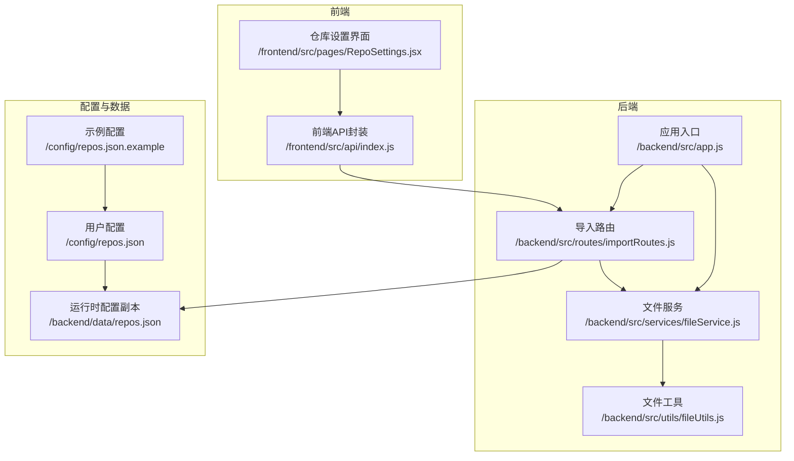
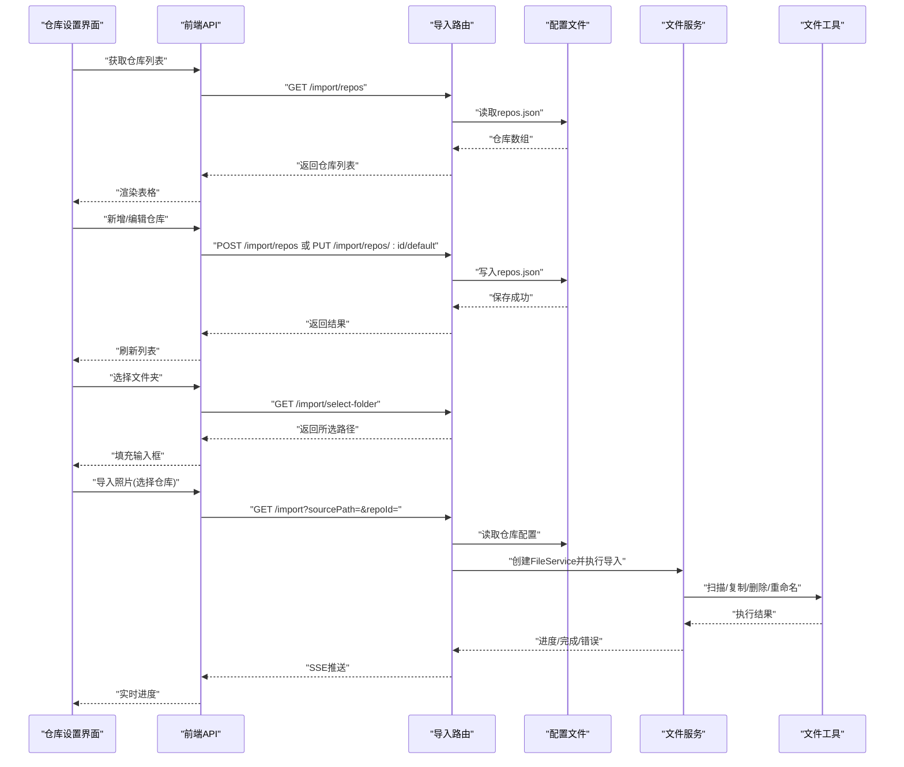
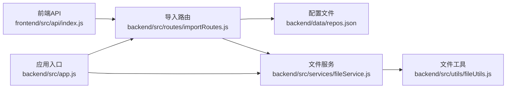

# 仓库管理模块

<cite>
**本文引用的文件**
- [backend/src/app.js](file://backend/src/app.js)
- [backend/src/routes/importRoutes.js](file://backend/src/routes/importRoutes.js)
- [backend/src/services/fileService.js](file://backend/src/services/fileService.js)
- [backend/src/utils/fileUtils.js](file://backend/src/utils/fileUtils.js)
- [backend/data/repos.json](file://backend/data/repos.json)
- [config/repos.json](file://config/repos.json)
- [config/repos.json.example](file://config/repos.json.example)
- [frontend/src/pages/RepoSettings.jsx](file://frontend/src/pages/RepoSettings.jsx)
- [frontend/src/api/index.js](file://frontend/src/api/index.js)
- [README.md](file://README.md)
</cite>

## 目录
1. [简介](#简介)
2. [项目结构](#项目结构)
3. [核心组件](#核心组件)
4. [架构概览](#架构概览)
5. [详细组件分析](#详细组件分析)
6. [依赖分析](#依赖分析)
7. [性能考虑](#性能考虑)
8. [故障排查指南](#故障排查指南)
9. [结论](#结论)
10. [附录](#附录)

## 简介
本模块负责多仓库配置与管理，涵盖仓库路径配置、默认仓库设置、仓库切换机制、仓库配置文件结构与验证规则、增删改查操作与持久化、路径有效性检查与跨平台处理、与导入功能的集成与数据隔离、以及迁移备份恢复操作指南。文档面向开发者与运维人员，帮助快速理解与维护仓库管理能力。

## 项目结构
仓库管理涉及前后端协作：
- 前端提供仓库配置界面与交互（仓库列表、新增/编辑/删除、设为默认、文件夹选择）
- 后端提供仓库配置API、导入流程中的仓库选择、静态文件服务按仓库路由
- 配置文件采用 JSON 结构，支持多仓库与默认仓库标记
- 工具层提供文件扫描、复制、删除、重命名等基础能力

图表来源
- [frontend/src/pages/RepoSettings.jsx:1-341](file://frontend/src/pages/RepoSettings.jsx#L1-L341)
- [frontend/src/api/index.js:1-168](file://frontend/src/api/index.js#L1-L168)
- [backend/src/app.js:1-146](file://backend/src/app.js#L1-L146)
- [backend/src/routes/importRoutes.js:1-627](file://backend/src/routes/importRoutes.js#L1-L627)
- [backend/src/services/fileService.js:1-443](file://backend/src/services/fileService.js#L1-L443)
- [backend/src/utils/fileUtils.js:1-167](file://backend/src/utils/fileUtils.js#L1-L167)
- [config/repos.json.example:1-17](file://config/repos.json.example#L1-L17)
- [config/repos.json:1-20](file://config/repos.json#L1-L20)
- [backend/data/repos.json:1-8](file://backend/data/repos.json#L1-L8)

章节来源
- [README.md:188-205](file://README.md#L188-L205)

## 核心组件
- 仓库配置文件结构与字段定义
  - 字段：id、name、path、isDefault
  - 示例与用户配置文件分离，便于团队协作与安全
- 前端仓库设置界面
  - 列表展示、新增/编辑/删除、设为默认、文件夹选择
  - 目录结构说明（jpg/raw/video）
- 后端仓库管理API
  - 获取仓库列表、新增仓库、删除仓库、设为默认、文件夹选择
  - 导入流程中根据仓库ID或默认仓库进行目标路径解析
- 文件服务与工具
  - 分类目录初始化、增量导入、文件复制/删除、重命名策略
  - 跨平台路径与权限处理

章节来源
- [config/repos.json.example:1-17](file://config/repos.json.example#L1-L17)
- [config/repos.json:1-20](file://config/repos.json#L1-L20)
- [backend/data/repos.json:1-8](file://backend/data/repos.json#L1-L8)
- [frontend/src/pages/RepoSettings.jsx:146-215](file://frontend/src/pages/RepoSettings.jsx#L146-L215)
- [frontend/src/api/index.js:151-165](file://frontend/src/api/index.js#L151-L165)
- [backend/src/routes/importRoutes.js:219-340](file://backend/src/routes/importRoutes.js#L219-L340)
- [backend/src/services/fileService.js:15-21](file://backend/src/services/fileService.js#L15-L21)
- [backend/src/utils/fileUtils.js:77-100](file://backend/src/utils/fileUtils.js#L77-L100)

## 架构概览
仓库管理贯穿“配置—接口—服务—工具”的链路，前端通过API与后端交互，后端读写配置文件并调用文件服务完成导入与浏览。

图表来源
- [frontend/src/pages/RepoSettings.jsx:42-144](file://frontend/src/pages/RepoSettings.jsx#L42-L144)
- [frontend/src/api/index.js:36-165](file://frontend/src/api/index.js#L36-L165)
- [backend/src/routes/importRoutes.js:83-182](file://backend/src/routes/importRoutes.js#L83-L182)
- [backend/src/services/fileService.js:24-167](file://backend/src/services/fileService.js#L24-L167)
- [backend/src/utils/fileUtils.js:23-100](file://backend/src/utils/fileUtils.js#L23-L100)

## 详细组件分析

### 仓库配置文件结构与验证规则
- 结构
  - 数组元素为仓库对象，包含 id、name、path、isDefault 四个字段
- 字段定义
  - id：仓库唯一标识，新增时自动生成
  - name：仓库名称，必填
  - path：仓库根路径，必填；若不存在则自动创建
  - isDefault：是否为默认仓库，同一时刻仅允许一个默认
- 验证规则
  - 新增时校验 name 与 path 是否为空
  - 若 isDefault 为真，则将其他仓库的 isDefault 置为假
  - 删除默认仓库时，若仍有仓库则自动将第一个仓库设为默认
- 示例与用户配置
  - 示例文件位于 config/repos.json.example
  - 用户配置位于 config/repos.json
  - 运行时配置副本位于 backend/data/repos.json

章节来源
- [config/repos.json.example:1-17](file://config/repos.json.example#L1-L17)
- [config/repos.json:1-20](file://config/repos.json#L1-L20)
- [backend/data/repos.json:1-8](file://backend/data/repos.json#L1-L8)
- [backend/src/routes/importRoutes.js:234-281](file://backend/src/routes/importRoutes.js#L234-L281)
- [backend/src/routes/importRoutes.js:283-340](file://backend/src/routes/importRoutes.js#L283-L340)

### 前端仓库管理界面设计
- 功能点
  - 展示仓库列表（名称、路径、默认标记）
  - 新增/编辑：名称、路径、是否默认
  - 删除：二次确认，提示不删除实际文件
  - 设为默认：仅非默认仓库显示
  - 文件夹选择：调用后端接口弹出系统对话框
  - 目录结构说明：根目录与子目录（jpg/raw/video）
- 交互流程
  - 加载时调用 getRepos 获取仓库列表
  - 新增/编辑：先删除旧配置，再添加新配置（简化处理）
  - 删除：调用 deleteRepo
  - 设为默认：调用 setDefaultRepo

章节来源
- [frontend/src/pages/RepoSettings.jsx:29-341](file://frontend/src/pages/RepoSettings.jsx#L29-L341)
- [frontend/src/api/index.js:151-165](file://frontend/src/api/index.js#L151-L165)

### 后端仓库管理API与持久化
- API 路由
  - GET /import/repos：获取仓库列表
  - POST /import/repos：新增仓库（含路径有效性检查与自动创建）
  - DELETE /import/repos/:id：删除仓库（删除默认仓库时自动设置下一个为默认）
  - PUT /import/repos/:id/default：设为默认
  - GET /import/select-folder：跨平台文件夹选择（macOS/osascript、Windows/PowerShell、Linux/zenity）
- 持久化机制
  - 读取与写入 backend/data/repos.json
  - 若配置文件不存在，按平台生成默认路径并创建默认仓库
- 跨平台路径处理
  - 默认导入路径与默认照片路径根据平台自动选择
  - 文件夹选择使用系统原生对话框，避免路径差异带来的问题

章节来源
- [backend/src/routes/importRoutes.js:218-340](file://backend/src/routes/importRoutes.js#L218-L340)
- [backend/src/routes/importRoutes.js:342-624](file://backend/src/routes/importRoutes.js#L342-L624)
- [backend/src/app.js:28-65](file://backend/src/app.js#L28-L65)

### 仓库切换机制与导入集成
- 仓库选择
  - 导入请求支持通过 repoId 指定目标仓库
  - 未指定时使用 isDefault 标记的仓库，否则使用第一个仓库
  - 特殊值 AUTO：使用默认照片路径
- 静态文件服务
  - /uploads 路由根据 repo 参数动态解析目标仓库路径
  - 若路径不存在，返回 404 并提示存储路径不存在
- 数据隔离
  - 不同仓库根目录相互独立，导入与浏览严格基于仓库路径
  - 删除照片时可选择同步删除 RAW（仅当主图为 JPG）

章节来源
- [backend/src/routes/importRoutes.js:83-120](file://backend/src/routes/importRoutes.js#L83-L120)
- [backend/src/app.js:67-91](file://backend/src/app.js#L67-L91)
- [backend/src/services/fileService.js:226-267](file://backend/src/services/fileService.js#L226-L267)

### 路径有效性检查、权限验证与跨平台处理
- 路径有效性检查
  - 新增仓库时若路径不存在，自动创建目录
  - 静态文件服务在解析路径前检查路径存在性
- 权限验证
  - 读取配置文件与扫描目录依赖系统权限
  - 导入过程使用增量复制策略，避免覆盖已存在文件
- 跨平台处理
  - 默认路径根据平台自动选择（Windows/macOS/Linux）
  - 文件夹选择使用系统原生对话框，保证路径格式正确
  - 文件扫描跳过隐藏文件（macOS 资源派生文件）

章节来源
- [backend/src/routes/importRoutes.js:246-252](file://backend/src/routes/importRoutes.js#L246-L252)
- [backend/src/app.js:82-90](file://backend/src/app.js#L82-L90)
- [backend/src/utils/fileUtils.js:23-66](file://backend/src/utils/fileUtils.js#L23-L66)

### 增删改查操作与配置持久化
- 新增
  - 校验必填字段，自动创建不存在的路径
  - 若 isDefault 为真，清空其他仓库的默认标记
- 修改
  - 界面层采用“先删后加”策略简化处理
- 删除
  - 若删除默认仓库且仍有其他仓库，自动将第一个仓库设为默认
- 查询
  - 读取 backend/data/repos.json，若不存在则按平台生成默认仓库
- 持久化
  - 所有变更写回 backend/data/repos.json

章节来源
- [backend/src/routes/importRoutes.js:234-340](file://backend/src/routes/importRoutes.js#L234-L340)
- [backend/src/app.js:38-65](file://backend/src/app.js#L38-L65)

### 与导入功能的集成关系与数据隔离
- 集成关系
  - 导入流程在 GET /import 中根据仓库配置解析目标路径
  - 使用 SSE 实时推送进度，前端通过 EventSource 接收
- 数据隔离
  - 每个仓库根目录独立，导入与浏览严格基于仓库路径
  - 删除照片时可选择同步删除 RAW（仅当主图为 JPG），避免数据不一致

章节来源
- [backend/src/routes/importRoutes.js:83-182](file://backend/src/routes/importRoutes.js#L83-L182)
- [backend/src/services/fileService.js:226-267](file://backend/src/services/fileService.js#L226-L267)

## 依赖分析
- 组件耦合
  - 前端 API 依赖后端路由
  - 后端路由依赖配置文件与文件服务
  - 文件服务依赖文件工具
- 外部依赖
  - Node.js/Express、CORS、exiftool-vendored（用于RAW缩略图）
  - 跨平台文件夹选择依赖系统工具（osascript/PowerShell/zenity）
- 潜在循环依赖
  - 无直接循环依赖，模块职责清晰

图表来源
- [frontend/src/api/index.js:1-168](file://frontend/src/api/index.js#L1-L168)
- [backend/src/routes/importRoutes.js:1-627](file://backend/src/routes/importRoutes.js#L1-L627)
- [backend/src/services/fileService.js:1-443](file://backend/src/services/fileService.js#L1-L443)
- [backend/src/utils/fileUtils.js:1-167](file://backend/src/utils/fileUtils.js#L1-L167)
- [backend/src/app.js:1-146](file://backend/src/app.js#L1-L146)

## 性能考虑
- 并发控制
  - 导入时限制并发处理数量，避免内存占用过高
- I/O 优化
  - 增量导入策略避免重复复制
  - 路径存在性检查与目录自动创建减少异常开销
- SSE 实时推送
  - 采用流式推送，前端按需渲染，降低前端压力

章节来源
- [backend/src/services/fileService.js:75-156](file://backend/src/services/fileService.js#L75-L156)
- [backend/src/utils/fileUtils.js:77-100](file://backend/src/utils/fileUtils.js#L77-L100)

## 故障排查指南
- 仓库列表获取失败
  - 检查后端日志与配置文件读取逻辑
  - 确认 backend/data/repos.json 是否存在或可读
- 新增仓库失败
  - 检查路径权限与磁盘空间
  - 确认 isDefault 与其他仓库的默认标记一致性
- 删除默认仓库后行为异常
  - 确认删除后是否自动设置了新的默认仓库
- 文件夹选择失败
  - macOS：检查 osascript 是否可用
  - Windows：检查 PowerShell 执行策略与临时文件权限
  - Linux：检查 zenity 是否安装
- 导入进度不更新
  - 检查浏览器控制台与后端日志
  - 确认跨域与SSE支持情况
- 静态文件服务返回404
  - 检查仓库路径是否存在与可访问

章节来源
- [backend/src/routes/importRoutes.js:342-624](file://backend/src/routes/importRoutes.js#L342-L624)
- [backend/src/app.js:67-91](file://backend/src/app.js#L67-L91)
- [README.md:166-187](file://README.md#L166-L187)

## 结论
仓库管理模块通过清晰的前后端分工、严格的配置文件结构与验证规则、完善的跨平台路径处理与权限检查，实现了多仓库的灵活配置与高效导入。结合增量导入、并发控制与SSE实时进度推送，系统在易用性与性能之间取得良好平衡。建议在团队协作中遵循示例配置模板与最佳实践，确保配置安全与一致性。

## 附录

### 仓库配置最佳实践
- 使用 config/repos.json.example 作为模板，复制为 config/repos.json
- 为每个仓库设置明确的用途与命名，便于识别与管理
- 仅保留一个 isDefault 仓库，避免歧义
- 路径尽量使用绝对路径，减少跨平台差异
- 定期备份 backend/data/repos.json 与 config/repos.json

### 仓库迁移、备份与恢复
- 备份
  - 备份 backend/data/repos.json 与 config/repos.json
- 迁移
  - 在新环境中复制配置文件，并确保目标路径可访问
  - 验证导入路径与默认路径设置
- 恢复
  - 将备份的配置文件覆盖到对应位置
  - 重新启动服务，确认仓库列表与导入功能正常

章节来源
- [config/repos.json.example:1-17](file://config/repos.json.example#L1-L17)
- [README.md:107-122](file://README.md#L107-L122)