# 仓库管理界面

<cite>
**本文档引用的文件**
- [RepoSettings.jsx](file://frontend/src/pages/RepoSettings.jsx)
- [Layout.jsx](file://frontend/src/components/Layout.jsx)
- [api/index.js](file://frontend/src/api/index.js)
- [App.jsx](file://frontend/src/App.jsx)
- [PhotoGallery.jsx](file://frontend/src/pages/PhotoGallery.jsx)
- [ImportPage.jsx](file://frontend/src/pages/ImportPage.jsx)
- [SyncDeletePage.jsx](file://frontend/src/pages/SyncDeletePage.jsx)
- [importRoutes.js](file://backend/src/routes/importRoutes.js)
- [fileService.js](file://backend/src/services/fileService.js)
- [repos.json](file://config/repos.json)
- [backend repos.json](file://backend/data/repos.json)
</cite>

## 目录
1. [简介](#简介)
2. [项目结构](#项目结构)
3. [核心组件](#核心组件)
4. [架构概览](#架构概览)
5. [详细组件分析](#详细组件分析)
6. [依赖关系分析](#依赖关系分析)
7. [性能考虑](#性能考虑)
8. [故障排除指南](#故障排除指南)
9. [结论](#结论)
10. [附录](#附录)

## 简介

仓库管理界面是相机照片管理系统中的核心功能模块，负责管理存储仓库的配置和维护。该界面提供了完整的仓库生命周期管理能力，包括仓库的添加、编辑、删除、默认设置等功能，为用户提供直观易用的仓库管理体验。

系统采用前后端分离架构，前端使用React + Ant Design构建现代化的用户界面，后端基于Express.js提供RESTful API服务。通过跨平台的文件夹选择对话框集成，实现了Windows、macOS和Linux系统的统一兼容性。

## 项目结构

项目采用模块化的前端架构，主要文件组织如下：

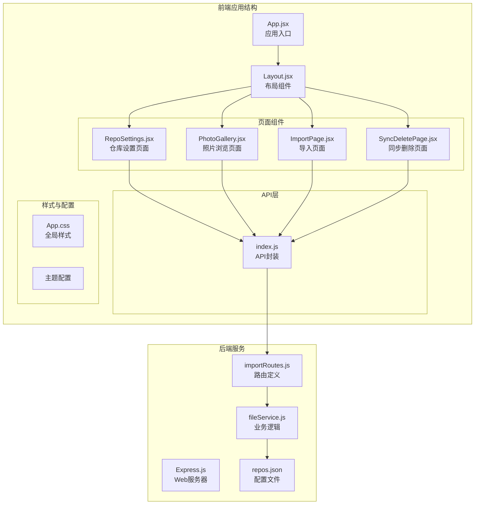

**图表来源**
- [App.jsx:11-38](file://frontend/src/App.jsx#L11-L38)
- [Layout.jsx:15-157](file://frontend/src/components/Layout.jsx#L15-L157)
- [RepoSettings.jsx:29-341](file://frontend/src/pages/RepoSettings.jsx#L29-L341)

**章节来源**
- [App.jsx:1-41](file://frontend/src/App.jsx#L1-L41)
- [Layout.jsx:1-160](file://frontend/src/components/Layout.jsx#L1-L160)

## 核心组件

### RepoSettings 组件架构

RepoSettings 组件是仓库管理界面的核心，采用了现代化的React Hooks模式和Ant Design组件库：

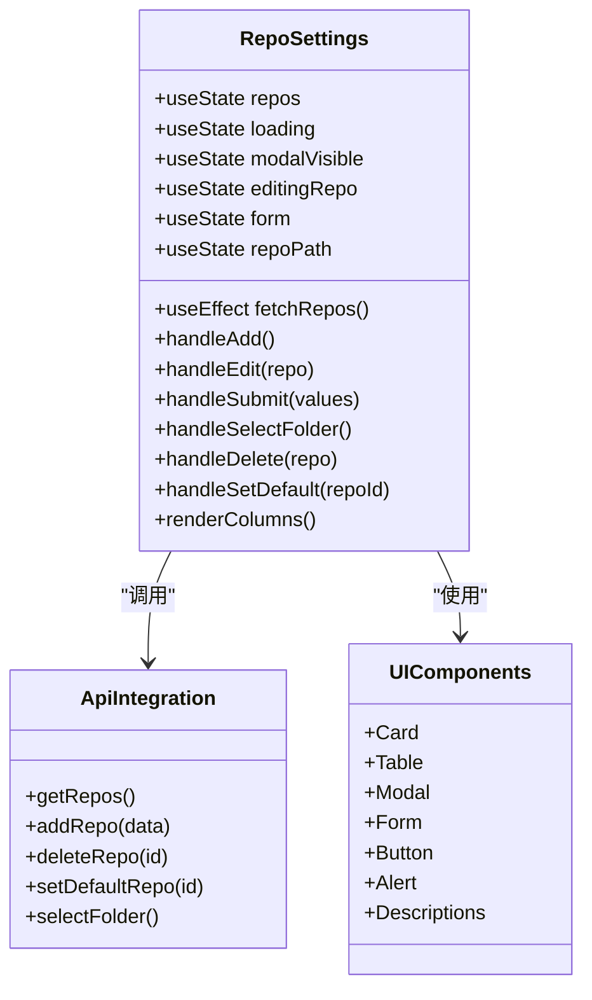

**图表来源**
- [RepoSettings.jsx:29-341](file://frontend/src/pages/RepoSettings.jsx#L29-L341)
- [api/index.js:37-165](file://frontend/src/api/index.js#L37-L165)

组件的主要职责包括：
- **数据管理**：维护仓库列表状态和加载状态
- **用户交互**：处理添加、编辑、删除等操作
- **表单验证**：确保输入数据的有效性
- **错误处理**：提供友好的错误反馈机制
- **UI渲染**：构建响应式的用户界面

**章节来源**
- [RepoSettings.jsx:29-341](file://frontend/src/pages/RepoSettings.jsx#L29-L341)

## 架构概览

系统采用分层架构设计，确保了良好的可维护性和扩展性：

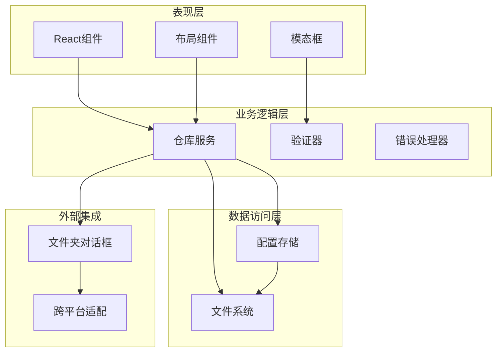

**图表来源**
- [RepoSettings.jsx:42-144](file://frontend/src/pages/RepoSettings.jsx#L42-L144)
- [importRoutes.js:234-340](file://backend/src/routes/importRoutes.js#L234-L340)

### 数据流设计

系统采用单向数据流模式，确保状态管理的可预测性：

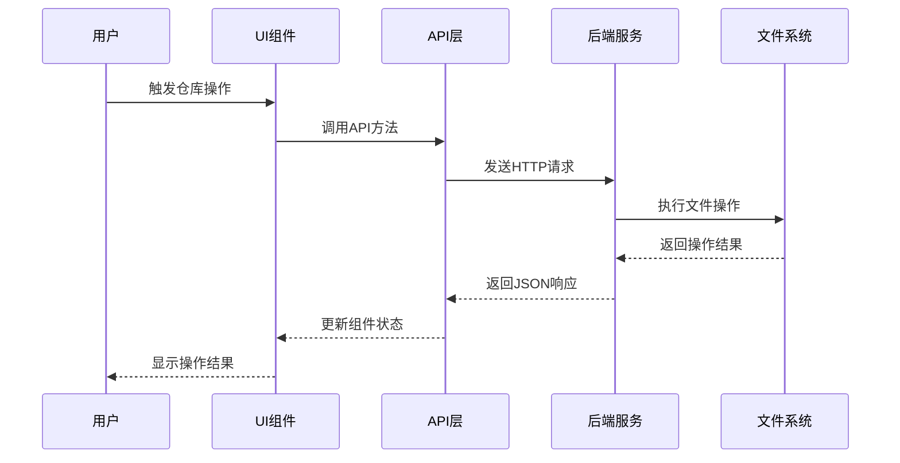

**图表来源**
- [api/index.js:151-165](file://frontend/src/api/index.js#L151-L165)
- [importRoutes.js:218-232](file://backend/src/routes/importRoutes.js#L218-L232)

## 详细组件分析

### 仓库列表展示组件

仓库列表采用Ant Design的Table组件，提供了丰富的视觉反馈和交互功能：

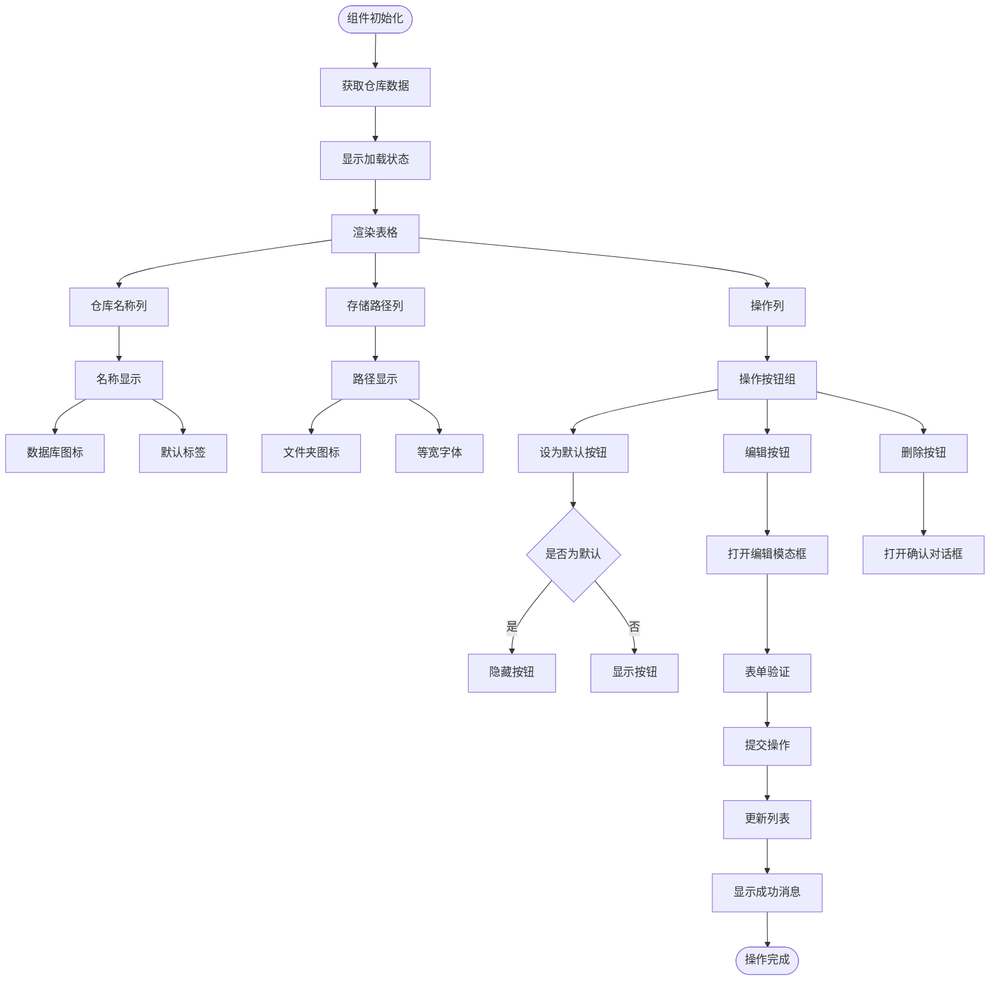

**图表来源**
- [RepoSettings.jsx:146-215](file://frontend/src/pages/RepoSettings.jsx#L146-L215)
- [RepoSettings.jsx:247-254](file://frontend/src/pages/RepoSettings.jsx#L247-L254)

### 表单验证与错误处理机制

表单验证采用Ant Design的Form组件，结合自定义验证规则：

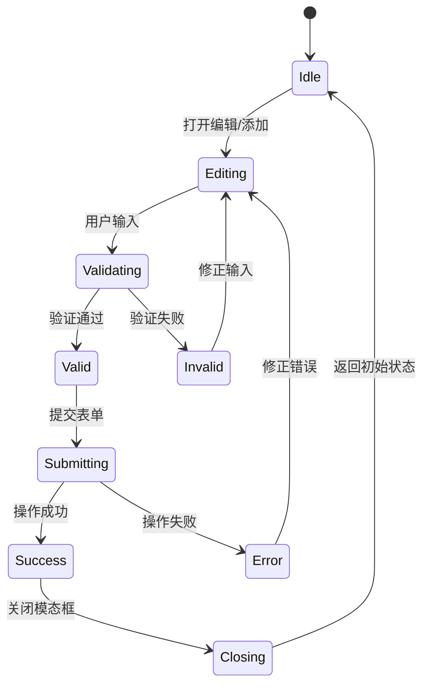

**图表来源**
- [RepoSettings.jsx:269-318](file://frontend/src/pages/RepoSettings.jsx#L269-L318)

### 文件夹选择对话框集成

系统集成了跨平台的文件夹选择功能，支持Windows、macOS和Linux：

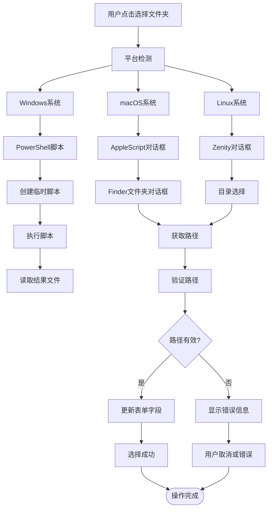

**图表来源**
- [importRoutes.js:342-624](file://backend/src/routes/importRoutes.js#L342-L624)

**章节来源**
- [RepoSettings.jsx:95-120](file://frontend/src/pages/RepoSettings.jsx#L95-L120)
- [importRoutes.js:342-624](file://backend/src/routes/importRoutes.js#L342-L624)

### 默认仓库设置机制

默认仓库的设置具有原子性和一致性保证：

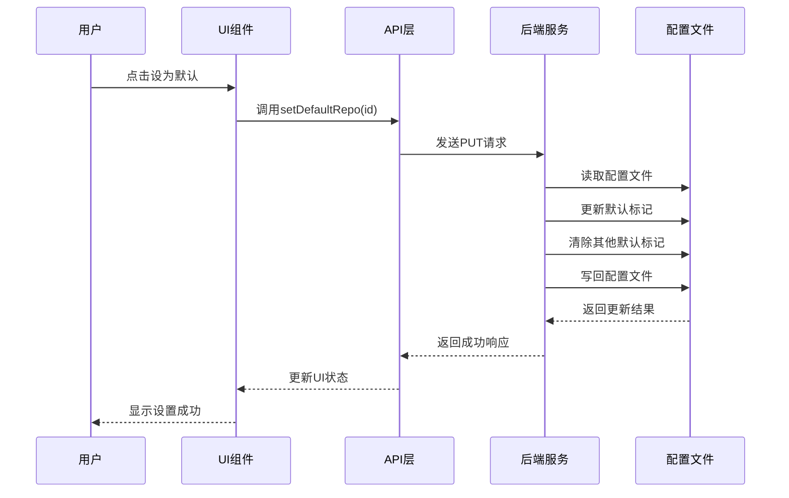

**图表来源**
- [RepoSettings.jsx:134-144](file://frontend/src/pages/RepoSettings.jsx#L134-L144)
- [importRoutes.js:318-340](file://backend/src/routes/importRoutes.js#L318-L340)

**章节来源**
- [RepoSettings.jsx:134-144](file://frontend/src/pages/RepoSettings.jsx#L134-L144)
- [importRoutes.js:318-340](file://backend/src/routes/importRoutes.js#L318-L340)

## 依赖关系分析

系统采用模块化的依赖管理，确保组件间的松耦合：

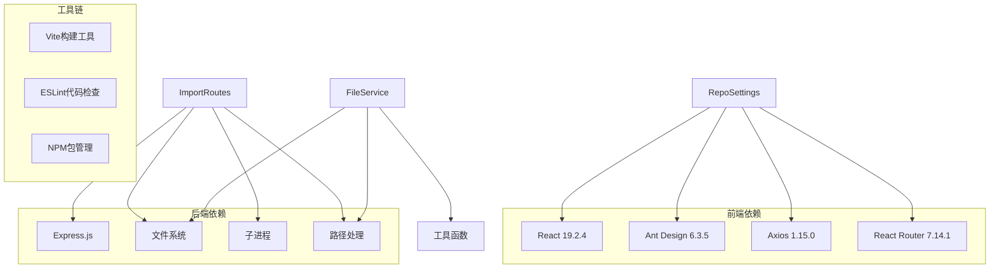

**图表来源**
- [frontend/package.json:12-31](file://frontend/package.json#L12-L31)

### 组件间通信机制

系统采用props传递和状态提升的方式管理组件间通信：

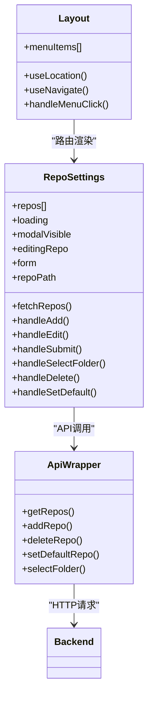

**图表来源**
- [Layout.jsx:39-64](file://frontend/src/components/Layout.jsx#L39-L64)
- [RepoSettings.jsx:42-93](file://frontend/src/pages/RepoSettings.jsx#L42-L93)

**章节来源**
- [Layout.jsx:39-64](file://frontend/src/components/Layout.jsx#L39-L64)
- [RepoSettings.jsx:42-93](file://frontend/src/pages/RepoSettings.jsx#L42-L93)

## 性能考虑

### 响应式设计优化

系统采用Ant Design的响应式栅格系统，确保在不同设备上的良好体验：

| 断点 | 屏幕宽度 | 列数 |
|------|----------|------|
| xs   | <576px   | 2    |
| sm   | ≥576px   | 4    |
| md   | ≥768px   | 6    |
| lg   | ≥992px   | 8    |
| xl   | ≥1200px  | 12   |
| xxl  | ≥1600px  | 24   |

### 并发处理策略

对于大量文件操作，系统采用并发限制策略：

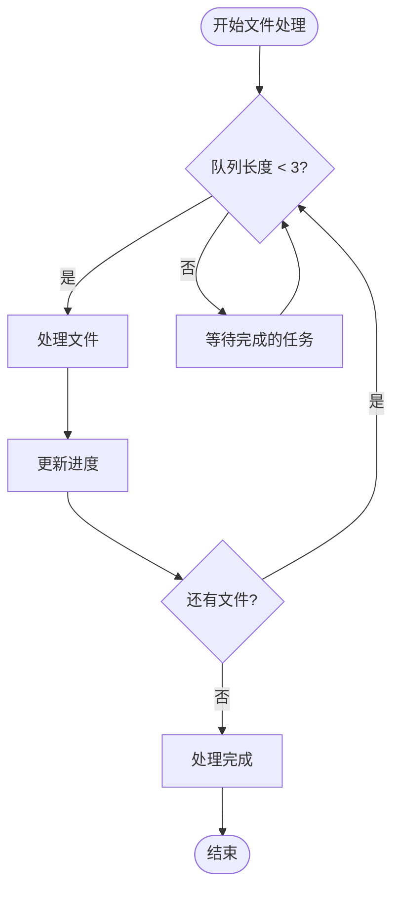

**图表来源**
- [fileService.js:75-156](file://backend/src/services/fileService.js#L75-L156)

### 缓存与状态管理

系统采用本地状态缓存减少API调用频率：

- **仓库列表缓存**：组件卸载前保持状态
- **表单状态缓存**：模态框关闭时不丢失数据
- **错误状态缓存**：用户修正后自动清除

## 故障排除指南

### 常见问题诊断

| 问题类型 | 症状描述 | 可能原因 | 解决方案 |
|----------|----------|----------|----------|
| 文件夹选择失败 | 选择对话框无响应 | 跨平台脚本执行权限不足 | 检查系统权限设置 |
| 仓库添加失败 | 提交后无响应 | 路径不存在且无法创建 | 验证路径权限和存在性 |
| 删除操作异常 | 删除后状态未更新 | API响应延迟 | 刷新页面或检查网络连接 |
| 默认设置失效 | 设置后仍显示其他仓库 | 配置文件写入失败 | 检查文件权限和磁盘空间 |

### 错误处理流程

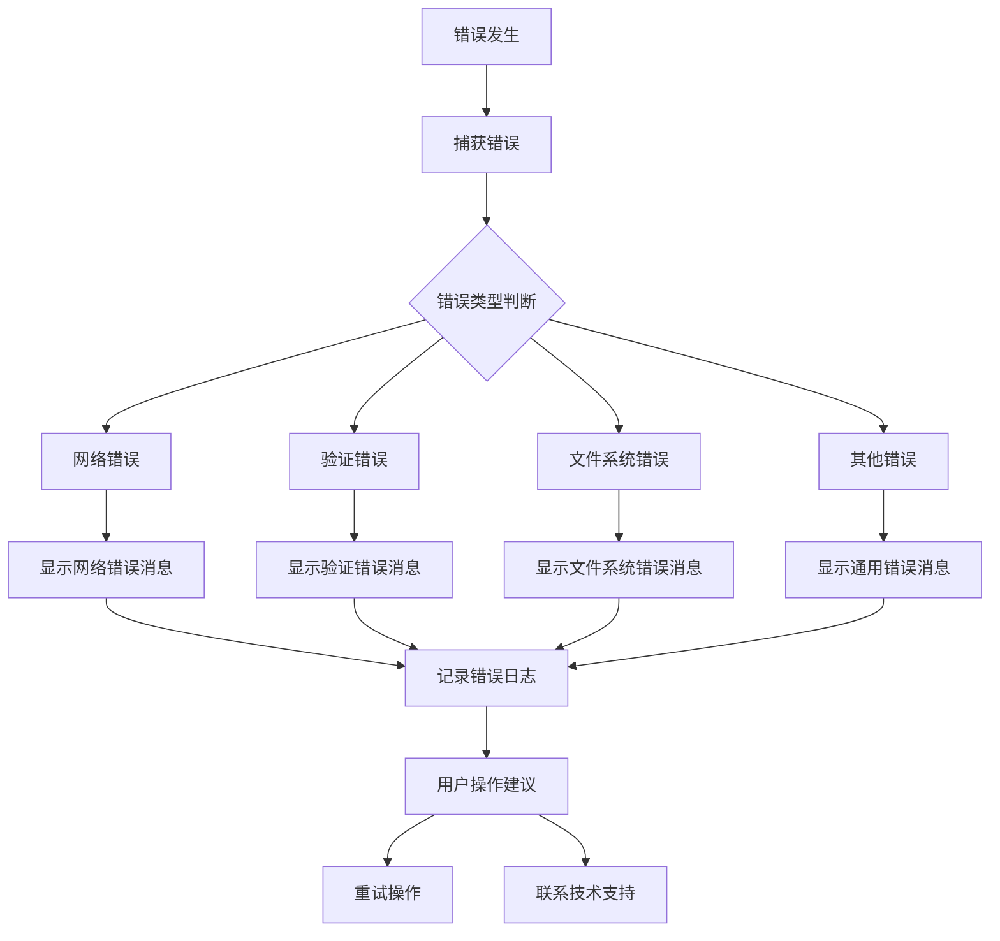

**图表来源**
- [RepoSettings.jsx:49-143](file://frontend/src/pages/RepoSettings.jsx#L49-L143)

**章节来源**
- [RepoSettings.jsx:49-143](file://frontend/src/pages/RepoSettings.jsx#L49-L143)

## 结论

仓库管理界面通过精心设计的架构和用户友好的交互，为用户提供了完整的仓库管理解决方案。系统具备以下优势：

1. **跨平台兼容性**：通过原生脚本集成实现了Windows、macOS和Linux的统一支持
2. **响应式设计**：适应不同屏幕尺寸和设备类型的用户界面
3. **错误处理机制**：完善的错误捕获和用户反馈系统
4. **性能优化**：合理的并发控制和状态管理策略
5. **可扩展性**：模块化的架构便于功能扩展和维护

该界面不仅满足了基本的仓库管理需求，还为未来的功能扩展奠定了坚实的基础。

## 附录

### 配置文件格式

仓库配置采用JSON格式存储，包含以下字段：

| 字段名 | 类型 | 必需 | 描述 |
|--------|------|------|------|
| id | string | 是 | 仓库唯一标识符 |
| name | string | 是 | 仓库显示名称 |
| path | string | 是 | 仓库存储路径 |
| isDefault | boolean | 否 | 是否为默认仓库 |

### API接口规范

系统提供RESTful API接口，支持标准的CRUD操作：

- **GET /api/import/repos** - 获取仓库列表
- **POST /api/import/repos** - 添加新仓库
- **DELETE /api/import/repos/:id** - 删除指定仓库
- **PUT /api/import/repos/:id/default** - 设置默认仓库
- **GET /api/import/select-folder** - 打开文件夹选择对话框

### 主题定制指南

系统支持Ant Design的主题定制，可通过以下方式进行扩展：

1. **颜色定制**：修改ConfigProvider中的token配置
2. **组件样式**：通过CSS变量覆盖默认样式
3. **布局调整**：修改Layout组件的样式属性
4. **响应式断点**：调整Ant Design的断点配置