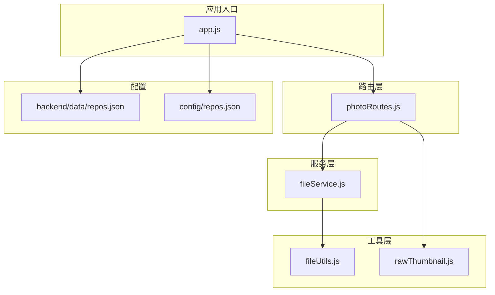
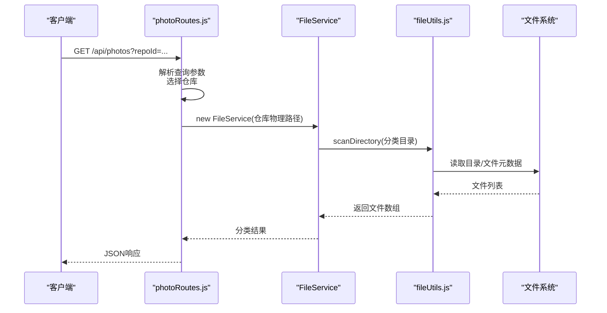
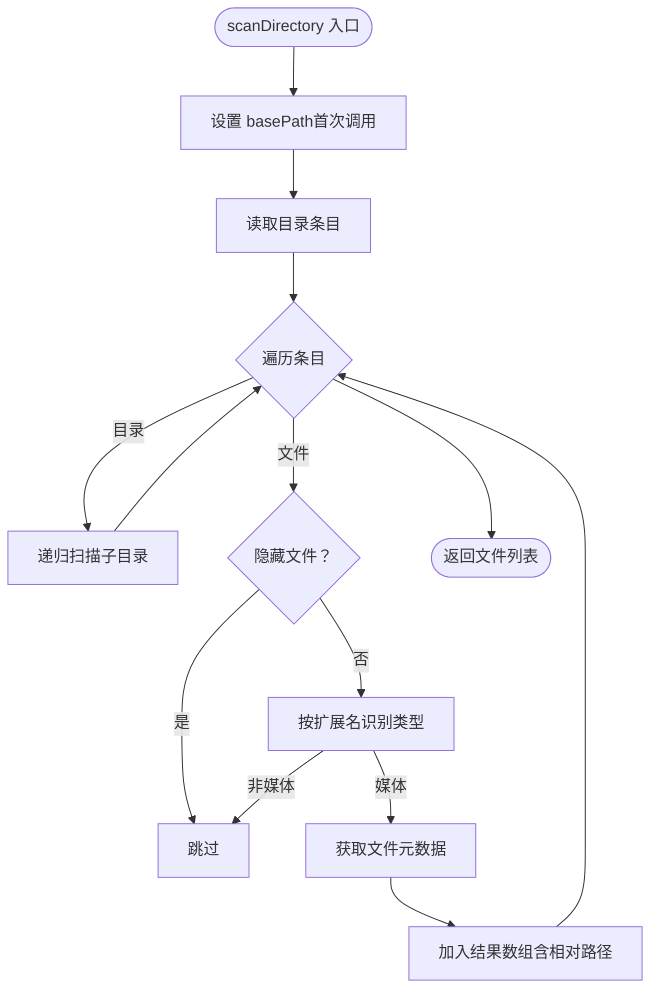
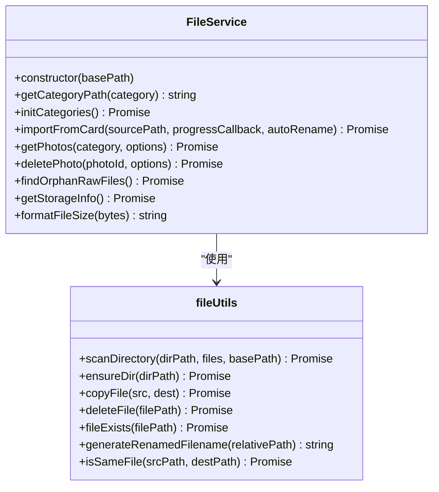
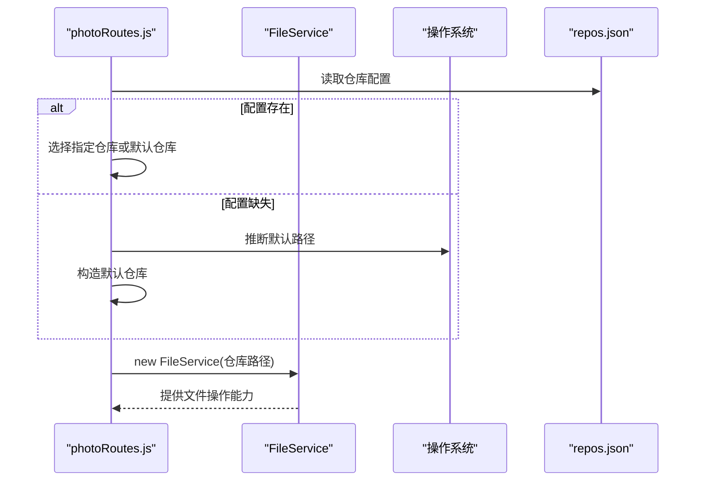
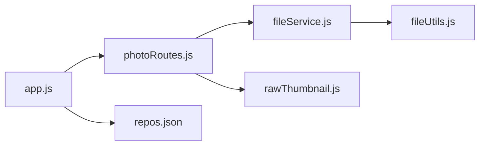

# 仓库路径处理

<cite>
**本文引用的文件**
- [fileUtils.js](file://backend/src/utils/fileUtils.js)
- [fileService.js](file://backend/src/services/fileService.js)
- [photoRoutes.js](file://backend/src/routes/photoRoutes.js)
- [app.js](file://backend/src/app.js)
- [rawThumbnail.js](file://backend/src/utils/rawThumbnail.js)
- [repos.json](file://backend/data/repos.json)
- [repos.json](file://config/repos.json)
- [package.json](file://backend/package.json)
</cite>

## 目录
1. [简介](#简介)
2. [项目结构](#项目结构)
3. [核心组件](#核心组件)
4. [架构总览](#架构总览)
5. [详细组件分析](#详细组件分析)
6. [依赖分析](#依赖分析)
7. [性能考虑](#性能考虑)
8. [故障排查指南](#故障排查指南)
9. [结论](#结论)
10. [附录](#附录)

## 简介
本文件系统性梳理了项目中“仓库路径处理”的实现与最佳实践，涵盖：
- 跨平台路径处理与兼容性
- 路径有效性验证、权限检查与目录创建
- 相对路径与绝对路径的转换
- 路径遍历攻击防护与安全验证
- 不同操作系统下路径分隔符处理差异
- 路径配置与环境变量策略
- 路径监控与变更通知机制
- 路径与文件系统的映射关系与数据一致性保障

## 项目结构
后端采用模块化设计，围绕“仓库”概念组织路径处理逻辑：
- 路由层负责仓库选择、参数解析与安全校验
- 服务层封装文件扫描、复制、删除等操作
- 工具层提供通用路径工具与RAW缩略图生成
- 配置层管理仓库列表与默认路径

图表来源
- [photoRoutes.js:1-739](file://backend/src/routes/photoRoutes.js#L1-L739)
- [app.js:1-146](file://backend/src/app.js#L1-L146)
- [fileService.js:1-443](file://backend/src/services/fileService.js#L1-L443)
- [fileUtils.js:1-167](file://backend/src/utils/fileUtils.js#L1-L167)
- [rawThumbnail.js:1-132](file://backend/src/utils/rawThumbnail.js#L1-L132)
- [repos.json:1-8](file://backend/data/repos.json#L1-L8)
- [repos.json:1-20](file://config/repos.json#L1-L20)

章节来源
- [photoRoutes.js:1-739](file://backend/src/routes/photoRoutes.js#L1-L739)
- [app.js:1-146](file://backend/src/app.js#L1-L146)

## 核心组件
- 路径工具与扫描器：提供文件类型识别、递归扫描、目录确保、文件复制/删除、相对路径生成等能力
- 文件服务：面向业务的仓库抽象，负责分类目录初始化、导入、查询、删除、统计等
- 路由与仓库选择：根据仓库ID或默认仓库定位实际物理路径，支持跨平台默认路径推断
- RAW缩略图生成：对RAW文件进行嵌入预览提取与降级策略

章节来源
- [fileUtils.js:1-167](file://backend/src/utils/fileUtils.js#L1-L167)
- [fileService.js:1-443](file://backend/src/services/fileService.js#L1-L443)
- [photoRoutes.js:1-739](file://backend/src/routes/photoRoutes.js#L1-L739)
- [rawThumbnail.js:1-132](file://backend/src/utils/rawThumbnail.js#L1-L132)

## 架构总览
路径处理贯穿“路由 -> 服务 -> 工具”的链路，并与配置文件协作确定仓库根路径。系统通过统一的路径拼接与相对路径计算，保证跨平台兼容与可移植性。

图表来源
- [photoRoutes.js:26-92](file://backend/src/routes/photoRoutes.js#L26-L92)
- [fileService.js:169-224](file://backend/src/services/fileService.js#L169-L224)
- [fileUtils.js:22-66](file://backend/src/utils/fileUtils.js#L22-L66)

## 详细组件分析

### 路径工具与扫描器（fileUtils.js）
- 文件类型识别：基于扩展名映射判断类型（jpg/raw/video），避免非媒体文件进入后续流程
- 递归扫描：使用文件条目对象逐项处理，跳过隐藏文件（macOS资源派生文件），计算相对路径
- 目录确保：通过访问性检测与递归创建，保证目标目录存在
- 文件复制：增量导入策略（不覆盖相同文件），比较文件大小与修改时间以判定是否重复
- 文件删除：提供删除接口并返回状态
- 名称处理：去除扩展名、生成重命名后的文件名（将路径分隔符替换为下划线）
- 同步性校验：通过stat比较文件大小与修改时间，作为“同文件”的依据

图表来源
- [fileUtils.js:22-66](file://backend/src/utils/fileUtils.js#L22-L66)

章节来源
- [fileUtils.js:1-167](file://backend/src/utils/fileUtils.js#L1-L167)

### 文件服务（fileService.js）
- 仓库抽象：以basePath为根，按类型生成分类目录路径
- 分类初始化：确保jpg/raw/video三类目录存在
- 导入流程：扫描源目录，按类型分类复制，支持自动重命名与并发控制
- 查询与排序：扫描分类目录，支持按名称/大小/修改时间排序与分页
- 删除与同步：删除主文件，若为JPG且开启同步则删除对应RAW
- 统计信息：计算各分类文件数量与总大小
- RAW孤儿检测：对比JPG与RAW文件名集合，找出无对应JPG的RAW

图表来源
- [fileService.js:1-443](file://backend/src/services/fileService.js#L1-L443)
- [fileUtils.js:1-167](file://backend/src/utils/fileUtils.js#L1-L167)

章节来源
- [fileService.js:1-443](file://backend/src/services/fileService.js#L1-L443)

### 路由与仓库选择（photoRoutes.js）
- 仓库配置：优先读取本地数据目录下的repos.json；若不存在则回退到默认路径
- 默认路径推断：根据平台（win32/darwin/linux）选择用户图片目录作为默认根
- 安全预览：对传入路径进行URL解码与存在性校验，支持Range请求与流式传输
- 批量导出：目标路径确保存在，增量模式避免覆盖

图表来源
- [photoRoutes.js:11-45](file://backend/src/routes/photoRoutes.js#L11-L45)
- [app.js:38-65](file://backend/src/app.js#L38-L65)

章节来源
- [photoRoutes.js:1-739](file://backend/src/routes/photoRoutes.js#L1-L739)
- [app.js:1-146](file://backend/src/app.js#L1-L146)

### RAW缩略图生成（rawThumbnail.js）
- 嵌入预览提取：尝试多种标签提取嵌入JPEG预览，验证起始字节并调整尺寸
- 降级策略：若嵌入预览不可用，尝试使用图像库解码RAW
- 失败兜底：返回null，由调用方生成占位图

章节来源
- [rawThumbnail.js:1-132](file://backend/src/utils/rawThumbnail.js#L1-L132)

## 依赖分析
- 路由层依赖服务层与工具层，同时读取配置文件决定仓库根路径
- 服务层依赖工具层的路径与文件操作能力
- 应用入口负责环境变量与默认路径推断，并提供动态静态文件服务

图表来源
- [photoRoutes.js:1-739](file://backend/src/routes/photoRoutes.js#L1-L739)
- [fileService.js:1-443](file://backend/src/services/fileService.js#L1-L443)
- [fileUtils.js:1-167](file://backend/src/utils/fileUtils.js#L1-L167)
- [rawThumbnail.js:1-132](file://backend/src/utils/rawThumbnail.js#L1-L132)
- [app.js:1-146](file://backend/src/app.js#L1-L146)

章节来源
- [package.json:1-30](file://backend/package.json#L1-L30)

## 性能考虑
- 并发控制：导入时限制同时处理的任务数，避免内存与IO压力
- 流式传输：预览与缩略图生成均采用流式读取，降低内存占用
- 增量导入：通过文件大小与修改时间快速判断重复，减少不必要的IO
- 目录扫描：仅扫描媒体文件并跳过隐藏文件，减少无效遍历

章节来源
- [fileService.js:75-156](file://backend/src/services/fileService.js#L75-L156)
- [photoRoutes.js:226-280](file://backend/src/routes/photoRoutes.js#L226-L280)
- [fileUtils.js:22-66](file://backend/src/utils/fileUtils.js#L22-L66)

## 故障排查指南
- 路径不存在：路由层在预览/缩略图生成前会检查文件存在性，若不存在返回404
- 跨平台路径：统一使用路径拼接与相对路径计算，避免硬编码分隔符
- 权限问题：确保服务进程对仓库根路径具备读写权限；必要时在启动脚本中提升权限
- 路径遍历：路由层对传入路径进行URL解码与存在性校验，建议前端不要直接暴露内部路径
- 默认路径：若配置文件缺失，系统会根据平台推断默认路径；可通过环境变量覆盖
- 日志与错误：全局错误处理与未捕获异常处理，避免服务崩溃

章节来源
- [photoRoutes.js:189-201](file://backend/src/routes/photoRoutes.js#L189-L201)
- [app.js:123-143](file://backend/src/app.js#L123-L143)

## 结论
本项目通过“路由层仓库选择 + 服务层路径抽象 + 工具层通用能力”的分层设计，实现了跨平台、安全、高效的仓库路径处理。配合增量导入、流式传输与并发控制，既保证了性能也兼顾了可靠性。建议在生产环境中结合环境变量与配置文件，明确仓库根路径，并定期校验权限与磁盘空间。

## 附录

### 跨平台路径处理与兼容性
- 默认路径推断：根据平台选择用户图片目录作为默认根
- 路径拼接：统一使用路径拼接函数，避免手动拼接分隔符
- 相对路径：在返回给前端时使用相对路径，便于前端渲染与导航

章节来源
- [photoRoutes.js:47-66](file://backend/src/routes/photoRoutes.js#L47-L66)
- [fileService.js:191-196](file://backend/src/services/fileService.js#L191-L196)

### 路径有效性验证与权限检查
- 存在性检查：在读取/预览/导出前先检查文件是否存在
- 访问性检测：通过访问性API判断目录可读写
- 自动创建：对目标目录进行存在性检查并递归创建

章节来源
- [photoRoutes.js:194-196](file://backend/src/routes/photoRoutes.js#L194-L196)
- [fileUtils.js:68-75](file://backend/src/utils/fileUtils.js#L68-L75)

### 相对路径与绝对路径的转换
- 绝对路径：服务层以仓库根为基准，构建分类目录与文件路径
- 相对路径：在返回给前端时计算相对于仓库根的相对路径，便于前端展示

章节来源
- [fileService.js:191-196](file://backend/src/services/fileService.js#L191-L196)
- [fileUtils.js:52-52](file://backend/src/utils/fileUtils.js#L52-L52)

### 路径遍历攻击防护与安全验证
- URL解码：对传入路径进行URL解码，避免编码绕过
- 存在性校验：严格检查文件/目录是否存在
- 范围请求：对视频支持Range请求，避免一次性加载大文件

章节来源
- [photoRoutes.js:190-201](file://backend/src/routes/photoRoutes.js#L190-L201)
- [photoRoutes.js:227-256](file://backend/src/routes/photoRoutes.js#L227-L256)

### 不同操作系统下路径分隔符处理差异
- 统一使用路径拼接与相对路径计算，避免硬编码分隔符
- 跨平台默认路径推断，确保在Windows/macOS/Linux上均可用

章节来源
- [photoRoutes.js:47-66](file://backend/src/routes/photoRoutes.js#L47-L66)

### 路径配置的最佳实践
- 优先使用配置文件定义仓库根路径，避免硬编码
- 支持环境变量覆盖默认路径
- 对于多仓库场景，通过仓库ID选择不同根路径

章节来源
- [repos.json:1-8](file://backend/data/repos.json#L1-L8)
- [repos.json:1-20](file://config/repos.json#L1-L20)
- [app.js:28-36](file://backend/src/app.js#L28-L36)

### 路径监控与变更通知
- 当前实现未包含文件系统事件监听（如inotify/FSWatcher）
- 建议在需要实时更新的场景引入文件系统监控库，结合缓存与事件队列进行增量刷新

[本节为概念性建议，不直接分析具体文件]

### 路径与文件系统的映射关系与数据一致性保证
- 服务层以仓库根为唯一映射源，所有文件操作基于此根
- 增量导入与同文件校验（大小+修改时间）减少重复与冲突
- 相对路径返回前端，避免泄露真实物理路径

章节来源
- [fileService.js:93-118](file://backend/src/services/fileService.js#L93-L118)
- [fileUtils.js:139-153](file://backend/src/utils/fileUtils.js#L139-L153)