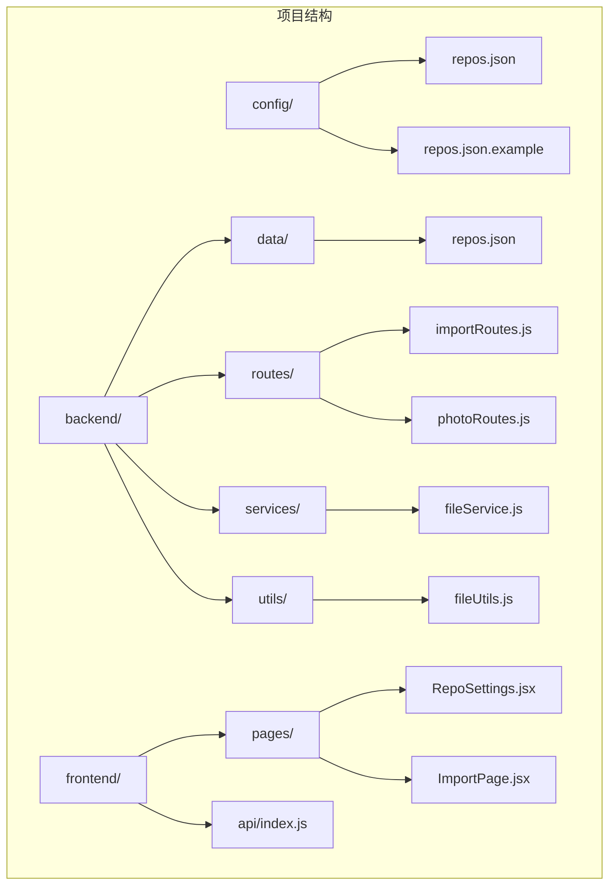
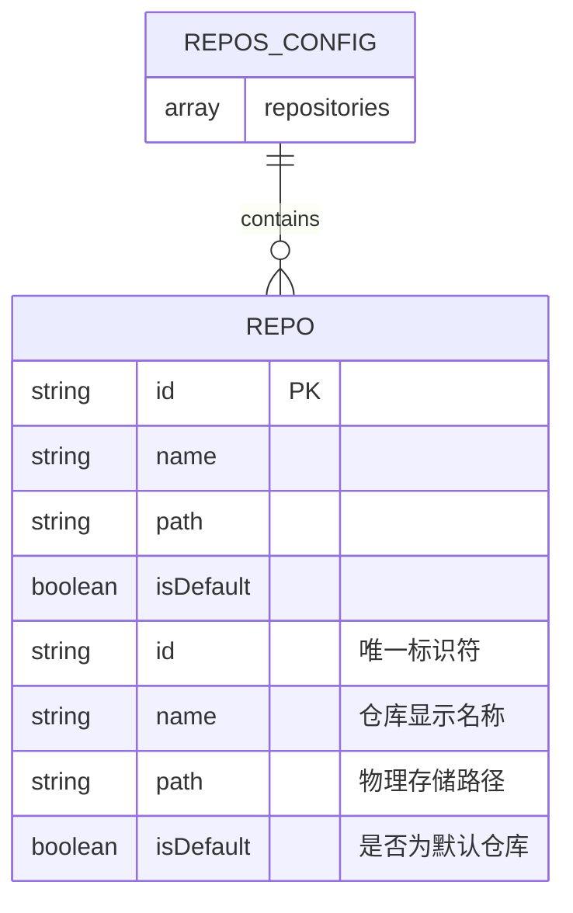
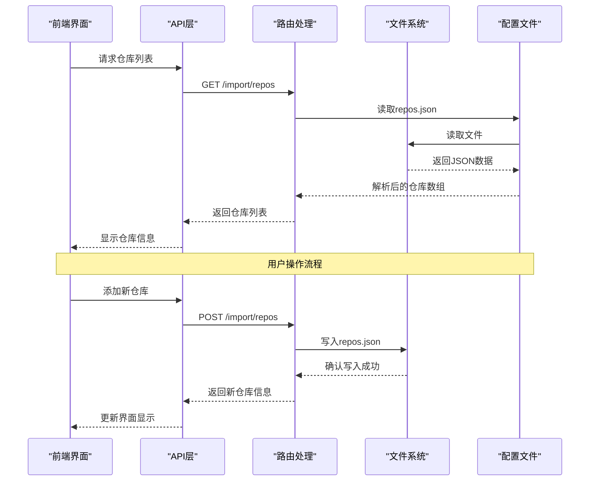
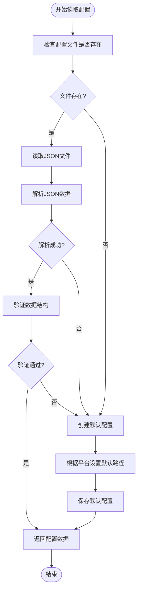
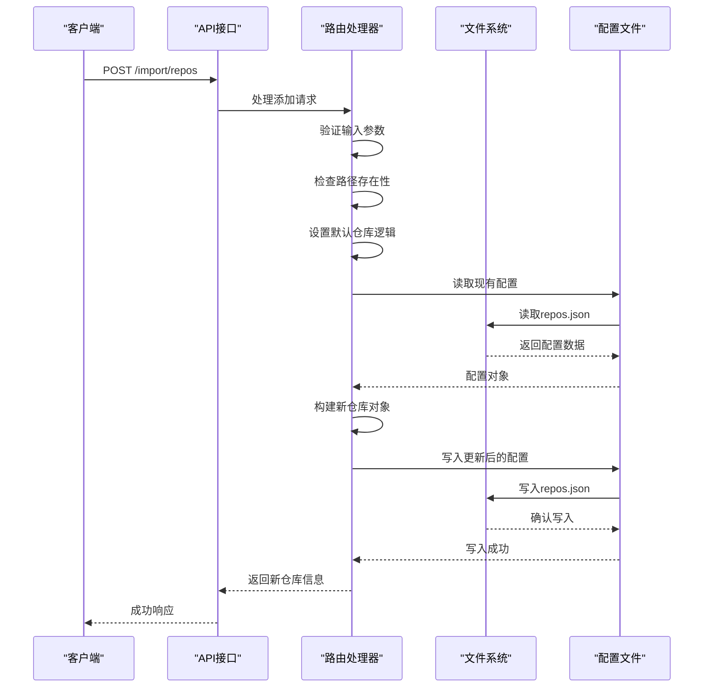
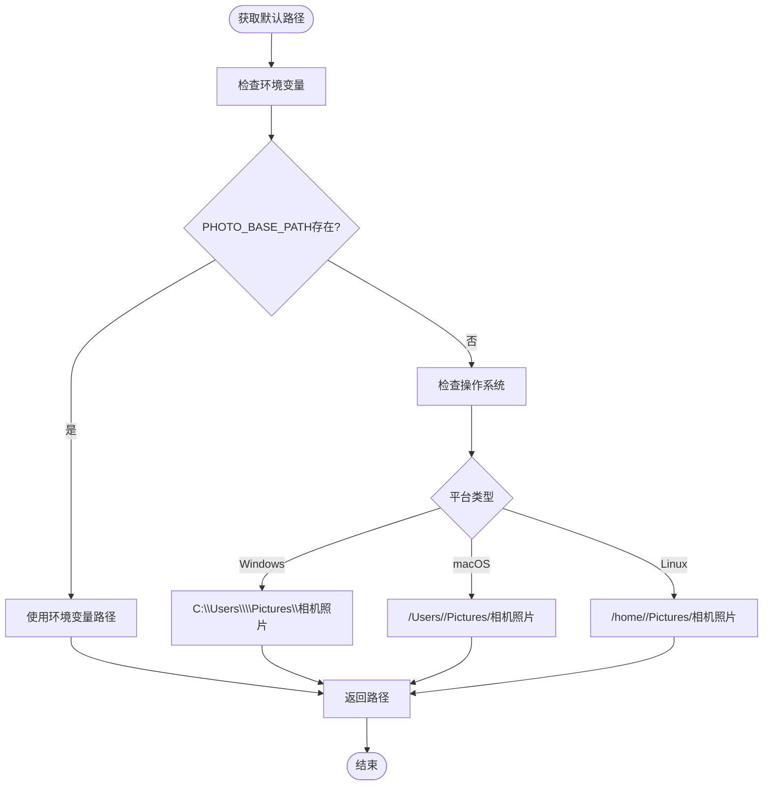
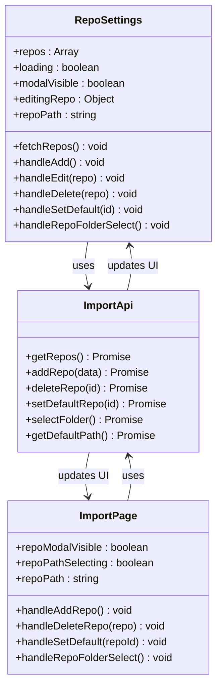
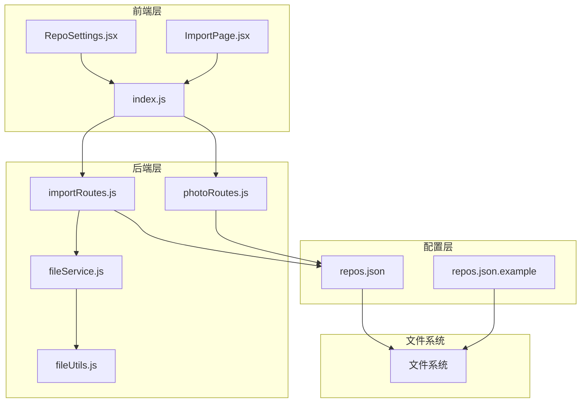

# 仓库配置文件

<cite>
**本文档引用的文件**
- [config/repos.json](file://config/repos.json)
- [config/repos.json.example](file://config/repos.json.example)
- [backend/data/repos.json](file://backend/data/repos.json)
- [backend/src/route/importRoutes.js](file://backend/src/route/importRoutes.js)
- [backend/src/route/photoRoutes.js](file://backend/src/route/photoRoutes.js)
- [backend/src/services/fileService.js](file://backend/src/services/fileService.js)
- [backend/src/utils/fileUtils.js](file://backend/src/utils/fileUtils.js)
- [frontend/src/api/index.js](file://frontend/src/api/index.js)
- [frontend/src/pages/RepoSettings.jsx](file://frontend/src/pages/RepoSettings.jsx)
- [frontend/src/pages/ImportPage.jsx](file://frontend/src/pages/ImportPage.jsx)
</cite>

## 目录
1. [简介](#简介)
2. [项目结构](#项目结构)
3. [核心组件](#核心组件)
4. [架构概览](#架构概览)
5. [详细组件分析](#详细组件分析)
6. [依赖关系分析](#依赖关系分析)
7. [性能考虑](#性能考虑)
8. [故障排除指南](#故障排除指南)
9. [结论](#结论)
10. [附录](#附录)

## 简介

仓库配置文件是照片管理系统的基础设施，用于定义和管理照片存储仓库的位置、名称和默认行为。该系统支持多平台部署，包括Windows、macOS和Linux操作系统，提供了灵活的仓库管理和导入功能。

本文档详细解释了repos.json配置文件的结构、字段定义、验证规则、读取解析机制以及跨平台路径处理策略。同时涵盖了配置文件的版本兼容性、迁移策略、备份恢复方法和最佳实践。

## 项目结构

项目采用前后端分离的架构设计，配置文件主要位于config目录下，同时在backend/data目录中也有备用配置文件。



**图表来源**
- [config/repos.json:1-20](file://config/repos.json#L1-L20)
- [backend/src/route/importRoutes.js:1-12](file://backend/src/route/importRoutes.js#L1-L12)
- [frontend/src/pages/RepoSettings.jsx:1-61](file://frontend/src/pages/RepoSettings.jsx#L1-L61)

**章节来源**
- [config/repos.json:1-20](file://config/repos.json#L1-L20)
- [config/repos.json.example:1-17](file://config/repos.json.example#L1-L17)
- [backend/data/repos.json:1-8](file://backend/data/repos.json#L1-L8)

## 核心组件

### 配置文件结构

仓库配置文件采用JSON数组格式，每个元素代表一个独立的存储仓库。系统支持多个仓库并存，其中只能有一个默认仓库。



**图表来源**
- [config/repos.json:1-20](file://config/repos.json#L1-L20)
- [config/repos.json.example:3-16](file://config/repos.json.example#L3-L16)

### 字段定义详解

| 字段名 | 类型 | 必需 | 描述 | 示例值 |
|--------|------|------|------|--------|
| id | string | 是 | 仓库唯一标识符，系统自动生成 | "1776333706008" |
| name | string | 是 | 仓库显示名称，用户可读 | "索尼" |
| path | string | 是 | 物理存储路径，支持绝对路径和相对路径 | "/Users/colorh/Pictures/索尼大法佬/" |
| isDefault | boolean | 否 | 是否为默认仓库，系统自动管理 | false |

**章节来源**
- [config/repos.json:2-19](file://config/repos.json#L2-L19)
- [config/repos.json.example:4-15](file://config/repos.json.example#L4-L15)

## 架构概览

系统采用三层架构设计，从前端界面到后端服务再到文件系统形成完整的数据流。



**图表来源**
- [frontend/src/api/index.js:151-164](file://frontend/src/api/index.js#L151-L164)
- [backend/src/route/importRoutes.js:218-232](file://backend/src/route/importRoutes.js#L218-L232)
- [backend/src/route/importRoutes.js:234-281](file://backend/src/route/importRoutes.js#L234-L281)

## 详细组件分析

### 配置文件读取机制

系统实现了智能的配置文件读取机制，支持多种错误处理策略。



**图表来源**
- [backend/src/route/importRoutes.js:24-53](file://backend/src/route/importRoutes.js#L24-L53)
- [backend/src/route/photoRoutes.js:11-24](file://backend/src/route/photoRoutes.js#L11-L24)

### 配置文件写入机制

系统提供了完整的配置文件写入和更新功能，确保数据的一致性和完整性。



**图表来源**
- [backend/src/route/importRoutes.js:234-281](file://backend/src/route/importRoutes.js#L234-L281)
- [backend/src/route/importRoutes.js:55-59](file://backend/src/route/importRoutes.js#L55-L59)

**章节来源**
- [backend/src/route/importRoutes.js:24-59](file://backend/src/route/importRoutes.js#L24-L59)
- [backend/src/route/photoRoutes.js:11-24](file://backend/src/route/photoRoutes.js#L11-L24)

### 跨平台路径处理

系统针对不同操作系统提供了智能的路径处理策略，确保配置文件在各种环境下的兼容性。



**图表来源**
- [backend/src/route/importRoutes.js:62-80](file://backend/src/route/importRoutes.js#L62-L80)
- [backend/src/app.js:45-65](file://backend/src/app.js#L45-L65)

**章节来源**
- [backend/src/route/importRoutes.js:30-80](file://backend/src/route/importRoutes.js#L30-L80)
- [backend/src/app.js:45-65](file://backend/src/app.js#L45-L65)

### 前端配置管理界面

前端提供了完整的仓库管理界面，支持增删改查操作和实时预览。



**图表来源**
- [frontend/src/pages/RepoSettings.jsx:29-61](file://frontend/src/pages/RepoSettings.jsx#L29-L61)
- [frontend/src/pages/ImportPage.jsx:141-187](file://frontend/src/pages/ImportPage.jsx#L141-L187)
- [frontend/src/api/index.js:37-165](file://frontend/src/api/index.js#L37-L165)

**章节来源**
- [frontend/src/pages/RepoSettings.jsx:29-61](file://frontend/src/pages/RepoSettings.jsx#L29-L61)
- [frontend/src/pages/ImportPage.jsx:141-187](file://frontend/src/pages/ImportPage.jsx#L141-L187)
- [frontend/src/api/index.js:37-165](file://frontend/src/api/index.js#L37-L165)

## 依赖关系分析

系统各组件之间的依赖关系清晰明确，形成了稳定的模块化架构。



**图表来源**
- [frontend/src/pages/RepoSettings.jsx:27-27](file://frontend/src/pages/RepoSettings.jsx#L27-L27)
- [frontend/src/api/index.js:37-165](file://frontend/src/api/index.js#L37-L165)
- [backend/src/route/importRoutes.js:1-11](file://backend/src/route/importRoutes.js#L1-L11)
- [backend/src/route/photoRoutes.js:7-8](file://backend/src/route/photoRoutes.js#L7-L8)

**章节来源**
- [backend/src/route/importRoutes.js:1-11](file://backend/src/route/importRoutes.js#L1-L11)
- [backend/src/route/photoRoutes.js:7-8](file://backend/src/route/photoRoutes.js#L7-L8)
- [backend/src/services/fileService.js:1-8](file://backend/src/services/fileService.js#L1-L8)

## 性能考虑

系统在配置文件处理方面采用了多项优化策略：

### 异步文件操作
- 使用Promise和async/await模式进行非阻塞文件操作
- 实现文件访问权限检查和自动创建机制
- 采用流式处理减少内存占用

### 并发控制
- 导入过程中的文件复制采用并发限制（最多3个并发）
- 进度回调机制避免UI阻塞
- 分页加载机制优化大数据集处理

### 缓存策略
- 配置文件读取后在内存中缓存
- 文件存在性检查减少重复IO操作
- 目录扫描结果缓存提升查询性能

## 故障排除指南

### 常见问题及解决方案

#### 配置文件读取失败
**症状**: 应用启动时报错，无法读取仓库配置
**原因**: 配置文件损坏或权限不足
**解决方法**:
1. 检查config/repos.json文件格式是否正确
2. 验证文件权限是否允许读取
3. 确认文件编码为UTF-8
4. 恢复到示例配置文件

#### 路径访问错误
**症状**: 添加仓库时提示路径不可访问
**原因**: 路径不存在或权限不足
**解决方法**:
1. 确认路径存在且可访问
2. 检查文件系统权限设置
3. 使用相对路径而非绝对路径
4. 在不同平台间转换路径分隔符

#### 默认仓库冲突
**症状**: 多个仓库被标记为默认
**原因**: 配置文件中多个isDefault字段为true
**解决方法**:
1. 确保只有一个仓库的isDefault为true
2. 使用API接口正确设置默认仓库
3. 重新生成配置文件

#### 跨平台路径问题
**症状**: 在不同操作系统间迁移配置失败
**原因**: 路径分隔符不兼容
**解决方法**:
1. 使用相对路径而非绝对路径
2. 在配置文件中统一使用正斜杠
3. 利用系统环境变量进行路径配置

**章节来源**
- [backend/src/route/importRoutes.js:246-252](file://backend/src/route/importRoutes.js#L246-L252)
- [backend/src/route/importRoutes.js:289-295](file://backend/src/route/importRoutes.js#L289-L295)

## 结论

仓库配置文件系统为照片管理系统提供了稳定可靠的基础设施。通过合理的数据结构设计、完善的错误处理机制和跨平台兼容性支持，系统能够满足不同用户的需求。

关键特性包括：
- 灵活的多仓库支持
- 智能的默认仓库管理
- 完善的跨平台路径处理
- 用户友好的配置界面
- 可靠的配置文件备份恢复

建议在生产环境中定期备份配置文件，并遵循最佳实践进行配置管理。

## 附录

### 配置文件示例模板

完整的配置文件示例模板如下：

```json
[
  {
    "id": "example-repo-1",
    "name": "示例仓库1",
    "path": "/your/path/to/photos",
    "isDefault": true
  },
  {
    "id": "example-repo-2",
    "name": "示例仓库2",
    "path": "/another/path/to/photos",
    "isDefault": false
  }
]
```

### 最佳实践建议

1. **路径管理**
   - 优先使用相对路径
   - 避免使用特殊字符和空格
   - 统一使用正斜杠分隔符

2. **仓库命名**
   - 使用有意义的仓库名称
   - 避免重复的仓库名称
   - 考虑按设备或用途分类

3. **默认仓库设置**
   - 保持只有一个默认仓库
   - 定期检查默认仓库的有效性
   - 在重要操作前确认默认仓库

4. **备份策略**
   - 定期备份config/repos.json文件
   - 在修改前创建备份副本
   - 测试备份文件的可恢复性

5. **安全考虑**
   - 限制配置文件的访问权限
   - 避免在公共目录存放敏感路径
   - 定期审查配置文件内容

### 版本兼容性说明

系统设计时充分考虑了版本兼容性：
- 向后兼容：新增字段时保持向后兼容
- 错误容忍：对格式错误的配置进行容错处理
- 自动修复：在必要时自动修复配置文件
- 迁移支持：提供配置文件迁移工具和脚本