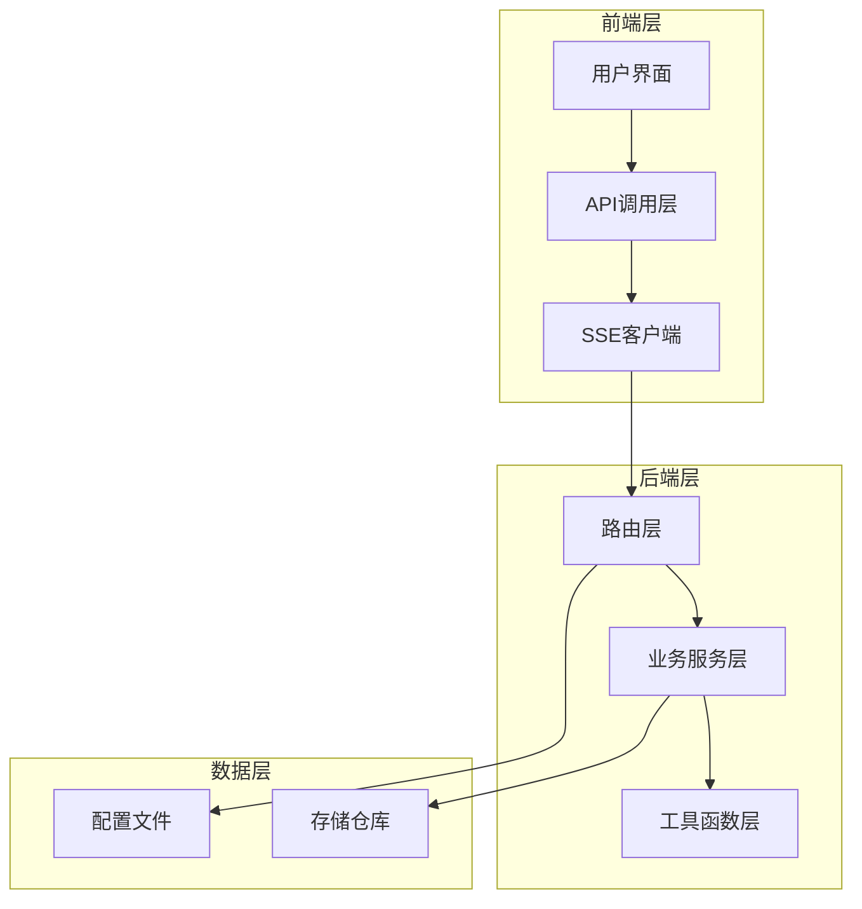
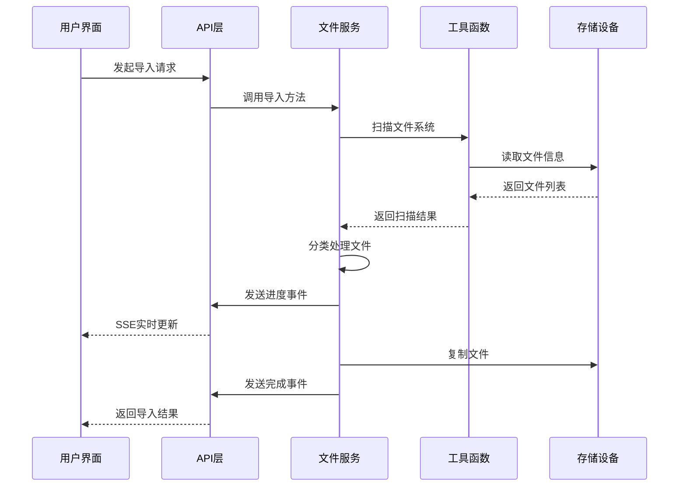
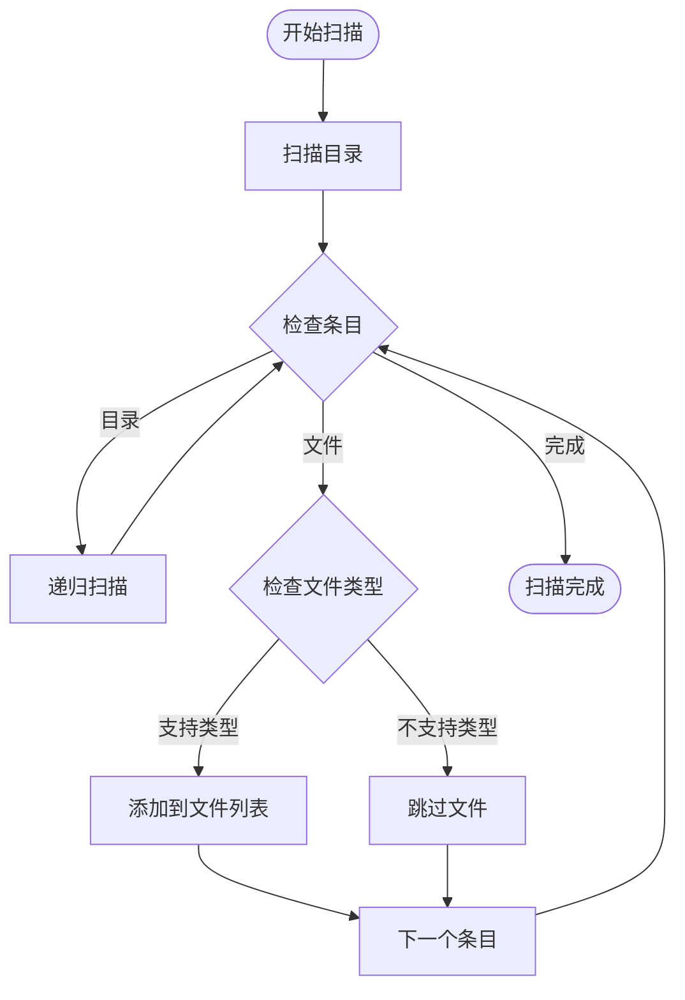
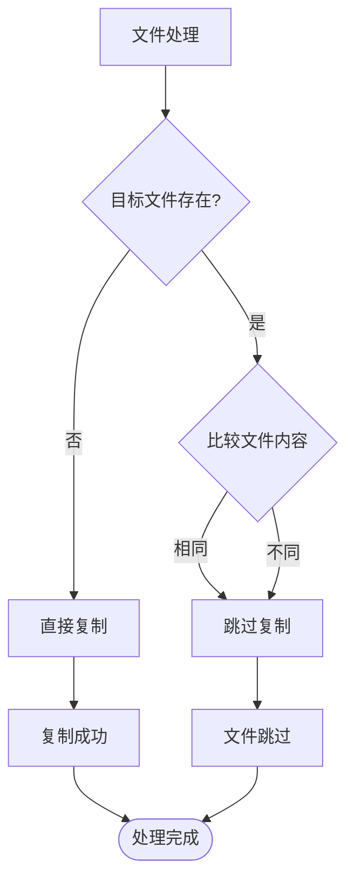
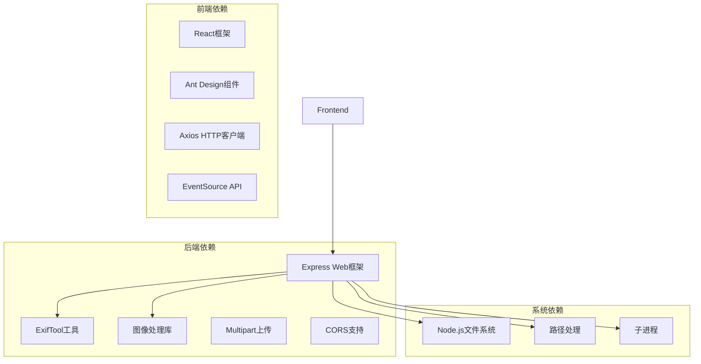
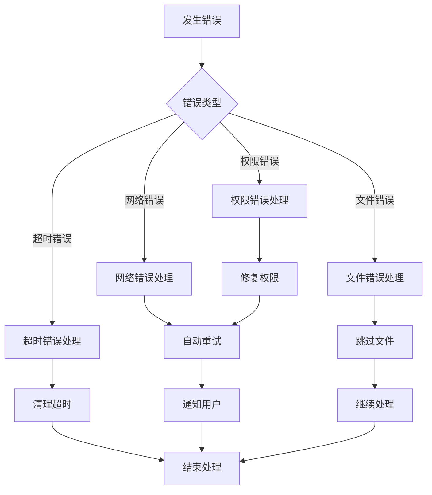

# 存储卡导入流程

<cite>
**本文档引用的文件**
- [importRoutes.js](file://backend/src/routes/importRoutes.js)
- [fileService.js](file://backend/src/services/fileService.js)
- [fileUtils.js](file://backend/src/utils/fileUtils.js)
- [ImportPage.jsx](file://frontend/src/pages/ImportPage.jsx)
- [index.js](file://frontend/src/api/index.js)
- [repos.json](file://backend/data/repos.json)
- [package.json](file://backend/package.json)
- [README.md](file://README.md)
- [rawThumbnail.js](file://backend/src/utils/rawThumbnail.js)
</cite>

## 目录
1. [简介](#简介)
2. [项目结构](#项目结构)
3. [核心组件](#核心组件)
4. [架构概览](#架构概览)
5. [详细组件分析](#详细组件分析)
6. [依赖关系分析](#依赖关系分析)
7. [性能考虑](#性能考虑)
8. [故障排除指南](#故障排除指南)
9. [结论](#结论)

## 简介

存储卡导入流程是照片管理系统的核心功能之一，负责从相机存储卡到本地仓库的完整导入过程。该系统支持实时进度监控、增量导入机制、文件类型过滤和错误处理，为用户提供可靠的媒体文件管理解决方案。

## 项目结构

该项目采用前后端分离架构，主要分为三个核心部分：

**图表来源**
- [importRoutes.js:1-627](file://backend/src/routes/importRoutes.js#L1-L627)
- [fileService.js:1-443](file://backend/src/services/fileService.js#L1-L443)
- [fileUtils.js:1-167](file://backend/src/utils/fileUtils.js#L1-L167)

**章节来源**
- [README.md:188-205](file://README.md#L188-L205)

## 核心组件

### 1. 导入路由控制器
负责处理存储卡导入请求，实现SSE实时进度推送和仓库配置管理。

### 2. 文件服务层
实现核心导入逻辑，包括文件扫描、分类处理、增量导入和并发控制。

### 3. 文件工具层
提供文件操作、类型识别、路径处理等基础功能。

### 4. 前端导入页面
提供用户界面、进度监控和仓库管理功能。

**章节来源**
- [importRoutes.js:82-182](file://backend/src/routes/importRoutes.js#L82-L182)
- [fileService.js:23-167](file://backend/src/services/fileService.js#L23-L167)
- [fileUtils.js:4-167](file://backend/src/utils/fileUtils.js#L4-L167)

## 架构概览

存储卡导入系统采用事件驱动架构，通过Server-Sent Events实现实时进度推送：

**图表来源**
- [importRoutes.js:83-182](file://backend/src/routes/importRoutes.js#L83-L182)
- [fileService.js:24-167](file://backend/src/services/fileService.js#L24-L167)

## 详细组件分析

### 导入路由组件分析

导入路由组件负责处理存储卡导入的HTTP请求，实现以下核心功能：

#### 1. 请求参数处理
- `sourcePath`: 存储卡根目录路径
- `repoId`: 目标仓库ID
- `autoRename`: 自动重命名标志

#### 2. 仓库配置管理
- 动态加载和保存仓库配置
- 支持多仓库管理和默认仓库设置
- 跨平台路径适配

#### 3. SSE实时进度推送
- 使用Server-Sent Events实现实时进度更新
- 支持进度、完成和错误三种消息类型
- 5分钟超时保护机制

**章节来源**
- [importRoutes.js:82-182](file://backend/src/routes/importRoutes.js#L82-L182)
- [importRoutes.js:24-59](file://backend/src/routes/importRoutes.js#L24-L59)

### 文件服务组件分析

文件服务组件是导入流程的核心，实现以下关键功能：

#### 1. 文件扫描机制

**图表来源**
- [fileUtils.js:22-66](file://backend/src/utils/fileUtils.js#L22-L66)

#### 2. 增量导入算法
系统采用智能增量导入策略，避免覆盖已存在的文件：

**图表来源**
- [fileUtils.js:77-100](file://backend/src/utils/fileUtils.js#L77-L100)

#### 3. 并发控制机制
系统使用并发限制避免内存溢出：
- 最大并发数：3个文件
- 动态队列管理
- 异步任务处理

**章节来源**
- [fileService.js:23-167](file://backend/src/services/fileService.js#L23-L167)
- [fileUtils.js:77-100](file://backend/src/utils/fileUtils.js#L77-L100)

### 文件工具组件分析

文件工具组件提供底层文件操作功能：

#### 1. 文件类型识别
支持的文件类型及扩展名：
- JPG/JPEG: `.jpg`, `.jpeg`
- RAW底片: `.raw`, `.cr2`, `.cr3`, `.nef`, `.arw`, `.dng`, `.orf`, `.raf`, `.rw2`
- 视频文件: `.mp4`, `.mov`, `.avi`, `.mkv`, `.m4v`, `.3gp`

#### 2. 路径处理功能
- 自动重命名生成：将目录层级编码到文件名中
- 跨平台路径适配
- 相对路径转换

**章节来源**
- [fileUtils.js:4-20](file://backend/src/utils/fileUtils.js#L4-L20)
- [fileUtils.js:129-137](file://backend/src/utils/fileUtils.js#L129-L137)

### 前端导入页面组件分析

前端导入页面提供完整的用户交互体验：

#### 1. 用户界面设计
- 分步骤引导导入流程
- 实时进度显示
- 导入结果统计

#### 2. SSE客户端实现
- EventSource API连接
- 自动重连机制
- 超时处理

#### 3. 仓库管理功能
- 多仓库配置
- 默认仓库设置
- 仓库路径选择

**章节来源**
- [ImportPage.jsx:274-690](file://frontend/src/pages/ImportPage.jsx#L274-L690)
- [index.js:37-165](file://frontend/src/api/index.js#L37-L165)

## 依赖关系分析

系统依赖关系图展示了各组件之间的依赖关系：

**图表来源**
- [package.json:10-18](file://backend/package.json#L10-L18)

**章节来源**
- [package.json:10-18](file://backend/package.json#L10-L18)

## 性能考虑

### 1. 并发处理优化
- **并发限制**：最大3个并发文件处理，避免内存溢出
- **动态队列**：根据处理完成情况动态调整队列长度
- **异步处理**：使用Promise.all等待所有任务完成

### 2. 文件处理策略
- **增量导入**：避免重复复制已存在的文件
- **智能跳过**：基于文件大小和修改时间判断文件是否相同
- **批量操作**：支持批量删除和批量导出

### 3. 内存管理
- **流式处理**：大文件采用流式处理避免内存占用过高
- **及时释放**：异步任务完成后及时清理内存
- **超时保护**：5分钟超时防止长时间占用资源

### 4. 网络优化
- **SSE连接复用**：单连接推送多个进度事件
- **压缩传输**：后端自动压缩SSE消息
- **断线重连**：自动处理网络中断情况

**章节来源**
- [fileService.js:75-156](file://backend/src/services/fileService.js#L75-L156)
- [index.js:113-120](file://frontend/src/api/index.js#L113-L120)

## 故障排除指南

### 1. 常见问题及解决方案

#### 存储卡路径问题
- **问题**：无法找到存储卡路径
- **解决方案**：使用"选择文件夹"按钮自动获取路径，或手动输入正确的路径

#### 权限不足
- **问题**：导入过程中出现权限错误
- **解决方案**：确保应用程序具有读取存储卡和写入目标仓库的权限

#### 文件重复
- **问题**：导入后发现文件重复
- **解决方案**：系统采用增量导入，不会覆盖已存在的文件。如需重新导入，请先删除目标仓库中的旧文件

#### 进度不更新
- **问题**：SSE连接无法建立或进度不更新
- **解决方案**：检查浏览器控制台是否有SSE连接错误，确认网络连接稳定

### 2. 错误处理机制

系统实现了多层次的错误处理：

**图表来源**
- [importRoutes.js:177-181](file://backend/src/routes/importRoutes.js#L177-L181)
- [fileService.js:119-125](file://backend/src/services/fileService.js#L119-L125)

### 3. 调试和监控

- **后端日志**：详细记录导入过程中的每一步操作
- **前端控制台**：显示SSE连接状态和错误信息
- **进度统计**：实时显示处理进度和剩余时间

**章节来源**
- [importRoutes.js:141-149](file://backend/src/routes/importRoutes.js#L141-L149)
- [fileService.js:127-143](file://backend/src/services/fileService.js#L127-L143)

## 结论

存储卡导入流程是一个高度集成的系统，通过合理的架构设计和优化策略，实现了可靠、高效的媒体文件导入功能。系统的主要优势包括：

1. **可靠性**：采用增量导入机制，避免覆盖已存在的文件
2. **实时性**：通过SSE实现毫秒级进度更新
3. **可扩展性**：模块化设计支持功能扩展和维护
4. **用户体验**：直观的界面设计和详细的进度反馈

未来可以进一步优化的方向包括暂停/恢复导入功能、显示实时传输速度、批量导入多个存储卡等特性。