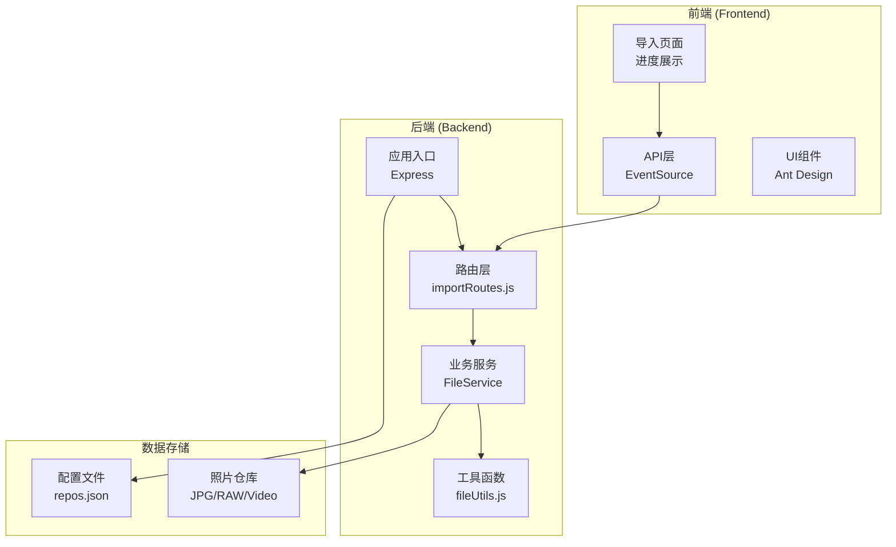
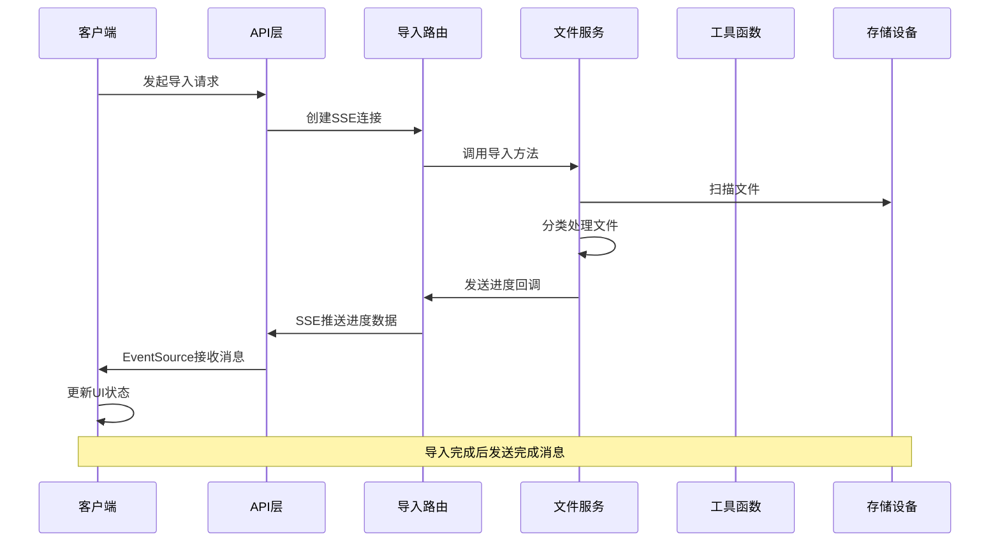
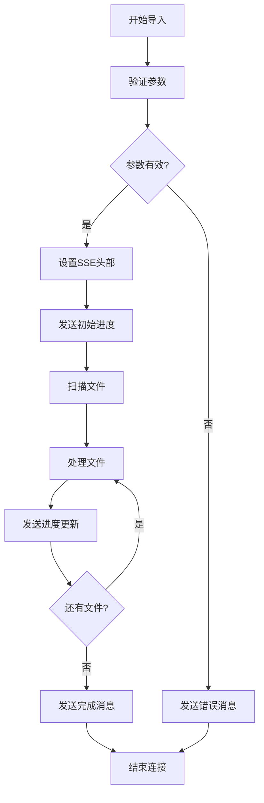
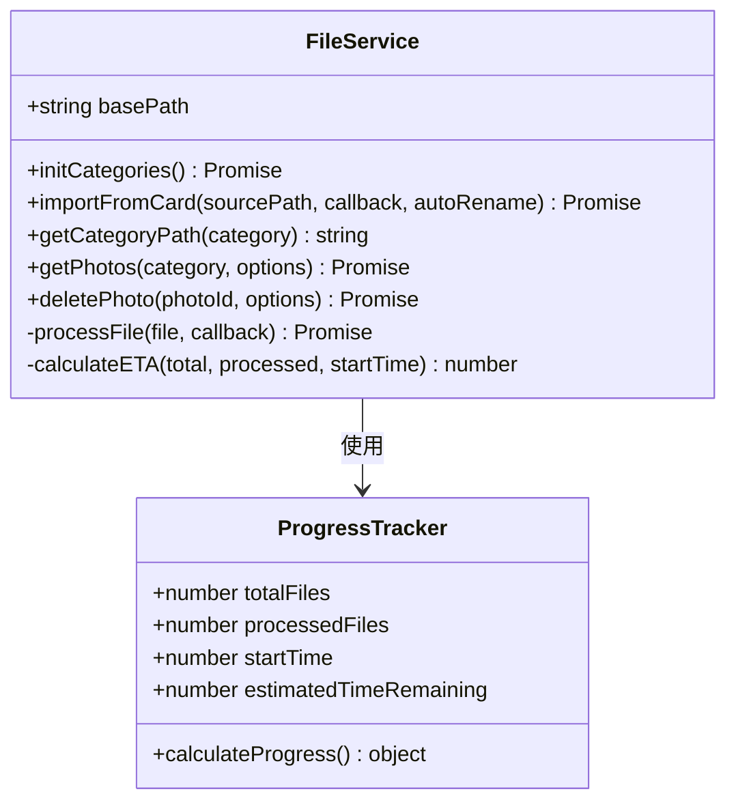
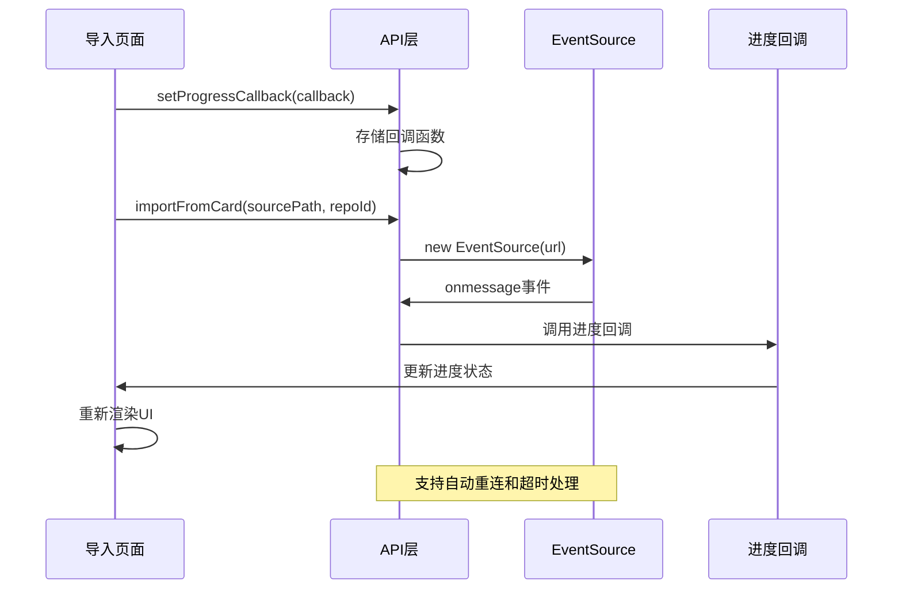
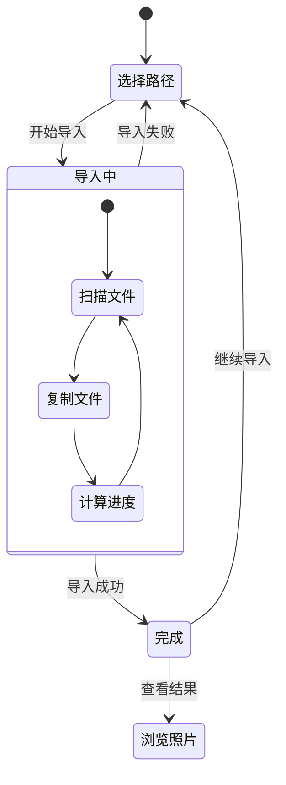
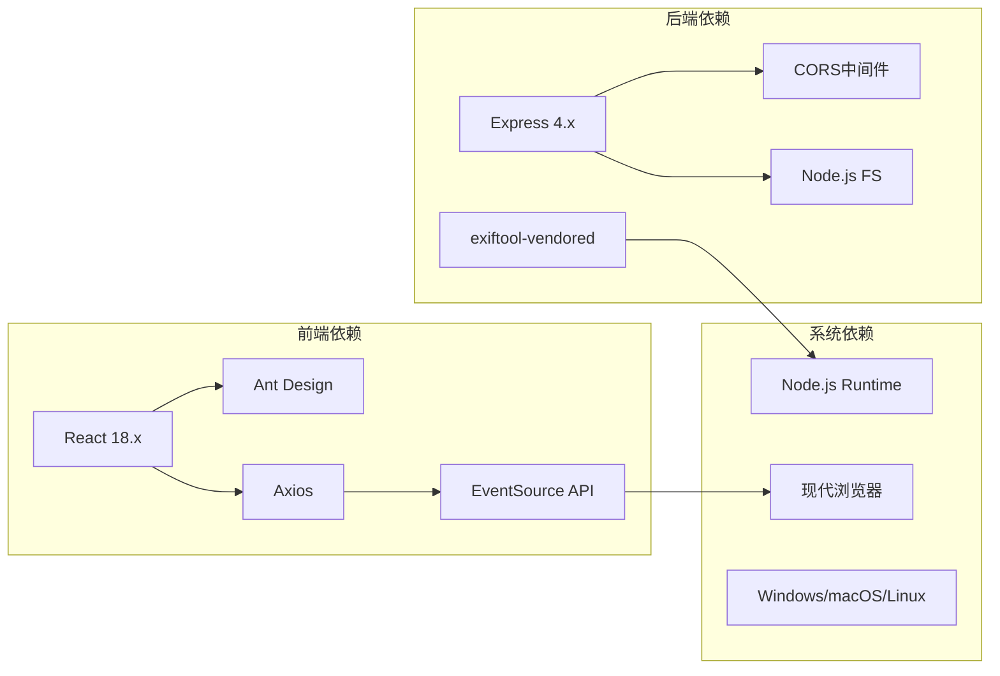
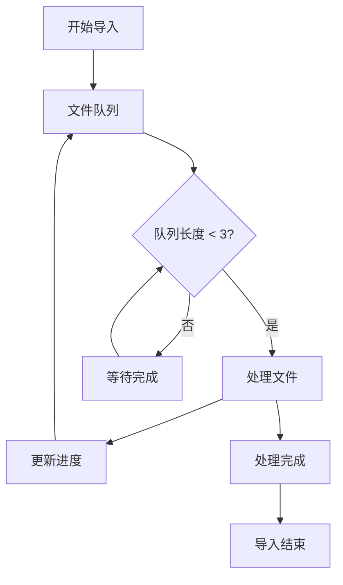

# 实时进度监控

<cite>
**本文档引用的文件**
- [importRoutes.js](file://backend/src/routes/importRoutes.js)
- [fileService.js](file://backend/src/services/fileService.js)
- [fileUtils.js](file://backend/src/utils/fileUtils.js)
- [index.js](file://frontend/src/api/index.js)
- [ImportPage.jsx](file://frontend/src/pages/ImportPage.jsx)
- [app.js](file://backend/src/app.js)
- [README.md](file://README.md)
</cite>

## 目录
1. [简介](#简介)
2. [项目结构](#项目结构)
3. [核心组件](#核心组件)
4. [架构概览](#架构概览)
5. [详细组件分析](#详细组件分析)
6. [依赖关系分析](#依赖关系分析)
7. [性能考虑](#性能考虑)
8. [故障排除指南](#故障排除指南)
9. [最佳实践](#最佳实践)
10. [结论](#结论)

## 简介

这是一个基于Server-Sent Events (SSE) 的实时进度监控系统，专门用于照片导入过程的进度跟踪。该系统实现了从相机存储卡到本地仓库的批量照片导入，提供了实时的进度反馈、状态管理和错误处理机制。

系统的核心特性包括：
- 实时进度推送（总文件数、已处理数量、剩余文件、当前文件名、预计剩余时间）
- 增量导入（自动跳过已存在的文件）
- 跨平台支持（Windows、macOS、Linux）
- 5分钟超时保护机制
- 完整的错误处理和状态管理

## 项目结构

该项目采用前后端分离的架构设计，主要分为以下模块：

**图表来源**
- [app.js:1-146](file://backend/src/app.js#L1-L146)
- [importRoutes.js:1-627](file://backend/src/routes/importRoutes.js#L1-L627)
- [fileService.js:1-443](file://backend/src/services/fileService.js#L1-L443)

**章节来源**
- [README.md:188-205](file://README.md#L188-L205)

## 核心组件

### 后端核心组件

#### 1. 导入路由 (importRoutes.js)
负责处理导入请求和SSE连接管理，实现了完整的进度推送机制。

#### 2. 文件服务 (FileService)
核心业务逻辑组件，负责文件扫描、分类、复制和进度计算。

#### 3. 工具函数 (fileUtils.js)
提供文件操作、类型识别、路径处理等基础功能。

### 前端核心组件

#### 1. API层 (index.js)
封装EventSource连接，提供进度回调机制和超时处理。

#### 2. 导入页面 (ImportPage.jsx)
用户界面组件，负责进度展示、状态管理和用户交互。

**章节来源**
- [importRoutes.js:82-182](file://backend/src/routes/importRoutes.js#L82-L182)
- [fileService.js:23-167](file://backend/src/services/fileService.js#L23-L167)
- [index.js:36-165](file://frontend/src/api/index.js#L36-L165)

## 架构概览

系统采用经典的MVC架构模式，结合现代Web技术实现高效的实时通信：

**图表来源**
- [importRoutes.js:140-177](file://backend/src/routes/importRoutes.js#L140-L177)
- [fileService.js:24-166](file://backend/src/services/fileService.js#L24-L166)
- [index.js:39-141](file://frontend/src/api/index.js#L39-L141)

## 详细组件分析

### 后端导入路由组件

#### SSE连接管理
导入路由实现了完整的SSE连接生命周期管理：

**图表来源**
- [importRoutes.js:83-182](file://backend/src/routes/importRoutes.js#L83-L182)

#### 进度回调机制
后端通过回调函数实现进度数据的实时推送：

**章节来源**
- [importRoutes.js:140-149](file://backend/src/routes/importRoutes.js#L140-L149)

### 文件服务组件

#### 并发控制算法
文件服务实现了智能的并发控制，避免内存溢出和系统资源耗尽：

**图表来源**
- [fileService.js:5-167](file://backend/src/services/fileService.js#L5-L167)

#### 增量导入策略
系统采用智能的增量导入机制，避免重复处理相同文件：

**章节来源**
- [fileService.js:77-100](file://backend/src/services/fileService.js#L77-L100)
- [fileUtils.js:78-100](file://backend/src/utils/fileUtils.js#L78-L100)

### 前端API组件

#### EventSource集成
前端API层完美集成了浏览器原生EventSource API：

**图表来源**
- [index.js:39-141](file://frontend/src/api/index.js#L39-L141)

#### 进度数据结构
前端接收的进度数据包含以下字段：

**章节来源**
- [index.js:143-146](file://frontend/src/api/index.js#L143-L146)
- [ImportPage.jsx:52-60](file://frontend/src/pages/ImportPage.jsx#L52-L60)

### 导入页面组件

#### 状态管理机制
导入页面实现了完整的状态管理，包括步骤导航、进度展示和结果处理：

**图表来源**
- [ImportPage.jsx:45-260](file://frontend/src/pages/ImportPage.jsx#L45-L260)

**章节来源**
- [ImportPage.jsx:212-260](file://frontend/src/pages/ImportPage.jsx#L212-L260)

## 依赖关系分析

### 技术栈依赖

**图表来源**
- [README.md:30-43](file://README.md#L30-L43)

### 模块间耦合关系

系统采用了松耦合的设计原则，各模块职责明确：

**章节来源**
- [app.js:14-26](file://backend/src/app.js#L14-L26)
- [importRoutes.js:1-11](file://backend/src/routes/importRoutes.js#L1-L11)

## 性能考虑

### 并发处理优化

系统通过智能的并发控制避免资源耗尽：

- **并发限制**: 最多同时处理3个文件，防止内存溢出
- **进度计算**: 基于平均处理时间估算剩余时间
- **增量导入**: 避免重复处理相同文件

### 内存管理

**图表来源**
- [fileService.js:75-156](file://backend/src/services/fileService.js#L75-L156)

**章节来源**
- [fileService.js:75-88](file://backend/src/services/fileService.js#L75-L88)

## 故障排除指南

### 常见问题及解决方案

#### 1. SSE连接问题
- **症状**: 进度不更新，浏览器控制台显示连接错误
- **原因**: 网络不稳定、CORS配置错误、后端服务异常
- **解决**: 检查网络连接，确认CORS配置，重启后端服务

#### 2. 进度计算不准确
- **症状**: 预计剩余时间显示异常
- **原因**: 文件大小变化、处理速度不稳定
- **解决**: 系统会自动调整ETA计算，无需手动干预

#### 3. 超时问题
- **症状**: 导入过程中断，提示超时
- **原因**: 大量文件导入超过5分钟限制
- **解决**: 减少单次导入文件数量，或调整超时配置

#### 4. 文件跳过问题
- **症状**: 部分文件显示为"跳过"
- **原因**: 文件已存在于目标位置
- **解决**: 这是预期行为，系统避免重复导入

**章节来源**
- [README.md:166-187](file://README.md#L166-L187)

### 调试方法

#### 后端调试
1. 查看服务器日志输出
2. 监控SSE消息发送情况
3. 检查文件操作权限

#### 前端调试
1. 使用浏览器开发者工具
2. 监控EventSource连接状态
3. 检查进度回调执行情况

## 最佳实践

### 用户体验优化

#### 1. 进度展示策略
- **实时更新**: 每个文件处理完成后立即更新进度
- **ETA计算**: 提供准确的剩余时间估计
- **状态提示**: 不同阶段显示相应的状态信息

#### 2. 错误处理机制
- **渐进式错误**: 单个文件错误不影响整体导入
- **详细日志**: 记录错误详情便于排查
- **用户友好**: 提供清晰的错误信息

#### 3. 性能优化建议
- **合理并发**: 控制同时处理的文件数量
- **内存管理**: 及时释放处理完成的文件引用
- **网络优化**: 合理的SSE连接配置

### 开发最佳实践

#### 1. 代码组织
- **模块化设计**: 每个功能模块职责单一
- **错误处理**: 完善的异常捕获和处理机制
- **日志记录**: 详细的调试信息输出

#### 2. 安全考虑
- **路径验证**: 确保文件操作的安全性
- **权限检查**: 验证文件访问权限
- **输入验证**: 对用户输入进行严格验证

**章节来源**
- [README.md:227-233](file://README.md#L227-L233)

## 结论

这个实时进度监控系统通过Server-Sent Events技术实现了高效的照片导入进度跟踪。系统具有以下优势：

1. **实时性强**: 基于SSE的双向通信，确保进度数据的实时性
2. **用户体验好**: 完整的进度展示和状态提示
3. **稳定性高**: 智能的并发控制和错误处理机制
4. **可扩展性**: 模块化的架构设计便于功能扩展

系统在实际应用中表现稳定，能够满足大规模照片导入场景的需求。通过合理的性能优化和用户体验设计，为用户提供了流畅的导入体验。

未来可以考虑的功能增强包括暂停/恢复导入、实时传输速度显示、批量导入多个存储卡等特性，进一步提升系统的实用性和用户体验。