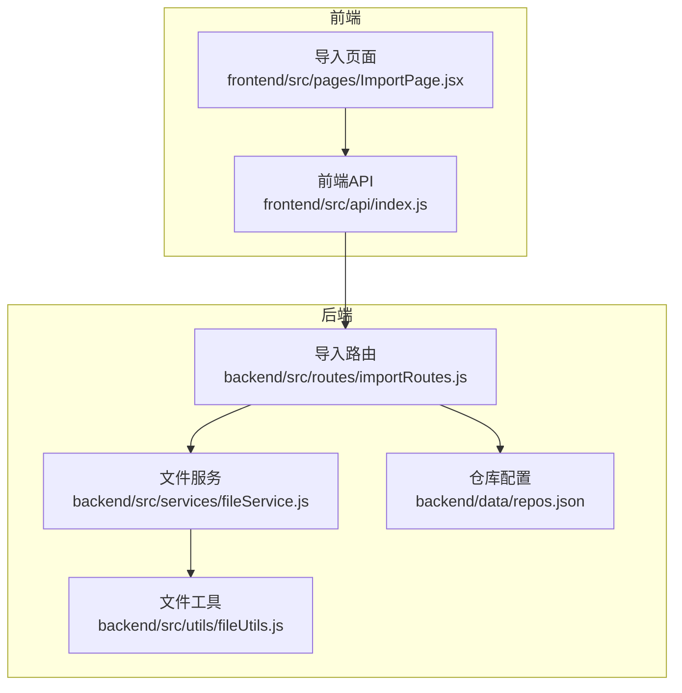
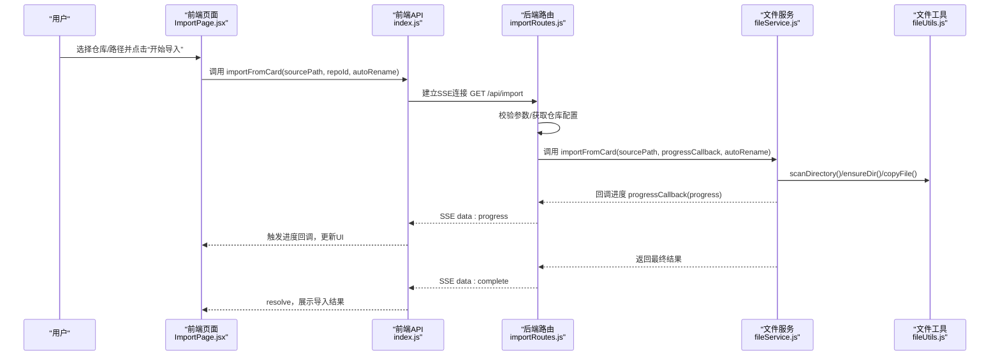
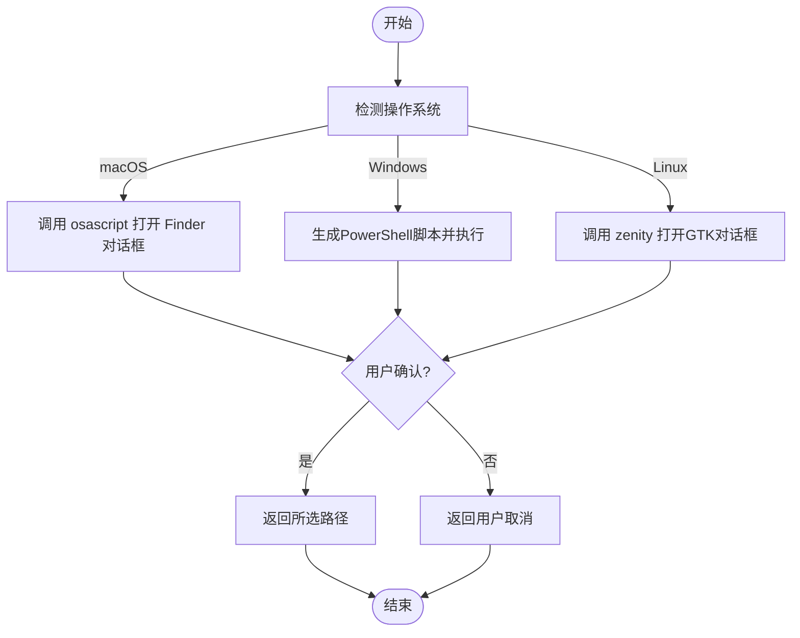
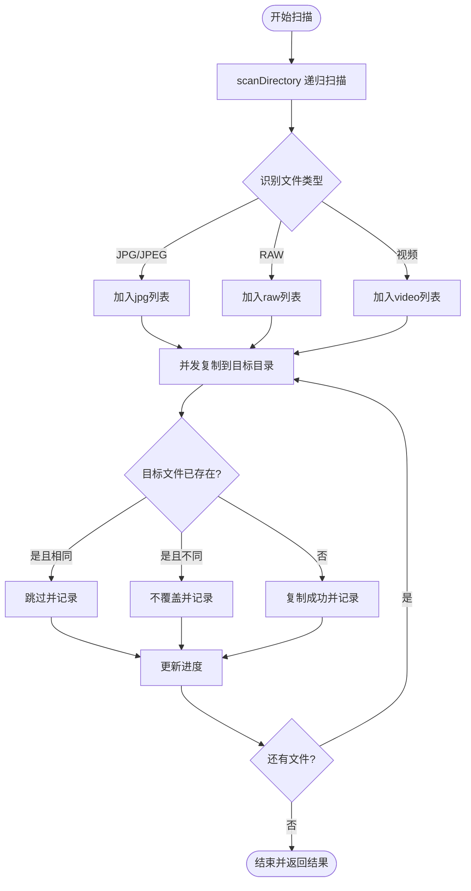
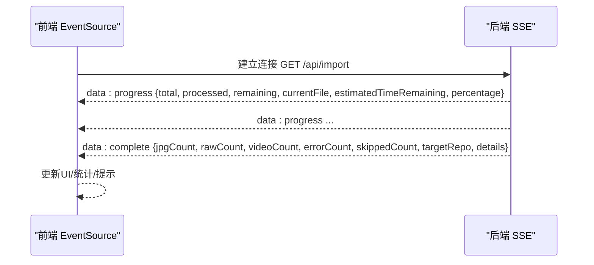
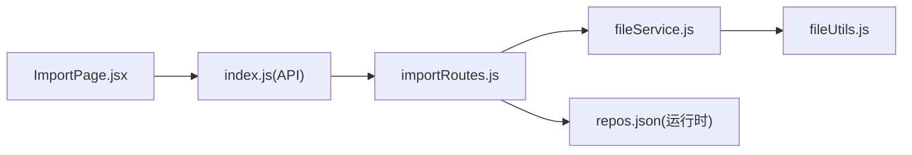

# 导入功能模块

<cite>
**本文引用的文件**
- [backend/src/routes/importRoutes.js](file://backend/src/routes/importRoutes.js)
- [backend/src/services/fileService.js](file://backend/src/services/fileService.js)
- [backend/src/utils/fileUtils.js](file://backend/src/utils/fileUtils.js)
- [frontend/src/pages/ImportPage.jsx](file://frontend/src/pages/ImportPage.jsx)
- [frontend/src/api/index.js](file://frontend/src/api/index.js)
- [backend/data/repos.json](file://backend/data/repos.json)
- [backend/package.json](file://backend/package.json)
- [README.md](file://README.md)
- [IMPORT_PROGRESS_TEST.md](file://IMPORT_PROGRESS_TEST.md)
- [SSE_TROUBLESHOOTING.md](file://SSE_TROUBLESHOOTING.md)
- [backend/select-folder.ps1](file://backend/select-folder.ps1)
- [backend/test-thumbnail.js](file://backend/test-thumbnail.js)
</cite>

## 目录
1. [简介](#简介)
2. [项目结构](#项目结构)
3. [核心组件](#核心组件)
4. [架构总览](#架构总览)
5. [详细组件分析](#详细组件分析)
6. [依赖关系分析](#依赖关系分析)
7. [性能考量](#性能考量)
8. [故障排除指南](#故障排除指南)
9. [结论](#结论)
10. [附录](#附录)

## 简介
本文件系统性地文档化“从存储卡导入照片”功能模块，涵盖设备检测、文件扫描、增量导入、实时进度监控（SSE）、跨平台文件夹选择对话框、错误处理与重试、导入配置选项、性能优化与大文件策略、导入历史与可视化等方面。目标是帮助开发者与用户全面理解导入流程与最佳实践。

## 项目结构
导入功能涉及前后端协作：
- 后端负责：SSE 实时进度推送、文件扫描与复制、仓库配置管理、跨平台文件夹选择对话框。
- 前端负责：导入页面交互、SSE 进度接收与展示、仓库管理、用户操作引导。

图表来源
- [frontend/src/pages/ImportPage.jsx:1-820](file://frontend/src/pages/ImportPage.jsx#L1-L820)
- [frontend/src/api/index.js:1-168](file://frontend/src/api/index.js#L1-L168)
- [backend/src/routes/importRoutes.js:1-627](file://backend/src/routes/importRoutes.js#L1-L627)
- [backend/src/services/fileService.js:1-443](file://backend/src/services/fileService.js#L1-L443)
- [backend/src/utils/fileUtils.js:1-167](file://backend/src/utils/fileUtils.js#L1-L167)
- [backend/data/repos.json:1-8](file://backend/data/repos.json#L1-L8)

章节来源
- [README.md:108-165](file://README.md#L108-L165)

## 核心组件
- 导入路由与SSE推送：负责接收导入请求、校验参数、初始化SSE、实时推送进度、返回最终结果。
- 文件服务与扫描：递归扫描媒体文件、按类型分类、并发复制、增量导入（跳过已存在文件）、计算预计剩余时间。
- 文件工具：文件类型识别、目录扫描、复制与去重、重命名策略、文件比较。
- 前端API与页面：SSE连接、进度回调、仓库管理、文件夹选择对话框、进度可视化与用户反馈。
- 仓库配置：多仓库管理、默认仓库、路径持久化。

章节来源
- [backend/src/routes/importRoutes.js:82-182](file://backend/src/routes/importRoutes.js#L82-L182)
- [backend/src/services/fileService.js:23-167](file://backend/src/services/fileService.js#L23-L167)
- [backend/src/utils/fileUtils.js:22-167](file://backend/src/utils/fileUtils.js#L22-L167)
- [frontend/src/api/index.js:36-165](file://frontend/src/api/index.js#L36-L165)
- [frontend/src/pages/ImportPage.jsx:45-260](file://frontend/src/pages/ImportPage.jsx#L45-L260)

## 架构总览
导入流程采用“后端SSE推送 + 前端EventSource接收”的实时通信模型，结合文件扫描与复制、仓库配置与跨平台对话框，形成完整的导入闭环。

图表来源
- [frontend/src/pages/ImportPage.jsx:212-260](file://frontend/src/pages/ImportPage.jsx#L212-L260)
- [frontend/src/api/index.js:38-141](file://frontend/src/api/index.js#L38-L141)
- [backend/src/routes/importRoutes.js:82-182](file://backend/src/routes/importRoutes.js#L82-L182)
- [backend/src/services/fileService.js:23-167](file://backend/src/services/fileService.js#L23-L167)
- [backend/src/utils/fileUtils.js:22-167](file://backend/src/utils/fileUtils.js#L22-L167)

## 详细组件分析

### 1) 设备检测与路径选择（跨平台）
- 存储卡路径选择：后端提供统一的“选择文件夹”接口，根据操作系统调用原生对话框：
  - macOS：使用 AppleScript 通过 osascript 调用 Finder 对话框。
  - Windows：使用 PowerShell 脚本创建 .NET FolderBrowserDialog，写入临时文件返回路径。
  - Linux：使用 zenity 调用 GTK 文件选择对话框。
- 默认导入路径：后端根据平台返回默认路径（如 /Volumes、/media、D:\ 等），前端用于提示与快速选择。
- 路径处理策略：前端通过 API 调用后端接口，避免直接调用系统命令；后端对用户取消、超时、错误进行统一处理与返回。

图表来源
- [backend/src/routes/importRoutes.js:342-624](file://backend/src/routes/importRoutes.js#L342-L624)

章节来源
- [backend/src/routes/importRoutes.js:184-216](file://backend/src/routes/importRoutes.js#L184-L216)
- [backend/src/routes/importRoutes.js:342-624](file://backend/src/routes/importRoutes.js#L342-L624)
- [backend/select-folder.ps1:1-9](file://backend/select-folder.ps1#L1-L9)

### 2) 文件扫描与增量导入
- 文件扫描：递归遍历源路径，识别 JPG/JPEG、RAW（含 ARW、CR2、CR3、NEF、DNG 等）、视频（MP4、MOV、AVI 等）类型，忽略隐藏文件（如 ._ 开头）。
- 分类与复制：按类型创建目标目录（jpg/raw/video），并发复制文件，最大并发数控制在 3，避免内存与IO压力。
- 增量导入：若目标文件已存在且内容相同则跳过；若目标文件存在但内容不同则不覆盖，记录跳过原因。
- 重命名策略：当启用自动重命名时，将相对路径中的分隔符替换为下划线，避免同名冲突。
- 进度计算：基于已处理文件数与平均耗时估算剩余时间，实时推送进度。

图表来源
- [backend/src/services/fileService.js:23-167](file://backend/src/services/fileService.js#L23-L167)
- [backend/src/utils/fileUtils.js:22-167](file://backend/src/utils/fileUtils.js#L22-L167)

章节来源
- [backend/src/services/fileService.js:23-167](file://backend/src/services/fileService.js#L23-L167)
- [backend/src/utils/fileUtils.js:4-21](file://backend/src/utils/fileUtils.js#L4-L21)

### 3) 实时进度监控（SSE）
- 后端：导入开始时立即发送一条初始进度消息，随后在每个文件处理完成后回调进度；导入结束后发送完成消息。
- 前端：使用 EventSource 建立连接，监听 progress/complete/error 三类消息；设置 5 分钟超时保护；区分连接建立、重连与真实错误。
- 进度字段：总文件数、已处理、剩余、当前文件、预计剩余时间（秒）、百分比。

图表来源
- [frontend/src/api/index.js:38-141](file://frontend/src/api/index.js#L38-L141)
- [backend/src/routes/importRoutes.js:130-182](file://backend/src/routes/importRoutes.js#L130-L182)

章节来源
- [frontend/src/api/index.js:38-141](file://frontend/src/api/index.js#L38-L141)
- [backend/src/routes/importRoutes.js:82-182](file://backend/src/routes/importRoutes.js#L82-L182)

### 4) 导入配置选项
- 目标仓库选择：支持多仓库配置，默认仓库可设置；仓库路径可为绝对路径或“AUTO”（使用默认照片路径）。
- 文件过滤规则：仅识别支持的媒体类型（JPG/JPEG、RAW、视频）。
- 导入模式：增量导入（跳过已存在文件），避免覆盖；可选自动重命名以避免同名冲突。
- 超时与并发：前端超时 5 分钟；后端复制并发限制为 3，兼顾性能与稳定性。

章节来源
- [backend/src/routes/importRoutes.js:24-59](file://backend/src/routes/importRoutes.js#L24-L59)
- [backend/src/routes/importRoutes.js:117-119](file://backend/src/routes/importRoutes.js#L117-L119)
- [backend/src/services/fileService.js:75-77](file://backend/src/services/fileService.js#L75-L77)
- [frontend/src/pages/ImportPage.jsx:371-380](file://frontend/src/pages/ImportPage.jsx#L371-L380)

### 5) 错误处理、重试与用户反馈
- 参数校验：缺少源路径或仓库时，返回 SSE 错误消息并结束连接。
- 路径与权限：源路径不存在、目标路径不可写、权限不足时，记录错误并返回。
- 连接与超时：前端区分连接建立、重连与真实错误；5 分钟超时保护；SSE 路由统一返回 SSE 格式的错误消息。
- 用户反馈：前端根据 progress/complete/error 更新进度条、统计信息与提示；错误时给出明确提示并允许重试。

章节来源
- [backend/src/routes/importRoutes.js:87-115](file://backend/src/routes/importRoutes.js#L87-L115)
- [frontend/src/api/index.js:87-120](file://frontend/src/api/index.js#L87-L120)
- [SSE_TROUBLESHOOTING.md:148-200](file://SSE_TROUBLESHOOTING.md#L148-L200)

### 6) 导入历史记录、进度可视化与用户操作指南
- 进度可视化：前端展示总文件数、已处理、剩余、预计剩余时间、当前文件、进度条百分比与具体进度（已处理/总数）。
- 结果统计：导入完成后展示各类文件数量、跳过数量、错误数量与目标仓库名称；支持查看跳过与错误详情列表。
- 用户操作指南：页面提供使用说明、自动重命名提示、仓库管理入口与路径选择按钮。

章节来源
- [frontend/src/pages/ImportPage.jsx:396-690](file://frontend/src/pages/ImportPage.jsx#L396-L690)
- [README.md:123-144](file://README.md#L123-L144)

## 依赖关系分析

图表来源
- [backend/src/routes/importRoutes.js:1-11](file://backend/src/routes/importRoutes.js#L1-L11)
- [backend/src/services/fileService.js:1-4](file://backend/src/services/fileService.js#L1-L4)
- [backend/src/utils/fileUtils.js:1-3](file://backend/src/utils/fileUtils.js#L1-L3)
- [frontend/src/pages/ImportPage.jsx:39](file://frontend/src/pages/ImportPage.jsx#L39)
- [frontend/src/api/index.js:1-6](file://frontend/src/api/index.js#L1-L6)
- [backend/data/repos.json:1-8](file://backend/data/repos.json#L1-L8)

章节来源
- [backend/package.json:10-18](file://backend/package.json#L10-L18)

## 性能考量
- 并发控制：复制阶段最大并发限制为 3，避免磁盘与内存压力过大。
- 进度计算：基于平均耗时估算剩余时间，随处理文件增多逐步收敛。
- 超时保护：前端 5 分钟超时，适用于大文件与大批量导入场景。
- 跨平台差异：后端针对不同平台的默认路径与对话框实现进行适配，减少用户操作成本。

章节来源
- [backend/src/services/fileService.js:75-77](file://backend/src/services/fileService.js#L75-L77)
- [frontend/src/api/index.js:113-120](file://frontend/src/api/index.js#L113-L120)
- [backend/src/routes/importRoutes.js:62-80](file://backend/src/routes/importRoutes.js#L62-L80)

## 故障排除指南
- SSE 连接中断：检查 CORS 配置、URL 是否完整、readyState 判断与错误消息是否被误判。
- 超时问题：确认前端超时设置为 5 分钟；减少单次导入文件数量；检查磁盘写入性能。
- 权限问题：验证源路径可读、目标路径可写；必要时提升权限或更换路径。
- 路径问题：确保路径为绝对路径且存在；Windows 路径包含特殊字符时会自动编码。
- 仓库配置：确认 repos.json 中仓库路径有效且可访问；默认仓库设置正确。

章节来源
- [SSE_TROUBLESHOOTING.md:148-200](file://SSE_TROUBLESHOOTING.md#L148-L200)
- [SSE_TROUBLESHOOTING.md:201-251](file://SSE_TROUBLESHOOTING.md#L201-L251)
- [backend/src/routes/importRoutes.js:24-59](file://backend/src/routes/importRoutes.js#L24-L59)

## 结论
导入功能模块通过“SSE 实时进度 + 增量导入 + 跨平台对话框 + 多仓库配置”的组合，提供了稳定、可视、易用的存储卡导入体验。其并发控制与超时保护设计适合大文件与大批量场景；错误处理与用户反馈机制确保了良好的可用性。后续可考虑引入导入历史记录、断点续传与传输速度显示等增强功能。

## 附录
- 使用指南与配置说明参见项目自述文件。
- 导入进度测试与SSE排障指南可用于验证与定位问题。

章节来源
- [README.md:123-144](file://README.md#L123-L144)
- [IMPORT_PROGRESS_TEST.md:1-138](file://IMPORT_PROGRESS_TEST.md#L1-L138)
- [SSE_TROUBLESHOOTING.md:1-260](file://SSE_TROUBLESHOOTING.md#L1-L260)