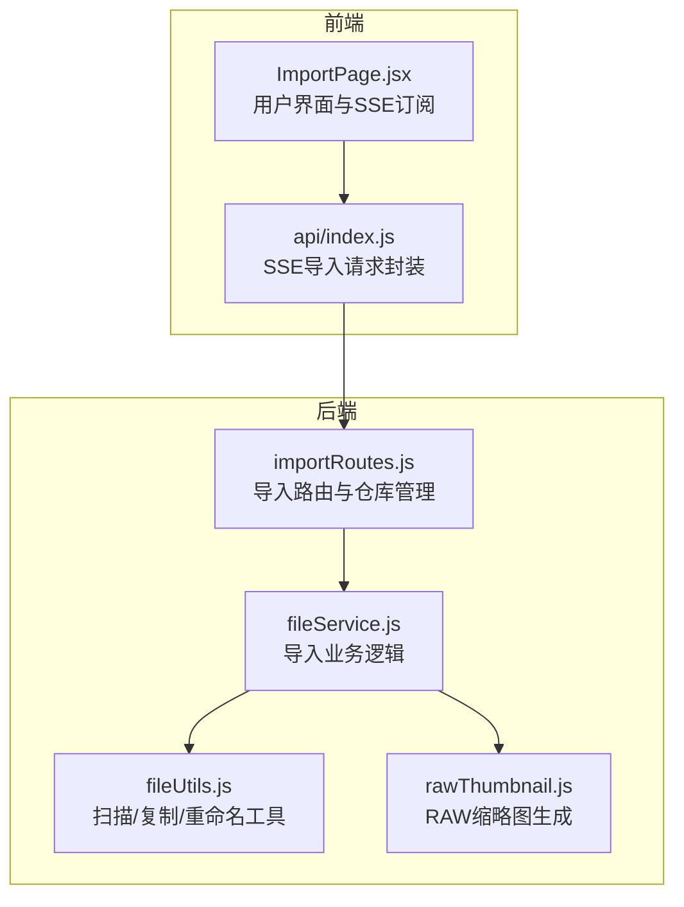
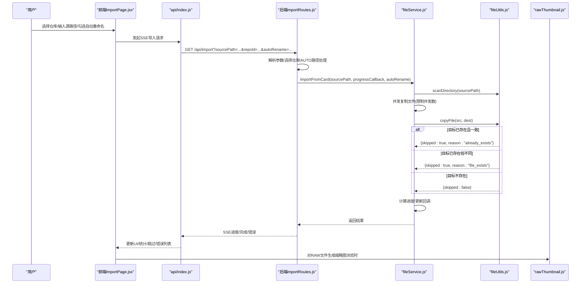
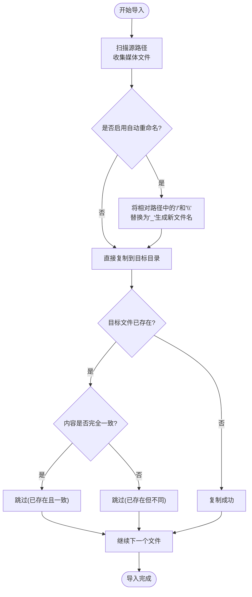
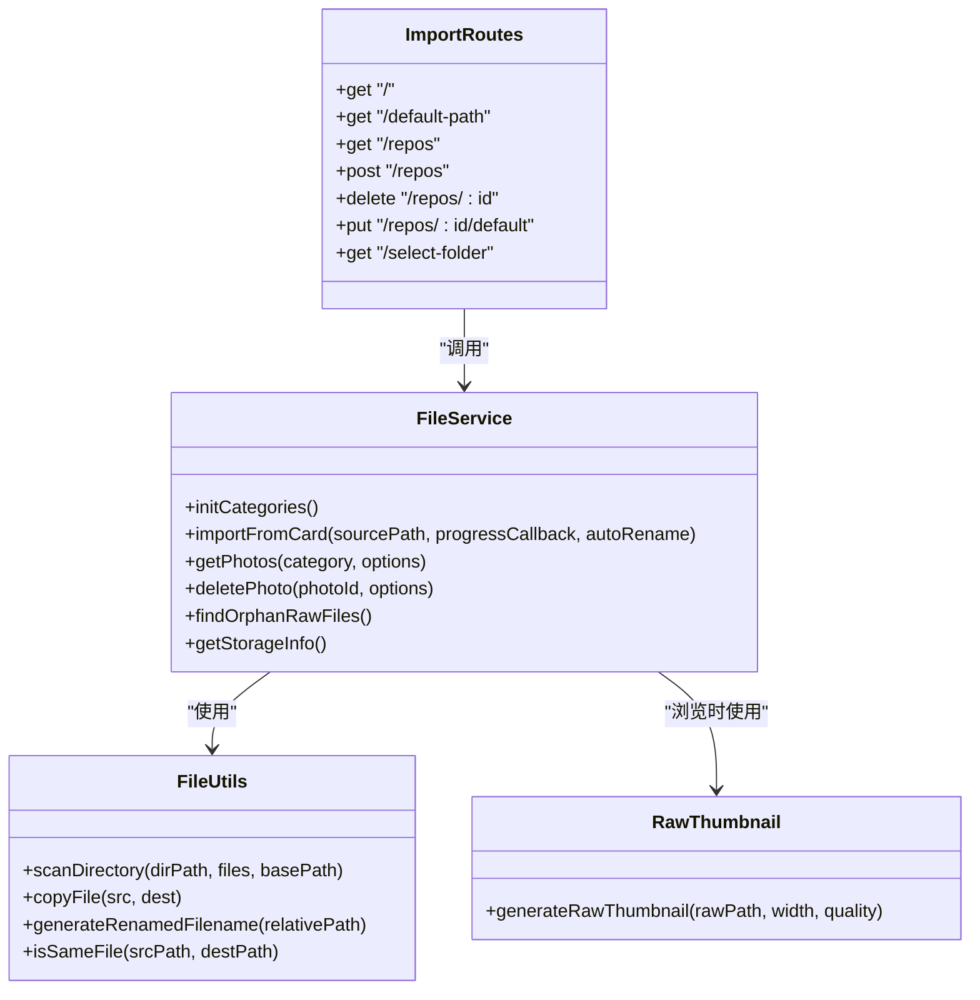

# 导入配置选项

<cite>
**本文引用的文件**
- [importRoutes.js](file://backend/src/routes/importRoutes.js)
- [fileService.js](file://backend/src/services/fileService.js)
- [fileUtils.js](file://backend/src/utils/fileUtils.js)
- [rawThumbnail.js](file://backend/src/utils/rawThumbnail.js)
- [ImportPage.jsx](file://frontend/src/pages/ImportPage.jsx)
- [index.js](file://frontend/src/api/index.js)
- [repos.json.example](file://config/repos.json.example)
- [repos.json](file://backend/data/repos.json)
- [README.md](file://README.md)
</cite>

## 目录
1. [简介](#简介)
2. [项目结构](#项目结构)
3. [核心组件](#核心组件)
4. [架构概览](#架构概览)
5. [详细组件分析](#详细组件分析)
6. [依赖关系分析](#依赖关系分析)
7. [性能考量](#性能考量)
8. [故障排查指南](#故障排查指南)
9. [结论](#结论)
10. [附录](#附录)

## 简介
本文件面向“导入配置选项”的综合说明，围绕以下主题展开：
- 目标仓库选择与管理
- 自动重命名选项与目录层级编码机制
- 文件过滤规则（支持的媒体类型）
- 增量导入模式与覆盖行为
- 导入过程中的文件处理选项（RAW文件处理、EXIF元数据保留、缩略图生成）
- 配置验证与错误处理机制
- 最佳实践与性能影响分析

## 项目结构
导入功能涉及前后端协作：前端负责用户交互与SSE进度订阅，后端负责扫描、复制、重命名与仓库管理，并通过SSE向前端推送实时进度。

图表来源
- [importRoutes.js:1-627](file://backend/src/routes/importRoutes.js#L1-L627)
- [fileService.js:1-443](file://backend/src/services/fileService.js#L1-L443)
- [fileUtils.js:1-167](file://backend/src/utils/fileUtils.js#L1-L167)
- [rawThumbnail.js:1-132](file://backend/src/utils/rawThumbnail.js#L1-L132)
- [ImportPage.jsx:1-820](file://frontend/src/pages/ImportPage.jsx#L1-L820)
- [index.js:1-168](file://frontend/src/api/index.js#L1-L168)

章节来源
- [importRoutes.js:1-627](file://backend/src/routes/importRoutes.js#L1-L627)
- [fileService.js:1-443](file://backend/src/services/fileService.js#L1-L443)
- [fileUtils.js:1-167](file://backend/src/utils/fileUtils.js#L1-L167)
- [rawThumbnail.js:1-132](file://backend/src/utils/rawThumbnail.js#L1-L132)
- [ImportPage.jsx:1-820](file://frontend/src/pages/ImportPage.jsx#L1-L820)
- [index.js:1-168](file://frontend/src/api/index.js#L1-L168)

## 核心组件
- 导入路由层：负责接收导入请求、解析查询参数、选择目标仓库、初始化SSE并调用业务服务。
- 导入服务层：负责扫描源路径、并发复制文件、增量导入策略、进度计算与回调。
- 工具层：负责文件扫描、复制（含去重）、重命名（目录层级编码）、文件存在性与一致性校验。
- RAW缩略图生成：针对RAW文件的三级降级策略（嵌入预览→解码→占位图）。
- 前端导入页：提供仓库选择、自动重命名开关、SSE进度展示与结果汇总。

章节来源
- [importRoutes.js:82-182](file://backend/src/routes/importRoutes.js#L82-L182)
- [fileService.js:23-167](file://backend/src/services/fileService.js#L23-L167)
- [fileUtils.js:22-166](file://backend/src/utils/fileUtils.js#L22-L166)
- [rawThumbnail.js:78-131](file://backend/src/utils/rawThumbnail.js#L78-L131)
- [ImportPage.jsx:45-260](file://frontend/src/pages/ImportPage.jsx#L45-L260)
- [index.js:37-165](file://frontend/src/api/index.js#L37-L165)

## 架构概览
导入流程采用“SSE实时进度 + 增量导入 + 自动重命名”的设计，确保用户体验与数据安全。

图表来源
- [importRoutes.js:82-182](file://backend/src/routes/importRoutes.js#L82-L182)
- [fileService.js:23-167](file://backend/src/services/fileService.js#L23-L167)
- [fileUtils.js:77-100](file://backend/src/utils/fileUtils.js#L77-L100)
- [rawThumbnail.js:78-131](file://backend/src/utils/rawThumbnail.js#L78-L131)
- [ImportPage.jsx:212-260](file://frontend/src/pages/ImportPage.jsx#L212-L260)
- [index.js:37-165](file://frontend/src/api/index.js#L37-L165)

## 详细组件分析

### 目标仓库选择与管理
- 仓库配置文件：前端与后端分别维护仓库配置，前端通过API获取/添加/删除/设置默认仓库；后端提供仓库列表读写与默认路径回退逻辑。
- 仓库选择：导入页提供下拉选择目标仓库；若未指定repoId，则使用标记为默认的仓库；当仓库path为“AUTO”时，使用默认照片路径。
- 路径有效性：添加仓库时会尝试创建目录；删除仓库时会自动调整默认仓库。

章节来源
- [importRoutes.js:24-59](file://backend/src/routes/importRoutes.js#L24-L59)
- [importRoutes.js:219-340](file://backend/src/routes/importRoutes.js#L219-L340)
- [ImportPage.jsx:62-136](file://frontend/src/pages/ImportPage.jsx#L62-L136)
- [ImportPage.jsx:138-181](file://frontend/src/pages/ImportPage.jsx#L138-L181)
- [repos.json.example:1-17](file://config/repos.json.example#L1-L17)
- [repos.json:1-8](file://backend/data/repos.json#L1-L8)

### 自动重命名选项与目录层级编码
- 功能说明：勾选“自动重命名以避免重复”，系统会将文件所在子文件夹路径编码到文件名中，避免不同子文件夹中的同名文件被跳过。
- 实现机制：基于文件的相对路径，将路径分隔符替换为下划线，形成新的文件名，再进行复制。
- 影响范围：仅影响导入阶段的目标文件名生成，不影响浏览与搜索。

图表来源
- [fileService.js:94-118](file://backend/src/services/fileService.js#L94-L118)
- [fileUtils.js:128-137](file://backend/src/utils/fileUtils.js#L128-L137)
- [fileUtils.js:77-100](file://backend/src/utils/fileUtils.js#L77-L100)

章节来源
- [ImportPage.jsx:371-380](file://frontend/src/pages/ImportPage.jsx#L371-L380)
- [fileService.js:94-118](file://backend/src/services/fileService.js#L94-L118)
- [fileUtils.js:128-137](file://backend/src/utils/fileUtils.js#L128-L137)

### 文件过滤规则与类型识别
- 支持类型：
  - JPG/JPEG
  - RAW：ARW、CR2、CR3、NEF、DNG、ORF、RAF、RW2 等
  - 视频：MP4、MOV、AVI、MKV、M4V、3GP 等
- 过滤方式：扫描目录时根据扩展名匹配类型，忽略隐藏文件（如以“._”开头的资源派生文件）。
- 结果结构：返回包含文件名、绝对路径、相对路径、类型、扩展名、大小、修改时间等字段的数组。

章节来源
- [fileUtils.js:4-20](file://backend/src/utils/fileUtils.js#L4-L20)
- [fileUtils.js:22-66](file://backend/src/utils/fileUtils.js#L22-L66)

### 增量导入模式与覆盖行为
- 增量导入：系统默认不覆盖已存在的文件。若目标文件已存在，会进一步比较文件大小与修改时间，若一致则视为同一文件，跳过复制；若不同则也跳过（避免覆盖）。
- 覆盖模式：当前实现不提供覆盖模式；如需覆盖，需手动删除目标文件后再导入。
- 跳过原因：已存在且一致（already_exists），或已存在但不同（file_exists）。

章节来源
- [fileService.js:94-118](file://backend/src/services/fileService.js#L94-L118)
- [fileUtils.js:77-100](file://backend/src/utils/fileUtils.js#L77-L100)
- [fileUtils.js:139-153](file://backend/src/utils/fileUtils.js#L139-L153)

### 导入过程中的文件处理选项
- RAW文件处理：
  - 导入阶段：RAW文件按类型复制到对应目录，不进行额外转换。
  - 浏览阶段：对RAW文件生成缩略图，采用三级降级策略（嵌入预览→解码→占位图）。
- EXIF元数据保留：导入阶段不修改原始文件，因此EXIF元数据保持不变。
- 缩略图生成：JPG与视频缩略图生成在浏览时进行；RAW缩略图生成在浏览时进行，优先提取嵌入预览，否则使用解码生成。

章节来源
- [fileService.js:169-224](file://backend/src/services/fileService.js#L169-L224)
- [rawThumbnail.js:78-131](file://backend/src/utils/rawThumbnail.js#L78-L131)
- [README.md:147-151](file://README.md#L147-L151)

### 配置验证与错误处理机制
- 参数校验：
  - 源路径必填：未提供源路径时，SSE推送错误消息并终止。
  - 仓库存在：未找到指定仓库时，SSE推送错误消息并终止。
- 路径处理：
  - AUTO路径：当仓库path为“AUTO”时，使用默认照片路径。
  - 路径不存在：添加仓库时尝试创建目录。
- 进度与结果：
  - SSE推送：progress（进度）、complete（完成）、error（错误）三类消息。
  - 前端回调：导入页设置进度回调，实时更新UI。
- 超时与断开：
  - SSE连接超时（5分钟）。
  - 连接断开时前端会尝试重连，但最终以readyState状态判定。

章节来源
- [importRoutes.js:82-182](file://backend/src/routes/importRoutes.js#L82-L182)
- [index.js:37-165](file://frontend/src/api/index.js#L37-L165)
- [README.md:166-186](file://README.md#L166-L186)

## 依赖关系分析

图表来源
- [importRoutes.js:1-627](file://backend/src/routes/importRoutes.js#L1-L627)
- [fileService.js:1-443](file://backend/src/services/fileService.js#L1-L443)
- [fileUtils.js:1-167](file://backend/src/utils/fileUtils.js#L1-L167)
- [rawThumbnail.js:1-132](file://backend/src/utils/rawThumbnail.js#L1-L132)

章节来源
- [importRoutes.js:1-627](file://backend/src/routes/importRoutes.js#L1-L627)
- [fileService.js:1-443](file://backend/src/services/fileService.js#L1-L443)
- [fileUtils.js:1-167](file://backend/src/utils/fileUtils.js#L1-L167)
- [rawThumbnail.js:1-132](file://backend/src/utils/rawThumbnail.js#L1-L132)

## 性能考量
- 并发控制：导入时限制并发复制任务数量，避免内存占用过高与磁盘争用。
- 进度估算：基于平均耗时计算剩余时间，提升用户体验。
- 跳过策略：已存在且一致的文件直接跳过，减少IO与CPU消耗。
- RAW缩略图生成：三级降级策略，优先使用嵌入预览，避免昂贵的解码成本。

章节来源
- [fileService.js:75-156](file://backend/src/services/fileService.js#L75-L156)
- [rawThumbnail.js:78-131](file://backend/src/utils/rawThumbnail.js#L78-L131)

## 故障排查指南
- 导入进度不更新
  - 检查浏览器控制台SSE连接错误。
  - 确认后端是否正确发送SSE消息（查看后端日志）。
  - 验证存储卡路径是否存在且可访问。
- RAW缩略图不显示
  - 确认RAW文件包含嵌入的JPEG预览（部分RAW文件可能没有）。
  - 检查后端日志是否有exiftool相关错误。
  - 验证依赖是否正确安装。
- CORS错误
  - 确认后端CORS配置正确并已重启服务。
- 超时问题
  - 导入大量文件时可能触发5分钟超时，建议减少单次导入文件数量或延长前端超时时间。

章节来源
- [README.md:166-186](file://README.md#L166-L186)

## 结论
本导入系统以“增量导入 + 自动重命名 + SSE进度”为核心设计，兼顾安全性与易用性。通过仓库管理、文件过滤与去重策略，有效避免重复导入与覆盖风险；通过RAW缩略图的三级降级策略，平衡了性能与体验。建议在大规模导入场景中结合并发控制与分批导入策略，以获得更稳定的性能表现。

## 附录

### 配置选项清单与说明
- 目标仓库
  - 作用：指定导入目标目录，支持多仓库与默认仓库。
  - 影响：决定导入后文件存放位置；当path为“AUTO”时使用默认照片路径。
  - 验证：添加仓库时会尝试创建目录；删除仓库时自动调整默认仓库。
- 自动重命名
  - 作用：启用后将相对路径中的“/”和“\”替换为“_”，避免同名文件被跳过。
  - 影响：仅影响导入阶段的目标文件名，不影响浏览与搜索。
  - 行为：与增量导入配合，即使文件名冲突也会被跳过（因为路径编码后不同）。
- 文件过滤规则
  - 作用：仅导入支持的媒体类型（JPG/JPEG、RAW、视频）。
  - 影响：忽略隐藏文件与不支持扩展名的文件。
- 增量导入模式
  - 作用：默认不覆盖已存在文件。
  - 行为：已存在且一致跳过；已存在但不同也跳过。
  - 区别：当前未提供覆盖模式，如需覆盖需手动删除目标文件。
- 文件处理选项
  - RAW文件处理：导入阶段不转换，浏览阶段按需生成缩略图。
  - EXIF元数据保留：导入阶段不修改原始文件，EXIF保持不变。
  - 缩略图生成：JPG/视频在浏览时生成；RAW采用三级降级策略。

章节来源
- [importRoutes.js:97-118](file://backend/src/routes/importRoutes.js#L97-L118)
- [fileService.js:23-167](file://backend/src/services/fileService.js#L23-L167)
- [fileUtils.js:4-20](file://backend/src/utils/fileUtils.js#L4-L20)
- [fileUtils.js:128-137](file://backend/src/utils/fileUtils.js#L128-L137)
- [rawThumbnail.js:78-131](file://backend/src/utils/rawThumbnail.js#L78-L131)
- [README.md:147-151](file://README.md#L147-L151)