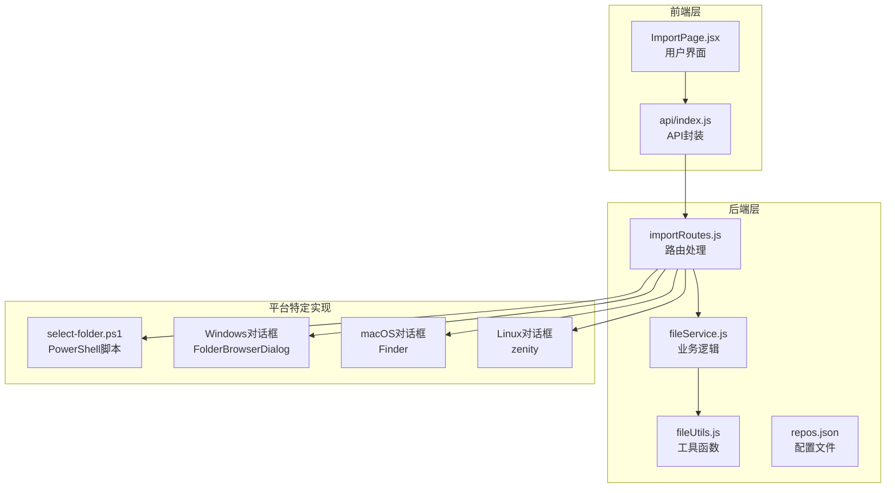
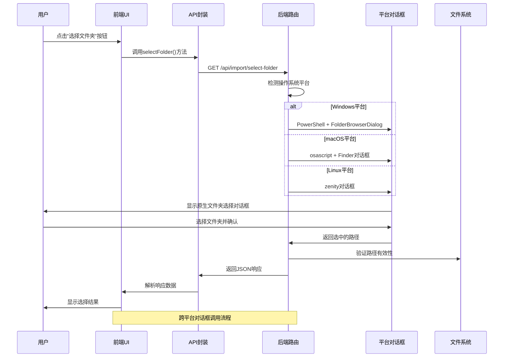
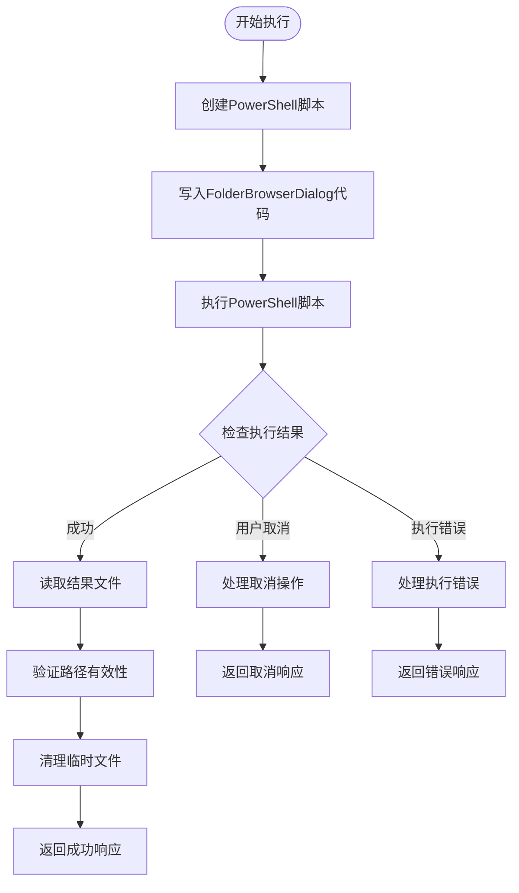
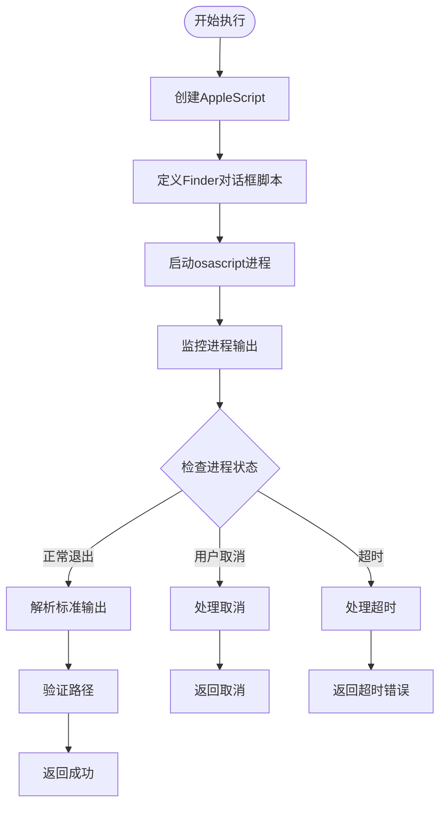
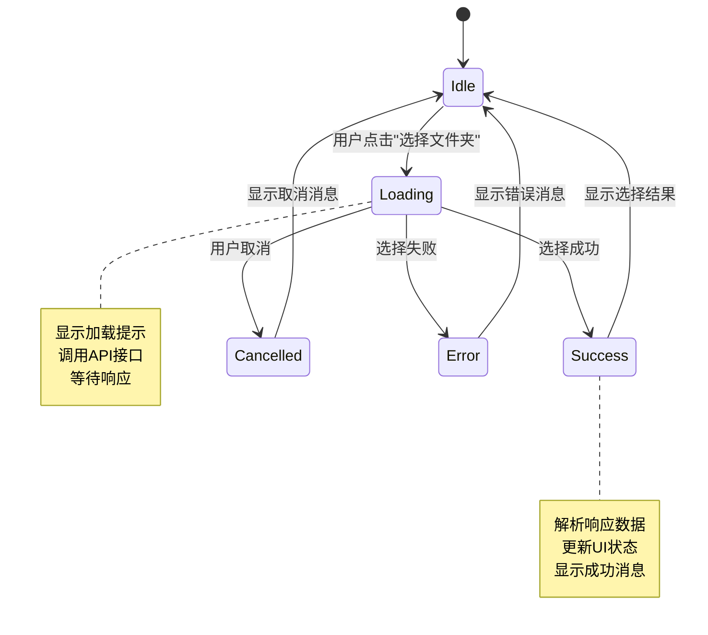
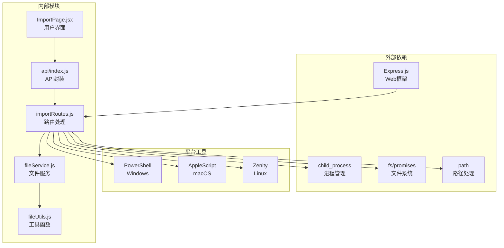

# 文件夹选择对话框

<cite>
**本文档引用的文件**
- [select-folder.ps1](file://backend/select-folder.ps1)
- [ImportPage.jsx](file://frontend/src/pages/ImportPage.jsx)
- [fileService.js](file://backend/src/services/fileService.js)
- [fileUtils.js](file://backend/src/utils/fileUtils.js)
- [index.js](file://frontend/src/api/index.js)
- [importRoutes.js](file://backend/src/routes/importRoutes.js)
- [package.json](file://backend/package.json)
- [repos.json](file://backend/data/repos.json)
</cite>

## 目录
1. [简介](#简介)
2. [项目结构](#项目结构)
3. [核心组件](#核心组件)
4. [架构概览](#架构概览)
5. [详细组件分析](#详细组件分析)
6. [依赖关系分析](#依赖关系分析)
7. [性能考虑](#性能考虑)
8. [故障排除指南](#故障排除指南)
9. [结论](#结论)

## 简介

文件夹选择对话框是相片管理系统的用户界面组件，允许用户通过系统原生对话框选择存储卡或目标存储仓库的路径。该功能实现了跨平台兼容性，支持Windows、macOS和Linux三种主要操作系统，并提供了统一的用户体验。

系统采用前后端分离架构，前端负责用户界面交互，后端负责平台特定的文件夹选择逻辑和文件导入处理。通过Express.js路由层协调，实现了从用户选择到文件导入的完整工作流程。

## 项目结构

文件夹选择功能涉及以下关键文件和模块：



**图表来源**
- [ImportPage.jsx:1-820](file://frontend/src/pages/ImportPage.jsx#L1-L820)
- [importRoutes.js:1-627](file://backend/src/routes/importRoutes.js#L1-L627)

**章节来源**
- [ImportPage.jsx:1-820](file://frontend/src/pages/ImportPage.jsx#L1-L820)
- [importRoutes.js:1-627](file://backend/src/routes/importRoutes.js#L1-L627)

## 核心组件

### 前端用户界面组件

前端的文件夹选择功能主要由ImportPage.jsx中的handleSourceFolderSelect和handleRepoFolderSelect两个方法实现：

- **handleSourceFolderSelect**: 处理存储卡路径选择
- **handleRepoFolderSelect**: 处理仓库路径选择
- **默认路径设置**: 通过getDefaultPath API获取平台特定的默认路径

### 后端路由组件

后端通过importRoutes.js中的select-folder路由处理跨平台文件夹选择：

- **平台检测**: 根据process.platform识别操作系统
- **平台特定实现**: 分别处理Windows、macOS、Linux的对话框调用
- **错误处理**: 统一的错误响应格式

### 工具函数组件

fileUtils.js提供了文件操作的核心工具函数：

- **scanDirectory**: 递归扫描目录并过滤媒体文件
- **copyFile**: 安全的文件复制，支持去重和重命名
- **generateRenamedFilename**: 生成基于路径的重命名文件名

**章节来源**
- [ImportPage.jsx:77-210](file://frontend/src/pages/ImportPage.jsx#L77-L210)
- [importRoutes.js:342-624](file://backend/src/routes/importRoutes.js#L342-L624)
- [fileUtils.js:1-167](file://backend/src/utils/fileUtils.js#L1-L167)

## 架构概览

文件夹选择对话框的完整架构如下：



**图表来源**
- [ImportPage.jsx:77-103](file://frontend/src/pages/ImportPage.jsx#L77-L103)
- [index.js:163-165](file://frontend/src/api/index.js#L163-L165)
- [importRoutes.js:342-624](file://backend/src/routes/importRoutes.js#L342-L624)

## 详细组件分析

### Windows平台实现

Windows平台使用PowerShell脚本结合.NET Framework的FolderBrowserDialog实现：

#### PowerShell脚本实现



**图表来源**
- [importRoutes.js:414-586](file://backend/src/routes/importRoutes.js#L414-L586)

#### 关键特性

- **置顶窗口**: 通过临时窗体确保对话框始终置顶
- **UTF8编码**: 使用BOM确保PowerShell脚本正确编码
- **超时控制**: 120秒执行超时，防止长时间阻塞
- **错误恢复**: 完整的临时文件清理机制

### macOS平台实现

macOS平台使用osascript调用Finder的应用程序对话框：

#### AppleScript实现



**图表来源**
- [importRoutes.js:349-395](file://backend/src/routes/importRoutes.js#L349-L395)

#### 关键特性

- **进程监控**: 使用spawn而非exec，更好的进程控制
- **超时机制**: 30秒超时保护
- **错误检测**: 通过stderr内容判断用户取消

### Linux平台实现

Linux平台使用zenity工具显示原生对话框：

#### Zenity实现


**图表来源**
- [importRoutes.js:587-606](file://backend/src/routes/importRoutes.js#L587-L606)

#### 关键特性

- **依赖检查**: 自动检测zenity工具可用性
- **简单实现**: 最小化的实现方式
- **超时控制**: 60秒执行超时

### 前端交互流程

前端通过React组件实现用户友好的文件夹选择体验：



**图表来源**
- [ImportPage.jsx:77-103](file://frontend/src/pages/ImportPage.jsx#L77-L103)

#### 关键特性

- **加载状态**: 显示消息提示和加载指示器
- **错误处理**: 统一的错误消息显示
- **状态管理**: React状态管理文件夹选择状态

**章节来源**
- [importRoutes.js:410-606](file://backend/src/routes/importRoutes.js#L410-L606)
- [ImportPage.jsx:77-210](file://frontend/src/pages/ImportPage.jsx#L77-L210)

## 依赖关系分析

文件夹选择功能的依赖关系如下：



**图表来源**
- [importRoutes.js:1-8](file://backend/src/routes/importRoutes.js#L1-L8)
- [package.json:10-18](file://backend/package.json#L10-L18)

### 核心依赖

- **Express.js**: Web应用框架，提供HTTP服务器和路由处理
- **child_process**: 进程管理，用于调用平台特定的对话框工具
- **fs/promises**: 异步文件系统操作，用于路径验证和文件处理
- **path**: 路径处理工具，确保跨平台兼容性

**章节来源**
- [package.json:10-18](file://backend/package.json#L10-L18)
- [importRoutes.js:1-8](file://backend/src/routes/importRoutes.js#L1-L8)

## 性能考虑

### 并发处理

文件导入功能采用了并发控制机制：

- **并发限制**: 最多同时处理3个文件，避免内存溢出
- **队列管理**: 使用Promise队列确保任务有序执行
- **进度跟踪**: 实时更新处理进度和估计剩余时间

### 资源管理

- **超时控制**: 各平台对话框都有合理的超时设置
- **临时文件清理**: 完成后自动清理PowerShell脚本和结果文件
- **内存优化**: 使用流式处理避免大文件内存占用

### 用户体验优化

- **加载状态**: 显示详细的进度信息和剩余时间估计
- **错误恢复**: 自动重试机制和错误提示
- **响应式设计**: 适配不同屏幕尺寸和设备

## 故障排除指南

### Windows平台问题

#### PowerShell执行失败

**症状**: 返回"打开文件夹选择对话框失败"错误

**解决方案**:
1. 检查PowerShell执行策略设置
2. 确认.NET Framework已安装
3. 验证临时文件权限
4. 检查防火墙设置

#### 对话框不显示

**症状**: 脚本执行但对话框未出现

**解决方案**:
1. 确认系统已安装Windows Forms
2. 检查用户账户控制(UAC)设置
3. 验证PowerShell脚本权限
4. 尝试以管理员身份运行

### macOS平台问题

#### Finder对话框异常

**症状**: osascript执行失败或对话框显示异常

**解决方案**:
1. 检查macOS版本兼容性
2. 确认Finder应用程序可用性
3. 验证AppleScript权限设置
4. 检查系统完整性保护(SIP)设置

#### 超时问题

**症状**: 30秒后连接自动断开

**解决方案**:
1. 检查网络连接稳定性
2. 减少系统负载
3. 重启Finder应用程序
4. 检查系统资源使用情况

### Linux平台问题

#### Zenity工具缺失

**症状**: 返回"command not found"错误

**解决方案**:
1. 安装zenity包：
   ```bash
   sudo apt-get install zenity    # Ubuntu/Debian
   sudo yum install zenity        # CentOS/RHEL
   sudo pacman -S zenity          # Arch Linux
   ```
2. 验证X11或Wayland显示服务器
3. 检查用户图形权限

#### 权限问题

**症状**: 无法访问某些目录

**解决方案**:
1. 检查目标目录的读取权限
2. 使用sudo权限运行应用
3. 修改目录权限设置
4. 检查SELinux或AppArmor配置

### 通用问题

#### 跨平台兼容性

**症状**: 在某些平台上对话框行为异常

**解决方案**:
1. 检查process.platform检测
2. 验证环境变量设置
3. 测试不同版本的系统兼容性
4. 实现降级方案

#### 性能问题

**症状**: 对话框响应缓慢或卡顿

**解决方案**:
1. 优化超时设置
2. 检查系统资源使用情况
3. 减少不必要的系统调用
4. 实现缓存机制

**章节来源**
- [importRoutes.js:545-586](file://backend/src/routes/importRoutes.js#L545-L586)
- [importRoutes.js:390-395](file://backend/src/routes/importRoutes.js#L390-L395)

## 结论

文件夹选择对话框功能通过精心设计的跨平台架构，成功实现了统一的用户体验。该系统的主要优势包括：

### 技术优势

- **跨平台兼容**: 通过平台特定的实现确保在Windows、macOS、Linux上的一致体验
- **错误处理**: 完善的错误检测和恢复机制
- **性能优化**: 合理的超时控制和资源管理
- **安全性**: 通过路径验证和权限检查防止安全问题

### 用户体验

- **直观界面**: 系统原生对话框提供熟悉的用户体验
- **实时反馈**: 详细的进度显示和状态更新
- **容错能力**: 良好的错误提示和恢复机制

### 扩展性

该架构为未来的功能扩展奠定了良好基础，可以轻松添加新的平台支持或增强现有功能。通过模块化的组件设计，系统具有良好的可维护性和可扩展性。

对于开发者而言，理解这些实现细节有助于更好地维护和扩展系统功能，同时为用户提供更加稳定可靠的服务。