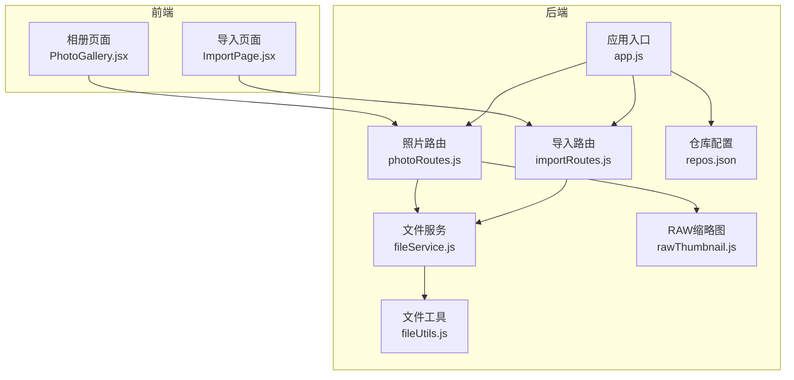
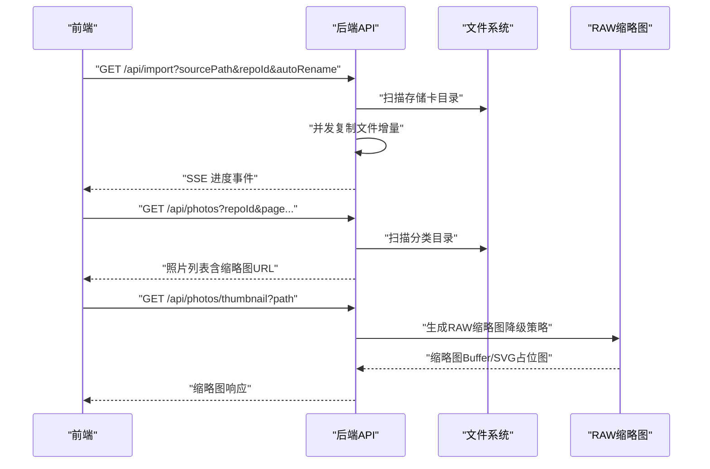
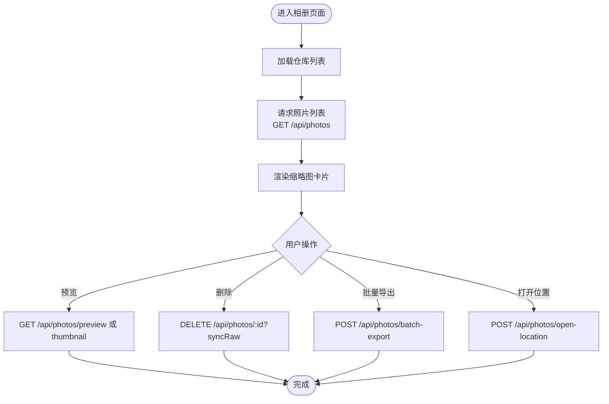
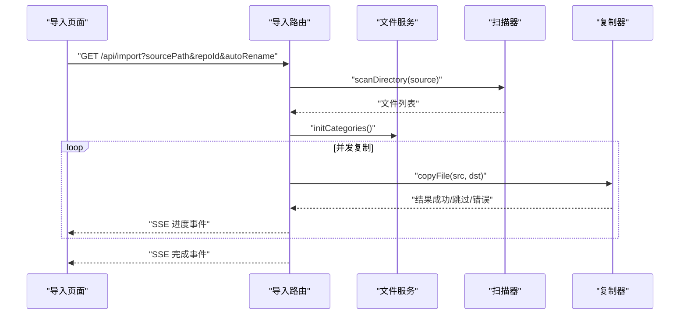
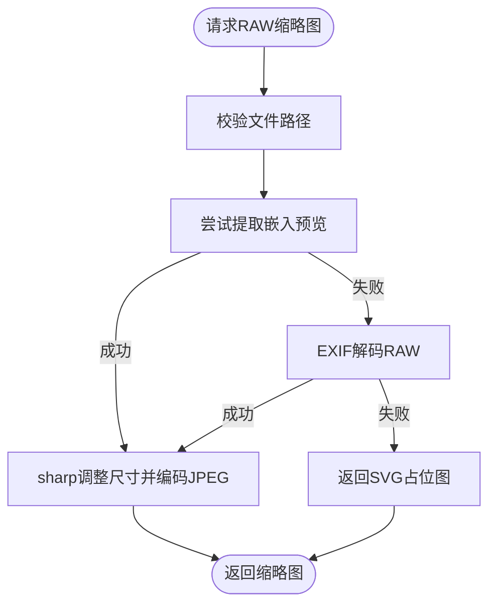
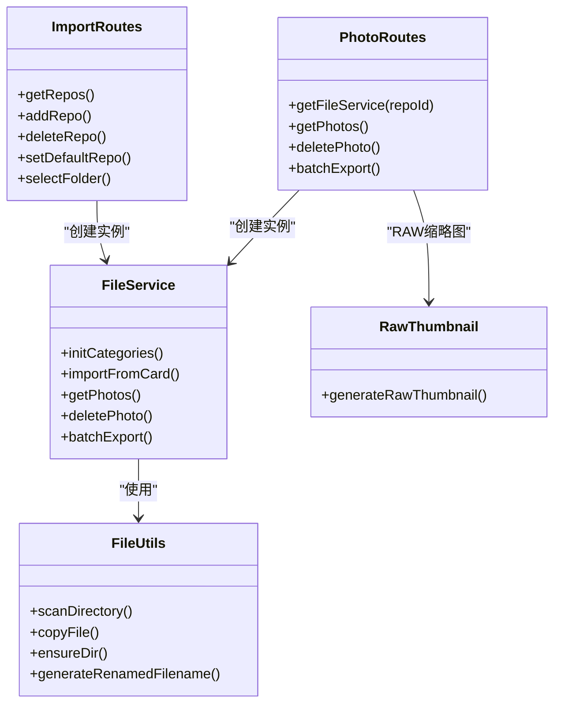
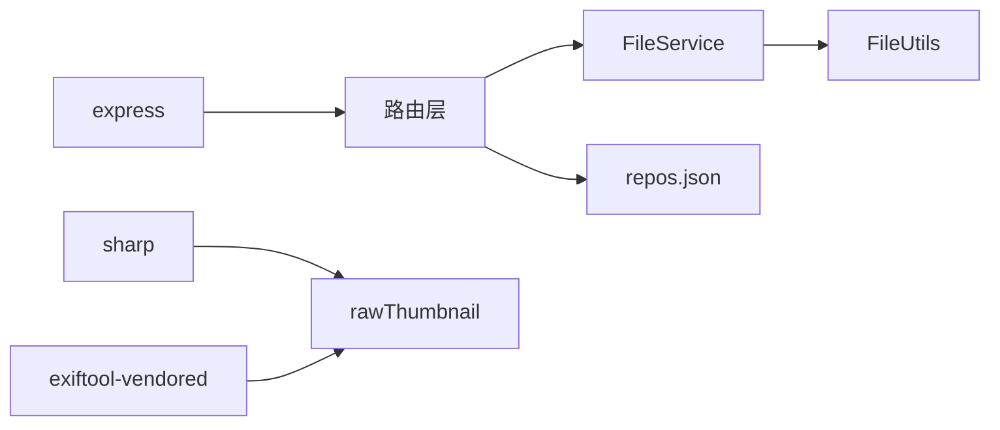

# 核心功能模块

<cite>
**本文引用的文件**
- [backend/src/app.js](file://backend/src/app.js)
- [backend/src/routes/photoRoutes.js](file://backend/src/routes/photoRoutes.js)
- [backend/src/routes/importRoutes.js](file://backend/src/routes/importRoutes.js)
- [backend/src/services/fileService.js](file://backend/src/services/fileService.js)
- [backend/src/utils/fileUtils.js](file://backend/src/utils/fileUtils.js)
- [backend/src/utils/rawThumbnail.js](file://backend/src/utils/rawThumbnail.js)
- [backend/data/repos.json](file://backend/data/repos.json)
- [backend/package.json](file://backend/package.json)
- [backend/test-raw-preview.js](file://backend/test-raw-preview.js)
- [backend/test-thumbnail.js](file://backend/test-thumbnail.js)
- [frontend/src/pages/ImportPage.jsx](file://frontend/src/pages/ImportPage.jsx)
- [frontend/src/pages/PhotoGallery.jsx](file://frontend/src/pages/PhotoGallery.jsx)
- [config/repos.json.example](file://config/repos.json.example)
</cite>

## 目录
1. [引言](#引言)
2. [项目结构](#项目结构)
3. [核心组件](#核心组件)
4. [架构总览](#架构总览)
5. [详细组件分析](#详细组件分析)
6. [依赖分析](#依赖分析)
7. [性能考虑](#性能考虑)
8. [故障排查指南](#故障排查指南)
9. [结论](#结论)
10. [附录](#附录)

## 引言
本文件面向开发者与使用者，系统性梳理摄影管理项目的四大核心功能模块：照片管理、导入功能、RAW 文件处理与仓库管理。文档从架构设计、数据流、处理逻辑、用户交互到关键实现细节逐层展开，辅以可视化图示与实操建议，帮助快速上手与深度定制。

## 项目结构
项目采用前后端分离架构：
- 后端基于 Express，提供 REST API 与 SSE 实时进度；核心模块包括路由、服务层与工具集。
- 前端基于 React + Ant Design，提供导入页面与相册浏览页面，负责用户交互与数据展示。
- 配置与数据：仓库配置文件 repos.json，支持多仓库与默认仓库切换。

图表来源
- [backend/src/app.js:10-146](file://backend/src/app.js#L10-146)
- [backend/src/routes/photoRoutes.js:1-739](file://backend/src/routes/photoRoutes.js#L1-739)
- [backend/src/routes/importRoutes.js:1-627](file://backend/src/routes/importRoutes.js#L1-627)
- [backend/src/services/fileService.js:1-443](file://backend/src/services/fileService.js#L1-443)
- [backend/src/utils/fileUtils.js:1-167](file://backend/src/utils/fileUtils.js#L1-167)
- [backend/src/utils/rawThumbnail.js:1-132](file://backend/src/utils/rawThumbnail.js#L1-132)
- [backend/data/repos.json:1-8](file://backend/data/repos.json#L1-8)

章节来源
- [backend/src/app.js:10-146](file://backend/src/app.js#L10-146)
- [backend/src/routes/photoRoutes.js:1-739](file://backend/src/routes/photoRoutes.js#L1-739)
- [backend/src/routes/importRoutes.js:1-627](file://backend/src/routes/importRoutes.js#L1-627)
- [backend/src/services/fileService.js:1-443](file://backend/src/services/fileService.js#L1-443)
- [backend/src/utils/fileUtils.js:1-167](file://backend/src/utils/fileUtils.js#L1-167)
- [backend/src/utils/rawThumbnail.js:1-132](file://backend/src/utils/rawThumbnail.js#L1-132)
- [backend/data/repos.json:1-8](file://backend/data/repos.json#L1-8)

## 核心组件
- 照片管理：提供照片列表、排序、分页、缩略图、预览、删除、批量导出、打开文件位置等功能。
- 导入功能：支持从存储卡增量导入 JPG/RAW/视频，实时进度（SSE），仓库选择与路径选择。
- RAW 文件处理：三段降级策略生成缩略图（嵌入预览 → EXIF 解码 → 占位图），提升兼容性。
- 仓库管理：多仓库配置、默认仓库、增删改与路径选择，支持跨平台文件夹选择。

章节来源
- [backend/src/routes/photoRoutes.js:68-736](file://backend/src/routes/photoRoutes.js#L68-736)
- [backend/src/routes/importRoutes.js:82-624](file://backend/src/routes/importRoutes.js#L82-624)
- [backend/src/utils/rawThumbnail.js:78-129](file://backend/src/utils/rawThumbnail.js#L78-129)
- [backend/src/services/fileService.js:169-443](file://backend/src/services/fileService.js#L169-443)

## 架构总览
后端通过路由分发请求至服务层，服务层调用工具集完成文件扫描、复制、删除与 RAW 缩略图生成；前端通过 API 与后端交互，导入页面使用 SSE 实时接收进度，相册页面提供浏览与批量操作。

图表来源
- [backend/src/routes/importRoutes.js:82-182](file://backend/src/routes/importRoutes.js#L82-182)
- [backend/src/routes/photoRoutes.js:68-466](file://backend/src/routes/photoRoutes.js#L68-466)
- [backend/src/services/fileService.js:23-167](file://backend/src/services/fileService.js#L23-167)
- [backend/src/utils/rawThumbnail.js:78-129](file://backend/src/utils/rawThumbnail.js#L78-129)

## 详细组件分析

### 照片管理模块
- 功能要点
  - 列表查询：按分类（jpg/raw/video）、分页、排序（修改时间/文件名/大小）。
  - 缩略图与预览：支持 JPEG/MOV/MP4 等，RAW 使用三段降级策略；视频支持 Range 请求。
  - 删除与批量导出：支持同步删除 RAW（JPG 删除时），批量导出采用增量模式。
  - 打开文件位置：跨平台打开文件夹或文件。
- 关键实现
  - 路由层解析查询参数，构造 FileService 实例，调用 getPhotos/deletePhoto/batchExport 等。
  - 缩略图生成：对视频走 ffmpeg 提取首帧，对 RAW 走 rawThumbnail，否则用 sharp。
  - 存储信息：统计各分类数量与总大小。
- 用户交互
  - 相册页面支持仓库切换、分类筛选、排序、分页、批量选择、导出与删除。

图表来源
- [frontend/src/pages/PhotoGallery.jsx:98-327](file://frontend/src/pages/PhotoGallery.jsx#L98-327)
- [backend/src/routes/photoRoutes.js:68-736](file://backend/src/routes/photoRoutes.js#L68-736)

章节来源
- [backend/src/routes/photoRoutes.js:68-736](file://backend/src/routes/photoRoutes.js#L68-736)
- [backend/src/services/fileService.js:169-443](file://backend/src/services/fileService.js#L169-443)
- [frontend/src/pages/PhotoGallery.jsx:98-327](file://frontend/src/pages/PhotoGallery.jsx#L98-327)

### 导入功能模块
- 功能要点
  - 从存储卡扫描媒体文件（JPG/RAW/视频），增量复制，避免覆盖。
  - 实时进度：SSE 推送进度事件，包含总文件数、已处理、剩余、预估剩余时间、当前文件。
  - 仓库选择：支持默认仓库与自定义仓库，路径可跨平台选择。
  - 自动重命名：将子目录层级编码到文件名，减少重复文件被跳过。
- 关键实现
  - 路由层解析 sourcePath/repoId/autoRename，调用 FileService.importFromCard。
  - 并发控制：限制同时处理任务数，避免内存压力。
  - 跨平台路径选择：macOS 使用 osascript，Windows 使用 PowerShell，Linux 使用 zenity。
- 用户交互
  - 导入页面提供步骤引导、进度统计、仓库管理、自动重命名开关与结果汇总。

图表来源
- [backend/src/routes/importRoutes.js:82-182](file://backend/src/routes/importRoutes.js#L82-182)
- [backend/src/services/fileService.js:23-167](file://backend/src/services/fileService.js#L23-167)
- [backend/src/utils/fileUtils.js:22-100](file://backend/src/utils/fileUtils.js#L22-100)

章节来源
- [backend/src/routes/importRoutes.js:82-624](file://backend/src/routes/importRoutes.js#L82-624)
- [backend/src/services/fileService.js:23-167](file://backend/src/services/fileService.js#L23-167)
- [frontend/src/pages/ImportPage.jsx:77-260](file://frontend/src/pages/ImportPage.jsx#L77-260)

### RAW 文件处理模块
- 功能要点
  - 三段降级策略：优先提取嵌入预览（JpgFromRaw/PreviewImage/ThumbnailImage），其次 EXIF 解码，最后返回 SVG 占位图。
  - 对于非标准 JPEG 预览，进行有效性校验（起始字节）。
- 关键实现
  - 使用 exiftool-vendored 提取二进制预览图，sharp 调整尺寸与质量。
  - photoRoutes 中对 RAW 缩略图生成失败回退到占位图。
- 测试辅助
  - 提供独立测试脚本验证预览提取与缩略图生成。

图表来源
- [backend/src/utils/rawThumbnail.js:78-129](file://backend/src/utils/rawThumbnail.js#L78-129)
- [backend/src/routes/photoRoutes.js:395-425](file://backend/src/routes/photoRoutes.js#L395-425)

章节来源
- [backend/src/utils/rawThumbnail.js:1-132](file://backend/src/utils/rawThumbnail.js#L1-132)
- [backend/src/routes/photoRoutes.js:395-425](file://backend/src/routes/photoRoutes.js#L395-425)
- [backend/test-raw-preview.js:1-69](file://backend/test-raw-preview.js#L1-69)
- [backend/test-thumbnail.js:1-32](file://backend/test-thumbnail.js#L1-32)

### 仓库管理模块
- 功能要点
  - 多仓库配置：增删改、设置默认仓库、路径校验与创建。
  - 跨平台文件夹选择：macOS（osascript）、Windows（PowerShell）、Linux（zenity）。
  - 默认仓库与 AUTO 路径：支持环境变量 PHOTO_BASE_PATH 与平台默认路径。
- 关键实现
  - repos.json 作为配置文件，首次缺失时按平台生成默认仓库。
  - 路由层提供仓库 CRUD 与默认设置，服务层按 repoId 选择目标路径。
- 用户交互
  - 导入页面与相册页面均支持仓库切换与管理。

图表来源
- [backend/src/routes/importRoutes.js:23-340](file://backend/src/routes/importRoutes.js#L23-340)
- [backend/src/routes/photoRoutes.js:26-45](file://backend/src/routes/photoRoutes.js#L26-45)
- [backend/src/services/fileService.js:5-443](file://backend/src/services/fileService.js#L5-443)
- [backend/src/utils/fileUtils.js:1-167](file://backend/src/utils/fileUtils.js#L1-167)
- [backend/src/utils/rawThumbnail.js:1-132](file://backend/src/utils/rawThumbnail.js#L1-132)

章节来源
- [backend/src/routes/importRoutes.js:23-340](file://backend/src/routes/importRoutes.js#L23-340)
- [backend/src/routes/photoRoutes.js:11-45](file://backend/src/routes/photoRoutes.js#L11-45)
- [backend/src/services/fileService.js:5-443](file://backend/src/services/fileService.js#L5-443)
- [backend/data/repos.json:1-8](file://backend/data/repos.json#L1-8)
- [config/repos.json.example:1-17](file://config/repos.json.example#L1-17)

## 依赖分析
- 外部依赖
  - express/cors/dotenv：Web 服务与环境变量。
  - sharp/exiftool-vendored：图像处理与 RAW 元数据读取。
  - multer：文件上传（当前未在核心流程使用）。
- 模块耦合
  - photoRoutes 与 importRoutes 均依赖 FileService，后者依赖 FileUtils。
  - photoRoutes 在 RAW 缩略图场景依赖 rawThumbnail。
- 循环依赖
  - 未发现循环依赖，职责清晰：路由 → 服务 → 工具。

图表来源
- [backend/package.json:10-18](file://backend/package.json#L10-18)
- [backend/src/routes/photoRoutes.js:395-425](file://backend/src/routes/photoRoutes.js#L395-425)
- [backend/src/utils/rawThumbnail.js:1-5](file://backend/src/utils/rawThumbnail.js#L1-5)
- [backend/src/services/fileService.js:1-4](file://backend/src/services/fileService.js#L1-4)
- [backend/data/repos.json:1-8](file://backend/data/repos.json#L1-8)

章节来源
- [backend/package.json:10-18](file://backend/package.json#L10-18)

## 性能考虑
- 并发与内存
  - 导入时限制并发任务数，避免大量文件同时复制导致内存峰值过高。
- I/O 优化
  - 列表与预览采用流式读取，支持 Range 请求，降低内存占用。
- 缩略图策略
  - RAW 三段降级策略，优先使用嵌入预览，避免大文件解码成本。
- 索引与扫描
  - 目录扫描递归遍历，建议合理组织目录结构，避免极深层级影响性能。

章节来源
- [backend/src/services/fileService.js:75-156](file://backend/src/services/fileService.js#L75-156)
- [backend/src/routes/photoRoutes.js:226-280](file://backend/src/routes/photoRoutes.js#L226-280)
- [backend/src/utils/rawThumbnail.js:78-129](file://backend/src/utils/rawThumbnail.js#L78-129)

## 故障排查指南
- 导入无文件
  - 检查存储卡路径是否正确，确认扫描到的文件类型是否受支持。
- 导入进度异常
  - 确认浏览器支持 SSE，网络代理未拦截 /api/import。
- RAW 缩略图为空白
  - 部分相机不嵌入预览，需依赖 EXIF 解码；若仍失败，检查 sharp 依赖与权限。
- 跨平台路径选择失败
  - macOS：确认系统允许 AppleScript；Windows：启用 ExecutionPolicy；Linux：安装 zenity。
- 删除同步 RAW 失败
  - 确认 JPG 与 RAW 文件名一致（不含扩展名），且 RAW 目录存在。

章节来源
- [backend/src/routes/importRoutes.js:342-624](file://backend/src/routes/importRoutes.js#L342-624)
- [backend/src/routes/photoRoutes.js:293-466](file://backend/src/routes/photoRoutes.js#L293-466)
- [backend/src/utils/rawThumbnail.js:108-129](file://backend/src/utils/rawThumbnail.js#L108-129)

## 结论
本项目通过清晰的模块划分与稳健的实现策略，提供了从导入、浏览到管理的完整工作流。RAW 缩略图的三段降级策略与增量导入机制显著提升了兼容性与用户体验。建议在生产环境中结合监控与日志，持续优化并发与 I/O 行为。

## 附录

### 使用场景与操作示例
- 从存储卡导入照片
  - 步骤：选择存储卡路径 → 选择目标仓库 → 可选自动重命名 → 开始导入 → 查看进度与结果。
  - 参考：[导入页面:212-260](file://frontend/src/pages/ImportPage.jsx#L212-260)
- 浏览与管理照片
  - 步骤：选择仓库与分类 → 排序与分页 → 预览/删除/批量导出 → 打开文件位置。
  - 参考：[相册页面:98-327](file://frontend/src/pages/PhotoGallery.jsx#L98-327)
- 管理仓库
  - 步骤：添加/删除/设置默认仓库 → 跨平台选择路径 → 生效于后续导入与浏览。
  - 参考：[导入路由仓库管理:234-340](file://backend/src/routes/importRoutes.js#L234-340)

### 配置选项
- 环境变量
  - DATA_DIR：数据目录（repos.json 等）。
  - PHOTO_BASE_PATH：默认照片根目录。
  - DEFAULT_IMPORT_PATH：导入页面默认扫描路径（可选）。
- 仓库配置
  - repos.json：包含 id/name/path/isDefault 字段，支持 AUTO 路径与默认仓库标记。
  - 示例参考：[repos.json.example:1-17](file://config/repos.json.example#L1-17)

章节来源
- [backend/src/app.js:28-65](file://backend/src/app.js#L28-65)
- [backend/src/routes/importRoutes.js:61-80](file://backend/src/routes/importRoutes.js#L61-80)
- [backend/data/repos.json:1-8](file://backend/data/repos.json#L1-8)
- [config/repos.json.example:1-17](file://config/repos.json.example#L1-17)