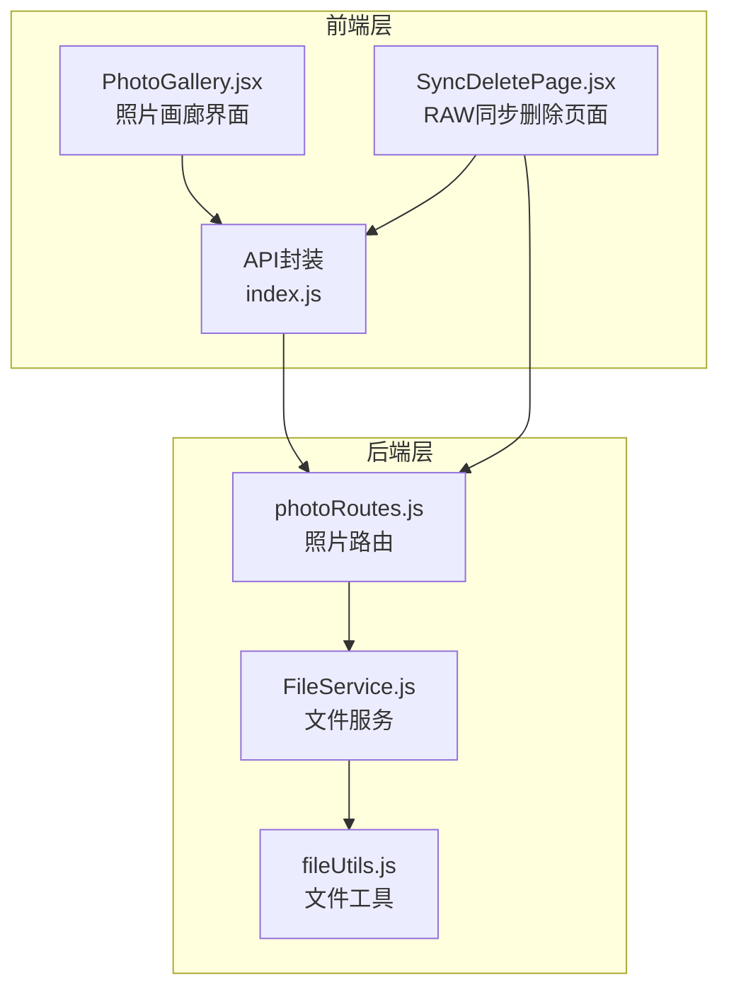
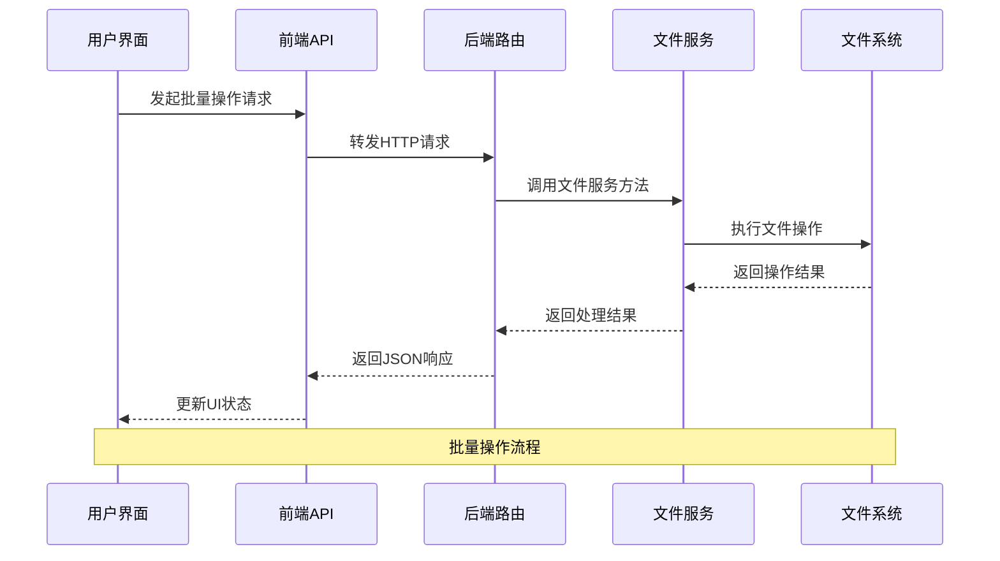
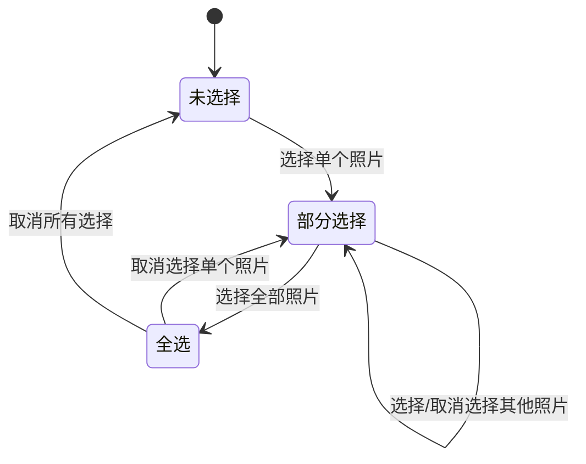
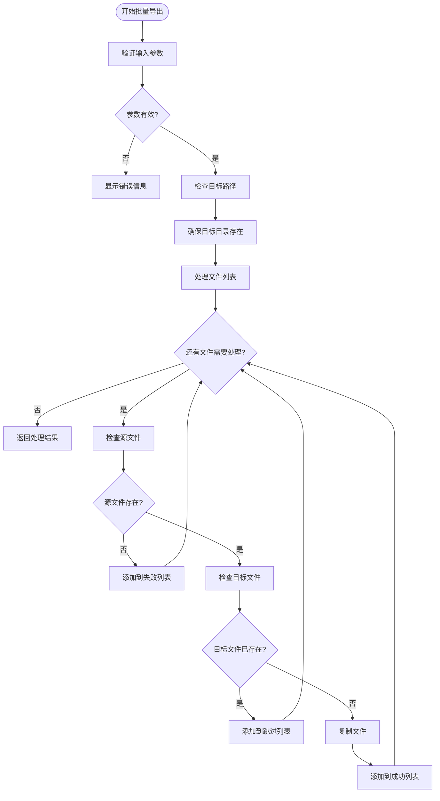
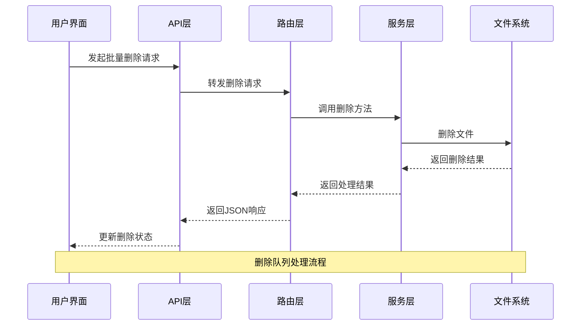
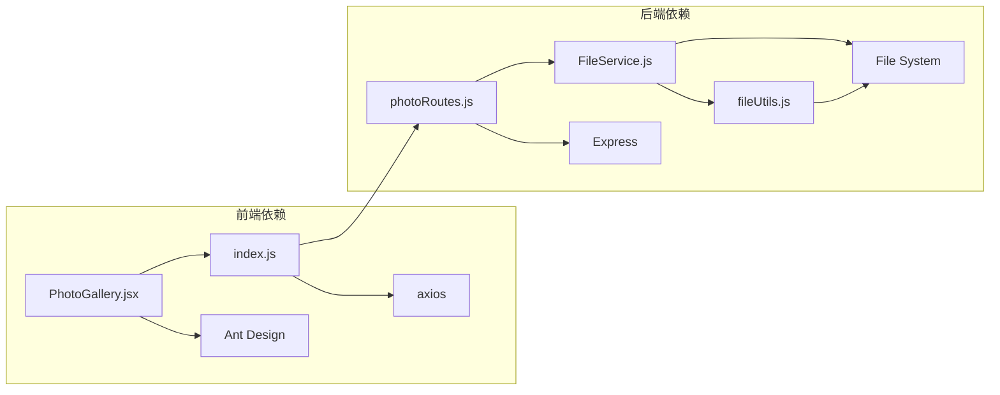

# 批量操作功能

<cite>
**本文档引用的文件**
- [PhotoGallery.jsx](file://frontend/src/pages/PhotoGallery.jsx)
- [photoRoutes.js](file://backend/src/routes/photoRoutes.js)
- [fileService.js](file://backend/src/services/fileService.js)
- [fileUtils.js](file://backend/src/utils/fileUtils.js)
- [index.js](file://frontend/src/api/index.js)
- [SyncDeletePage.jsx](file://frontend/src/pages/SyncDeletePage.jsx)
</cite>

## 目录
1. [简介](#简介)
2. [项目结构](#项目结构)
3. [核心组件](#核心组件)
4. [架构概览](#架构概览)
5. [详细组件分析](#详细组件分析)
6. [依赖关系分析](#依赖关系分析)
7. [性能考虑](#性能考虑)
8. [故障排除指南](#故障排除指南)
9. [结论](#结论)

## 简介

批量操作功能是照片管理系统中的核心特性之一，它允许用户对多个照片文件进行统一操作，包括批量导出和批量删除。该功能通过高效的多选机制、智能的增量复制策略和完善的错误处理机制，为用户提供流畅的批量文件管理体验。

本文档将深入分析批量操作功能的实现原理，包括多选机制、批量导出、批量删除等核心功能，并提供性能优化建议和最佳实践指导。

## 项目结构

批量操作功能涉及前端界面、API路由和后端服务三个层面的协作：

**图表来源**
- [PhotoGallery.jsx:1-800](file://frontend/src/pages/PhotoGallery.jsx#L1-L800)
- [photoRoutes.js:1-739](file://backend/src/routes/photoRoutes.js#L1-L739)
- [fileService.js:1-443](file://backend/src/services/fileService.js#L1-L443)

**章节来源**
- [PhotoGallery.jsx:1-800](file://frontend/src/pages/PhotoGallery.jsx#L1-L800)
- [photoRoutes.js:1-739](file://backend/src/routes/photoRoutes.js#L1-L739)

## 核心组件

批量操作功能由以下核心组件构成：

### 多选机制组件
- **选择状态管理**：维护选中照片的ID数组和全选状态
- **选择控制器**：提供全选、反选和单选功能
- **选择状态显示**：实时显示已选中照片数量

### 批量导出组件
- **导出路径选择**：支持手动输入和系统文件夹选择器
- **增量复制策略**：避免覆盖已存在的文件
- **导出进度监控**：提供详细的进度统计和时间估算

### 批量删除组件
- **删除队列管理**：有序处理多个删除请求
- **并发控制**：限制同时进行的删除操作数量
- **错误处理**：捕获和报告单个文件的删除失败

**章节来源**
- [PhotoGallery.jsx:314-470](file://frontend/src/pages/PhotoGallery.jsx#L314-L470)
- [photoRoutes.js:642-736](file://backend/src/routes/photoRoutes.js#L642-L736)

## 架构概览

批量操作功能采用分层架构设计，确保前后端分离和职责明确：

**图表来源**
- [PhotoGallery.jsx:400-427](file://frontend/src/pages/PhotoGallery.jsx#L400-L427)
- [photoRoutes.js:642-736](file://backend/src/routes/photoRoutes.js#L642-L736)

## 详细组件分析

### 多选机制实现

多选机制提供了灵活的照片选择方式：

#### 选择状态管理

**图表来源**
- [PhotoGallery.jsx:314-331](file://frontend/src/pages/PhotoGallery.jsx#L314-L331)

#### 选择控制器功能
- **全选功能**：一键选择当前页面显示的所有照片
- **反选功能**：切换当前页面照片的选择状态
- **单选功能**：精确控制每个照片的选择状态

**章节来源**
- [PhotoGallery.jsx:314-331](file://frontend/src/pages/PhotoGallery.jsx#L314-L331)

### 批量导出功能

批量导出功能实现了高效的安全文件复制：

#### 导出流程

**图表来源**
- [photoRoutes.js:642-736](file://backend/src/routes/photoRoutes.js#L642-L736)

#### 增量复制策略
批量导出采用增量复制策略，确保数据安全：
- **文件存在性检查**：在复制前检查目标文件是否已存在
- **内容完整性验证**：比较文件大小和修改时间判断文件是否相同
- **智能跳过机制**：避免不必要的文件复制操作

**章节来源**
- [photoRoutes.js:671-718](file://backend/src/routes/photoRoutes.js#L671-L718)
- [fileUtils.js:77-100](file://backend/src/utils/fileUtils.js#L77-L100)

### 批量删除功能

批量删除功能提供了安全的文件清理机制：

#### 删除队列管理

**图表来源**
- [PhotoGallery.jsx:439-469](file://frontend/src/pages/PhotoGallery.jsx#L439-L469)

#### 并发控制机制
批量删除采用顺序处理模式，确保操作的稳定性和安全性：
- **串行处理**：逐个处理删除请求，避免并发冲突
- **错误隔离**：单个文件删除失败不影响其他文件的处理
- **状态更新**：实时更新删除进度和结果统计

**章节来源**
- [PhotoGallery.jsx:439-469](file://frontend/src/pages/PhotoGallery.jsx#L439-L469)

### 用户界面组件

#### 批量操作工具栏
批量操作工具栏提供了直观的操作入口：
- **全选按钮**：一键选择当前页面的所有照片
- **导出按钮**：启动批量导出流程
- **删除按钮**：启动批量删除流程
- **取消选择按钮**：清空当前选择状态

#### 导出对话框
导出对话框提供了完整的导出配置界面：
- **目标路径输入**：支持手动输入和文件夹选择器
- **导出统计**：显示成功、失败、跳过的文件数量
- **进度反馈**：实时显示导出进度和剩余时间

**章节来源**
- [PhotoGallery.jsx:553-588](file://frontend/src/pages/PhotoGallery.jsx#L553-L588)
- [PhotoGallery.jsx:793-827](file://frontend/src/pages/PhotoGallery.jsx#L793-L827)

## 依赖关系分析

批量操作功能涉及多个模块间的复杂依赖关系：

**图表来源**
- [PhotoGallery.jsx:1-40](file://frontend/src/pages/PhotoGallery.jsx#L1-L40)
- [index.js:1-168](file://frontend/src/api/index.js#L1-L168)
- [photoRoutes.js:1-6](file://backend/src/routes/photoRoutes.js#L1-L6)

**章节来源**
- [index.js:1-168](file://frontend/src/api/index.js#L1-L168)
- [photoRoutes.js:1-739](file://backend/src/routes/photoRoutes.js#L1-L739)

## 性能考虑

批量操作功能在设计时充分考虑了性能优化：

### 异步处理策略
- **事件驱动架构**：使用Promise和async/await实现非阻塞操作
- **流式处理**：对大文件采用流式读写，避免内存溢出
- **并发限制**：合理控制同时进行的操作数量

### 进度反馈机制
- **实时进度更新**：提供准确的处理进度和剩余时间估算
- **状态可视化**：通过UI元素直观展示操作状态
- **错误快速响应**：及时捕获和报告处理过程中的问题

### 内存管理
- **分批处理**：避免一次性加载大量数据到内存
- **垃圾回收**：及时释放不再使用的对象引用
- **资源清理**：确保文件句柄和网络连接正确关闭

## 故障排除指南

### 常见问题及解决方案

#### 批量导出失败
**问题症状**：导出过程中出现错误或部分文件未成功导出

**可能原因**：
- 目标路径权限不足
- 磁盘空间不足
- 源文件被其他程序占用

**解决步骤**：
1. 检查目标路径的写入权限
2. 确认磁盘有足够的可用空间
3. 关闭可能占用源文件的其他应用程序
4. 重新尝试导出操作

#### 批量删除异常
**问题症状**：删除操作中断或部分文件无法删除

**可能原因**：
- 文件被系统或其他进程锁定
- 权限不足导致删除失败
- 文件路径包含特殊字符

**解决步骤**：
1. 确认文件没有被其他程序使用
2. 检查用户账户的文件删除权限
3. 尝试以管理员身份运行应用程序
4. 手动删除问题文件后重试

#### 选择状态异常
**问题症状**：多选功能失效或选择状态显示错误

**可能原因**：
- 页面缓存问题
- React状态管理异常
- 分页导致的选择状态丢失

**解决步骤**：
1. 刷新整个页面以清除缓存
2. 检查浏览器控制台是否有JavaScript错误
3. 确认分页设置不会影响选择状态
4. 重新登录应用程序

**章节来源**
- [PhotoGallery.jsx:400-427](file://frontend/src/pages/PhotoGallery.jsx#L400-L427)
- [photoRoutes.js:642-736](file://backend/src/routes/photoRoutes.js#L642-L736)

## 结论

批量操作功能通过精心设计的多选机制、智能的增量复制策略和完善的错误处理机制，为用户提供了高效、安全的照片管理体验。该功能不仅提升了用户的操作效率，还确保了数据的安全性和完整性。

### 主要优势
- **高效性**：支持大规模文件的批量操作
- **安全性**：采用增量复制策略避免数据覆盖
- **可靠性**：完善的错误处理和状态管理
- **用户体验**：直观的界面设计和实时进度反馈

### 技术特点
- **模块化设计**：清晰的前后端分离架构
- **异步处理**：非阻塞的并发操作支持
- **资源优化**：合理的内存和CPU使用策略
- **扩展性**：易于添加新的批量操作功能

批量操作功能作为照片管理系统的核心特性，为用户提供了专业级的文件管理能力，是现代数字资产管理不可或缺的重要组成部分。