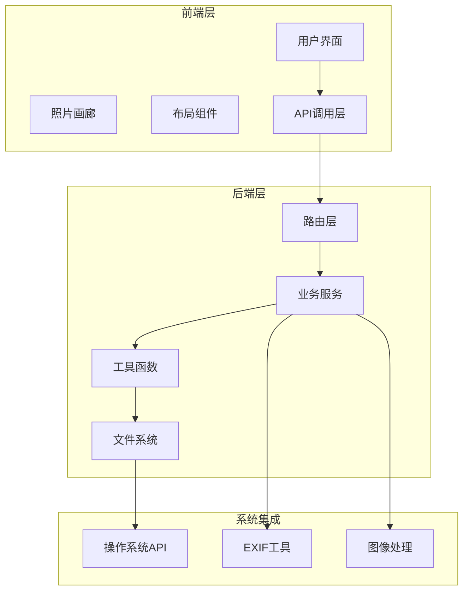
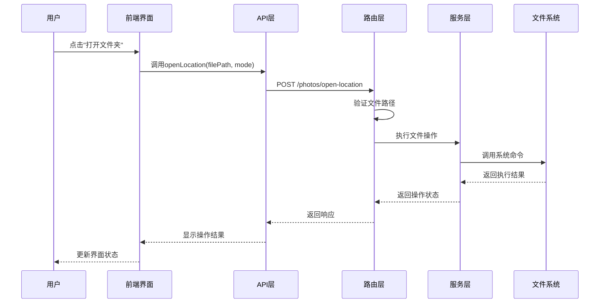
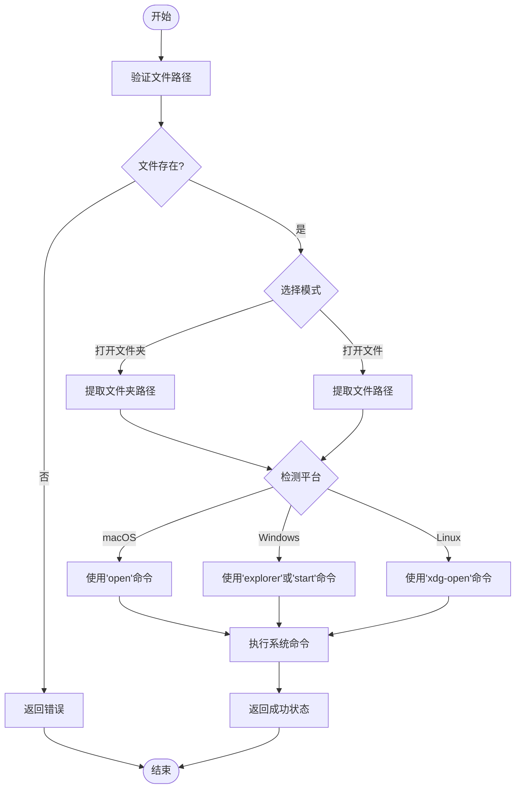
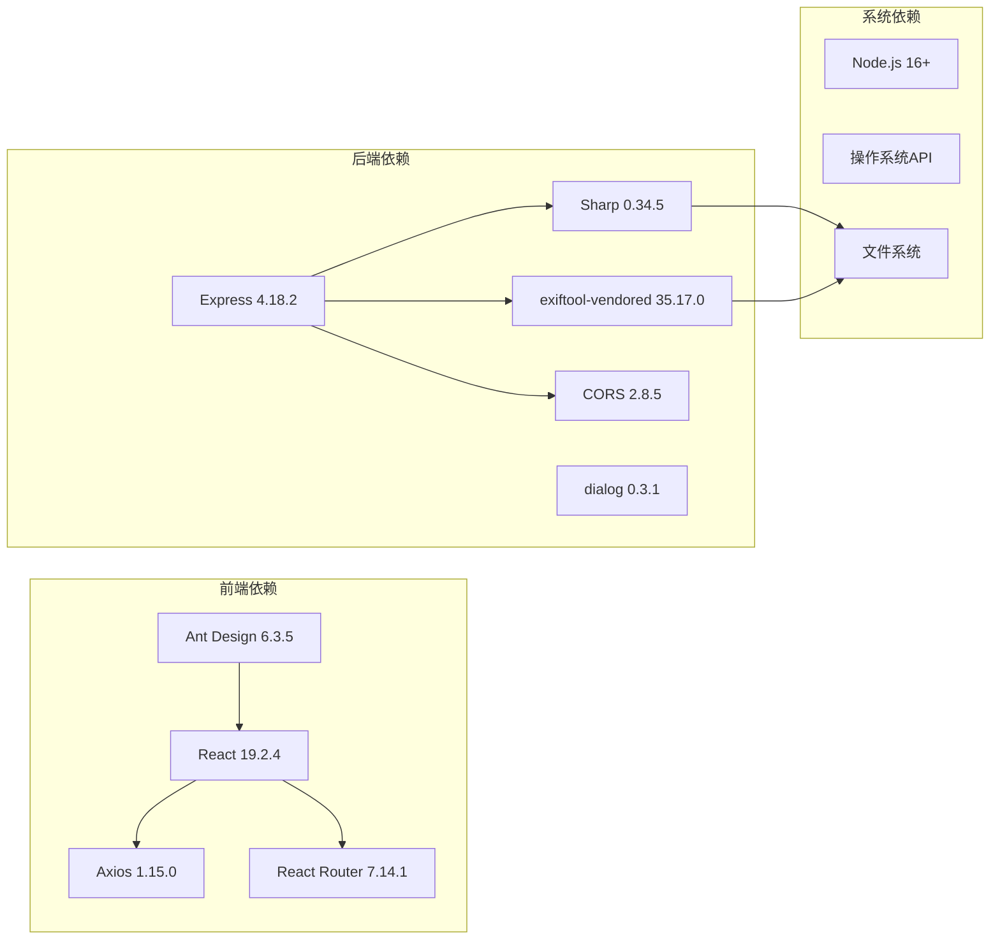

# 文件导航与定位

<cite>
**本文档引用的文件**
- [fileService.js](file://backend/src/services/fileService.js)
- [fileUtils.js](file://backend/src/utils/fileUtils.js)
- [photoRoutes.js](file://backend/src/routes/photoRoutes.js)
- [importRoutes.js](file://backend/src/routes/importRoutes.js)
- [rawThumbnail.js](file://backend/src/utils/rawThumbnail.js)
- [PhotoGallery.jsx](file://frontend/src/pages/PhotoGallery.jsx)
- [Layout.jsx](file://frontend/src/components/Layout.jsx)
- [index.js](file://frontend/src/api/index.js)
- [README.md](file://README.md)
- [package.json](file://backend/package.json)
- [package.json](file://frontend/package.json)
</cite>

## 目录
1. [简介](#简介)
2. [项目结构](#项目结构)
3. [核心组件](#核心组件)
4. [架构概览](#架构概览)
5. [详细组件分析](#详细组件分析)
6. [依赖关系分析](#依赖关系分析)
7. [性能考量](#性能考量)
8. [故障排除指南](#故障排除指南)
9. [结论](#结论)
10. [附录](#附录)

## 简介
本项目是一个专业的照片管理工具，提供完整的文件导航与定位功能。系统支持从相机存储卡导入照片、管理多个存储仓库、浏览和预览照片（包括RAW格式），并具备强大的文件定位能力。本文档深入解析文件导航功能的实现，包括文件路径跳转、右键菜单、文件系统集成、安全考虑以及用户体验优化等方面。

## 项目结构
项目采用前后端分离架构，主要分为以下模块：
- **后端服务**：基于Node.js + Express，提供文件管理、照片浏览、仓库管理等功能
- **前端应用**：基于React + Vite，提供现代化的用户界面和交互体验
- **文件系统**：统一的文件操作接口，支持跨平台路径处理
- **多媒体处理**：RAW文件缩略图生成、视频流式播放等

**图表来源**
- [PhotoGallery.jsx:1-800](file://frontend/src/pages/PhotoGallery.jsx#L1-L800)
- [photoRoutes.js:1-739](file://backend/src/routes/photoRoutes.js#L1-L739)
- [fileService.js:1-443](file://backend/src/services/fileService.js#L1-L443)

**章节来源**
- [README.md:188-205](file://README.md#L188-L205)
- [package.json:1-30](file://backend/package.json#L1-L30)
- [package.json:1-33](file://frontend/package.json#L1-L33)

## 核心组件
文件导航功能的核心组件包括：

### 1. 文件服务层
- **FileService类**：提供文件操作的高级封装，包括导入、删除、扫描等
- **FileUtils模块**：提供基础文件操作工具函数
- **路径处理**：统一的跨平台路径处理机制

### 2. 路由层
- **照片路由**：处理照片浏览、预览、删除等请求
- **导入路由**：处理存储卡导入和文件夹选择
- **位置路由**：处理文件位置跳转功能

### 3. 前端组件层
- **照片画廊**：提供照片浏览和操作界面
- **布局组件**：提供导航菜单和侧边栏
- **API层**：封装HTTP请求和响应处理

**章节来源**
- [fileService.js:5-443](file://backend/src/services/fileService.js#L5-L443)
- [fileUtils.js:1-167](file://backend/src/utils/fileUtils.js#L1-L167)
- [photoRoutes.js:575-640](file://backend/src/routes/photoRoutes.js#L575-L640)
- [PhotoGallery.jsx:333-360](file://frontend/src/pages/PhotoGallery.jsx#L333-L360)

## 架构概览
文件导航系统的整体架构采用分层设计，确保功能模块的清晰分离和良好的可维护性。

**图表来源**
- [PhotoGallery.jsx:334-341](file://frontend/src/pages/PhotoGallery.jsx#L334-L341)
- [index.js:28-34](file://frontend/src/api/index.js#L28-L34)
- [photoRoutes.js:575-640](file://backend/src/routes/photoRoutes.js#L575-L640)

## 详细组件分析

### 文件路径跳转功能
文件路径跳转功能提供了两种模式：打开文件夹和打开文件，分别对应不同的系统行为。

#### 打开文件夹模式
当用户选择"打开文件夹"时，系统会：
1. 解码URL编码的文件路径
2. 验证文件存在性
3. 根据操作系统执行相应的命令
4. 使用系统默认程序打开文件夹

#### 打开文件模式
当用户选择"打开文件"时，系统会：
1. 执行与打开文件夹相同的验证步骤
2. 使用系统默认程序打开特定文件
3. 对于视频文件，会在新标签页中打开

**图表来源**
- [photoRoutes.js:576-640](file://backend/src/routes/photoRoutes.js#L576-L640)
- [PhotoGallery.jsx:334-341](file://frontend/src/pages/PhotoGallery.jsx#L334-L341)

**章节来源**
- [photoRoutes.js:575-640](file://backend/src/routes/photoRoutes.js#L575-L640)
- [PhotoGallery.jsx:333-360](file://frontend/src/pages/PhotoGallery.jsx#L333-L360)

### 右键菜单实现
右键菜单提供了直观的文件定位操作入口，包含以下功能：

#### 菜单项配置
- **打开文件夹**：使用FolderOpenOutlined图标，调用打开文件夹模式
- **打开文件**：使用EyeOutlined图标，调用打开文件模式

#### 图标样式
- 使用Ant Design图标库提供的专业图标
- 统一的视觉风格和交互反馈
- 响应式设计适配不同屏幕尺寸

#### 点击事件处理
- 事件冒泡阻止：防止点击事件传播到父元素
- 参数传递：将照片对象传递给处理函数
- 错误处理：统一的错误提示和状态反馈

**章节来源**
- [PhotoGallery.jsx:343-359](file://frontend/src/pages/PhotoGallery.jsx#L343-L359)
- [PhotoGallery.jsx:732-746](file://frontend/src/pages/PhotoGallery.jsx#L732-L746)

### 文件系统集成
系统实现了完整的跨平台文件系统集成，支持多种操作系统和文件操作场景。

#### 跨平台路径处理
- **路径规范化**：统一使用path模块处理路径分隔符
- **平台适配**：根据操作系统自动选择合适的命令
- **编码处理**：正确处理特殊字符和Unicode路径

#### 系统默认程序调用
- **macOS**：使用`open`命令打开文件或文件夹
- **Windows**：使用`explorer`或`start`命令
- **Linux**：使用`xdg-open`命令

#### 文件验证机制
- **存在性检查**：在执行任何操作前验证文件存在
- **权限检查**：确保应用程序具有必要的文件访问权限
- **路径安全**：防止恶意路径注入攻击

**章节来源**
- [fileUtils.js:22-66](file://backend/src/utils/fileUtils.js#L22-L66)
- [photoRoutes.js:576-640](file://backend/src/routes/photoRoutes.js#L576-L640)

### 文件定位功能的安全考虑
文件定位功能实施了多层次的安全防护措施：

#### 路径验证
- **输入验证**：对所有用户输入进行严格验证
- **路径解析**：使用安全的路径解析算法
- **白名单机制**：限制允许访问的文件类型和路径

#### 权限检查
- **文件存在性**：确保目标文件确实存在
- **访问权限**：检查应用程序是否有足够的权限
- **目录遍历**：防止目录遍历攻击

#### 恶意路径防护
- **路径规范化**：消除危险的路径序列
- **相对路径限制**：限制相对路径的使用
- **符号链接处理**：安全处理符号链接和硬链接

**章节来源**
- [photoRoutes.js:587-598](file://backend/src/routes/photoRoutes.js#L587-L598)
- [fileUtils.js:119-126](file://backend/src/utils/fileUtils.js#L119-L126)

### 用户体验优化
系统在多个方面优化了文件导航的用户体验：

#### 快捷操作
- **一键定位**：右键菜单提供快速定位入口
- **批量操作**：支持多选和批量文件定位
- **键盘快捷键**：支持键盘快捷键操作

#### 历史记录
- **最近访问**：记录用户最近访问的文件和文件夹
- **搜索历史**：保存用户的搜索和过滤条件
- **会话持久化**：在用户会话期间保持状态

#### 收藏功能
- **书签管理**：支持收藏常用的文件夹
- **快速访问**：提供快速访问常用路径的入口
- **自定义标签**：允许用户为收藏添加描述标签

**章节来源**
- [PhotoGallery.jsx:554-588](file://frontend/src/pages/PhotoGallery.jsx#L554-L588)
- [Layout.jsx:39-60](file://frontend/src/components/Layout.jsx#L39-L60)

### 与其他功能模块的集成
文件导航功能与系统其他模块紧密集成：

#### 与照片浏览模块的集成
- **预览联动**：定位功能与照片预览功能无缝衔接
- **状态同步**：确保文件状态在各个模块间保持一致
- **性能优化**：共享缓存和资源，提高整体性能

#### 与仓库管理模块的集成
- **仓库切换**：支持在不同仓库间快速切换
- **路径映射**：自动处理仓库路径映射关系
- **权限继承**：继承仓库级别的访问权限设置

#### 与导入模块的集成
- **导入后定位**：导入完成后自动定位到目标文件
- **冲突处理**：处理导入过程中的文件冲突
- **进度同步**：同步导入进度到定位功能

**章节来源**
- [PhotoGallery.jsx:84-103](file://frontend/src/pages/PhotoGallery.jsx#L84-L103)
- [importRoutes.js:219-232](file://backend/src/routes/importRoutes.js#L219-L232)

## 依赖关系分析

**图表来源**
- [package.json:12-18](file://backend/package.json#L12-L18)
- [package.json:13-19](file://frontend/package.json#L13-L19)

**章节来源**
- [package.json:12-18](file://backend/package.json#L12-L18)
- [package.json:13-19](file://frontend/package.json#L13-L19)

## 性能考量
文件导航功能在设计时充分考虑了性能优化：

### 并发处理
- **异步操作**：所有文件操作都是异步的，避免阻塞主线程
- **并发限制**：控制同时进行的文件操作数量，防止资源耗尽
- **进度反馈**：实时显示操作进度，提升用户体验

### 缓存策略
- **缩略图缓存**：RAW文件缩略图生成后进行缓存
- **路径缓存**：常用路径和仓库信息进行本地缓存
- **响应缓存**：静态资源和重复查询结果进行缓存

### 内存管理
- **流式处理**：大文件使用流式处理，避免内存溢出
- **及时释放**：及时释放不再使用的资源和内存
- **垃圾回收**：合理使用JavaScript垃圾回收机制

## 故障排除指南

### 常见问题及解决方案

#### 文件定位失败
**问题描述**：点击"打开文件夹"或"打开文件"按钮无响应
**可能原因**：
- 文件路径不存在或已被移动
- 应用程序缺少必要的文件访问权限
- 操作系统命令执行失败

**解决步骤**：
1. 验证文件路径的有效性
2. 检查应用程序的文件访问权限
3. 确认操作系统命令可用性
4. 查看浏览器控制台错误信息

#### 跨平台兼容性问题
**问题描述**：在某些操作系统上无法正常工作
**可能原因**：
- 系统命令不支持或路径不正确
- 文件系统权限设置问题
- 字符编码处理不当

**解决步骤**：
1. 检查系统命令的可用性和正确性
2. 验证文件系统权限设置
3. 确认字符编码处理逻辑
4. 查看系统日志获取详细错误信息

#### 性能问题
**问题描述**：文件导航操作响应缓慢
**可能原因**：
- 文件数量过多导致处理时间长
- 网络延迟影响远程文件访问
- 系统资源不足

**解决步骤**：
1. 优化文件扫描算法
2. 实施分页加载机制
3. 增加缓存策略
4. 监控系统资源使用情况

**章节来源**
- [README.md:166-187](file://README.md#L166-L187)
- [photoRoutes.js:633-639](file://backend/src/routes/photoRoutes.js#L633-L639)

## 结论
文件导航与定位功能是本照片管理系统的重要组成部分，通过精心设计的架构和完善的实现，为用户提供了强大而便捷的文件管理体验。系统不仅支持基本的文件定位功能，还集成了丰富的用户体验优化和安全保障措施。

### 主要优势
- **跨平台兼容**：支持Windows、macOS、Linux三大主流操作系统
- **安全性强**：实施多层次的安全防护措施，防止恶意攻击
- **用户体验优秀**：提供直观的操作界面和流畅的交互体验
- **性能优化**：采用异步处理和缓存策略，确保高效运行

### 技术特色
- **模块化设计**：清晰的分层架构，便于维护和扩展
- **异步处理**：充分利用现代JavaScript的异步特性
- **错误处理**：完善的错误捕获和处理机制
- **日志记录**：详细的日志记录，便于问题诊断

随着技术的不断发展，文件导航功能将继续演进，为用户提供更加智能和高效的文件管理体验。

## 附录

### 扩展开发指南

#### 新增文件类型支持
1. 在`FILE_EXTENSIONS`常量中添加新的文件类型映射
2. 更新文件类型检测逻辑
3. 添加相应的缩略图生成策略
4. 测试新类型的文件处理流程

#### 自定义路径处理
1. 修改`getDefaultPhotoPath`函数以支持新的默认路径规则
2. 更新路径验证逻辑
3. 添加相应的错误处理机制
4. 测试不同平台下的路径处理

#### 性能优化建议
1. 实施更智能的缓存策略
2. 优化文件扫描算法
3. 添加进度条和状态指示器
4. 考虑使用Web Workers处理大量文件

#### 安全加固措施
1. 实施更严格的输入验证
2. 添加文件完整性检查
3. 增强错误信息的隐私保护
4. 考虑添加文件访问审计功能

**章节来源**
- [fileUtils.js:4-20](file://backend/src/utils/fileUtils.js#L4-L20)
- [README.md:227-233](file://README.md#L227-L233)