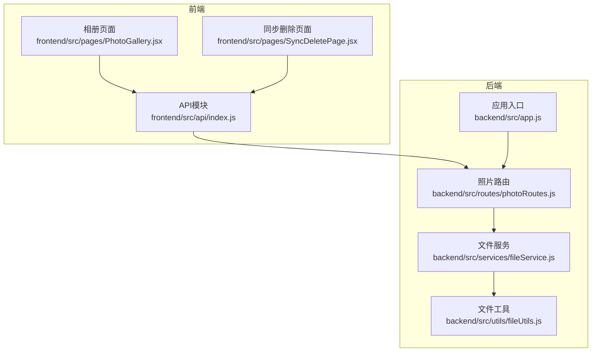
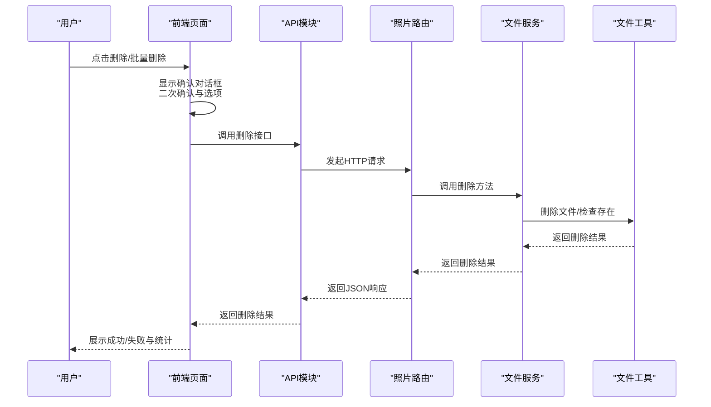
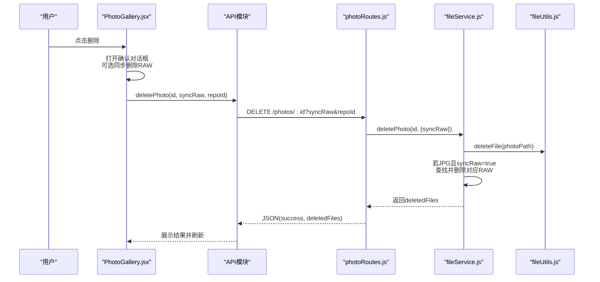
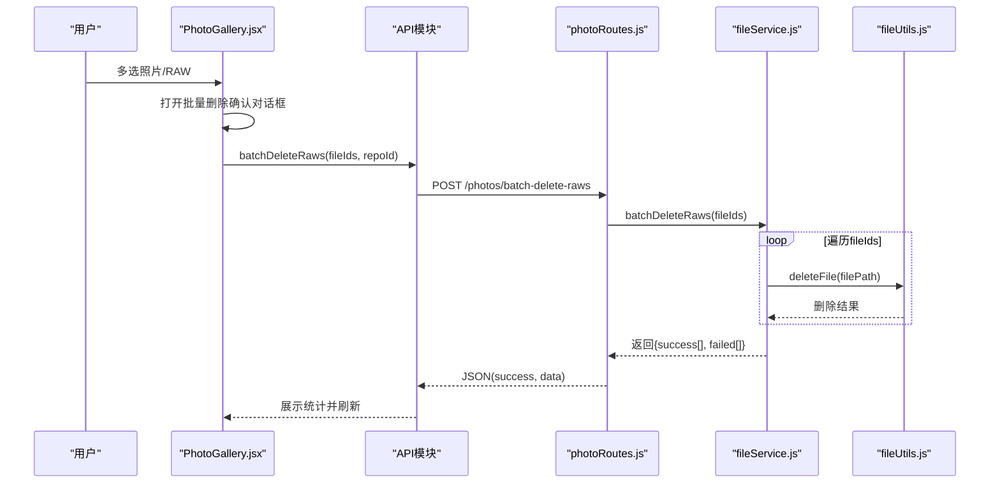
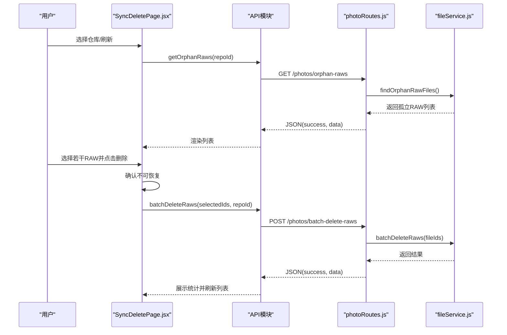
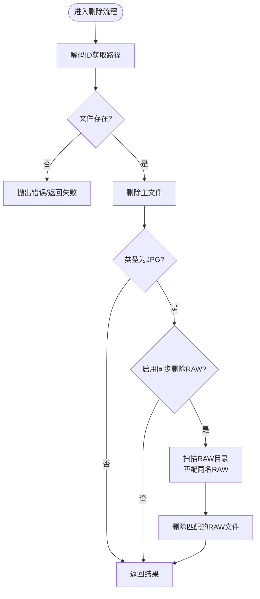
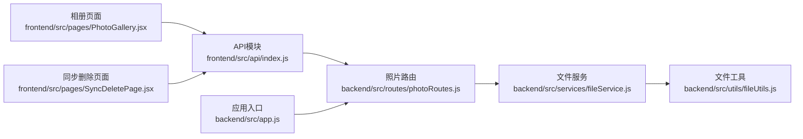

# 照片删除操作

<cite>
**本文引用的文件**
- [photoRoutes.js](file://backend/src/routes/photoRoutes.js)
- [fileService.js](file://backend/src/services/fileService.js)
- [fileUtils.js](file://backend/src/utils/fileUtils.js)
- [SyncDeletePage.jsx](file://frontend/src/pages/SyncDeletePage.jsx)
- [PhotoGallery.jsx](file://frontend/src/pages/PhotoGallery.jsx)
- [index.js](file://frontend/src/api/index.js)
- [app.js](file://backend/src/app.js)
- [repos.json](file://backend/data/repos.json)
- [repos.json](file://config/repos.json)
</cite>

## 目录
1. [简介](#简介)
2. [项目结构](#项目结构)
3. [核心组件](#核心组件)
4. [架构总览](#架构总览)
5. [详细组件分析](#详细组件分析)
6. [依赖关系分析](#依赖关系分析)
7. [性能考量](#性能考量)
8. [故障排除指南](#故障排除指南)
9. [结论](#结论)
10. [附录](#附录)

## 简介
本文件系统性地文档化了照片删除操作的完整流程，涵盖：
- 单张照片删除：确认对话框、同步删除RAW选项与实际删除操作
- 批量删除：多选机制、删除队列处理与结果统计
- 安全保障：二次确认、不可恢复提示与错误回滚机制
- 进度反馈与状态更新：前端交互与后端路由配合
- 日志记录与审计：请求日志与错误处理
- 权限控制与文件系统安全：仓库路径校验与静态文件服务
- 故障排除与性能优化：常见问题与改进建议

## 项目结构
后端采用Express框架，路由层负责HTTP接口，服务层封装业务逻辑，工具层提供文件系统操作；前端使用React + Ant Design，通过Axios与后端API通信。

**图表来源**
- [app.js:114-121](file://backend/src/app.js#L114-L121)
- [photoRoutes.js:11-24](file://backend/src/routes/photoRoutes.js#L11-L24)
- [fileService.js:1-8](file://backend/src/services/fileService.js#L1-L8)
- [fileUtils.js:1-10](file://backend/src/utils/fileUtils.js#L1-L10)
- [index.js:1-6](file://frontend/src/api/index.js#L1-L6)

**章节来源**
- [app.js:114-121](file://backend/src/app.js#L114-L121)
- [photoRoutes.js:11-24](file://backend/src/routes/photoRoutes.js#L11-L24)
- [fileService.js:1-8](file://backend/src/services/fileService.js#L1-L8)
- [fileUtils.js:1-10](file://backend/src/utils/fileUtils.js#L1-L10)
- [index.js:1-6](file://frontend/src/api/index.js#L1-L6)

## 核心组件
- 前端API模块：封装删除、批量删除、获取孤立RAW等接口
- 单张删除对话框：PhotoGallery.jsx中的确认弹窗与同步删除选项
- 批量删除页面：SyncDeletePage.jsx中的多选、确认与结果展示
- 后端路由：photoRoutes.js中的删除接口与批量删除接口
- 文件服务：fileService.js中的删除逻辑与孤立RAW检测
- 文件工具：fileUtils.js中的删除、存在性检查等基础操作

**章节来源**
- [index.js:9-34](file://frontend/src/api/index.js#L9-L34)
- [PhotoGallery.jsx:137-159](file://frontend/src/pages/PhotoGallery.jsx#L137-L159)
- [SyncDeletePage.jsx:118-159](file://frontend/src/pages/SyncDeletePage.jsx#L118-L159)
- [photoRoutes.js:130-176](file://backend/src/routes/photoRoutes.js#L130-L176)
- [fileService.js:226-267](file://backend/src/services/fileService.js#L226-L267)
- [fileUtils.js:102-111](file://backend/src/utils/fileUtils.js#L102-L111)

## 架构总览
删除操作的端到端流程如下：

**图表来源**
- [PhotoGallery.jsx:137-159](file://frontend/src/pages/PhotoGallery.jsx#L137-L159)
- [SyncDeletePage.jsx:118-159](file://frontend/src/pages/SyncDeletePage.jsx#L118-L159)
- [index.js:19-23](file://frontend/src/api/index.js#L19-L23)
- [photoRoutes.js:130-176](file://backend/src/routes/photoRoutes.js#L130-L176)
- [fileService.js:226-267](file://backend/src/services/fileService.js#L226-L267)
- [fileUtils.js:102-111](file://backend/src/utils/fileUtils.js#L102-L111)

## 详细组件分析

### 单张照片删除流程
- 前端确认对话框
  - PhotoGallery.jsx提供单张删除确认弹窗，支持“同步删除RAW”选项
  - 选项仅在JPG类型时显示，避免对非JPG无效操作
- 后端删除接口
  - photoRoutes.js提供DELETE /photos/:id，接收syncRaw与repoId查询参数
  - fileService.js的deletePhoto方法执行删除：先删主文件，再按需同步删除RAW
- 结果反馈
  - 前端收到成功响应后刷新相册列表，并提示成功

**图表来源**
- [PhotoGallery.jsx:838-895](file://frontend/src/pages/PhotoGallery.jsx#L838-L895)
- [index.js:19-21](file://frontend/src/api/index.js#L19-L21)
- [photoRoutes.js:130-149](file://backend/src/routes/photoRoutes.js#L130-L149)
- [fileService.js:226-267](file://backend/src/services/fileService.js#L226-L267)
- [fileUtils.js:102-111](file://backend/src/utils/fileUtils.js#L102-L111)

**章节来源**
- [PhotoGallery.jsx:137-159](file://frontend/src/pages/PhotoGallery.jsx#L137-L159)
- [PhotoGallery.jsx:838-895](file://frontend/src/pages/PhotoGallery.jsx#L838-L895)
- [photoRoutes.js:130-149](file://backend/src/routes/photoRoutes.js#L130-L149)
- [fileService.js:226-267](file://backend/src/services/fileService.js#L226-L267)
- [fileUtils.js:102-111](file://backend/src/utils/fileUtils.js#L102-L111)

### 批量删除流程
- 前端多选与确认
  - PhotoGallery.jsx支持多选照片，批量删除时同样提供同步删除RAW选项
  - 对话框中包含不可恢复提示与警告
- 后端批量删除接口
  - photoRoutes.js提供POST /photos/batch-delete-raws，接收fileIds与repoId
  - fileService.js的batchDeleteRaws逐个删除RAW文件，收集成功/失败列表
- 结果统计与刷新
  - 前端汇总成功/失败数量，提示用户并重新拉取数据

**图表来源**
- [PhotoGallery.jsx:429-469](file://frontend/src/pages/PhotoGallery.jsx#L429-L469)
- [index.js:22-23](file://frontend/src/api/index.js#L22-L23)
- [photoRoutes.js:151-176](file://backend/src/routes/photoRoutes.js#L151-L176)
- [fileService.js:418-439](file://backend/src/services/fileService.js#L418-L439)
- [fileUtils.js:102-111](file://backend/src/utils/fileUtils.js#L102-L111)

**章节来源**
- [PhotoGallery.jsx:429-469](file://frontend/src/pages/PhotoGallery.jsx#L429-L469)
- [photoRoutes.js:151-176](file://backend/src/routes/photoRoutes.js#L151-L176)
- [fileService.js:418-439](file://backend/src/services/fileService.js#L418-L439)
- [fileUtils.js:102-111](file://backend/src/utils/fileUtils.js#L102-L111)

### 同步删除RAW底片（独立页面）
- 页面职责
  - SyncDeletePage.jsx列出孤立RAW文件（无对应JPG），支持全选、多选与删除
  - 删除前二次确认，提示不可恢复
- 后端逻辑
  - photoRoutes.js提供GET /photos/orphan-raws与POST /photos/batch-delete-raws
  - fileService.js的findOrphanRawFiles与batchDeleteRaws分别负责检测与删除

**图表来源**
- [SyncDeletePage.jsx:73-90](file://frontend/src/pages/SyncDeletePage.jsx#L73-L90)
- [SyncDeletePage.jsx:118-159](file://frontend/src/pages/SyncDeletePage.jsx#L118-L159)
- [index.js:16-23](file://frontend/src/api/index.js#L16-L23)
- [photoRoutes.js:112-176](file://backend/src/routes/photoRoutes.js#L112-L176)
- [fileService.js:269-306](file://backend/src/services/fileService.js#L269-L306)
- [fileService.js:418-439](file://backend/src/services/fileService.js#L418-L439)

**章节来源**
- [SyncDeletePage.jsx:73-90](file://frontend/src/pages/SyncDeletePage.jsx#L73-L90)
- [SyncDeletePage.jsx:118-159](file://frontend/src/pages/SyncDeletePage.jsx#L118-L159)
- [photoRoutes.js:112-176](file://backend/src/routes/photoRoutes.js#L112-L176)
- [fileService.js:269-306](file://backend/src/services/fileService.js#L269-L306)
- [fileService.js:418-439](file://backend/src/services/fileService.js#L418-L439)

### 删除算法与数据结构
- 删除算法
  - 单张删除：解码ID获取路径，检查存在，删除主文件；若JPG且开启同步删除，则遍历RAW扩展名匹配并删除
  - 批量删除：逐个删除RAW文件，记录成功/失败
- 关键数据结构
  - 孤立RAW检测：以JPG文件名集合为基准，过滤RAW文件名（去扩展名后比较）
  - 删除结果：success与failed数组，便于前端统计与展示

**图表来源**
- [fileService.js:226-267](file://backend/src/services/fileService.js#L226-L267)
- [fileService.js:269-306](file://backend/src/services/fileService.js#L269-L306)
- [fileService.js:418-439](file://backend/src/services/fileService.js#L418-L439)

**章节来源**
- [fileService.js:226-267](file://backend/src/services/fileService.js#L226-L267)
- [fileService.js:269-306](file://backend/src/services/fileService.js#L269-L306)
- [fileService.js:418-439](file://backend/src/services/fileService.js#L418-L439)

## 依赖关系分析

**图表来源**
- [index.js:1-6](file://frontend/src/api/index.js#L1-L6)
- [photoRoutes.js:1-10](file://backend/src/routes/photoRoutes.js#L1-L10)
- [fileService.js:1-8](file://backend/src/services/fileService.js#L1-L8)
- [fileUtils.js:1-10](file://backend/src/utils/fileUtils.js#L1-L10)
- [PhotoGallery.jsx:1-31](file://frontend/src/pages/PhotoGallery.jsx#L1-L31)
- [SyncDeletePage.jsx:1-31](file://frontend/src/pages/SyncDeletePage.jsx#L1-L31)
- [app.js:114-121](file://backend/src/app.js#L114-L121)

**章节来源**
- [index.js:1-6](file://frontend/src/api/index.js#L1-L6)
- [photoRoutes.js:1-10](file://backend/src/routes/photoRoutes.js#L1-L10)
- [fileService.js:1-8](file://backend/src/services/fileService.js#L1-L8)
- [fileUtils.js:1-10](file://backend/src/utils/fileUtils.js#L1-L10)
- [PhotoGallery.jsx:1-31](file://frontend/src/pages/PhotoGallery.jsx#L1-L31)
- [SyncDeletePage.jsx:1-31](file://frontend/src/pages/SyncDeletePage.jsx#L1-L31)
- [app.js:114-121](file://backend/src/app.js#L114-L121)

## 性能考量
- 并发与队列
  - 批量删除采用逐个删除策略，避免大量并发IO造成阻塞；如需提升吞吐，可在前端增加分批提交与后端批量处理队列
- 文件扫描
  - 孤立RAW检测使用扫描目录与集合查找，时间复杂度近似O(J+R)，其中J为JPG数量，R为RAW数量；可通过缓存JPG名集合减少重复计算
- 前端渲染
  - 列表分页与懒加载有助于提升大数据集下的交互性能
- I/O优化
  - 删除操作为顺序写，建议在高负载场景下避免同时进行大量导入/导出操作

[本节为通用性能建议，不直接分析具体文件]

## 故障排除指南
- 删除失败
  - 检查文件是否存在与权限；fileUtils.js的deleteFile返回布尔值，fileService.js在删除失败时记录错误日志
  - 前端通过message提示失败原因
- 无法找到仓库路径
  - app.js在动态静态文件服务中校验路径存在性，不存在时返回404；请检查仓库配置
- 事件源连接问题
  - 导入流程使用SSE，若连接断开或超时，前端会根据readyState与错误事件进行处理；可检查网络与代理设置
- 仓库配置
  - 后端与前端均提供仓库配置文件，确保DATA_DIR与PHOTO_BASE_PATH环境变量正确

**章节来源**
- [fileUtils.js:102-111](file://backend/src/utils/fileUtils.js#L102-L111)
- [fileService.js:308-334](file://backend/src/services/fileService.js#L308-L334)
- [app.js:67-91](file://backend/src/app.js#L67-L91)
- [index.js:87-110](file://frontend/src/api/index.js#L87-L110)
- [repos.json:1-8](file://backend/data/repos.json#L1-L8)
- [repos.json:1-20](file://config/repos.json#L1-L20)

## 结论
本系统提供了完善的照片删除能力，覆盖单张与批量删除、同步删除RAW、二次确认与不可恢复提示、结果统计与错误处理。通过清晰的前后端职责划分与稳健的文件操作封装，确保了删除流程的可靠性与用户体验。后续可在批量处理队列与缓存策略上进一步优化性能。

[本节为总结性内容，不直接分析具体文件]

## 附录

### 删除操作的权限控制与文件系统安全
- 仓库路径校验
  - app.js在提供静态文件服务时，先检查仓库路径是否存在，不存在则返回404，防止越权访问
- 文件存在性检查
  - fileService.js在删除前检查文件存在性，避免对不存在文件的无效操作
- 跨平台兼容
  - 默认路径根据操作系统自动选择，减少配置错误

**章节来源**
- [app.js:67-91](file://backend/src/app.js#L67-L91)
- [fileService.js:233-235](file://backend/src/services/fileService.js#L233-L235)

### 日志记录与审计
- 请求日志
  - app.js中统一中间件记录每次请求的方法与URL，便于审计
- 错误处理
  - app.js全局捕获未捕获异常与未处理Promise拒绝，避免服务崩溃并记录错误堆栈
- 删除日志
  - fileUtils.js在删除失败时输出错误日志，fileService.js在批量删除中记录失败项

**章节来源**
- [app.js:22-26](file://backend/src/app.js#L22-L26)
- [app.js:133-143](file://backend/src/app.js#L133-L143)
- [fileUtils.js:104-109](file://backend/src/utils/fileUtils.js#L104-L109)
- [fileService.js:308-334](file://backend/src/services/fileService.js#L308-L334)

### 删除操作的安全保障措施
- 二次确认
  - PhotoGallery.jsx与SyncDeletePage.jsx均提供确认对话框，明确不可恢复提示
- 同步删除选项
  - 仅在JPG类型时显示同步删除RAW选项，避免对非JPG类型误操作
- 错误回滚
  - 删除操作为幂等性较低的操作，当前实现未提供自动回滚；建议在需要时引入事务型存储或备份策略

**章节来源**
- [PhotoGallery.jsx:838-895](file://frontend/src/pages/PhotoGallery.jsx#L838-L895)
- [SyncDeletePage.jsx:124-138](file://frontend/src/pages/SyncDeletePage.jsx#L124-L138)
- [fileService.js:248-261](file://backend/src/services/fileService.js#L248-L261)