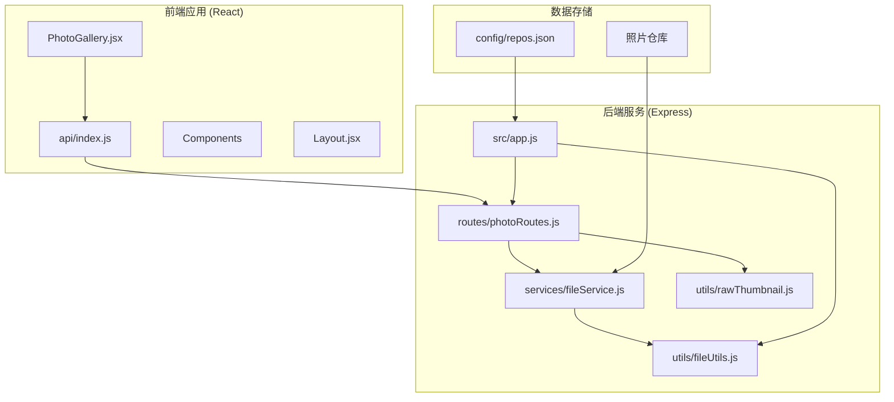
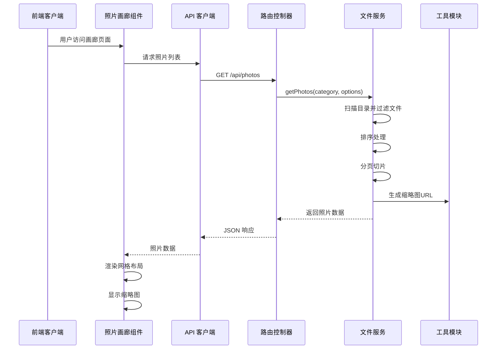
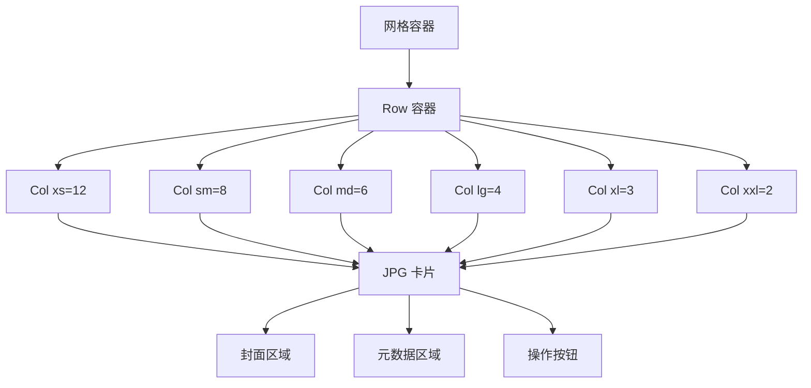
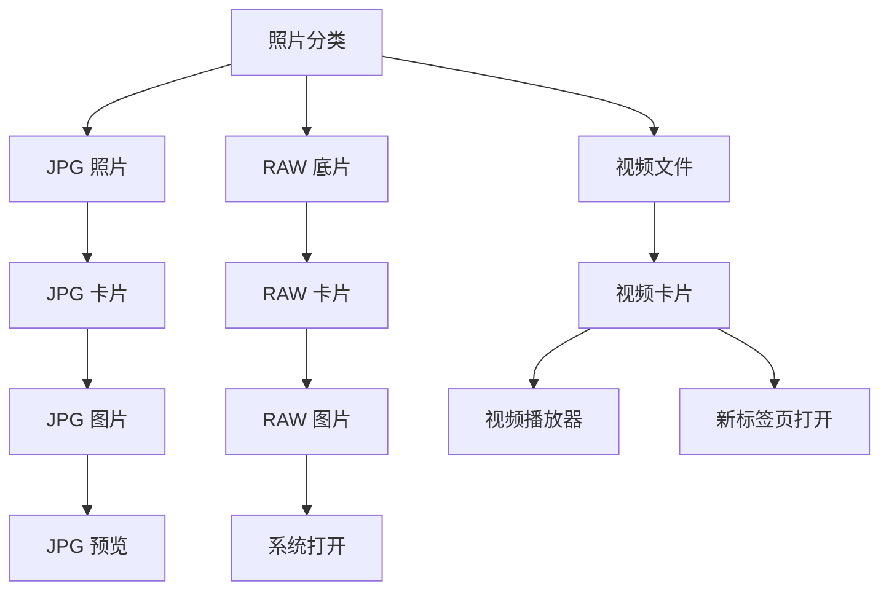
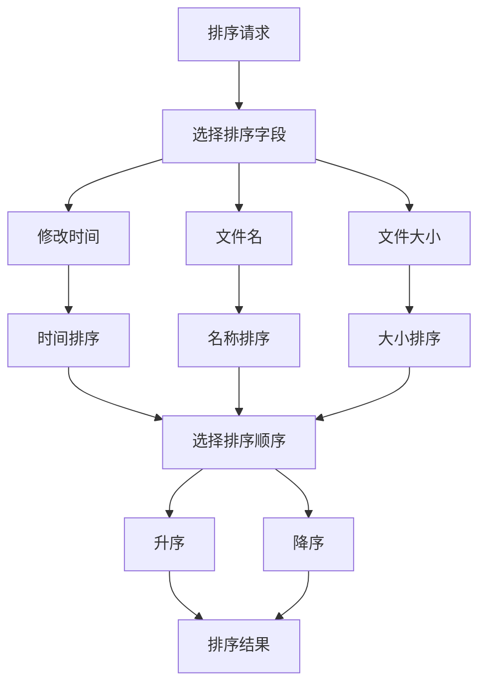
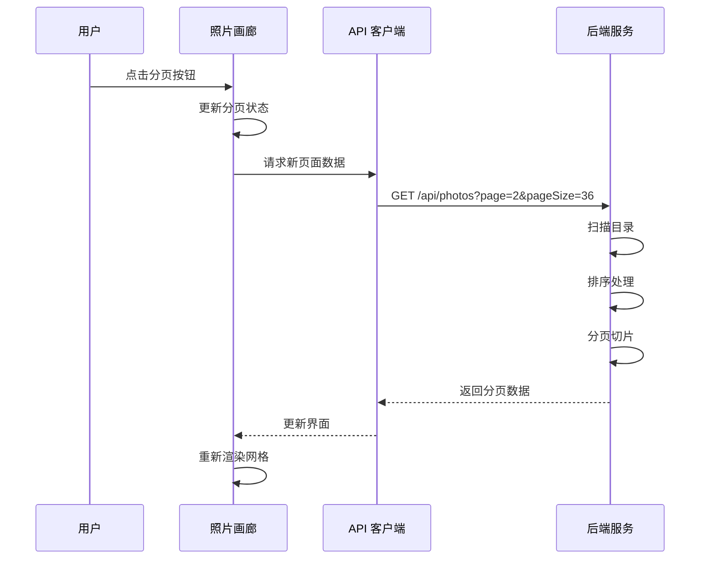
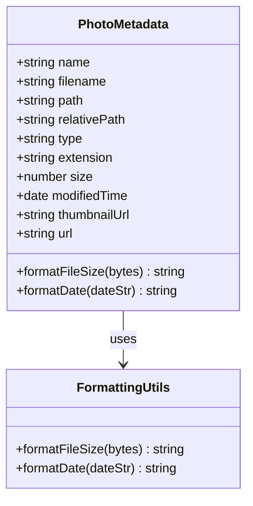
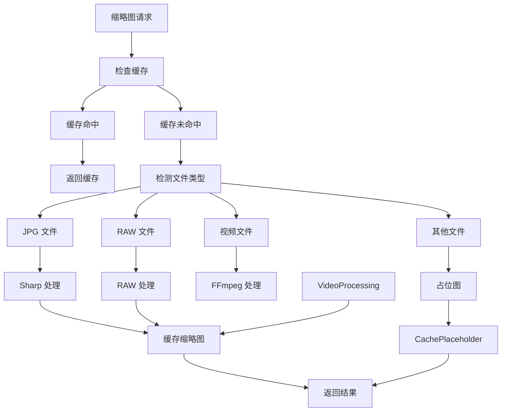
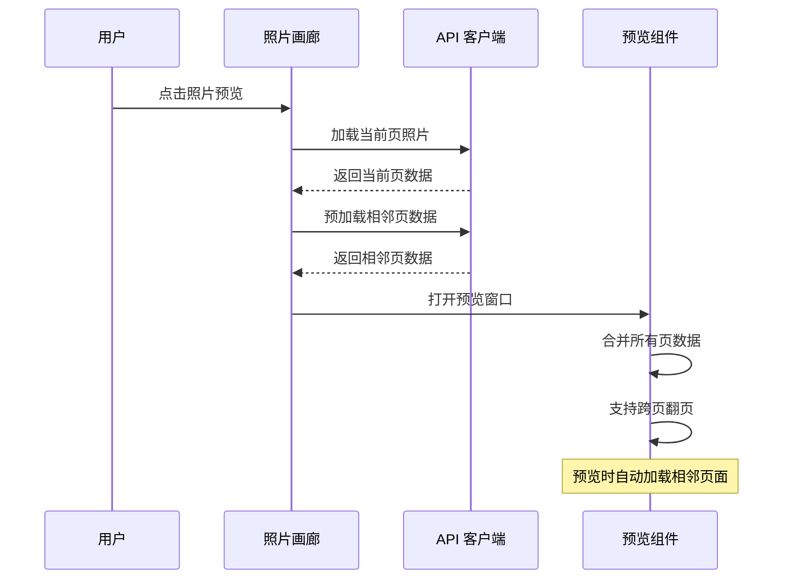
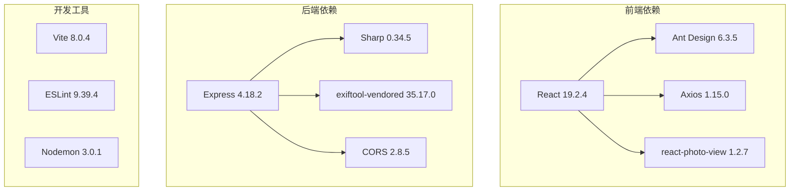

# 照片浏览与展示

<cite>
**本文档引用的文件**
- [PhotoGallery.jsx](file://frontend/src/pages/PhotoGallery.jsx)
- [photoRoutes.js](file://backend/src/routes/photoRoutes.js)
- [fileService.js](file://backend/src/services/fileService.js)
- [index.js](file://frontend/src/api/index.js)
- [rawThumbnail.js](file://backend/src/utils/rawThumbnail.js)
- [fileUtils.js](file://backend/src/utils/fileUtils.js)
- [App.jsx](file://frontend/src/App.jsx)
- [Layout.jsx](file://frontend/src/components/Layout.jsx)
- [app.js](file://backend/src/app.js)
- [repos.json](file://config/repos.json)
- [package.json](file://backend/package.json)
- [package.json](file://frontend/package.json)
</cite>

## 目录
1. [简介](#简介)
2. [项目结构](#项目结构)
3. [核心组件](#核心组件)
4. [架构概览](#架构概览)
5. [详细组件分析](#详细组件分析)
6. [依赖关系分析](#依赖关系分析)
7. [性能考虑](#性能考虑)
8. [故障排除指南](#故障排除指南)
9. [结论](#结论)
10. [附录](#附录)

## 简介
本项目是一个基于 React + Express 的照片管理系统，专注于提供高效的照片浏览与展示功能。系统实现了响应式网格布局、智能缩略图生成、多分类照片管理、灵活的排序与分页机制，以及完善的元数据展示功能。

## 项目结构
项目采用前后端分离架构，前端使用 React + Ant Design 构建用户界面，后端使用 Express 提供 RESTful API 服务。



**图表来源**
- [PhotoGallery.jsx:1-944](file://frontend/src/pages/PhotoGallery.jsx#L1-L944)
- [photoRoutes.js:1-739](file://backend/src/routes/photoRoutes.js#L1-L739)
- [fileService.js:1-443](file://backend/src/services/fileService.js#L1-L443)

**章节来源**
- [App.jsx:1-41](file://frontend/src/App.jsx#L1-L41)
- [Layout.jsx:1-160](file://frontend/src/components/Layout.jsx#L1-L160)
- [app.js:1-146](file://backend/src/app.js#L1-L146)

## 核心组件
系统的核心功能围绕以下组件构建：

### 前端组件
- **照片画廊组件**: 实现照片网格展示、响应式布局、预览功能
- **API 客户端**: 封装后端接口调用，统一错误处理
- **布局组件**: 提供导航菜单和存储统计信息

### 后端服务
- **文件服务**: 照片扫描、分类、排序、分页处理
- **路由控制器**: RESTful API 接口实现
- **工具模块**: 文件操作、RAW 缩略图生成

**章节来源**
- [PhotoGallery.jsx:43-131](file://frontend/src/pages/PhotoGallery.jsx#L43-L131)
- [index.js:8-34](file://frontend/src/api/index.js#L8-L34)
- [fileService.js:5-443](file://backend/src/services/fileService.js#L5-L443)

## 架构概览



**图表来源**
- [PhotoGallery.jsx:105-131](file://frontend/src/pages/PhotoGallery.jsx#L105-L131)
- [photoRoutes.js:68-92](file://backend/src/routes/photoRoutes.js#L68-L92)
- [fileService.js:169-224](file://backend/src/services/fileService.js#L169-L224)

## 详细组件分析

### 照片网格布局实现

#### 响应式设计架构
系统采用 Ant Design 的栅格系统实现响应式布局，支持多种屏幕尺寸：



**图表来源**
- [PhotoGallery.jsx:600-771](file://frontend/src/pages/PhotoGallery.jsx#L600-L771)

#### 卡片组件结构
每个照片卡片包含三个主要部分：
- **封面区域**: 显示缩略图，支持点击预览
- **元数据区域**: 显示文件名、大小、修改时间
- **操作区域**: 提供打开位置、预览、删除等操作

**章节来源**
- [PhotoGallery.jsx:602-769](file://frontend/src/pages/PhotoGallery.jsx#L602-L769)

### 照片分类系统

#### 分类处理逻辑
系统支持三种照片分类，每种分类有不同的处理方式：



**图表来源**
- [PhotoGallery.jsx:625-729](file://frontend/src/pages/PhotoGallery.jsx#L625-L729)

#### 分类显示差异
- **JPG 照片**: 支持图片预览，使用 Ant Design Image 组件
- **RAW 底片**: 使用系统命令直接打开，不进行预览
- **视频文件**: 在新标签页中打开播放

**章节来源**
- [PhotoGallery.jsx:161-172](file://frontend/src/pages/PhotoGallery.jsx#L161-L172)

### 照片排序功能

#### 排序算法实现
系统支持三种排序方式，每种都有对应的比较逻辑：



**图表来源**
- [fileService.js:200-211](file://backend/src/services/fileService.js#L200-L211)

#### 排序字段处理
- **修改时间**: 使用日期对象比较，支持升序/降序
- **文件名**: 使用本地字符串比较，支持国际化排序
- **文件大小**: 使用数值比较，支持升序/降序

**章节来源**
- [fileService.js:200-211](file://backend/src/services/fileService.js#L200-L211)

### 分页机制实现

#### 分页控制流程
系统实现了一个完整的分页机制，支持页码切换和每页数量调整：



**图表来源**
- [PhotoGallery.jsx:310-312](file://frontend/src/pages/PhotoGallery.jsx#L310-L312)
- [photoRoutes.js:69-92](file://backend/src/routes/photoRoutes.js#L69-L92)

#### 分页参数配置
- **默认每页数量**: 36 张照片
- **可选每页数量**: 36、72、108、144
- **页码切换**: 支持快速跳转和连续翻页

**章节来源**
- [PhotoGallery.jsx:777-790](file://frontend/src/pages/PhotoGallery.jsx#L777-L790)

### 照片元数据展示

#### 元数据格式化
系统提供了完整的元数据展示功能：



**图表来源**
- [fileService.js:186-198](file://backend/src/services/fileService.js#L186-L198)
- [PhotoGallery.jsx:471-481](file://frontend/src/pages/PhotoGallery.jsx#L471-L481)

#### 元数据字段说明
- **文件名**: 显示原始文件名，支持工具提示
- **文件大小**: 自动格式化为合适的单位（B/KB/MB/GB）
- **修改时间**: 本地化显示为中文格式

**章节来源**
- [PhotoGallery.jsx:748-767](file://frontend/src/pages/PhotoGallery.jsx#L748-L767)

### 缩略图生成与缓存策略

#### 缩略图生成架构
系统实现了智能的缩略图生成和缓存机制：



**图表来源**
- [photoRoutes.js:293-466](file://backend/src/routes/photoRoutes.js#L293-L466)
- [rawThumbnail.js:78-129](file://backend/src/utils/rawThumbnail.js#L78-L129)

#### 缩略图生成策略
系统采用三级降级策略处理 RAW 文件：

1. **第一级**: 从 RAW 文件中提取嵌入的预览图
2. **第二级**: 使用 Sharp 直接解码 RAW 文件
3. **第三级**: 返回 null，由调用方生成占位图

**章节来源**
- [rawThumbnail.js:78-129](file://backend/src/utils/rawThumbnail.js#L78-L129)

### 预览功能实现

#### 跨页预览机制
系统实现了智能的跨页预览功能：



**图表来源**
- [PhotoGallery.jsx:174-308](file://frontend/src/pages/PhotoGallery.jsx#L174-L308)

#### 预览优化策略
- **防抖机制**: 防止频繁的预览加载请求
- **缓存策略**: 预加载相邻页面到内存
- **跨页支持**: 实现无缝的预览体验

**章节来源**
- [PhotoGallery.jsx:225-308](file://frontend/src/pages/PhotoGallery.jsx#L225-L308)

## 依赖关系分析

### 技术栈依赖



**图表来源**
- [package.json:12-19](file://backend/package.json#L12-L19)
- [package.json:13-19](file://frontend/package.json#L13-L19)

### 关键依赖关系
- **文件扫描**: `fileUtils.js` 提供目录扫描和文件类型识别
- **缩略图生成**: `rawThumbnail.js` 和 `sharp` 实现智能缩略图生成
- **API 通信**: `index.js` 封装所有后端接口调用
- **路由处理**: `photoRoutes.js` 实现 RESTful API 路由

**章节来源**
- [fileUtils.js:22-66](file://backend/src/utils/fileUtils.js#L22-L66)
- [rawThumbnail.js:1-132](file://backend/src/utils/rawThumbnail.js#L1-L132)
- [index.js:8-34](file://frontend/src/api/index.js#L8-L34)

## 性能考虑

### 前端性能优化
1. **虚拟滚动**: 对于大量照片场景，建议实现虚拟滚动以提升渲染性能
2. **图片懒加载**: 已实现基础的懒加载机制，可进一步优化
3. **缓存策略**: 利用浏览器缓存和 CDN 提升缩略图加载速度

### 后端性能优化
1. **并发控制**: 导入功能已实现并发限制，避免内存溢出
2. **流式传输**: 视频文件使用流式传输，避免内存占用过高
3. **缓存机制**: 缩略图生成结果进行缓存，减少重复计算

### 数据库优化
1. **索引策略**: 建议为修改时间和文件名建立数据库索引
2. **查询优化**: 使用分页查询避免一次性加载大量数据
3. **缓存层**: 实现 Redis 缓存提升查询性能

## 故障排除指南

### 常见问题及解决方案

#### 缩略图生成失败
**问题症状**: RAW 文件缩略图显示为占位图
**可能原因**:
- EXIF 工具不可用
- RAW 文件格式不受支持
- 文件权限问题

**解决步骤**:
1. 检查 EXIF 工具安装状态
2. 验证 RAW 文件完整性
3. 确认文件访问权限

#### 照片预览加载缓慢
**问题症状**: 点击预览后页面卡顿
**可能原因**:
- 网络带宽不足
- 图片文件过大
- 浏览器缓存问题

**解决步骤**:
1. 检查网络连接稳定性
2. 调整缩略图质量参数
3. 清除浏览器缓存

#### 分页显示异常
**问题症状**: 分页按钮点击无效或数据错乱
**可能原因**:
- API 参数传递错误
- 前端状态管理问题
- 后端排序逻辑异常

**解决步骤**:
1. 检查 API 请求参数
2. 验证前端状态更新
3. 确认后端排序实现

**章节来源**
- [rawThumbnail.js:108-129](file://backend/src/utils/rawThumbnail.js#L108-L129)
- [PhotoGallery.jsx:174-308](file://frontend/src/pages/PhotoGallery.jsx#L174-L308)

## 结论
本照片管理系统实现了完整的照片浏览与展示功能，具有以下特点：

1. **响应式设计**: 适配多种设备和屏幕尺寸
2. **智能分类**: 支持 JPG、RAW、视频三种类型的差异化处理
3. **高效性能**: 采用流式传输和缓存策略优化加载速度
4. **用户体验**: 提供流畅的预览和交互体验
5. **可扩展性**: 模块化设计便于功能扩展和维护

系统在照片管理的各个方面都体现了良好的工程实践，为用户提供了稳定可靠的照片浏览体验。

## 附录

### API 接口规范

#### 照片列表接口
- **方法**: GET `/api/photos`
- **参数**:
  - `category`: 照片分类 (jpg/raw/video)
  - `page`: 页码 (默认: 1)
  - `pageSize`: 每页数量 (默认: 50)
  - `sortBy`: 排序字段 (modifiedTime/name/size)
  - `sortOrder`: 排序顺序 (asc/desc)
  - `repoId`: 仓库ID

#### 缩略图接口
- **方法**: GET `/api/photos/thumbnail`
- **参数**:
  - `path`: 文件绝对路径
  - `width`: 缩略图宽度 (默认: 300)
  - `quality`: 图像质量 (默认: 80)

#### 预览接口
- **方法**: GET `/api/photos/preview`
- **参数**:
  - `path`: 文件绝对路径
  - `repo`: 仓库ID

### 配置文件说明

#### 仓库配置
```json
{
  "id": "唯一标识符",
  "name": "仓库名称",
  "path": "照片存储路径",
  "isDefault": "是否为默认仓库"
}
```

#### 环境变量
- `PORT`: 服务器端口号 (默认: 3001)
- `DATA_DIR`: 数据存储目录
- `PHOTO_BASE_PATH`: 默认照片路径