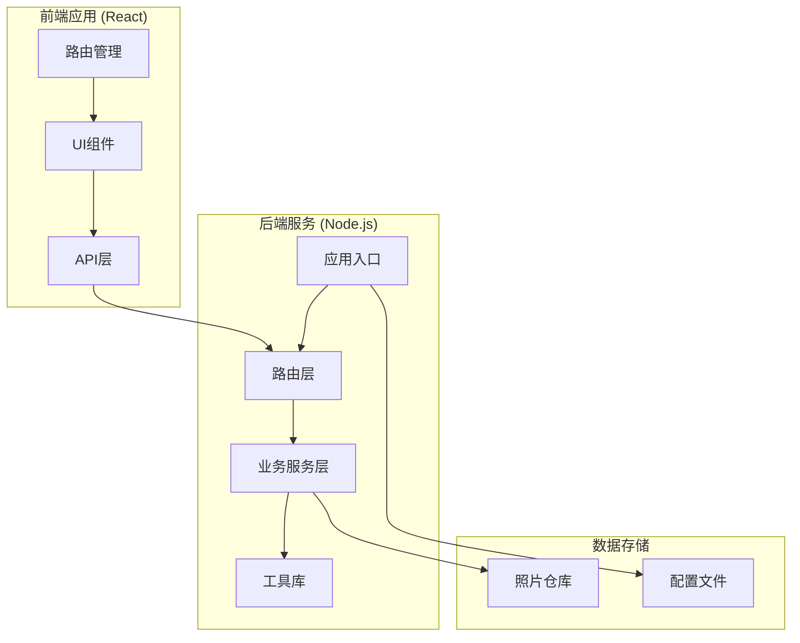
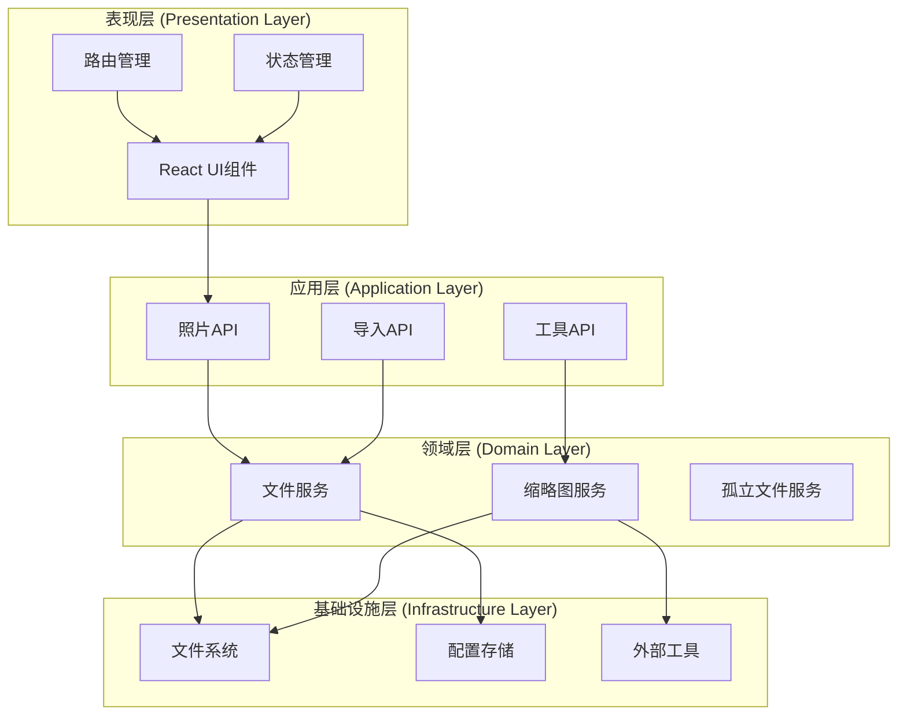
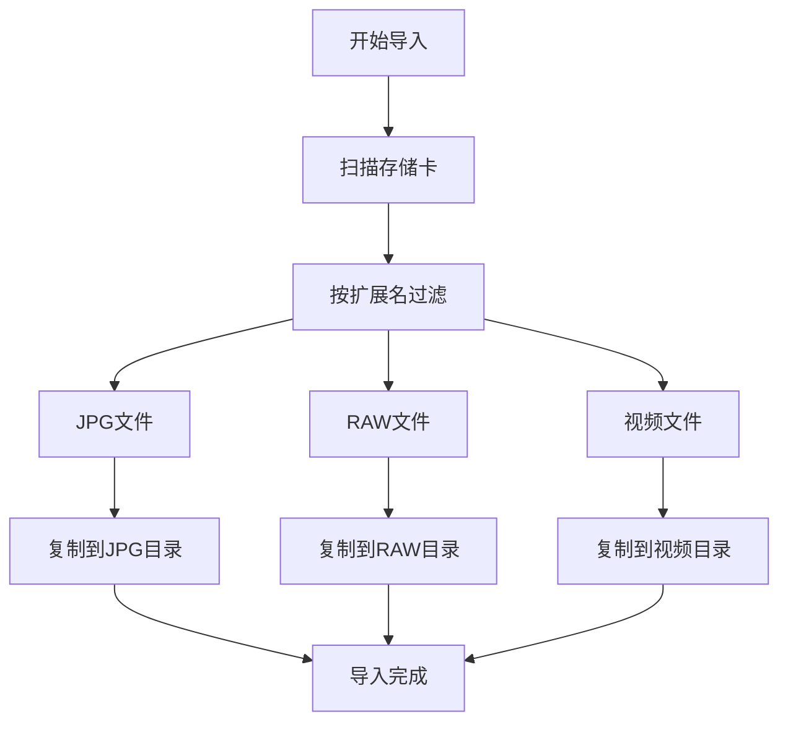
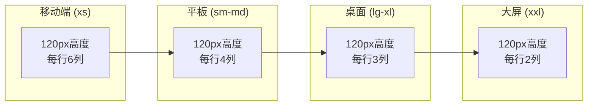
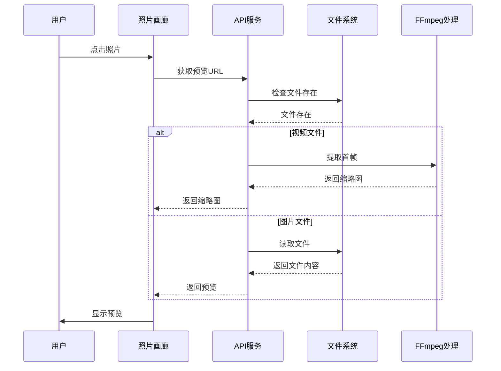
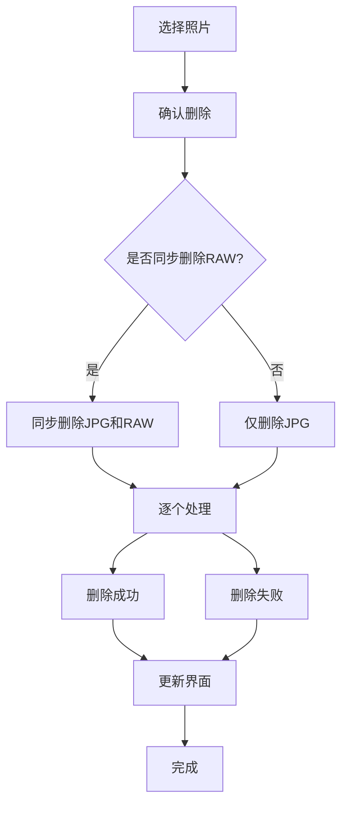
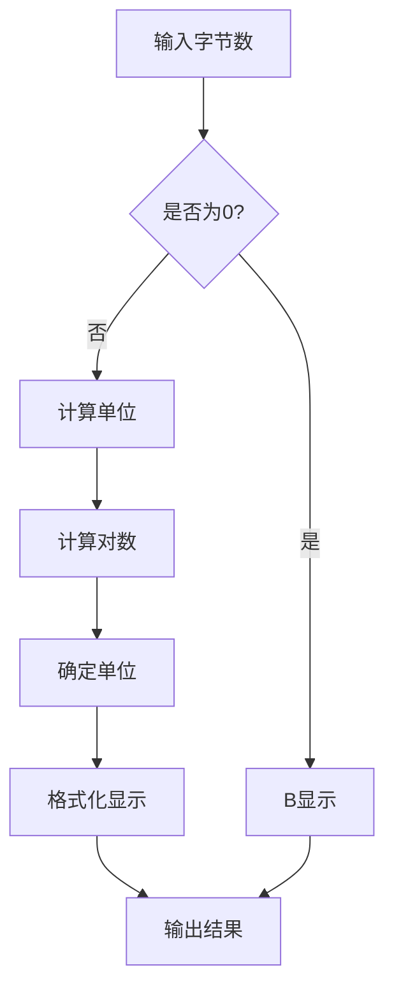
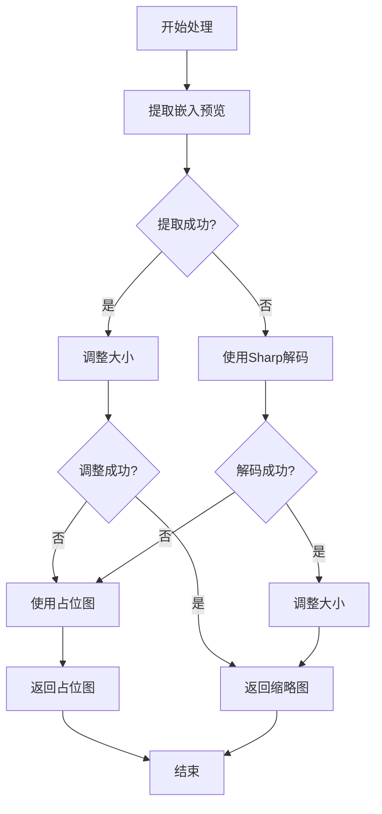
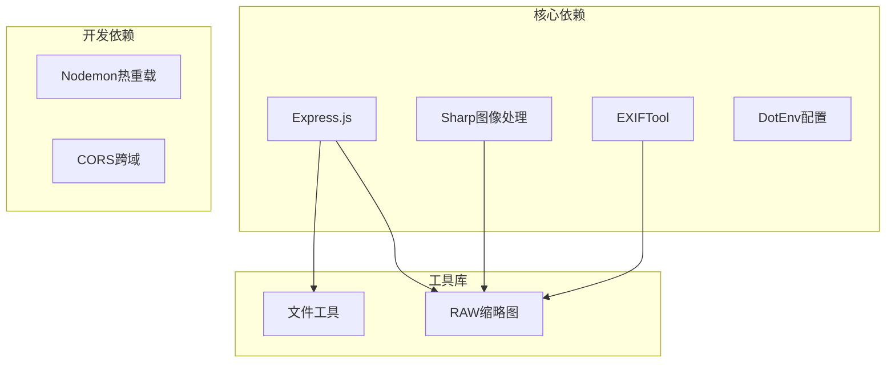
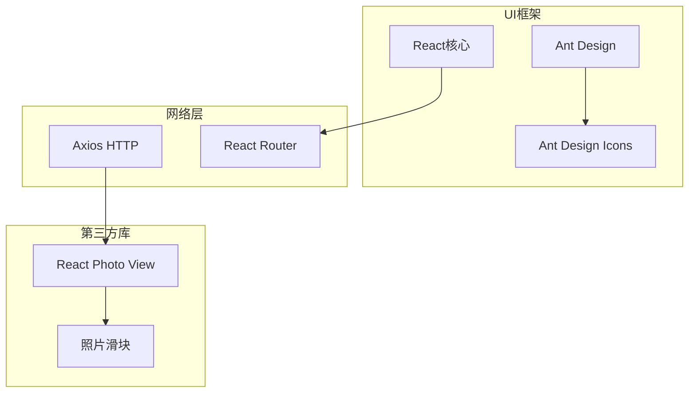

# 照片管理模块

<cite>
**本文档引用的文件**
- [backend/src/app.js](file://backend/src/app.js)
- [backend/src/routes/photoRoutes.js](file://backend/src/routes/photoRoutes.js)
- [backend/src/services/fileService.js](file://backend/src/services/fileService.js)
- [backend/src/utils/fileUtils.js](file://backend/src/utils/fileUtils.js)
- [backend/src/utils/rawThumbnail.js](file://backend/src/utils/rawThumbnail.js)
- [backend/data/repos.json](file://backend/data/repos.json)
- [backend/package.json](file://backend/package.json)
- [frontend/src/pages/PhotoGallery.jsx](file://frontend/src/pages/PhotoGallery.jsx)
- [frontend/src/api/index.js](file://frontend/src/api/index.js)
- [frontend/src/App.jsx](file://frontend/src/App.jsx)
- [frontend/package.json](file://frontend/package.json)
- [README.md](file://README.md)
- [backend/RAW_THUMBNAIL_FIX.md](file://backend/RAW_THUMBNAIL_FIX.md)
</cite>

## 目录
1. [简介](#简介)
2. [项目结构](#项目结构)
3. [核心组件](#核心组件)
4. [架构概览](#架构概览)
5. [详细组件分析](#详细组件分析)
6. [依赖关系分析](#依赖关系分析)
7. [性能考虑](#性能考虑)
8. [故障排除指南](#故障排除指南)
9. [结论](#结论)
10. [附录](#附录)

## 简介
照片管理模块是一个基于Node.js和React构建的现代化照片管理系统，专为处理相机照片、RAW底片和视频文件而设计。该系统提供了完整的照片浏览、预览、删除和批量操作功能，支持多仓库管理和跨平台部署。

系统采用前后端分离架构，后端使用Express.js提供RESTful API，前端使用React配合Ant Design构建用户界面。核心功能包括：

- **照片分类管理**：JPG、RAW、视频文件的智能分类和组织
- **高效浏览体验**：响应式网格布局、无限滚动和懒加载
- **强大的预览功能**：支持缩放、旋转、全屏查看和视频流式播放
- **批量操作支持**：多选、批量导出、批量删除和同步删除
- **元数据展示**：文件大小格式化、时间戳处理和详细信息显示
- **性能优化**：并发控制、缓存策略和资源管理

## 项目结构
该项目采用清晰的分层架构，前后端分离的设计使得系统具有良好的可维护性和扩展性。

**图表来源**
- [frontend/src/App.jsx:1-41](file://frontend/src/App.jsx#L1-L41)
- [backend/src/app.js:1-146](file://backend/src/app.js#L1-L146)

**章节来源**
- [README.md:1-3](file://README.md#L1-L3)
- [frontend/package.json:1-33](file://frontend/package.json#L1-L33)
- [backend/package.json:1-30](file://backend/package.json#L1-L30)

## 核心组件
系统由多个相互协作的核心组件构成，每个组件都有明确的职责和边界。

### 后端核心组件

#### 应用服务器 (Express.js)
应用服务器作为系统的核心入口点，负责：
- CORS配置和中间件管理
- 动态静态文件服务
- 错误处理和健康检查
- 跨平台路径处理

#### 路由系统
路由系统提供完整的RESTful API接口：
- 照片列表获取和分页
- 缩略图生成和预览
- 批量操作支持
- 存储信息查询

#### 文件服务层
文件服务层封装了所有文件操作逻辑：
- 目录扫描和文件过滤
- 并发控制和性能优化
- RAW文件特殊处理
- 存储空间统计

### 前端核心组件

#### 照片画廊 (PhotoGallery)
照片画廊是用户交互的主要界面，提供：
- 响应式网格布局
- 多种排序和筛选选项
- 批量选择和操作
- 预览和导航功能

#### API客户端
API客户端封装了所有后端通信逻辑：
- Axios配置和拦截器
- SSE事件流支持
- 错误处理和重试机制
- 进度跟踪和状态管理

**章节来源**
- [backend/src/app.js:1-146](file://backend/src/app.js#L1-L146)
- [backend/src/routes/photoRoutes.js:1-739](file://backend/src/routes/photoRoutes.js#L1-L739)
- [backend/src/services/fileService.js:1-443](file://backend/src/services/fileService.js#L1-L443)
- [frontend/src/pages/PhotoGallery.jsx:1-800](file://frontend/src/pages/PhotoGallery.jsx#L1-L800)
- [frontend/src/api/index.js:1-168](file://frontend/src/api/index.js#L1-L168)

## 架构概览
系统采用经典的三层架构设计，确保了关注点分离和代码的可维护性。

**图表来源**
- [frontend/src/App.jsx:1-41](file://frontend/src/App.jsx#L1-L41)
- [frontend/src/api/index.js:1-168](file://frontend/src/api/index.js#L1-L168)
- [backend/src/services/fileService.js:1-443](file://backend/src/services/fileService.js#L1-L443)

系统的关键特性包括：

1. **异步处理**：所有长时间运行的操作都使用Promise和async/await模式
2. **错误隔离**：全局错误处理器防止单个请求影响整个系统
3. **资源管理**：自动化的资源清理和内存管理
4. **配置驱动**：支持多仓库配置和环境变量

**章节来源**
- [backend/src/app.js:118-146](file://backend/src/app.js#L118-L146)
- [backend/src/routes/photoRoutes.js:642-739](file://backend/src/routes/photoRoutes.js#L642-L739)

## 详细组件分析

### 照片分类与管理

#### 分类机制
系统支持三种主要的照片分类：

**图表来源**
- [backend/src/utils/fileUtils.js:4-20](file://backend/src/utils/fileUtils.js#L4-L20)
- [backend/src/services/fileService.js:24-167](file://backend/src/services/fileService.js#L24-L167)

#### 文件类型识别
系统使用精确的文件类型识别机制：

| 分类 | 支持的扩展名 | 数量 |
|------|-------------|------|
| JPG | .jpg, .jpeg | 2 |
| RAW | .raw, .cr2, .cr3, .nef, .arw, .dng, .orf, .raf, .rw2 | 9 |
| 视频 | .mp4, .mov, .avi, .mkv, .m4v, .3gp | 6 |

**章节来源**
- [backend/src/utils/fileUtils.js:4-20](file://backend/src/utils/fileUtils.js#L4-L20)
- [backend/src/services/fileService.js:169-224](file://backend/src/services/fileService.js#L169-L224)

### 照片浏览与网格布局

#### 响应式设计
照片画廊采用灵活的响应式布局：

**图表来源**
- [frontend/src/pages/PhotoGallery.jsx:600-770](file://frontend/src/pages/PhotoGallery.jsx#L600-L770)

#### 网格布局实现
网格布局通过CSS Grid和Flexbox实现：

- **列间距**：12px固定间距
- **卡片尺寸**：120px高度，自适应宽度
- **悬停效果**：卡片悬停时的交互反馈
- **图片适配**：object-fit: cover确保图片填充

**章节来源**
- [frontend/src/pages/PhotoGallery.jsx:600-770](file://frontend/src/pages/PhotoGallery.jsx#L600-L770)

### 预览功能实现

#### 预览系统架构
预览功能支持多种文件类型的处理：

**图表来源**
- [backend/src/routes/photoRoutes.js:178-291](file://backend/src/routes/photoRoutes.js#L178-L291)
- [backend/src/routes/photoRoutes.js:468-571](file://backend/src/routes/photoRoutes.js#L468-L571)

#### 缩放和旋转功能
预览系统支持以下交互功能：

- **缩放**：支持多倍数缩放，最大支持10倍
- **旋转**：支持90度倍数旋转
- **全屏**：全屏模式下的沉浸式体验
- **手势支持**：触摸设备的手势控制

**章节来源**
- [frontend/src/pages/PhotoGallery.jsx:161-223](file://frontend/src/pages/PhotoGallery.jsx#L161-L223)
- [backend/src/routes/photoRoutes.js:294-466](file://backend/src/routes/photoRoutes.js#L294-L466)

### 批量操作功能

#### 批量删除工作流程
批量删除功能提供了安全的批量操作机制：

**图表来源**
- [frontend/src/pages/PhotoGallery.jsx:429-469](file://frontend/src/pages/PhotoGallery.jsx#L429-L469)
- [backend/src/services/fileService.js:226-267](file://backend/src/services/fileService.js#L226-L267)

#### 批量导出机制
批量导出功能支持增量导出和错误处理：

- **增量模式**：跳过已存在的文件，避免重复导出
- **错误恢复**：单个文件失败不影响整体导出
- **进度反馈**：实时显示导出进度和结果统计

**章节来源**
- [frontend/src/pages/PhotoGallery.jsx:400-427](file://frontend/src/pages/PhotoGallery.jsx#L400-L427)
- [backend/src/routes/photoRoutes.js:642-736](file://backend/src/routes/photoRoutes.js#L642-L736)

### 元数据展示与格式化

#### 文件大小格式化
系统实现了智能的文件大小格式化：

**图表来源**
- [backend/src/services/fileService.js:365-372](file://backend/src/services/fileService.js#L365-L372)
- [frontend/src/pages/PhotoGallery.jsx:471-481](file://frontend/src/pages/PhotoGallery.jsx#L471-L481)

#### 时间戳处理
时间戳处理采用了本地化格式化：

- **中文格式**：使用本地化设置显示中文日期时间
- **精确到秒**：显示完整的日期和时间信息
- **用户友好**：友好的时间显示格式

**章节来源**
- [frontend/src/pages/PhotoGallery.jsx:479-481](file://frontend/src/pages/PhotoGallery.jsx#L479-L481)
- [backend/src/services/fileService.js:365-372](file://backend/src/services/fileService.js#L365-L372)

### RAW文件处理优化

#### 三级降级策略
RAW文件缩略图生成采用了三级降级策略：

**图表来源**
- [backend/src/utils/rawThumbnail.js:78-129](file://backend/src/utils/rawThumbnail.js#L78-L129)

#### EXIF工具集成
系统集成了exiftool-vendored库进行RAW文件处理：

- **自动进程管理**：exiftool-vendored自动管理进程池
- **跨平台兼容**：支持Windows、macOS、Linux
- **性能优化**：避免进程创建开销，提高处理速度

**章节来源**
- [backend/src/utils/rawThumbnail.js:1-132](file://backend/src/utils/rawThumbnail.js#L1-L132)
- [backend/RAW_THUMBNAIL_FIX.md:1-100](file://backend/RAW_THUMBNAIL_FIX.md#L1-L100)

## 依赖关系分析

### 后端依赖架构

**图表来源**
- [backend/package.json:10-21](file://backend/package.json#L10-L21)

### 前端依赖架构

**图表来源**
- [frontend/package.json:12-20](file://frontend/package.json#L12-L20)

**章节来源**
- [backend/package.json:10-21](file://backend/package.json#L10-L21)
- [frontend/package.json:12-20](file://frontend/package.json#L12-L20)

## 性能考虑

### 并发控制策略
系统采用了多层并发控制机制：

#### 文件导入并发限制
- **并发数量**：最多3个文件同时处理
- **队列管理**：使用Promise队列避免内存溢出
- **进度反馈**：实时显示处理进度和剩余时间

#### 图像处理优化
- **懒加载**：图片首次显示时才加载缩略图
- **缓存策略**：缩略图缓存1天，减少重复处理
- **流式传输**：大文件使用流式传输避免内存占用

### 内存管理
系统实现了严格的内存管理策略：

- **文件句柄管理**：自动清理文件流和句柄
- **垃圾回收**：及时释放不再使用的对象
- **监控机制**：监控内存使用情况及时预警

### 网络优化
- **SSE支持**：使用Server-Sent Events实现实时进度
- **超时控制**：5分钟超时防止连接挂起
- **错误重试**：网络异常时自动重试机制

## 故障排除指南

### 常见问题诊断

#### RAW缩略图生成失败
**问题症状**：RAW文件显示占位图而非缩略图

**解决方案**：
1. 检查exiftool-vendored安装
2. 验证RAW文件格式支持
3. 查看后端控制台日志
4. 确认文件权限正确

#### 照片预览加载缓慢
**问题症状**：预览图片加载时间过长

**解决方案**：
1. 检查网络连接稳定性
2. 验证文件路径正确性
3. 清理浏览器缓存
4. 调整缩略图质量设置

#### 批量操作失败
**问题症状**：批量删除或导出部分失败

**解决方案**：
1. 检查目标路径权限
2. 验证磁盘空间充足
3. 查看具体失败原因
4. 重新执行失败的操作

### 错误处理策略

#### 前端错误处理
- **用户友好提示**：使用Message组件显示错误信息
- **操作回滚**：失败时自动回滚已成功的操作
- **重试机制**：网络错误时自动重试

#### 后端错误处理
- **全局异常捕获**：防止未捕获异常导致服务崩溃
- **资源清理**：错误发生时自动清理临时资源
- **日志记录**：详细记录错误信息便于调试

**章节来源**
- [backend/src/app.js:133-143](file://backend/src/app.js#L133-L143)
- [frontend/src/pages/PhotoGallery.jsx:155-159](file://frontend/src/pages/PhotoGallery.jsx#L155-L159)

## 结论
照片管理模块是一个功能完整、性能优异的照片管理解决方案。系统通过合理的架构设计和优化的实现策略，为用户提供了流畅的照片浏览、预览和管理体验。

### 主要优势
1. **架构清晰**：前后端分离，职责明确
2. **性能优秀**：多层优化确保快速响应
3. **功能全面**：涵盖照片管理的所有核心需求
4. **扩展性强**：模块化设计便于功能扩展
5. **用户体验佳**：直观的界面和流畅的交互

### 技术亮点
- 智能的RAW文件处理和缩略图生成
- 高效的批量操作和并发控制
- 完善的错误处理和故障恢复机制
- 响应式设计支持多设备访问

该系统为个人和专业用户提供了一个可靠的数字资产管理解决方案，具有良好的可维护性和扩展前景。

## 附录

### API接口参考

#### 照片管理API
| 接口 | 方法 | 描述 | 参数 |
|------|------|------|------|
| /api/photos | GET | 获取照片列表 | category, page, pageSize, sortBy, sortOrder, repoId |
| /api/photos/:id | DELETE | 删除照片 | syncRaw, repoId |
| /api/photos/batch-delete-raws | POST | 批量删除RAW文件 | fileIds, repoId |
| /api/photos/thumbnail | GET | 获取缩略图 | path, width, quality |
| /api/photos/preview | GET | 预览图片 | path |

#### 导入管理API
| 接口 | 方法 | 描述 | 参数 |
|------|------|------|------|
| /api/import | GET | 从存储卡导入 | sourcePath, repoId, autoRename |
| /api/import/repos | GET/POST/PUT/DELETE | 仓库管理 | 仓库配置 |

**章节来源**
- [backend/src/routes/photoRoutes.js:68-176](file://backend/src/routes/photoRoutes.js#L68-L176)
- [frontend/src/api/index.js:9-34](file://frontend/src/api/index.js#L9-L34)

### 配置选项
系统支持多种配置选项：

- **存储仓库**：支持多个仓库配置和默认仓库设置
- **文件路径**：支持自定义照片存储路径
- **缩略图质量**：可调节缩略图质量和尺寸
- **排序选项**：支持按修改时间、文件名、文件大小排序

**章节来源**
- [backend/data/repos.json:1-8](file://backend/data/repos.json#L1-L8)
- [backend/src/app.js:28-65](file://backend/src/app.js#L28-L65)