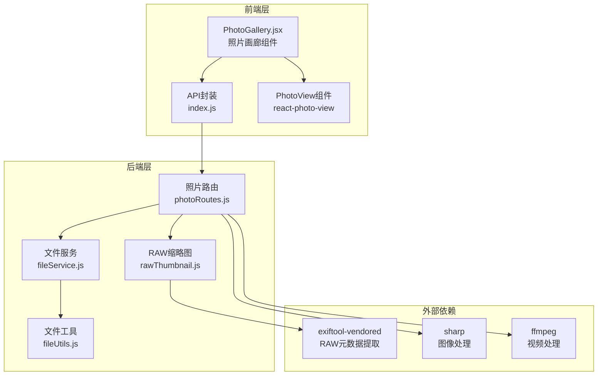
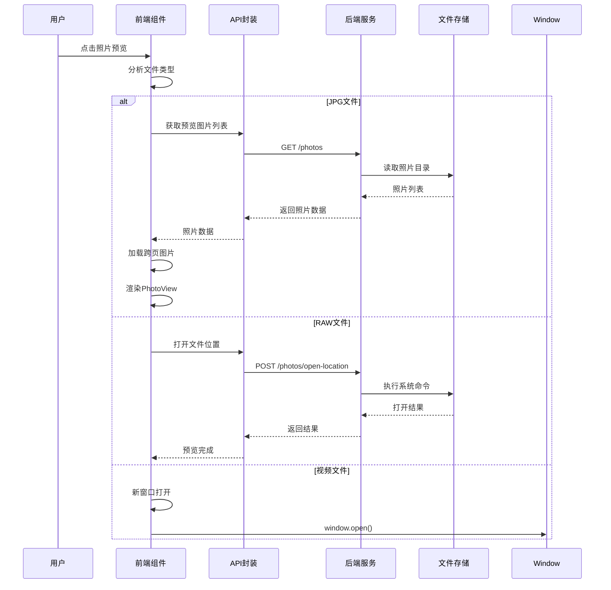
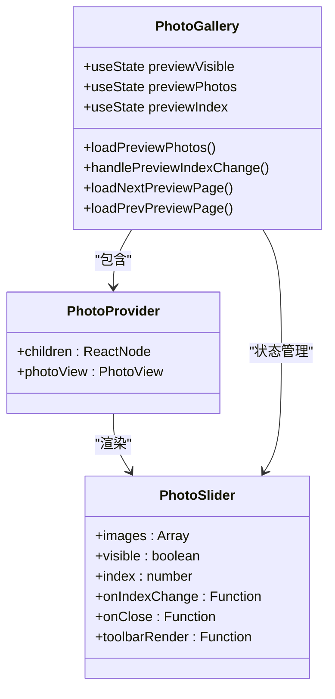
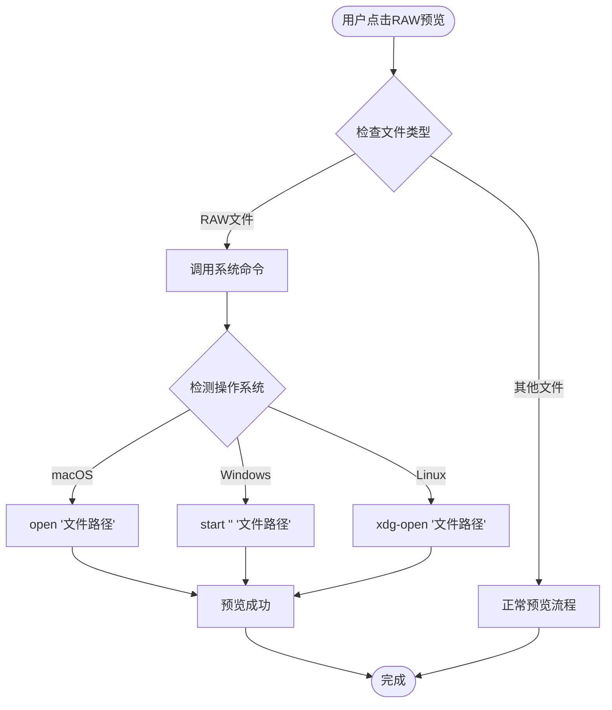
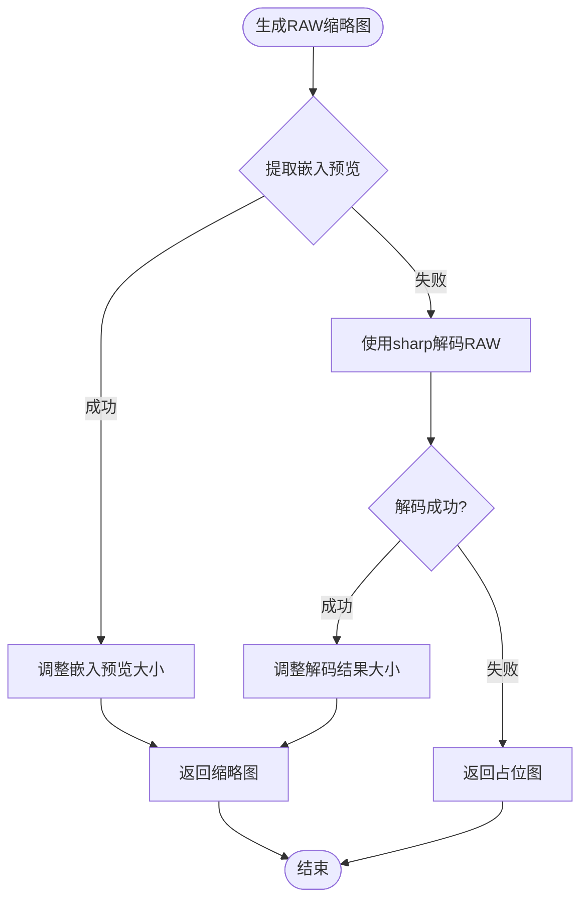
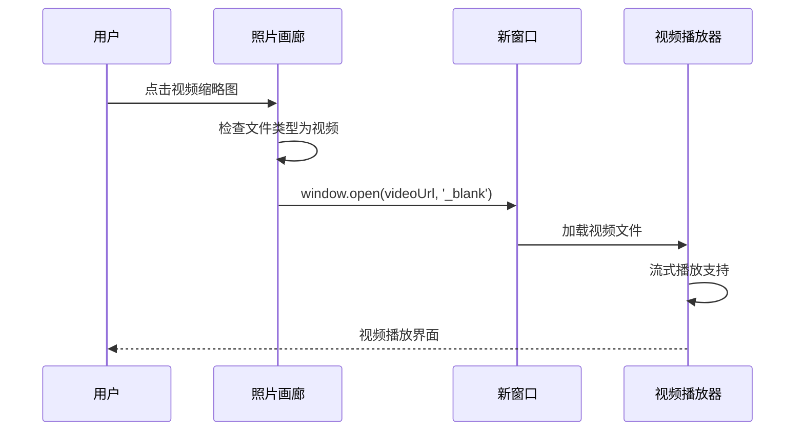
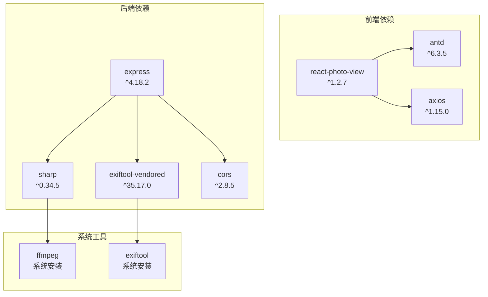
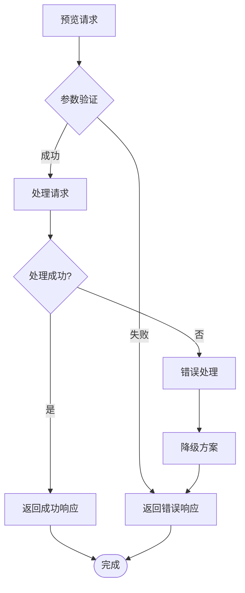

# 照片预览功能

<cite>
**本文档引用的文件**
- [PhotoGallery.jsx](file://frontend/src/pages/PhotoGallery.jsx)
- [photoRoutes.js](file://backend/src/routes/photoRoutes.js)
- [fileService.js](file://backend/src/services/fileService.js)
- [rawThumbnail.js](file://backend/src/utils/rawThumbnail.js)
- [fileUtils.js](file://backend/src/utils/fileUtils.js)
- [index.js](file://frontend/src/api/index.js)
- [package.json](file://frontend/package.json)
- [package.json](file://backend/package.json)
- [README.md](file://README.md)
</cite>

## 目录
1. [简介](#简介)
2. [项目结构](#项目结构)
3. [核心组件](#核心组件)
4. [架构概览](#架构概览)
5. [详细组件分析](#详细组件分析)
6. [依赖关系分析](#依赖关系分析)
7. [性能考虑](#性能考虑)
8. [故障排除指南](#故障排除指南)
9. [结论](#结论)
10. [附录](#附录)

## 简介

照片预览功能是本项目的核心特性之一，提供了对JPG图片、RAW底片和视频文件的统一预览体验。该功能采用现代化的技术架构，结合前端React组件和后端Node.js服务，实现了高性能、跨平台的照片浏览体验。

本功能支持以下主要特性：
- **多格式预览**：JPG图片使用PhotoView组件，RAW文件使用系统命令调用，视频文件在新窗口打开
- **智能预览工具栏**：提供旋转、缩放、全屏查看等交互操作
- **跨页翻页**：支持在不同页面间无缝浏览照片
- **状态管理**：完善的预览可见性控制和图片加载状态处理
- **性能优化**：图片缓存、延迟加载和内存管理策略

## 项目结构

项目采用前后端分离架构，预览功能涉及以下关键文件：

**图表来源**
- [PhotoGallery.jsx:1-944](file://frontend/src/pages/PhotoGallery.jsx#L1-L944)
- [photoRoutes.js:1-739](file://backend/src/routes/photoRoutes.js#L1-L739)
- [fileService.js:1-443](file://backend/src/services/fileService.js#L1-L443)
- [rawThumbnail.js:1-132](file://backend/src/utils/rawThumbnail.js#L1-L132)

**章节来源**
- [PhotoGallery.jsx:1-944](file://frontend/src/pages/PhotoGallery.jsx#L1-L944)
- [photoRoutes.js:1-739](file://backend/src/routes/photoRoutes.js#L1-L739)

## 核心组件

### 前端预览组件

PhotoGallery组件是预览功能的核心，负责：
- **状态管理**：预览可见性、图片列表、当前索引等状态
- **跨页翻页**：动态加载相邻页面的图片
- **工具栏渲染**：自定义旋转、缩放按钮
- **文件类型处理**：根据文件类型选择不同的预览策略

### 后端预览服务

后端提供完整的预览服务，包括：
- **缩略图生成**：支持JPG、RAW、视频文件的缩略图生成
- **原图预览**：流式传输大文件，支持Range请求
- **RAW处理**：使用exiftool-vendored提取嵌入预览
- **视频处理**：使用ffmpeg提取首帧作为缩略图

**章节来源**
- [PhotoGallery.jsx:161-308](file://frontend/src/pages/PhotoGallery.jsx#L161-L308)
- [photoRoutes.js:293-466](file://backend/src/routes/photoRoutes.js#L293-L466)

## 架构概览

预览功能采用分层架构设计，确保各层职责清晰：

**图表来源**
- [PhotoGallery.jsx:161-172](file://frontend/src/pages/PhotoGallery.jsx#L161-L172)
- [photoRoutes.js:575-640](file://backend/src/routes/photoRoutes.js#L575-L640)

## 详细组件分析

### JPG图片预览组件

JPG图片使用react-photo-view库实现高级预览功能：

**图表来源**
- [PhotoGallery.jsx:77-308](file://frontend/src/pages/PhotoGallery.jsx#L77-L308)

#### 工具栏功能实现

预览工具栏提供完整的交互控制：

| 功能 | 实现方式 | 用户体验 |
|------|----------|----------|
| 旋转 | `onRotate(rotate ± 90)` | 支持顺时针/逆时针旋转90度 |
| 缩放 | `onScale(scale ± 0.5)` | 支持放大/缩小操作 |
| 全屏 | PhotoView内置 | 自动适配屏幕尺寸 |
| 关闭 | `onClose`回调 | 点击遮罩或ESC键 |

**章节来源**
- [PhotoGallery.jsx:899-937](file://frontend/src/pages/PhotoGallery.jsx#L899-L937)

### RAW文件预览机制

RAW文件采用系统命令调用的方式进行预览：

**图表来源**
- [PhotoGallery.jsx:165-167](file://frontend/src/pages/PhotoGallery.jsx#L165-L167)
- [photoRoutes.js:606-625](file://backend/src/routes/photoRoutes.js#L606-L625)

#### RAW缩略图生成策略

RAW文件缩略图生成采用三级降级策略：

**图表来源**
- [rawThumbnail.js:78-129](file://backend/src/utils/rawThumbnail.js#L78-L129)

**章节来源**
- [rawThumbnail.js:1-132](file://backend/src/utils/rawThumbnail.js#L1-132)

### 视频文件预览机制

视频文件采用新窗口打开的方式：

**图表来源**
- [PhotoGallery.jsx:163-164](file://frontend/src/pages/PhotoGallery.jsx#L163-L164)

#### 视频缩略图生成

视频缩略图使用ffmpeg提取首帧：

| 参数 | 值 | 说明 |
|------|-----|------|
| 提取时间 | 00:00:01 | 从第1秒开始提取 |
| 帧数量 | 1 | 只提取1帧 |
| 缩放比例 | width:-1 | 按宽度等比缩放 |
| 编码格式 | mjpeg | JPEG编码 |
| 质量参数 | 5 | 高质量压缩 |

**章节来源**
- [photoRoutes.js:322-392](file://backend/src/routes/photoRoutes.js#L322-L392)

## 依赖关系分析

预览功能涉及多个技术栈的协作：

**图表来源**
- [package.json:10-18](file://backend/package.json#L10-L18)
- [package.json:12-19](file://frontend/package.json#L12-L19)

**章节来源**
- [package.json:1-30](file://backend/package.json#L1-L30)
- [package.json:1-33](file://frontend/package.json#L1-L33)

## 性能考虑

### 图片缓存策略

预览功能实施了多层次的缓存机制：

1. **缩略图缓存**：后端为缩略图设置1天缓存时间
2. **浏览器缓存**：前端为缩略图URL添加时间戳参数
3. **内存缓存**：React组件缓存当前页图片数据

### 延迟加载优化

- **跨页预加载**：在当前页基础上预加载前后各1页的图片
- **防抖机制**：防止频繁的跨页加载请求
- **懒加载**：仅在需要时才加载下一页数据

### 内存管理

- **流式传输**：大文件使用流式传输，避免一次性加载到内存
- **Range请求**：支持视频文件的分段下载
- **及时释放**：预览关闭时及时释放相关资源

**章节来源**
- [PhotoGallery.jsx:174-308](file://frontend/src/pages/PhotoGallery.jsx#L174-L308)
- [photoRoutes.js:226-280](file://backend/src/routes/photoRoutes.js#L226-L280)

## 故障排除指南

### 常见问题及解决方案

| 问题类型 | 症状描述 | 可能原因 | 解决方案 |
|----------|----------|----------|----------|
| RAW缩略图不显示 | 显示占位图 | RAW文件无嵌入预览 | 安装exiftool-vendored依赖 |
| 视频预览失败 | 无法播放视频 | ffmpeg未安装 | 安装ffmpeg并添加到PATH |
| 预览卡顿 | 翻页响应慢 | 网络延迟或文件过大 | 检查网络连接，优化文件大小 |
| 跨页加载失败 | 下一页无法加载 | API请求超时 | 增加超时时间或减少页面大小 |

### 错误处理机制

预览功能具备完善的错误处理：

**章节来源**
- [PhotoGallery.jsx:217-222](file://frontend/src/pages/PhotoGallery.jsx#L217-L222)
- [photoRoutes.js:281-290](file://backend/src/routes/photoRoutes.js#L281-L290)

## 结论

照片预览功能通过精心设计的架构和优化策略，为用户提供了流畅、稳定的多格式照片浏览体验。该功能的主要优势包括：

1. **技术先进性**：采用React + Node.js的现代技术栈
2. **性能优异**：多层缓存和流式传输优化
3. **用户体验好**：完整的工具栏功能和跨页翻页
4. **扩展性强**：模块化设计便于功能扩展

未来可以进一步优化的方向包括：
- 增加暂停/恢复预览功能
- 实现实时传输速度显示
- 支持手势操作
- 增强离线预览能力

## 附录

### 开发最佳实践

1. **组件设计**：保持单一职责，合理拆分组件
2. **状态管理**：使用React Hooks管理复杂状态
3. **错误处理**：提供友好的错误提示和降级方案
4. **性能监控**：定期检查内存使用和渲染性能
5. **测试覆盖**：为关键功能编写单元测试

### 扩展开发指南

如需扩展预览功能，建议遵循以下步骤：

1. **需求分析**：明确扩展的具体需求和预期效果
2. **技术评估**：评估现有架构的扩展能力和性能影响
3. **设计实现**：设计新的组件和API接口
4. **测试验证**：进行全面的功能和性能测试
5. **文档更新**：更新相关技术文档和用户指南