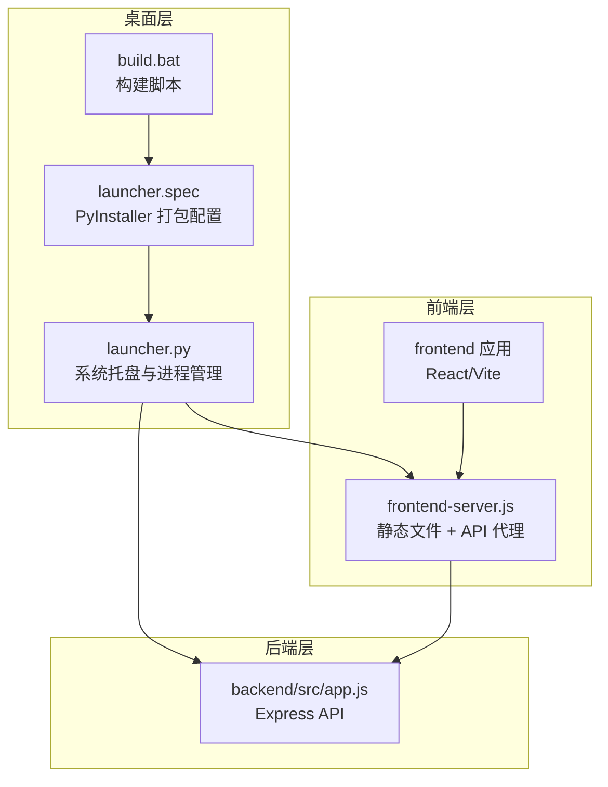
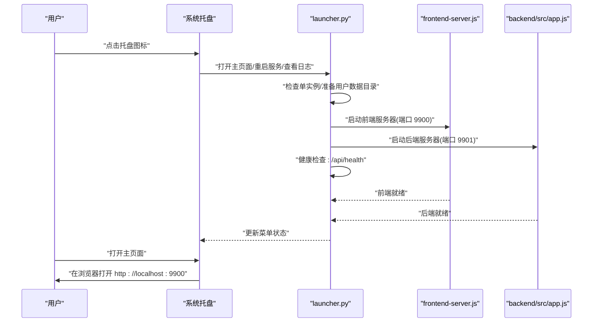
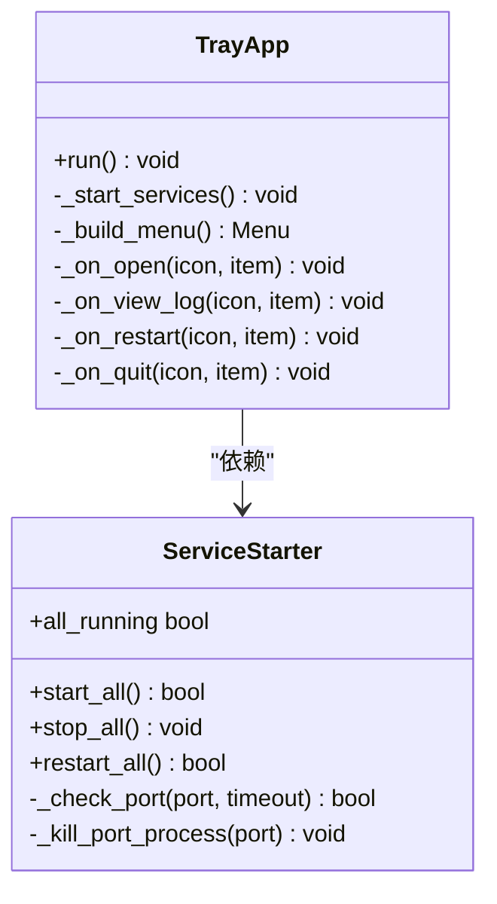
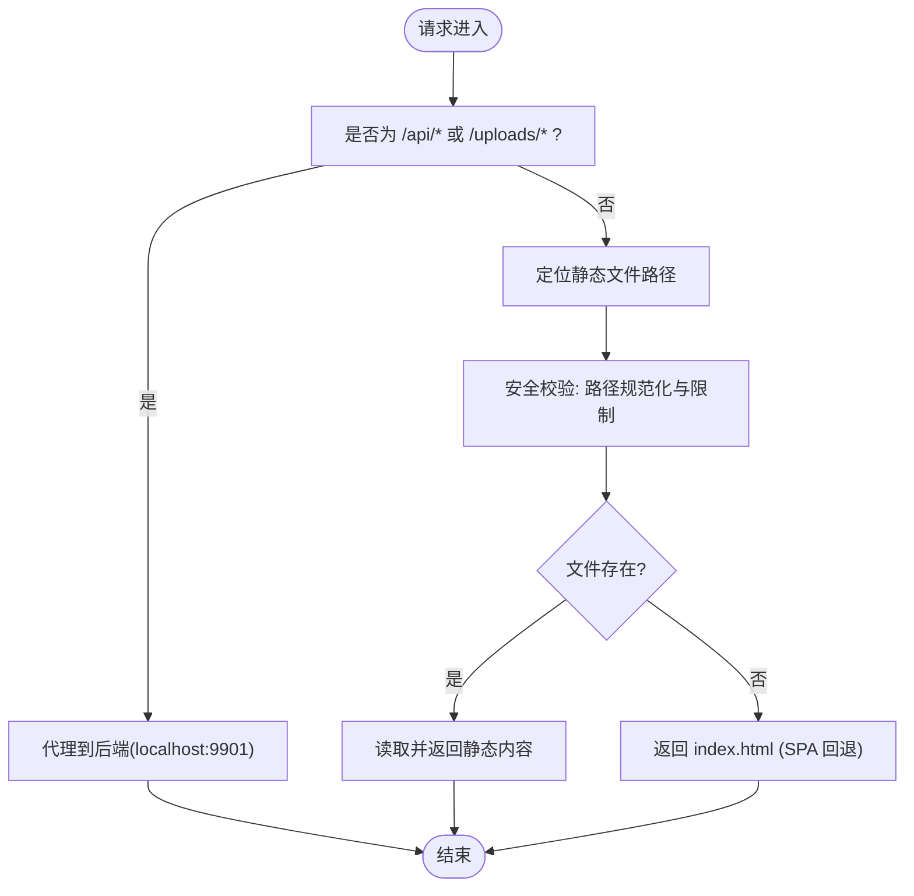
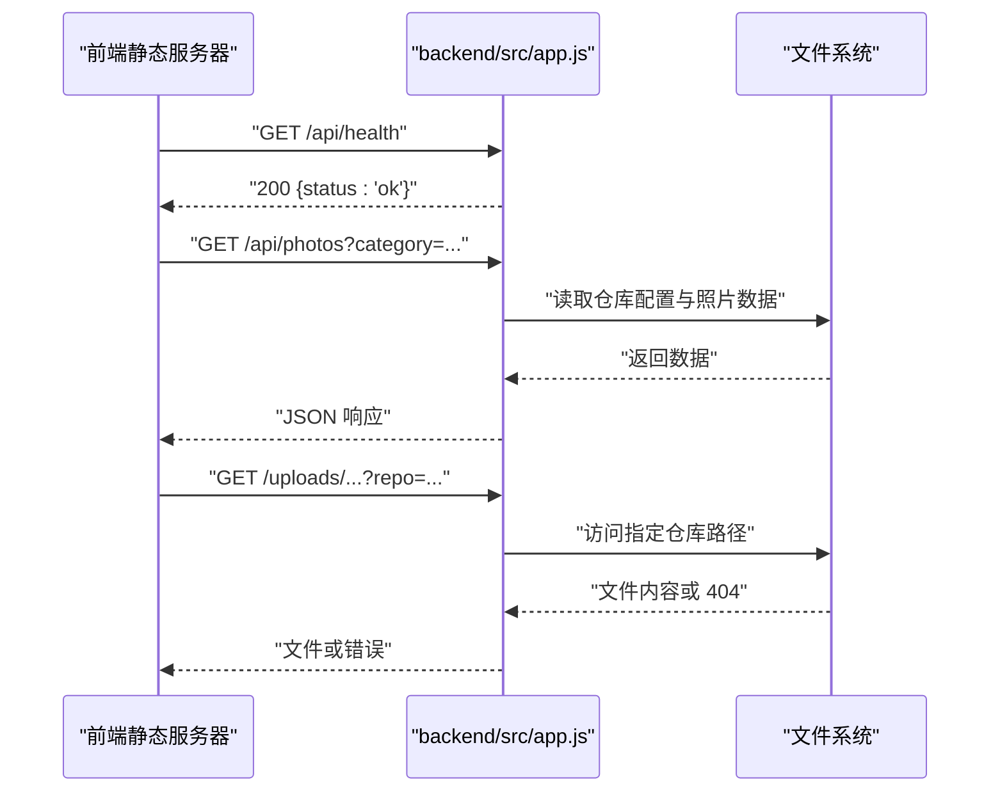
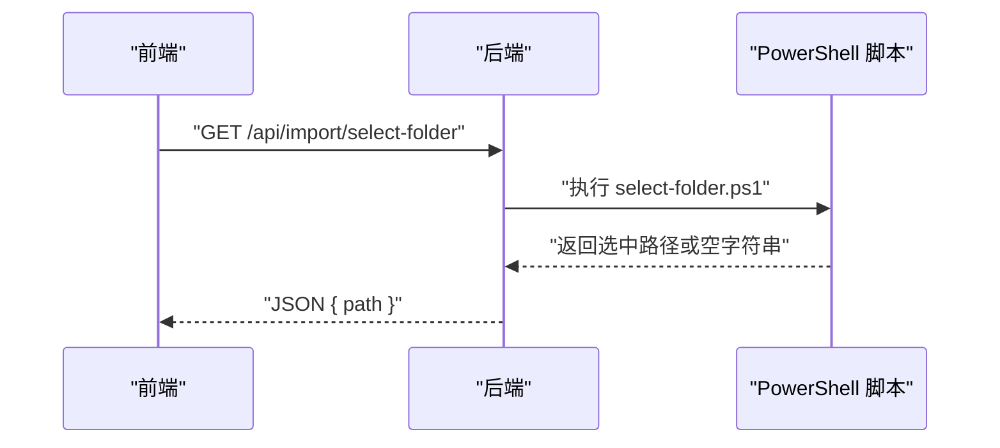
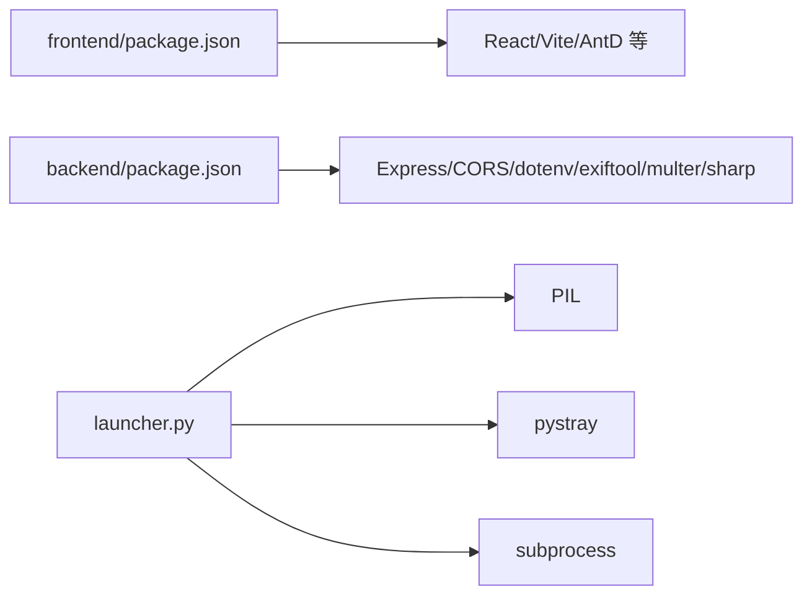

# Electron 集成

<cite>
**本文引用的文件**
- [launcher.spec](file://launcher.spec)
- [launcher.py](file://launcher.py)
- [frontend-server.js](file://frontend-server.js)
- [build.bat](file://build.bat)
- [CameraPhotoManager.spec](file://CameraPhotoManager.spec)
- [backend/src/app.js](file://backend/src/app.js)
- [backend/package.json](file://backend/package.json)
- [frontend/package.json](file://frontend/package.json)
- [backend/select-folder.ps1](file://backend/select-folder.ps1)
- [config/repos.json](file://config/repos.json)
- [config/repos.json.example](file://config/repos.json.example)
- [README.md](file://README.md)
- [frontend/src/main.jsx](file://frontend/src/main.jsx)
- [frontend/vite.config.js](file://frontend/vite.config.js)
- [frontend/src/api/index.js](file://frontend/src/api/index.js)
</cite>

## 目录
1. [引言](#引言)
2. [项目结构](#项目结构)
3. [核心组件](#核心组件)
4. [架构总览](#架构总览)
5. [详细组件分析](#详细组件分析)
6. [依赖分析](#依赖分析)
7. [性能考虑](#性能考虑)
8. [故障排查指南](#故障排查指南)
9. [结论](#结论)
10. [附录](#附录)

## 引言
本文件面向摄影管理项目的 Electron 集成架构，系统性阐述桌面启动器的设计与实现，包括：
- 启动器脚本 launcher.spec 与 launcher.py 的职责与工作流
- 前端服务器集成方案与代理机制
- 文件选择对话框的实现与跨平台兼容策略
- 资源文件管理、图标配置与应用元数据
- 打包配置与跨平台构建参数、签名与发布流程
- 调试技巧与性能优化建议

## 项目结构
该项目采用“Python 启动器 + Node.js 前后端 + React 前端”的混合架构。桌面应用通过 Python 启动器负责：
- 单实例保护
- 用户数据目录初始化
- Node.js 前后端服务的启动、健康检查与重启
- 系统托盘交互与日志输出
- 资源打包与图标配置

前端服务器以 Node.js 内置模块实现，提供静态文件服务与 API 代理；后端基于 Express，提供照片管理与导入相关的 API。

图表来源
- [launcher.py:487-513](file://launcher.py#L487-L513)
- [frontend-server.js:86-139](file://frontend-server.js#L86-L139)
- [backend/src/app.js:10-146](file://backend/src/app.js#L10-L146)
- [build.bat:1-43](file://build.bat#L1-L43)
- [launcher.spec:10-58](file://launcher.spec#L10-L58)

章节来源
- [README.md:188-206](file://README.md#L188-L206)
- [build.bat:1-43](file://build.bat#L1-L43)
- [launcher.spec:10-58](file://launcher.spec#L10-L58)

## 核心组件
- 桌面启动器与系统托盘
  - 单实例检测、用户数据目录初始化、Node.js 可用性验证、前后端服务启动与健康检查、托盘菜单与日志查看
- 前端静态服务器
  - 提供前端构建产物的静态服务，将 /api 与 /uploads 代理至后端，SPA 回退与安全校验
- 后端 API 服务
  - Express 应用，提供照片管理、导入进度推送、仓库配置与静态文件服务
- 构建与打包
  - PyInstaller 配置与构建脚本，打包前端、后端与资源文件，设置图标与隐藏导入

章节来源
- [launcher.py:23-37](file://launcher.py#L23-L37)
- [launcher.py:141-384](file://launcher.py#L141-L384)
- [frontend-server.js:46-122](file://frontend-server.js#L46-L122)
- [backend/src/app.js:10-146](file://backend/src/app.js#L10-L146)
- [launcher.spec:14-58](file://launcher.spec#L14-L58)

## 架构总览
下图展示桌面启动器如何协调前端静态服务器与后端 API 服务，并通过系统托盘提供用户交互入口。

图表来源
- [launcher.py:425-482](file://launcher.py#L425-L482)
- [frontend-server.js:135-139](file://frontend-server.js#L135-L139)
- [backend/src/app.js:119-121](file://backend/src/app.js#L119-L121)

## 详细组件分析

### 启动器与系统托盘（launcher.py）
- 单实例保护：使用命名互斥量在 Windows 上检测重复实例，避免重复启动
- 用户数据目录：按平台创建应用专属数据目录，初始化仓库配置文件
- Node.js 检测：优先使用 PATH 中的 node，否则尝试常见安装路径
- 服务启动与健康检查：并行启动前端与后端，通过 HTTP 请求轮询 /api/health 确认就绪
- 端口清理：Windows 下通过 netstat/taskkill 清理占用端口的旧进程
- 托盘菜单：提供打开主页面、查看日志、重启服务、退出等操作
- 日志：统一写入用户数据目录下的日志文件，支持立即刷新与控制台输出

图表来源
- [launcher.py:141-384](file://launcher.py#L141-L384)
- [launcher.py:406-482](file://launcher.py#L406-L482)

章节来源
- [launcher.py:23-37](file://launcher.py#L23-L37)
- [launcher.py:141-384](file://launcher.py#L141-L384)
- [launcher.py:406-482](file://launcher.py#L406-L482)

### 前端静态服务器（frontend-server.js）
- 静态文件服务：提供 frontend/dist 目录下的静态资源，内置 MIME 类型映射与缓存头
- API 代理：将 /api/* 与 /uploads/* 代理到后端（端口 9901），并设置 host 头
- SPA 回退：对不存在的静态文件返回 index.html，支持前端路由
- 安全校验：禁止目录穿越，确保请求路径位于前端目录内
- 端口占用处理：监听到端口被占用时输出错误并退出进程

图表来源
- [frontend-server.js:86-122](file://frontend-server.js#L86-L122)

章节来源
- [frontend-server.js:46-122](file://frontend-server.js#L46-L122)
- [frontend-server.js:124-139](file://frontend-server.js#L124-L139)

### 后端 API 服务（backend/src/app.js）
- 中间件与日志：CORS、JSON 解析、请求日志
- 数据目录：支持通过环境变量 DATA_DIR 指定用户数据目录，默认在 backend/data
- 动态静态文件服务：根据查询参数 repo 切换不同仓库路径，提供 /uploads/* 文件访问
- 路由：/api/photos 与 /api/import
- 健康检查：/api/health 返回服务状态
- 全局错误处理：未捕获异常与未处理 Promise 拒绝不导致进程退出

图表来源
- [frontend-server.js:91-94](file://frontend-server.js#L91-L94)
- [backend/src/app.js:119-121](file://backend/src/app.js#L119-L121)
- [backend/src/app.js:115-117](file://backend/src/app.js#L115-L117)
- [backend/src/app.js:68-91](file://backend/src/app.js#L68-L91)

章节来源
- [backend/src/app.js:10-146](file://backend/src/app.js#L10-L146)

### 文件选择对话框与跨平台兼容（PowerShell 脚本）
- Windows 文件夹选择：通过 PowerShell 调用 System.Windows.Forms.FolderBrowserDialog
- 输出约定：成功返回选中路径，取消返回空字符串
- 前端调用：前端通过 /api/import/select-folder 触发后端执行该脚本并返回结果

图表来源
- [frontend/src/api/index.js:163-165](file://frontend/src/api/index.js#L163-L165)
- [backend/select-folder.ps1:1-9](file://backend/select-folder.ps1#L1-L9)

章节来源
- [frontend/src/api/index.js:163-165](file://frontend/src/api/index.js#L163-L165)
- [backend/select-folder.ps1:1-9](file://backend/select-folder.ps1#L1-L9)

### 资源文件管理、图标配置与应用元数据
- 资源打包：PyInstaller spec 将前端构建产物、后端代码与资源文件打包到最终可执行文件
- 图标配置：指定应用图标路径，用于托盘与系统菜单栏显示
- 应用元数据：spec 中设置可执行文件名、UPX 压缩、隐藏导入等

章节来源
- [launcher.spec:14-58](file://launcher.spec#L14-L58)
- [CameraPhotoManager.spec:8-39](file://CameraPhotoManager.spec#L8-L39)

### 打包配置与发布流程
- 构建脚本 build.bat
  - 先构建前端（Vite）、再安装后端依赖、最后使用 PyInstaller 打包
  - 输出位于 dist/CameraPhotoManager.exe
- PyInstaller 配置 launcher.spec
  - datas 包含前端 dist、后端、前端服务器与图标
  - hiddenimports 包含 PIL、pystray 等依赖
  - console=False，静默启动，不显示控制台窗口
  - icon 指向 electron/assets/icon.png

章节来源
- [build.bat:1-43](file://build.bat#L1-L43)
- [launcher.spec:14-58](file://launcher.spec#L14-L58)
- [CameraPhotoManager.spec:8-39](file://CameraPhotoManager.spec#L8-L39)

## 依赖分析
- 前端开发依赖
  - React、Vite、Ant Design、Axios、React Router 等
- 后端运行依赖
  - Express、CORS、dotenv、exiftool-vendored、multer、sharp 等
- 桌面启动器依赖
  - PIL（图像处理）、pystray（系统托盘）、subprocess（进程管理）

图表来源
- [frontend/package.json:12-31](file://frontend/package.json#L12-L31)
- [backend/package.json:10-29](file://backend/package.json#L10-L29)
- [launcher.py:141-384](file://launcher.py#L141-L384)

章节来源
- [frontend/package.json:12-31](file://frontend/package.json#L12-L31)
- [backend/package.json:10-29](file://backend/package.json#L10-L29)

## 性能考虑
- 前端静态服务器
  - 对静态资源设置缓存头，减少带宽消耗
  - 代理仅针对 /api 与 /uploads，避免不必要的转发
- 后端 API
  - 使用 CORS 白名单与凭证支持，减少跨域错误重试
  - 全局错误处理避免异常导致服务崩溃
- 启动器
  - 并行启动前后端，缩短冷启动时间
  - 端口轮询与健康检查确保服务可用后再显示“运行中”
- 打包
  - UPX 压缩减小体积，隐藏导入减少运行时查找开销

章节来源
- [frontend-server.js:55-59](file://frontend-server.js#L55-L59)
- [backend/src/app.js:14-26](file://backend/src/app.js#L14-L26)
- [backend/src/app.js:134-143](file://backend/src/app.js#L134-L143)
- [launcher.py:200-353](file://launcher.py#L200-L353)
- [launcher.spec:48-58](file://launcher.spec#L48-L58)

## 故障排查指南
- 启动失败
  - 检查 Node.js 是否安装且可用
  - 查看用户数据目录下的 launcher.log、backend.log、frontend.log
  - 确认端口 9900/9901 未被占用，必要时清理旧进程
- 前端无法访问
  - 确认前端服务器已就绪并通过健康检查
  - 检查代理规则与 SPA 回退逻辑
- 后端 API 404/403
  - 检查仓库路径是否存在与可访问
  - 确认 /uploads/* 请求是否携带正确的 repo 查询参数
- 文件夹选择无效
  - 确认 Windows 环境下 PowerShell 可执行
  - 检查后端执行脚本的权限与输出

章节来源
- [launcher.py:205-244](file://launcher.py#L205-L244)
- [frontend-server.js:106-121](file://frontend-server.js#L106-L121)
- [backend/src/app.js:68-91](file://backend/src/app.js#L68-L91)
- [backend/select-folder.ps1:1-9](file://backend/select-folder.ps1#L1-L9)

## 结论
本项目通过 Python 启动器统一管理 Node.js 前后端服务，结合系统托盘提供简洁的用户交互；前端静态服务器与后端 API 通过明确的代理与路由边界实现清晰的数据流；PowerShell 脚本与跨平台路径处理保证了文件选择对话框的可用性。配合 PyInstaller 的资源打包与图标配置，形成可分发的桌面应用。

## 附录
- 配置文件
  - 仓库配置：config/repos.json 与 config/repos.json.example
- 开发与构建
  - 前端开发：Vite 热更新，代理至后端端口
  - 后端开发：Nodemon 自动重启
  - 打包：build.bat 统一构建流程

章节来源
- [config/repos.json:1-20](file://config/repos.json#L1-L20)
- [config/repos.json.example:1-17](file://config/repos.json.example#L1-L17)
- [frontend/vite.config.js:7-20](file://frontend/vite.config.js#L7-L20)
- [README.md:207-226](file://README.md#L207-L226)