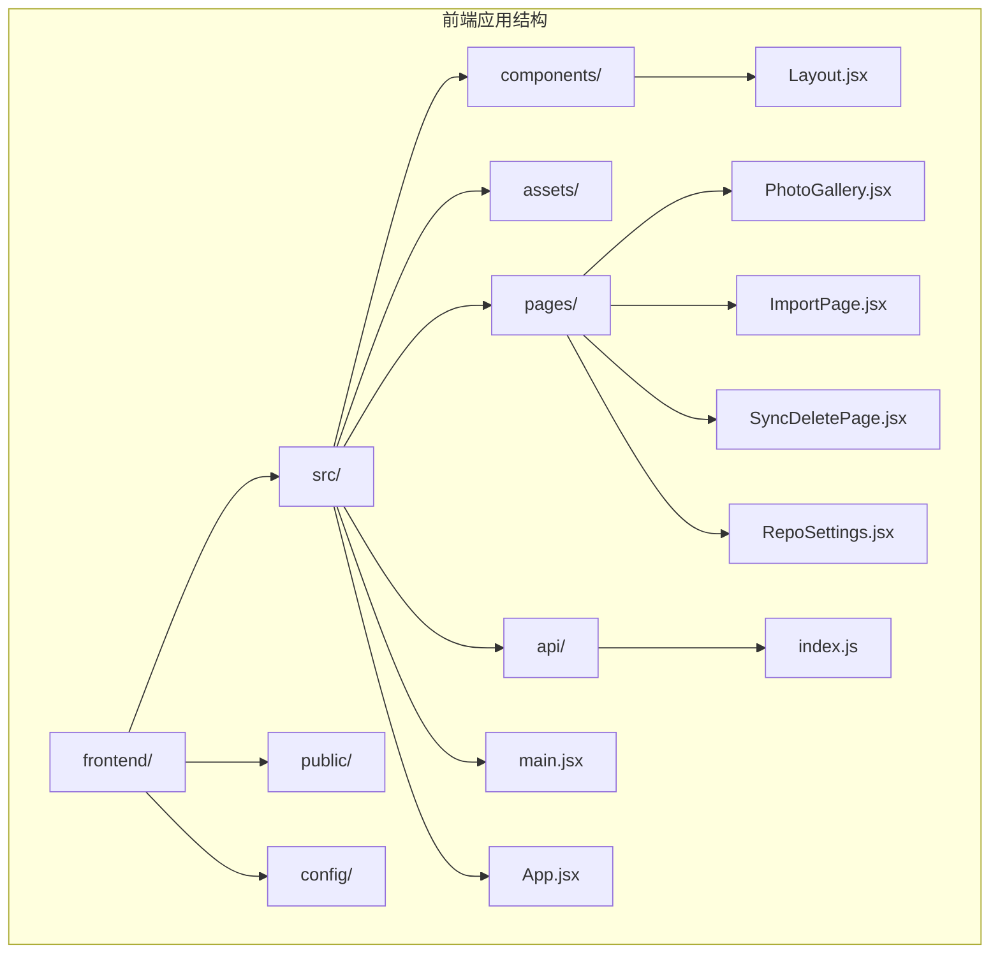
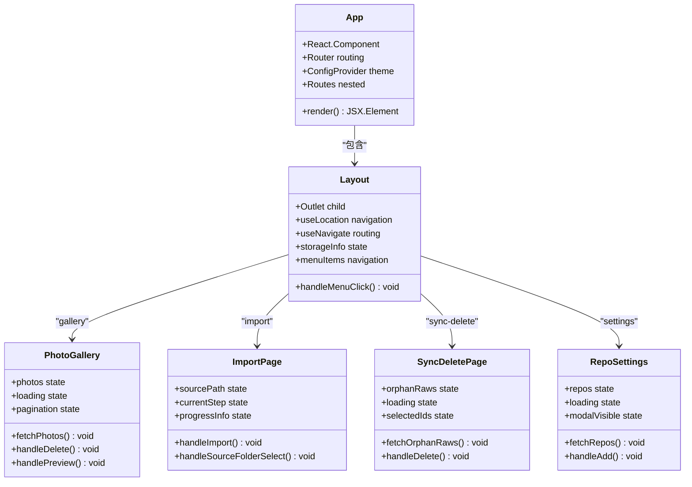
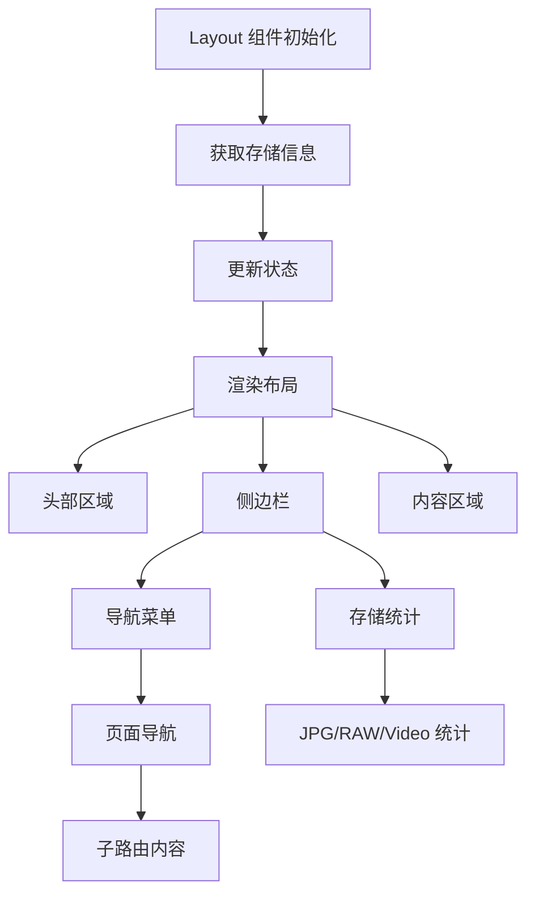
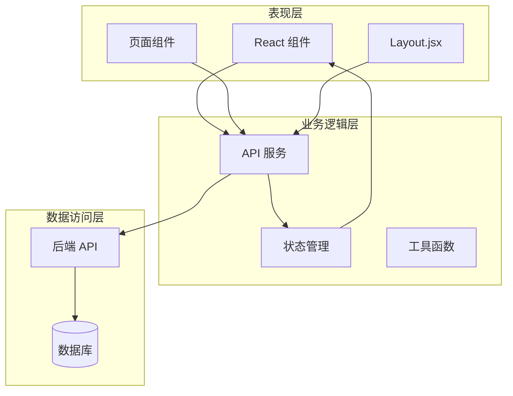
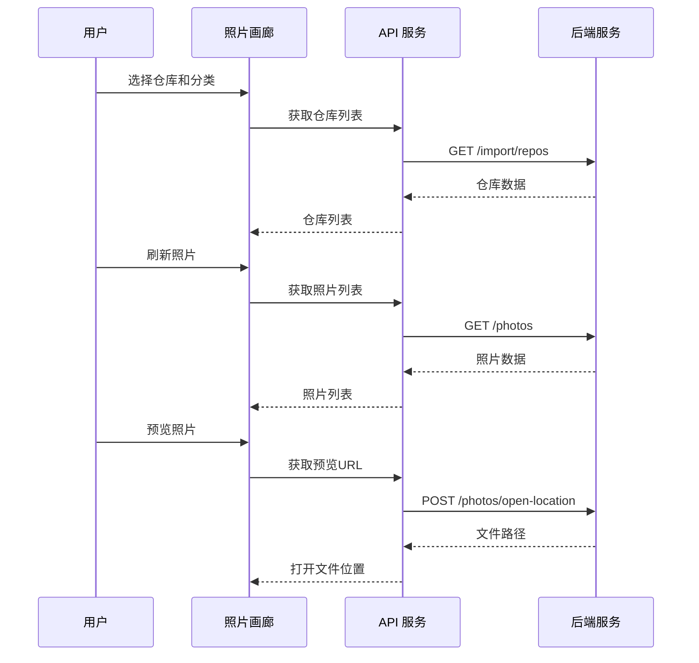
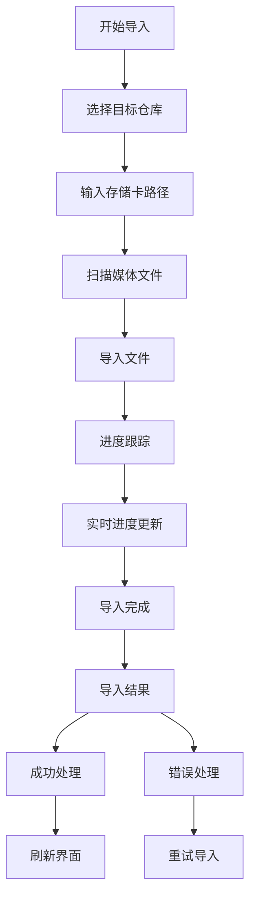
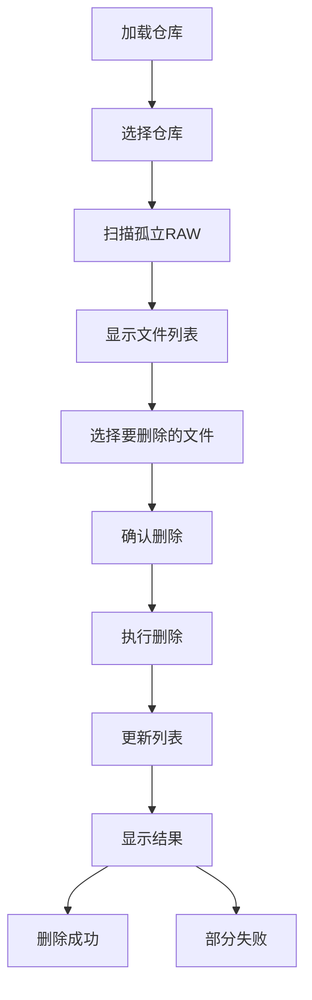
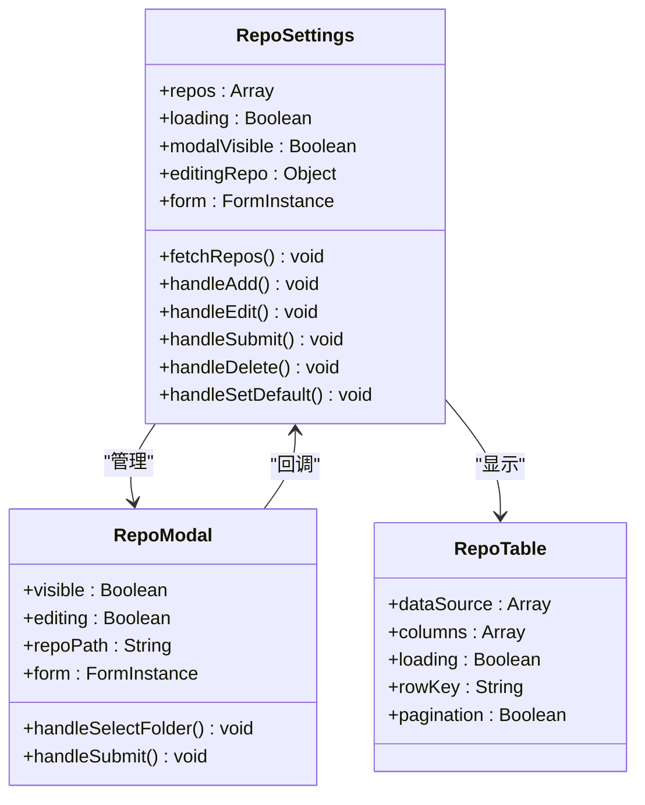

# 前端架构

<cite>
**本文档引用的文件**
- [frontend/src/App.jsx](file://frontend/src/App.jsx)
- [frontend/src/components/Layout.jsx](file://frontend/src/components/Layout.jsx)
- [frontend/src/pages/PhotoGallery.jsx](file://frontend/src/pages/PhotoGallery.jsx)
- [frontend/src/pages/ImportPage.jsx](file://frontend/src/pages/ImportPage.jsx)
- [frontend/src/pages/SyncDeletePage.jsx](file://frontend/src/pages/SyncDeletePage.jsx)
- [frontend/src/pages/RepoSettings.jsx](file://frontend/src/pages/RepoSettings.jsx)
- [frontend/src/api/index.js](file://frontend/src/api/index.js)
- [frontend/vite.config.js](file://frontend/vite.config.js)
- [frontend/package.json](file://frontend/package.json)
- [frontend/src/App.css](file://frontend/src/App.css)
- [frontend/src/index.css](file://frontend/src/index.css)
- [frontend/src/main.jsx](file://frontend/src/main.jsx)
- [frontend/README.md](file://frontend/README.md)
- [frontend/eslint.config.js](file://frontend/eslint.config.js)
</cite>

## 目录
1. [简介](#简介)
2. [项目结构](#项目结构)
3. [核心组件](#核心组件)
4. [架构概览](#架构概览)
5. [详细组件分析](#详细组件分析)
6. [依赖关系分析](#依赖关系分析)
7. [性能考虑](#性能考虑)
8. [故障排除指南](#故障排除指南)
9. [结论](#结论)

## 简介

这是一个基于 React 的摄影管理系统前端应用，采用现代化的前端技术栈构建。该应用提供了完整的照片管理功能，包括照片浏览、存储卡导入、RAW 文件同步删除和仓库配置管理。

应用采用模块化架构设计，使用 React Router 进行路由管理，Ant Design 作为 UI 组件库，Axios 进行 API 通信，并通过 Vite 进行构建和开发服务器配置。

## 项目结构

前端项目采用清晰的文件组织结构，按照功能模块进行分层：



**图表来源**
- [frontend/src/App.jsx:1-41](file://frontend/src/App.jsx#L1-L41)
- [frontend/src/main.jsx:1-11](file://frontend/src/main.jsx#L1-L11)

**章节来源**
- [frontend/src/App.jsx:1-41](file://frontend/src/App.jsx#L1-L41)
- [frontend/src/main.jsx:1-11](file://frontend/src/main.jsx#L1-L11)

## 核心组件

### 应用根组件 (App.jsx)

App.jsx 作为整个应用的根组件，负责全局路由配置和主题设置。它使用 React Router 进行路由管理，配置了嵌套路由结构，支持多页面导航。



**图表来源**
- [frontend/src/App.jsx:11-38](file://frontend/src/App.jsx#L11-L38)
- [frontend/src/components/Layout.jsx:15-157](file://frontend/src/components/Layout.jsx#L15-L157)

应用的主要特性包括：
- **主题配置**：使用 Ant Design 的 ConfigProvider 进行全局主题设置
- **路由管理**：通过 React Router 实现嵌套路由和页面导航
- **国际化支持**：配置中文本地化
- **响应式设计**：支持多种屏幕尺寸

**章节来源**
- [frontend/src/App.jsx:1-41](file://frontend/src/App.jsx#L1-L41)

### 布局组件 (Layout.jsx)

Layout.jsx 实现了应用的整体布局设计，采用 Ant Design 的 Layout 组件系统，提供了侧边导航菜单和主内容区域。



**图表来源**
- [frontend/src/components/Layout.jsx:15-157](file://frontend/src/components/Layout.jsx#L15-L157)

布局组件的关键功能：
- **导航菜单**：提供照片浏览、存储卡导入、同步删除RAW、仓库配置等功能入口
- **存储统计**：实时显示各类文件的数量和大小统计
- **响应式布局**：适配不同屏幕尺寸的设备

**章节来源**
- [frontend/src/components/Layout.jsx:1-160](file://frontend/src/components/Layout.jsx#L1-L160)

## 架构概览

应用采用分层架构设计，清晰分离了表现层、业务逻辑层和数据访问层：



**图表来源**
- [frontend/src/api/index.js:1-168](file://frontend/src/api/index.js#L1-L168)
- [frontend/src/App.jsx:1-41](file://frontend/src/App.jsx#L1-L41)

## 详细组件分析

### 照片画廊组件 (PhotoGallery.jsx)

PhotoGallery 是应用的核心功能组件，提供了完整的照片浏览、管理和操作功能。



**图表来源**
- [frontend/src/pages/PhotoGallery.jsx:84-135](file://frontend/src/pages/PhotoGallery.jsx#L84-L135)
- [frontend/src/api/index.js:9-34](file://frontend/src/api/index.js#L9-L34)

主要功能特性：
- **多仓库支持**：支持多个存储仓库的切换和管理
- **分页加载**：实现大容量照片的分页浏览
- **批量操作**：支持批量导出和批量删除功能
- **预览功能**：提供照片预览和跨页翻页功能
- **搜索过滤**：支持按类型、排序方式等条件筛选

**章节来源**
- [frontend/src/pages/PhotoGallery.jsx:1-944](file://frontend/src/pages/PhotoGallery.jsx#L1-L944)

### 存储卡导入组件 (ImportPage.jsx)

ImportPage 实现了从存储卡导入照片的完整流程，包括进度跟踪和错误处理。



**图表来源**
- [frontend/src/pages/ImportPage.jsx:212-260](file://frontend/src/pages/ImportPage.jsx#L212-L260)

导入流程的关键特性：
- **SSE 实时进度**：使用 Server-Sent Events 实时跟踪导入进度
- **增量导入**：避免覆盖已存在的文件
- **自动重命名**：防止同名文件冲突
- **详细日志**：记录跳过和错误的文件信息

**章节来源**
- [frontend/src/pages/ImportPage.jsx:1-820](file://frontend/src/pages/ImportPage.jsx#L1-L820)

### 同步删除组件 (SyncDeletePage.jsx)

SyncDeletePage 提供了删除孤立 RAW 文件的功能，帮助用户清理不再需要的底片文件。



**图表来源**
- [frontend/src/pages/SyncDeletePage.jsx:73-90](file://frontend/src/pages/SyncDeletePage.jsx#L73-L90)

删除功能的特点：
- **孤立文件检测**：自动识别没有对应 JPG 文件的 RAW 文件
- **批量删除**：支持一次删除多个文件
- **安全确认**：删除前进行二次确认
- **结果反馈**：显示删除成功和失败的具体情况

**章节来源**
- [frontend/src/pages/SyncDeletePage.jsx:1-384](file://frontend/src/pages/SyncDeletePage.jsx#L1-L384)

### 仓库设置组件 (RepoSettings.jsx)

RepoSettings 提供了存储仓库的完整管理功能。



**图表来源**
- [frontend/src/pages/RepoSettings.jsx:29-144](file://frontend/src/pages/RepoSettings.jsx#L29-L144)

仓库管理功能：
- **多仓库支持**：支持创建和管理多个存储仓库
- **默认仓库**：设置和切换默认仓库
- **路径管理**：通过系统对话框选择仓库路径
- **表单验证**：完整的表单验证和错误处理

**章节来源**
- [frontend/src/pages/RepoSettings.jsx:1-341](file://frontend/src/pages/RepoSettings.jsx#L1-L341)

## 依赖关系分析

前端应用的依赖关系清晰明确，采用了模块化的依赖管理策略：

```mermaid
graph TB
subgraph "核心依赖"
React[react ^19.2.4]
ReactDOM[react-dom ^19.2.4]
Router[react-router-dom ^7.14.1]
Antd[antd ^6.3.5]
Axios[axios ^1.15.0]
end
subgraph "开发依赖"
Vite[vite ^8.0.4]
ReactPlugin[@vitejs/plugin-react ^6.0.1]
ESLint[eslint ^9.39.4]
Typescript[@types/react ^19.2.14]
end
subgraph "UI 组件"
PhotoView[react-photo-view ^1.2.7]
Icons[@ant-design/icons ^6.1.1]
end
App --> React
App --> Router
App --> Antd
App --> Axios
PhotoGallery --> PhotoView
ImportPage --> Icons
Layout --> Icons
Vite --> ReactPlugin
ESLint --> Typescript
```

**图表来源**
- [frontend/package.json:12-30](file://frontend/package.json#L12-L30)

**章节来源**
- [frontend/package.json:1-33](file://frontend/package.json#L1-L33)

## 性能考虑

应用在性能方面采用了多项优化策略：

### 构建优化
- **Vite 构建**：使用 Vite 进行快速构建和开发服务器启动
- **按需加载**：组件按需加载，减少初始包体积
- **代码分割**：路由级别的代码分割，提高加载速度

### 运行时优化
- **虚拟滚动**：大量照片时使用虚拟滚动技术
- **防抖处理**：输入和搜索操作使用防抖优化
- **缓存策略**：合理使用浏览器缓存和组件缓存

### 网络优化
- **SSE 进度**：使用 Server-Sent Events 实现实时进度更新
- **超时控制**：API 请求设置合理的超时时间
- **错误重试**：网络异常时提供重试机制

**章节来源**
- [frontend/vite.config.js:1-21](file://frontend/vite.config.js#L1-L21)
- [frontend/src/api/index.js:3-6](file://frontend/src/api/index.js#L3-L6)

## 故障排除指南

### 常见问题及解决方案

#### API 连接问题
- **问题**：无法连接到后端 API
- **原因**：代理配置或后端服务未启动
- **解决**：检查 Vite 配置中的代理设置和后端服务状态

#### 照片加载失败
- **问题**：照片缩略图无法加载
- **原因**：文件路径错误或权限问题
- **解决**：检查文件系统权限和路径配置

#### 导入进度异常
- **问题**：导入进度停滞
- **原因**：网络中断或文件过大
- **解决**：检查网络连接，考虑分批导入

#### 存储卡导入失败
- **问题**：存储卡路径无效
- **原因**：路径不存在或权限不足
- **解决**：使用系统对话框选择有效路径

**章节来源**
- [frontend/src/api/index.js:38-141](file://frontend/src/api/index.js#L38-L141)
- [frontend/vite.config.js:7-18](file://frontend/vite.config.js#L7-L18)

## 结论

这个摄影管理系统的前端架构展现了现代 React 应用的最佳实践。通过清晰的组件分层、合理的状态管理和高效的 API 交互，实现了功能完整且用户体验优秀的照片管理应用。

主要优势包括：
- **模块化设计**：清晰的文件组织和组件职责分离
- **响应式布局**：良好的移动端适配和用户体验
- **性能优化**：多项性能优化策略确保流畅体验
- **错误处理**：完善的错误处理和用户反馈机制

未来可以考虑的改进方向：
- **状态管理**：引入更复杂的状态管理方案（如 Redux）
- **测试覆盖**：增加单元测试和集成测试
- **国际化**：扩展多语言支持
- **PWA 功能**：添加离线支持和应用安装能力