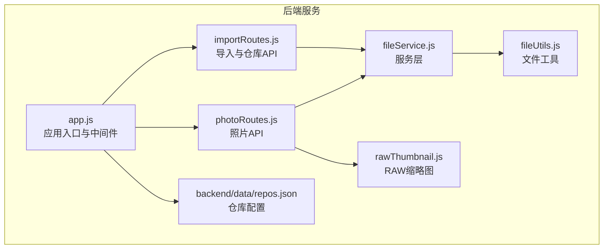
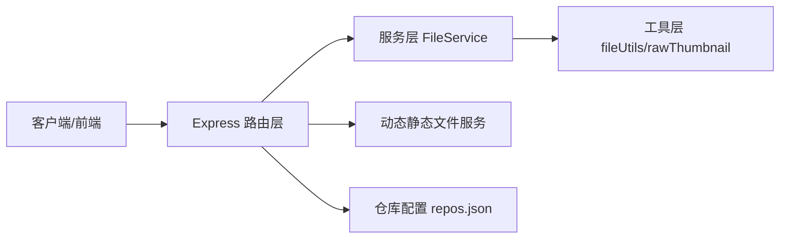
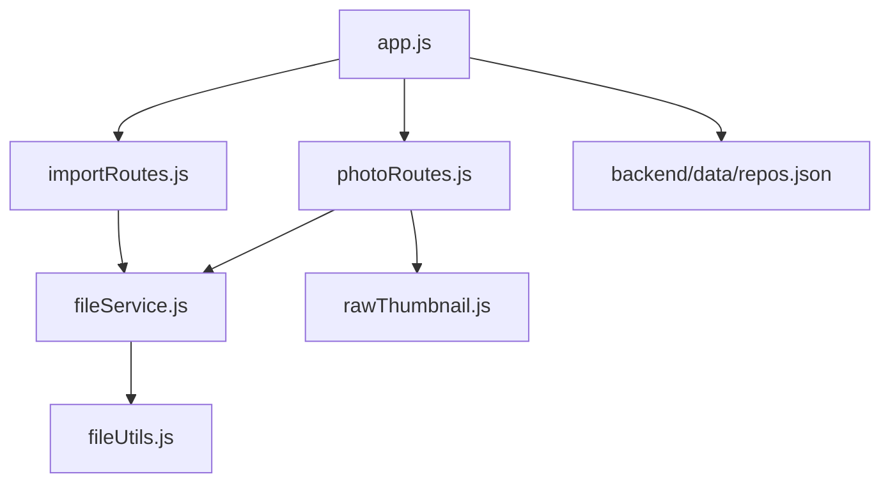

# 后端架构

<cite>
**本文引用的文件**
- [backend/src/app.js](file://backend/src/app.js)
- [backend/src/routes/photoRoutes.js](file://backend/src/routes/photoRoutes.js)
- [backend/src/routes/importRoutes.js](file://backend/src/routes/importRoutes.js)
- [backend/src/services/fileService.js](file://backend/src/services/fileService.js)
- [backend/src/utils/fileUtils.js](file://backend/src/utils/fileUtils.js)
- [backend/src/utils/rawThumbnail.js](file://backend/src/utils/rawThumbnail.js)
- [backend/data/repos.json](file://backend/data/repos.json)
- [backend/package.json](file://backend/package.json)
- [README.md](file://README.md)
</cite>

## 目录
1. [引言](#引言)
2. [项目结构](#项目结构)
3. [核心组件](#核心组件)
4. [架构总览](#架构总览)
5. [详细组件分析](#详细组件分析)
6. [依赖关系分析](#依赖关系分析)
7. [性能考量](#性能考量)
8. [故障排查指南](#故障排查指南)
9. [结论](#结论)
10. [附录](#附录)

## 引言
本文件面向摄影管理项目的后端架构，围绕基于 Express.js 的 Node.js 服务进行系统化说明。重点涵盖：
- 中间件配置、路由设计与错误处理机制
- MVC 架构模式在后端的实现（photoRoutes 与 importRoutes 对应不同业务模块）
- 服务层 fileService 的设计（文件操作封装、业务逻辑抽象、数据访问模式）
- CORS 配置、静态文件服务与跨平台路径处理策略
- 仓库配置管理（repos.json 的读写与动态路径解析）
- API 设计原则（RESTful 路由规范、HTTP 状态码使用、错误响应格式）
- 性能优化建议与安全注意事项

## 项目结构
后端采用按职责分层的组织方式：
- 应用入口与中间件：app.js
- 路由层：photoRoutes.js（照片浏览/预览/管理）、importRoutes.js（导入/仓库管理）
- 服务层：fileService.js（核心业务逻辑）
- 工具层：fileUtils.js（文件扫描、复制、删除、重命名等）、rawThumbnail.js（RAW 缩略图生成）
- 数据与配置：backend/data/repos.json（运行时仓库配置）

图表来源
- [backend/src/app.js:1-146](file://backend/src/app.js#L1-L146)
- [backend/src/routes/photoRoutes.js:1-739](file://backend/src/routes/photoRoutes.js#L1-L739)
- [backend/src/routes/importRoutes.js:1-627](file://backend/src/routes/importRoutes.js#L1-L627)
- [backend/src/services/fileService.js:1-443](file://backend/src/services/fileService.js#L1-L443)
- [backend/src/utils/fileUtils.js:1-167](file://backend/src/utils/fileUtils.js#L1-L167)
- [backend/src/utils/rawThumbnail.js:1-132](file://backend/src/utils/rawThumbnail.js#L1-L132)
- [backend/data/repos.json:1-8](file://backend/data/repos.json#L1-L8)

章节来源
- [backend/src/app.js:1-146](file://backend/src/app.js#L1-L146)
- [backend/src/routes/photoRoutes.js:1-739](file://backend/src/routes/photoRoutes.js#L1-L739)
- [backend/src/routes/importRoutes.js:1-627](file://backend/src/routes/importRoutes.js#L1-L627)
- [backend/src/services/fileService.js:1-443](file://backend/src/services/fileService.js#L1-L443)
- [backend/src/utils/fileUtils.js:1-167](file://backend/src/utils/fileUtils.js#L1-L167)
- [backend/src/utils/rawThumbnail.js:1-132](file://backend/src/utils/rawThumbnail.js#L1-L132)
- [backend/data/repos.json:1-8](file://backend/data/repos.json#L1-L8)

## 核心组件
- 应用入口与中间件：负责 CORS、JSON 解析、请求日志、健康检查、全局错误处理、动态静态文件服务与仓库配置读取。
- 路由层：
  - photoRoutes：照片浏览、存储信息、孤立 RAW 查询、删除、批量删除 RAW、预览（URL 参数与 base64 ID 两种）、缩略图（含 RAW 嵌入预览与 fallback）、打开文件位置、批量导出。
  - importRoutes：SSE 导入进度推送、默认导入路径、仓库 CRUD、跨平台文件夹选择对话框。
- 服务层：FileService 封装导入、扫描、排序分页、删除、统计、RAW 孤儿查找、批量删除等。
- 工具层：fileUtils 提供扫描、复制（增量）、删除、重命名、比较等；rawThumbnail 提供 RAW 嵌入预览提取与降级策略。
- 配置：backend/data/repos.json 作为运行时仓库配置文件，支持默认仓库与 AUTO 路径解析。

章节来源
- [backend/src/app.js:1-146](file://backend/src/app.js#L1-L146)
- [backend/src/routes/photoRoutes.js:1-739](file://backend/src/routes/photoRoutes.js#L1-L739)
- [backend/src/routes/importRoutes.js:1-627](file://backend/src/routes/importRoutes.js#L1-L627)
- [backend/src/services/fileService.js:1-443](file://backend/src/services/fileService.js#L1-L443)
- [backend/src/utils/fileUtils.js:1-167](file://backend/src/utils/fileUtils.js#L1-L167)
- [backend/src/utils/rawThumbnail.js:1-132](file://backend/src/utils/rawThumbnail.js#L1-L132)
- [backend/data/repos.json:1-8](file://backend/data/repos.json#L1-L8)

## 架构总览
后端采用典型的 MVC 模式：
- Model：仓库配置（repos.json）与文件系统
- View：由前端渲染（后端提供 API），后端在 photoRoutes 中通过缩略图/预览接口生成响应
- Controller：Express 路由层（photoRoutes、importRoutes）作为控制器，调用服务层与工具层

图表来源
- [backend/src/app.js:1-146](file://backend/src/app.js#L1-L146)
- [backend/src/routes/photoRoutes.js:1-739](file://backend/src/routes/photoRoutes.js#L1-L739)
- [backend/src/routes/importRoutes.js:1-627](file://backend/src/routes/importRoutes.js#L1-L627)
- [backend/src/services/fileService.js:1-443](file://backend/src/services/fileService.js#L1-L443)
- [backend/src/utils/fileUtils.js:1-167](file://backend/src/utils/fileUtils.js#L1-L167)
- [backend/src/utils/rawThumbnail.js:1-132](file://backend/src/utils/rawThumbnail.js#L1-L132)
- [backend/data/repos.json:1-8](file://backend/data/repos.json#L1-L8)

## 详细组件分析

### 应用入口与中间件（app.js）
- CORS：允许任意来源、凭证、常见方法，满足前后端联调需求。
- 中间件链：CORS → JSON/URL 编码解析 → 请求日志 → 动态静态文件服务 → 路由 → 健康检查 → 全局错误处理。
- 动态静态文件服务：根据查询参数 repo 选择仓库路径，校验路径存在性后通过 express.static 提供文件服务。
- 仓库配置：DATA_DIR 可通过环境变量覆盖，默认指向 backend/data；repos.json 读取失败时按平台推断默认路径并返回默认仓库。
- 全局错误处理：统一 500 响应；进程级未捕获异常与未处理 Promise 拒绝记录日志，避免服务崩溃。

章节来源
- [backend/src/app.js:1-146](file://backend/src/app.js#L1-L146)

### 路由层：photoRoutes（照片模块）
- 路由前缀：/api/photos
- 核心能力：
  - 列表：分页、排序（名称/大小/修改时间）、仓库选择、返回缩略图与预览链接。
  - 存储信息：统计各分类文件数量与总大小。
  - 孤立 RAW：查找无对应 JPG 的 RAW 文件。
  - 删除：支持同步删除 RAW（JPG 删除时）。
  - 批量删除 RAW：按文件 ID 列表删除。
  - 预览：支持 Range 请求（视频流式播放），非视频完整流式传输。
  - 缩略图：RAW 嵌入预览优先，否则 sharp 解码，失败则返回占位图；视频首帧提取。
  - 打开位置：跨平台打开文件或文件夹。
  - 批量导出：增量模式（已存在跳过），返回成功/失败/跳过统计。
- 错误处理：统一包装 success/error 字段，状态码遵循语义化。

章节来源
- [backend/src/routes/photoRoutes.js:1-739](file://backend/src/routes/photoRoutes.js#L1-L739)

### 路由层：importRoutes（导入与仓库模块）
- 路由前缀：/api/import
- 核心能力：
  - SSE 导入：GET 接口，实时推送进度（总文件数、已处理、剩余、估计剩余时间、当前文件、百分比），支持错误与完成事件。
  - 默认导入路径：按平台返回默认路径。
  - 仓库管理：查询、新增、删除、设置默认。
  - 跨平台文件夹选择：macOS（osascript）、Windows（PowerShell）、Linux（zenity），带超时与取消处理。
- 错误处理：SSE 与 JSON 统一错误格式。

章节来源
- [backend/src/routes/importRoutes.js:1-627](file://backend/src/routes/importRoutes.js#L1-L627)

### 服务层：FileService
- 职责：封装导入、扫描、排序分页、删除、统计、RAW 孤儿查找、批量删除等。
- 关键流程：
  - importFromCard：扫描源目录，初始化分类目录，按类型分类复制，使用并发队列限制避免内存溢出，回调进度。
  - getPhotos：扫描分类目录，过滤当前类型，映射为标准化对象，支持排序与分页。
  - deletePhoto：删除主文件，若为 JPG 且开启同步删除则删除对应 RAW。
  - findOrphanRawFiles：对比 JPG 名称集合，找出无对应 JPG 的 RAW。
  - deleteRawFiles/batchDeleteRaws：批量删除 RAW。
  - getStorageInfo：统计各分类数量与总大小。
- 并发控制：导入时限制并发数，避免大文件导入导致内存压力。

章节来源
- [backend/src/services/fileService.js:1-443](file://backend/src/services/fileService.js#L1-L443)

### 工具层：fileUtils
- 文件类型识别：支持 JPG、RAW、视频扩展名映射。
- 目录扫描：递归遍历，跳过隐藏文件，收集文件元信息（大小、修改时间、相对路径）。
- 复制策略：增量导入，不覆盖相同文件（通过文件大小与修改时间比较）。
- 删除、存在性检查、文件名处理、重命名策略（将路径层级编码到文件名）。

章节来源
- [backend/src/utils/fileUtils.js:1-167](file://backend/src/utils/fileUtils.js#L1-L167)

### 工具层：rawThumbnail（RAW 缩略图）
- 三级降级策略：
  1) 从 RAW 提取嵌入预览（JpgFromRaw/PreviewImage/ThumbnailImage 等标签），验证为有效 JPEG 后调整尺寸；
  2) 使用 sharp 直接解码 RAW；
  3) 返回 null，由调用方生成占位图。
- 使用 exiftool-vendored 的 Node.js API，避免命令行开销与跨平台差异。

章节来源
- [backend/src/utils/rawThumbnail.js:1-132](file://backend/src/utils/rawThumbnail.js#L1-L132)

### 仓库配置管理（repos.json）
- 读写：app.js 与 importRoutes 均读取 backend/data/repos.json；importRoutes 支持新增/删除/设置默认仓库，并保证默认唯一。
- 动态路径解析：支持 AUTO 关键字，回退到平台默认照片目录；可通过环境变量 PHOTO_BASE_PATH 覆盖默认路径。
- 默认行为：当读取失败时，按平台推断默认路径并返回默认仓库。

章节来源
- [backend/src/app.js:38-65](file://backend/src/app.js#L38-L65)
- [backend/src/routes/importRoutes.js:23-53](file://backend/src/routes/importRoutes.js#L23-L53)
- [backend/data/repos.json:1-8](file://backend/data/repos.json#L1-L8)

### API 设计原则
- RESTful 路由规范：
  - 资源命名：/api/photos、/api/import
  - 动作映射：GET/POST/PUT/DELETE 对应查询、创建、更新、删除
- HTTP 状态码使用：
  - 200：成功
  - 400：参数缺失或非法
  - 404：资源不存在
  - 500：服务器内部错误
- 错误响应格式：
  - 统一字段：success（布尔）、error（字符串）
  - SSE 场景：type: progress/complete/error

章节来源
- [backend/src/routes/photoRoutes.js:68-176](file://backend/src/routes/photoRoutes.js#L68-L176)
- [backend/src/routes/importRoutes.js:82-182](file://backend/src/routes/importRoutes.js#L82-L182)

### CORS 配置与静态文件服务
- CORS：origin 允许任意来源，credentials 允许携带凭证，支持常见方法。
- 动态静态文件服务：根据 repo 查询参数选择仓库路径，校验路径存在性后通过 express.static 提供文件服务；不存在时返回 404。

章节来源
- [backend/src/app.js:14-18](file://backend/src/app.js#L14-L18)
- [backend/src/app.js:67-91](file://backend/src/app.js#L67-L91)

### 跨平台路径处理策略
- 默认路径：按平台自动选择用户图片目录（Windows/macOS/Linux），可由 PHOTO_BASE_PATH 覆盖。
- 文件夹选择：macOS（osascript）、Windows（PowerShell）、Linux（zenity），带超时与取消处理。
- RAW 缩略图：使用 exiftool-vendored 的 Node.js API，自动处理跨平台差异。

章节来源
- [backend/src/app.js:94-112](file://backend/src/app.js#L94-L112)
- [backend/src/routes/importRoutes.js:343-624](file://backend/src/routes/importRoutes.js#L343-L624)
- [backend/src/utils/rawThumbnail.js:1-132](file://backend/src/utils/rawThumbnail.js#L1-L132)

## 依赖关系分析

图表来源
- [backend/src/routes/photoRoutes.js:1-739](file://backend/src/routes/photoRoutes.js#L1-L739)
- [backend/src/routes/importRoutes.js:1-627](file://backend/src/routes/importRoutes.js#L1-L627)
- [backend/src/services/fileService.js:1-443](file://backend/src/services/fileService.js#L1-L443)
- [backend/src/utils/fileUtils.js:1-167](file://backend/src/utils/fileUtils.js#L1-L167)
- [backend/src/utils/rawThumbnail.js:1-132](file://backend/src/utils/rawThumbnail.js#L1-L132)
- [backend/src/app.js:1-146](file://backend/src/app.js#L1-L146)
- [backend/data/repos.json:1-8](file://backend/data/repos.json#L1-L8)

章节来源
- [backend/src/app.js:1-146](file://backend/src/app.js#L1-L146)
- [backend/src/routes/photoRoutes.js:1-739](file://backend/src/routes/photoRoutes.js#L1-L739)
- [backend/src/routes/importRoutes.js:1-627](file://backend/src/routes/importRoutes.js#L1-L627)
- [backend/src/services/fileService.js:1-443](file://backend/src/services/fileService.js#L1-L443)
- [backend/src/utils/fileUtils.js:1-167](file://backend/src/utils/fileUtils.js#L1-L167)
- [backend/src/utils/rawThumbnail.js:1-132](file://backend/src/utils/rawThumbnail.js#L1-L132)
- [backend/data/repos.json:1-8](file://backend/data/repos.json#L1-L8)

## 性能考量
- 导入并发控制：FileService 在导入时限制并发数，避免内存峰值与磁盘争用。
- 流式传输：预览与缩略图生成优先使用流式传输，避免一次性加载大文件到内存。
- 缓存控制：缩略图与预览设置 Cache-Control，提升重复访问性能。
- SSE 进度：导入进度通过 SSE 推送，前端可及时感知进度，避免轮询开销。
- 跨平台优化：rawThumbnail 使用 exiftool-vendored 的 Node.js API，避免命令行进程开销。

章节来源
- [backend/src/services/fileService.js:75-167](file://backend/src/services/fileService.js#L75-L167)
- [backend/src/routes/photoRoutes.js:226-280](file://backend/src/routes/photoRoutes.js#L226-L280)
- [backend/src/routes/photoRoutes.js:294-466](file://backend/src/routes/photoRoutes.js#L294-L466)
- [backend/src/utils/rawThumbnail.js:1-132](file://backend/src/utils/rawThumbnail.js#L1-L132)

## 故障排查指南
- CORS 错误：检查后端 CORS 配置与来源白名单。
- 静态文件路径不存在：确认仓库路径存在且可访问，或检查 repoId 与 AUTO 解析。
- RAW 缩略图不显示：确认 RAW 包含嵌入预览，检查 exiftool-vendored 是否正确安装，查看后端日志。
- 导入进度不更新：检查浏览器控制台与后端日志，确认 SSE 连接与超时设置。
- 未捕获异常：后端已记录日志并保持服务运行，检查日志定位问题。

章节来源
- [backend/src/app.js:133-143](file://backend/src/app.js#L133-L143)
- [README.md:166-187](file://README.md#L166-L187)

## 结论
该后端架构清晰地实现了 MVC 分层，路由层专注于 API 行为，服务层封装核心业务，工具层提供可复用的文件操作与 RAW 缩略图生成能力。通过动态静态文件服务、CORS 配置与跨平台路径处理，满足多平台部署与多仓库管理需求。SSE 进度推送与流式传输提升了用户体验与性能。建议持续关注导入并发与缓存策略，确保大规模数据场景下的稳定性与性能。

## 附录
- 依赖清单：express、cors、dotenv、exiftool-vendored、sharp、multer、dialog 等。
- 启动方式：npm scripts 提供 start/dev，支持热更新与监听重启。

章节来源
- [backend/package.json:10-21](file://backend/package.json#L10-L21)
- [README.md:44-105](file://README.md#L44-L105)