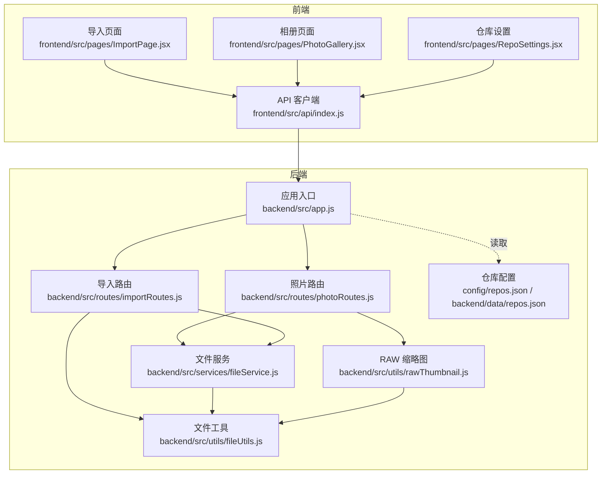
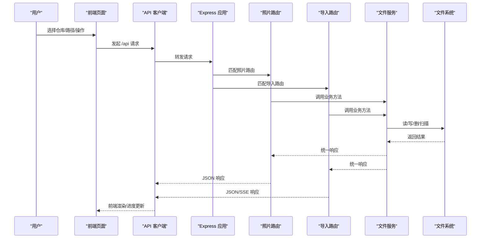
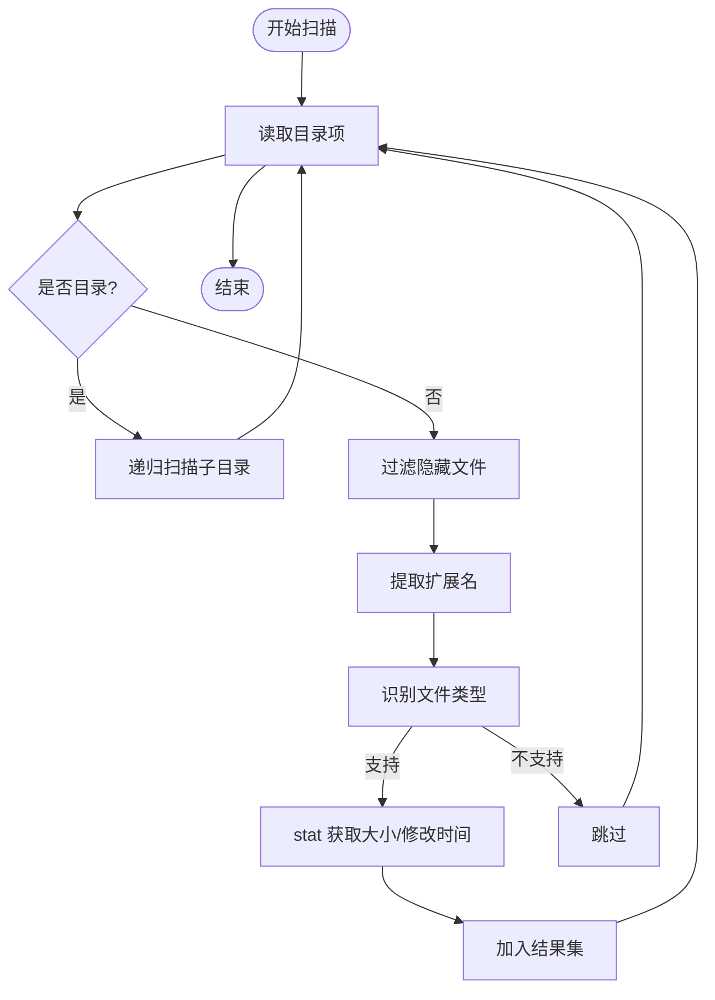
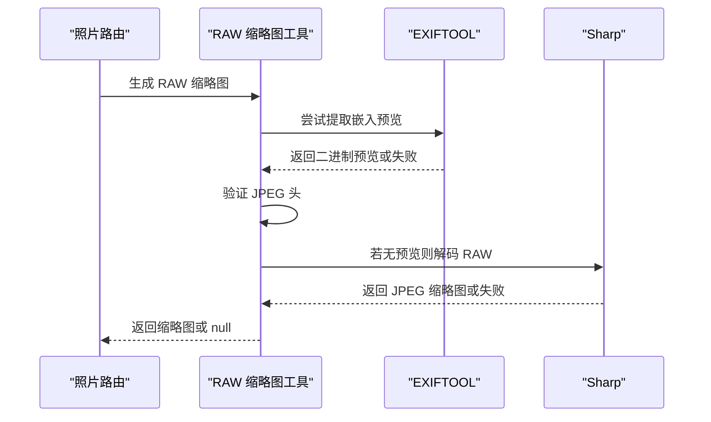
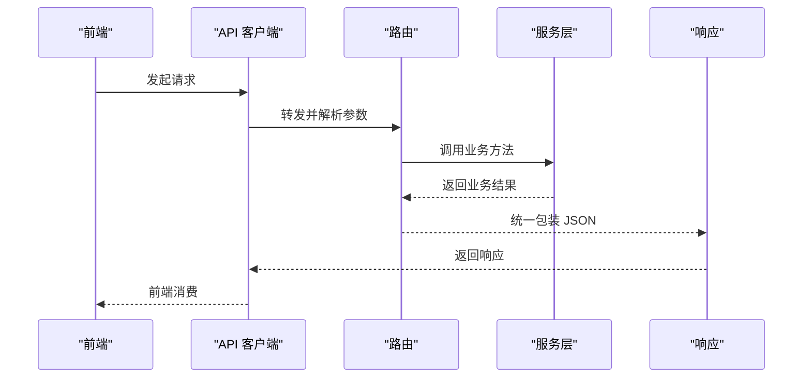
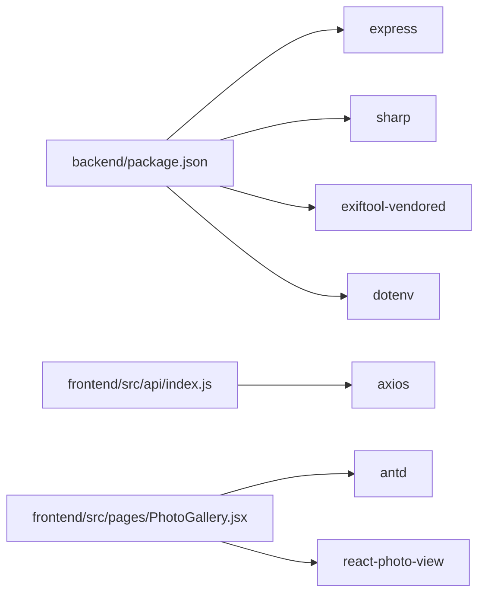

# 数据流设计

<cite>
**本文引用的文件**
- [backend/src/app.js](file://backend/src/app.js)
- [backend/src/routes/photoRoutes.js](file://backend/src/routes/photoRoutes.js)
- [backend/src/routes/importRoutes.js](file://backend/src/routes/importRoutes.js)
- [backend/src/services/fileService.js](file://backend/src/services/fileService.js)
- [backend/src/utils/fileUtils.js](file://backend/src/utils/fileUtils.js)
- [backend/src/utils/rawThumbnail.js](file://backend/src/utils/rawThumbnail.js)
- [backend/package.json](file://backend/package.json)
- [config/repos.json](file://config/repos.json)
- [backend/data/repos.json](file://backend/data/repos.json)
- [frontend/src/api/index.js](file://frontend/src/api/index.js)
- [frontend/src/pages/ImportPage.jsx](file://frontend/src/pages/ImportPage.jsx)
- [frontend/src/pages/PhotoGallery.jsx](file://frontend/src/pages/PhotoGallery.jsx)
- [frontend/src/pages/RepoSettings.jsx](file://frontend/src/pages/RepoSettings.jsx)
</cite>

## 目录
1. [简介](#简介)
2. [项目结构](#项目结构)
3. [核心组件](#核心组件)
4. [架构总览](#架构总览)
5. [详细组件分析](#详细组件分析)
6. [依赖关系分析](#依赖关系分析)
7. [性能考量](#性能考量)
8. [故障排查指南](#故障排查指南)
9. [结论](#结论)
10. [附录](#附录)

## 简介
本文件面向摄影管理项目的数据流设计，系统围绕“前端状态驱动 + API 请求 + 后端业务处理 + 文件系统操作”的完整闭环展开。重点涵盖：
- 前端状态更新与交互流程
- API 层请求参数处理、响应格式化与错误传播
- 文件工具类设计（类型识别、路径处理、元数据提取）
- RAW 文件处理的特殊数据流（嵌入预览提取、缩略图生成、跨平台兼容）
- 数据持久化（配置文件管理、临时文件处理、缓存策略）
- 并发与异步最佳实践、数据一致性保障

## 项目结构
项目采用前后端分离架构，前端基于 React/Vite，后端基于 Node.js/Express，核心模块分布如下：
- 前端：页面组件、API 客户端、状态管理
- 后端：应用入口、路由层、服务层、工具层
- 配置：仓库配置文件（config/backend/data）

图表来源
- [backend/src/app.js:1-146](file://backend/src/app.js#L1-L146)
- [backend/src/routes/photoRoutes.js:1-739](file://backend/src/routes/photoRoutes.js#L1-L739)
- [backend/src/routes/importRoutes.js:1-627](file://backend/src/routes/importRoutes.js#L1-L627)
- [backend/src/services/fileService.js:1-443](file://backend/src/services/fileService.js#L1-L443)
- [backend/src/utils/fileUtils.js:1-167](file://backend/src/utils/fileUtils.js#L1-L167)
- [backend/src/utils/rawThumbnail.js:1-132](file://backend/src/utils/rawThumbnail.js#L1-L132)
- [config/repos.json:1-20](file://config/repos.json#L1-L20)
- [backend/data/repos.json:1-8](file://backend/data/repos.json#L1-L8)

章节来源
- [backend/src/app.js:1-146](file://backend/src/app.js#L1-L146)
- [backend/src/routes/photoRoutes.js:1-739](file://backend/src/routes/photoRoutes.js#L1-L739)
- [backend/src/routes/importRoutes.js:1-627](file://backend/src/routes/importRoutes.js#L1-L627)
- [backend/src/services/fileService.js:1-443](file://backend/src/services/fileService.js#L1-L443)
- [backend/src/utils/fileUtils.js:1-167](file://backend/src/utils/fileUtils.js#L1-L167)
- [backend/src/utils/rawThumbnail.js:1-132](file://backend/src/utils/rawThumbnail.js#L1-L132)
- [config/repos.json:1-20](file://config/repos.json#L1-L20)
- [backend/data/repos.json:1-8](file://backend/data/repos.json#L1-L8)

## 核心组件
- 应用入口与中间件：统一 CORS、JSON 解析、请求日志、静态文件服务、健康检查、全局错误处理
- 路由层：照片路由（预览、缩略图、删除、批量导出等）、导入路由（SSE 实时进度、仓库管理、文件夹选择）
- 服务层：文件服务（导入、扫描、删除、统计、RAW 孤立文件检测、批量删除）
- 工具层：文件工具（类型识别、扫描、复制、删除、重命名、比较）、RAW 缩略图（嵌入预览提取、解码降级）
- 前端 API 客户端：封装 /api 前缀，SSE 导入进度监听，仓库管理与文件夹选择

章节来源
- [backend/src/app.js:1-146](file://backend/src/app.js#L1-L146)
- [backend/src/routes/photoRoutes.js:1-739](file://backend/src/routes/photoRoutes.js#L1-L739)
- [backend/src/routes/importRoutes.js:1-627](file://backend/src/routes/importRoutes.js#L1-L627)
- [backend/src/services/fileService.js:1-443](file://backend/src/services/fileService.js#L1-L443)
- [backend/src/utils/fileUtils.js:1-167](file://backend/src/utils/fileUtils.js#L1-L167)
- [backend/src/utils/rawThumbnail.js:1-132](file://backend/src/utils/rawThumbnail.js#L1-L132)
- [frontend/src/api/index.js:1-168](file://frontend/src/api/index.js#L1-L168)

## 架构总览
系统数据流自上而下分为三层：
- 前端层：用户操作触发状态更新，发起 API 请求；导入页面使用 SSE 实时接收进度
- API 层：路由解析参数、校验仓库、调用服务层；对响应进行统一包装
- 服务层：文件扫描、复制、删除、统计；RAW 特殊处理（嵌入预览提取、解码降级）

图表来源
- [backend/src/app.js:1-146](file://backend/src/app.js#L1-L146)
- [backend/src/routes/photoRoutes.js:1-739](file://backend/src/routes/photoRoutes.js#L1-L739)
- [backend/src/routes/importRoutes.js:1-627](file://backend/src/routes/importRoutes.js#L1-L627)
- [backend/src/services/fileService.js:1-443](file://backend/src/services/fileService.js#L1-L443)
- [frontend/src/api/index.js:1-168](file://frontend/src/api/index.js#L1-L168)

## 详细组件分析

### 文件工具类设计
- 文件类型识别：基于扩展名映射，支持 JPG/JPEG、RAW（多厂商）、视频（MP4/MOV/AVI/MKV/WEBM/M4V/3GP）
- 路径处理：递归扫描目录，过滤隐藏文件（macOS 资源派生），计算相对路径，统计文件大小与修改时间
- 元数据提取：通过文件系统 stat 获取 mtime、size；RAW 缩略图生成时通过 EXIFTOOL 提取嵌入预览
- 增量导入：复制前检查目标文件是否存在与内容一致，避免覆盖；支持自动重命名避免同名冲突
- 并发控制：导入时限制并发数量，防止内存与磁盘压力过大

图表来源
- [backend/src/utils/fileUtils.js:22-66](file://backend/src/utils/fileUtils.js#L22-L66)

章节来源
- [backend/src/utils/fileUtils.js:1-167](file://backend/src/utils/fileUtils.js#L1-L167)

### RAW 文件处理的特殊数据流
- 嵌入预览提取：优先尝试 JpgFromRaw/PreviewImage/ThumbnailImage 等标签，验证 JPEG 头，调整尺寸并编码
- 解码降级：若无嵌入预览，尝试使用 sharp 直接解码 RAW；失败则返回 null，由调用方生成占位图
- 跨平台兼容：Windows/macOS/Linux 分别处理文件夹选择对话框与命令行工具（PowerShell/AppleScript/zenity），确保用户交互一致

图表来源
- [backend/src/utils/rawThumbnail.js:6-132](file://backend/src/utils/rawThumbnail.js#L6-L132)
- [backend/src/routes/photoRoutes.js:395-466](file://backend/src/routes/photoRoutes.js#L395-L466)

章节来源
- [backend/src/utils/rawThumbnail.js:1-132](file://backend/src/utils/rawThumbnail.js#L1-L132)
- [backend/src/routes/photoRoutes.js:1-739](file://backend/src/routes/photoRoutes.js#L1-L739)

### API 层的数据转换与验证机制
- 请求参数处理：路由层解析 query/body 参数，校验必填字段，仓库 ID 解析与默认回退
- 响应数据格式化：统一 success/error 字段包装，错误信息透传
- 错误传播策略：中间件捕获未处理异常，避免服务崩溃；SSE 场景下错误以事件形式发送
- 资源访问控制：静态文件服务根据 repo 参数动态切换路径，不存在时返回 404

图表来源
- [frontend/src/api/index.js:1-168](file://frontend/src/api/index.js#L1-L168)
- [backend/src/routes/photoRoutes.js:68-92](file://backend/src/routes/photoRoutes.js#L68-L92)
- [backend/src/routes/importRoutes.js:82-182](file://backend/src/routes/importRoutes.js#L82-L182)

章节来源
- [frontend/src/api/index.js:1-168](file://frontend/src/api/index.js#L1-L168)
- [backend/src/routes/photoRoutes.js:1-739](file://backend/src/routes/photoRoutes.js#L1-L739)
- [backend/src/routes/importRoutes.js:1-627](file://backend/src/routes/importRoutes.js#L1-L627)

### 数据持久化实现方案
- 配置文件管理：仓库配置文件位于 config/repos.json 与 backend/data/repos.json，应用启动时读取，不存在时按平台默认路径生成
- 临时文件处理：导入时使用增量模式，避免覆盖；Windows/macOS/Linux 通过系统命令或脚本选择文件夹，临时文件按需清理
- 缓存策略：缩略图与视频首帧生成后设置缓存头；静态文件服务设置缓存控制；SSE 进度事件按需发送

章节来源
- [backend/src/app.js:28-65](file://backend/src/app.js#L28-L65)
- [backend/src/routes/importRoutes.js:342-624](file://backend/src/routes/importRoutes.js#L342-L624)
- [backend/src/routes/photoRoutes.js:293-466](file://backend/src/routes/photoRoutes.js#L293-L466)

### 并发处理与异步最佳实践
- 导入并发控制：限制同时处理的任务数，避免内存与磁盘压力过大；使用 Promise.race 等待队列释放
- 流式传输：预览与缩略图生成采用流式读取，避免一次性加载大文件到内存；视频支持 Range 请求
- SSE 实时进度：导入使用 EventSource，前端监听 progress/complete/error 事件，超时与断线处理完善
- 数据一致性：增量导入与重命名策略确保重复导入不覆盖；删除时同步 RAW 文件（可选）

章节来源
- [backend/src/services/fileService.js:75-167](file://backend/src/services/fileService.js#L75-L167)
- [backend/src/routes/photoRoutes.js:178-291](file://backend/src/routes/photoRoutes.js#L178-L291)
- [frontend/src/pages/ImportPage.jsx:212-260](file://frontend/src/pages/ImportPage.jsx#L212-L260)

## 依赖关系分析
- 后端依赖：express、cors、sharp、exiftool-vendored、dotenv
- 前端依赖：axios、Ant Design、react-photo-view
- 跨平台能力：PowerShell/AppleScript/zenity 用于文件夹选择；EXIFTOOL 用于嵌入预览提取

图表来源
- [backend/package.json:1-30](file://backend/package.json#L1-L30)
- [frontend/src/api/index.js:1-168](file://frontend/src/api/index.js#L1-L168)
- [frontend/src/pages/PhotoGallery.jsx:1-800](file://frontend/src/pages/PhotoGallery.jsx#L1-L800)

章节来源
- [backend/package.json:1-30](file://backend/package.json#L1-L30)
- [frontend/src/api/index.js:1-168](file://frontend/src/api/index.js#L1-L168)
- [frontend/src/pages/PhotoGallery.jsx:1-800](file://frontend/src/pages/PhotoGallery.jsx#L1-L800)

## 性能考量
- 导入阶段：并发限制与进度回调降低用户等待感；增量导入减少 IO 压力
- 预览阶段：流式传输与缓存头提升加载速度；RAW 缩略图三级降级策略保证可用性
- 路由层：静态文件服务按仓库动态切换，避免不必要的文件扫描
- 前端：分页与懒加载、跨页预览列表优化体验

## 故障排查指南
- 未捕获异常：应用层全局捕获 uncaughtException/unhandledRejection，避免服务崩溃
- 文件不存在：路由层对文件路径进行存在性检查，返回明确错误
- SSE 断线：前端监听 readyState 与错误事件，必要时重连或提示超时
- 跨平台问题：Windows/macOS/Linux 的文件夹选择对话框差异，需分别处理返回值与超时

章节来源
- [backend/src/app.js:123-143](file://backend/src/app.js#L123-L143)
- [backend/src/routes/photoRoutes.js:178-291](file://backend/src/routes/photoRoutes.js#L178-L291)
- [backend/src/routes/importRoutes.js:342-624](file://backend/src/routes/importRoutes.js#L342-L624)
- [frontend/src/pages/ImportPage.jsx:87-120](file://frontend/src/pages/ImportPage.jsx#L87-L120)

## 结论
本项目通过清晰的分层架构与完善的工具层设计，实现了从前端交互到文件系统修改的完整数据流闭环。文件工具类提供了稳健的类型识别与路径处理能力，RAW 缩略图生成采用三级降级策略确保跨平台兼容性。API 层统一了请求参数处理与响应格式，结合 SSE 实时进度与流式传输，显著提升了用户体验。在并发与异步方面，通过并发控制与流式处理保障了性能与稳定性。

## 附录
- 仓库配置文件位置与默认回退策略
- 前端页面与 API 的交互要点（导入进度、仓库管理、文件夹选择）
- RAW 缩略图生成的关键路径与降级策略

章节来源
- [config/repos.json:1-20](file://config/repos.json#L1-L20)
- [backend/data/repos.json:1-8](file://backend/data/repos.json#L1-L8)
- [frontend/src/pages/ImportPage.jsx:1-820](file://frontend/src/pages/ImportPage.jsx#L1-L820)
- [frontend/src/pages/RepoSettings.jsx:1-341](file://frontend/src/pages/RepoSettings.jsx#L1-L341)
- [backend/src/utils/rawThumbnail.js:78-132](file://backend/src/utils/rawThumbnail.js#L78-L132)