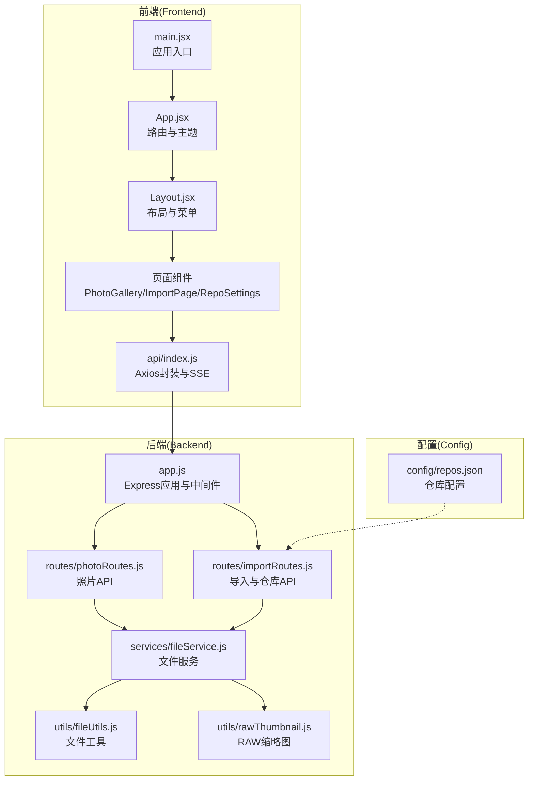
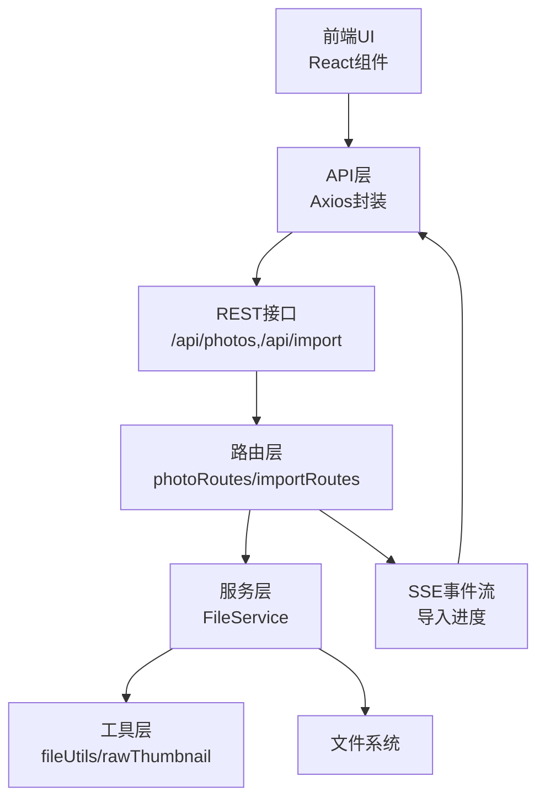
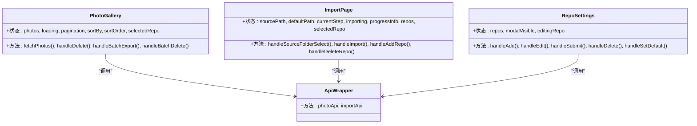
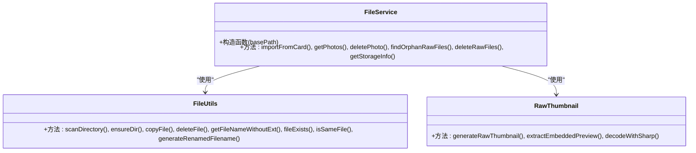
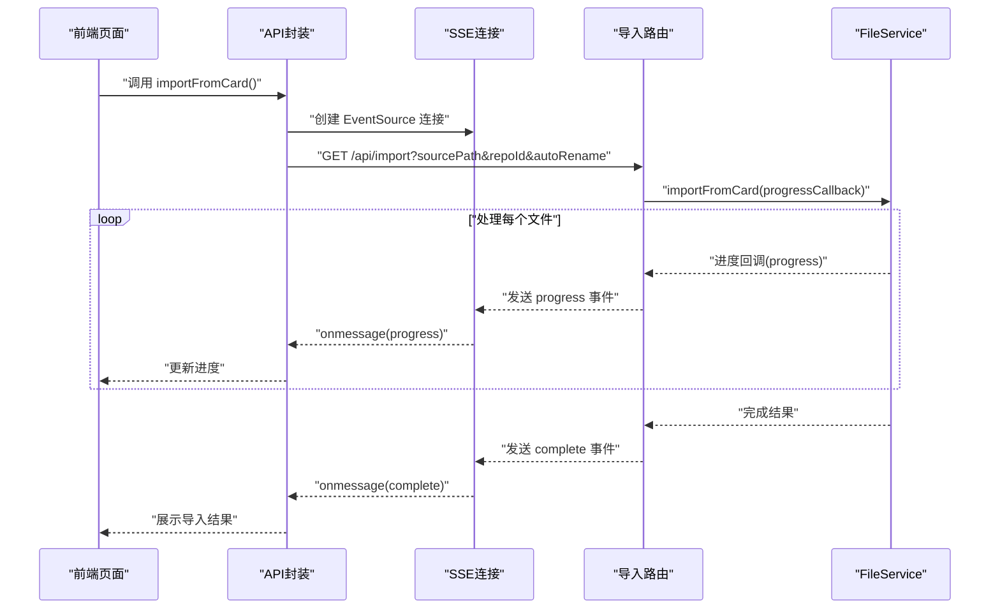
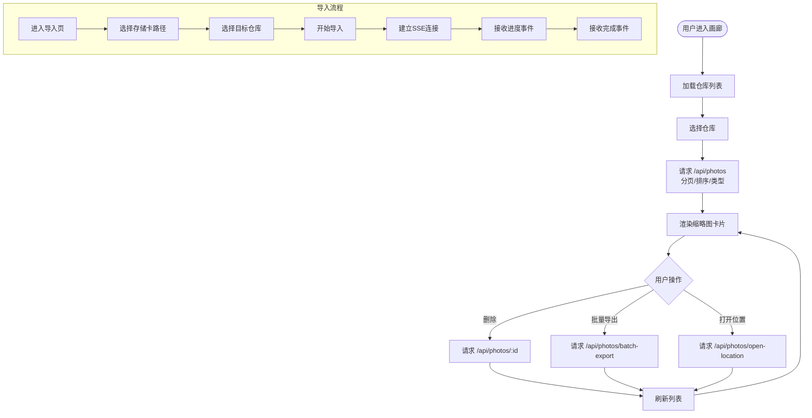
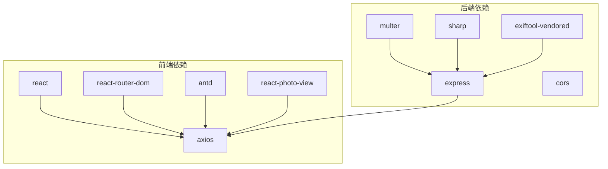

# 系统架构

<cite>
**本文引用的文件**
- [README.md](file://README.md)
- [frontend/package.json](file://frontend/package.json)
- [backend/package.json](file://backend/package.json)
- [frontend/src/main.jsx](file://frontend/src/main.jsx)
- [backend/src/app.js](file://backend/src/app.js)
- [frontend/src/App.jsx](file://frontend/src/App.jsx)
- [backend/src/routes/photoRoutes.js](file://backend/src/routes/photoRoutes.js)
- [backend/src/routes/importRoutes.js](file://backend/src/routes/importRoutes.js)
- [backend/src/services/fileService.js](file://backend/src/services/fileService.js)
- [frontend/src/api/index.js](file://frontend/src/api/index.js)
- [backend/src/utils/fileUtils.js](file://backend/src/utils/fileUtils.js)
- [backend/src/utils/rawThumbnail.js](file://backend/src/utils/rawThumbnail.js)
- [frontend/src/components/Layout.jsx](file://frontend/src/components/Layout.jsx)
- [frontend/src/pages/PhotoGallery.jsx](file://frontend/src/pages/PhotoGallery.jsx)
- [frontend/src/pages/ImportPage.jsx](file://frontend/src/pages/ImportPage.jsx)
- [frontend/src/pages/RepoSettings.jsx](file://frontend/src/pages/RepoSettings.jsx)
- [config/repos.json](file://config/repos.json)
</cite>

## 目录
1. [引言](#引言)
2. [项目结构](#项目结构)
3. [核心组件](#核心组件)
4. [架构总览](#架构总览)
5. [详细组件分析](#详细组件分析)
6. [依赖分析](#依赖分析)
7. [性能考量](#性能考量)
8. [故障排查指南](#故障排查指南)
9. [结论](#结论)
10. [附录](#附录)

## 引言
本项目是一个基于 Electron 的跨平台桌面应用，用于管理相机照片与视频，支持从存储卡导入、浏览缩略图、预览、批量导出、同步删除 RAW 等功能。系统采用前后端分离架构：前端使用 React + Vite，后端使用 Node.js + Express，二者通过 REST API 通信；导入流程采用 Server-Sent Events（SSE）实现实时进度反馈。系统通过“存储仓库”概念实现多目录管理，支持跨平台路径与文件系统操作。

## 项目结构
项目采用模块化分层组织：
- frontend：React 前端应用，负责用户界面与交互，通过 axios 调用后端 API。
- backend：Node.js + Express 后端，提供 REST API 与 SSE，封装文件服务与工具。
- config：配置文件（如 repos.json），存储仓库配置。
- electron：Electron 资源目录（当前上下文未提供具体代码）。
- build：构建产物目录（当前上下文未提供具体代码）。

**图表来源**
- [frontend/src/main.jsx:1-11](file://frontend/src/main.jsx#L1-L11)
- [frontend/src/App.jsx:1-41](file://frontend/src/App.jsx#L1-L41)
- [frontend/src/components/Layout.jsx:1-160](file://frontend/src/components/Layout.jsx#L1-L160)
- [frontend/src/pages/PhotoGallery.jsx:1-794](file://frontend/src/pages/PhotoGallery.jsx#L1-L794)
- [frontend/src/pages/ImportPage.jsx:1-820](file://frontend/src/pages/ImportPage.jsx#L1-L820)
- [frontend/src/pages/RepoSettings.jsx:1-341](file://frontend/src/pages/RepoSettings.jsx#L1-L341)
- [frontend/src/api/index.js:1-168](file://frontend/src/api/index.js#L1-L168)
- [backend/src/app.js:1-146](file://backend/src/app.js#L1-L146)
- [backend/src/routes/photoRoutes.js:1-739](file://backend/src/routes/photoRoutes.js#L1-L739)
- [backend/src/routes/importRoutes.js:1-627](file://backend/src/routes/importRoutes.js#L1-L627)
- [backend/src/services/fileService.js:1-443](file://backend/src/services/fileService.js#L1-L443)
- [backend/src/utils/fileUtils.js:1-167](file://backend/src/utils/fileUtils.js#L1-L167)
- [backend/src/utils/rawThumbnail.js:1-132](file://backend/src/utils/rawThumbnail.js#L1-L132)
- [config/repos.json:1-20](file://config/repos.json#L1-L20)

**章节来源**
- [README.md:1-3](file://README.md#L1-L3)
- [frontend/package.json:1-33](file://frontend/package.json#L1-L33)
- [backend/package.json:1-30](file://backend/package.json#L1-L30)

## 核心组件
- 前端应用入口与路由
  - 应用入口负责挂载 React 根节点，渲染顶层组件。
  - 顶层组件配置 Ant Design 主题与国际化，定义路由与页面映射。
- 页面组件
  - 照片画廊：支持按仓库、类型、排序浏览，批量导出与删除，打开文件位置。
  - 存储卡导入：通过 SSE 实时显示导入进度，支持自动重命名与仓库选择。
  - 仓库配置：增删改查存储仓库，设置默认仓库。
- API 层
  - 前端通过 axios 封装统一基础路径与超时，照片与导入 API 分离。
  - 导入 API 使用 EventSource 实现 SSE，接收进度、完成与错误事件。
- 服务层
  - 后端通过路由层调用服务层，服务层封装文件扫描、复制、删除、RAW 处理等业务逻辑。
  - 工具层提供文件扫描、目录创建、文件比较、RAW 缩略图生成等通用能力。
- 数据持久层
  - 仓库配置文件 repos.json 存储在后端数据目录，支持读取与更新。

**章节来源**
- [frontend/src/main.jsx:1-11](file://frontend/src/main.jsx#L1-L11)
- [frontend/src/App.jsx:1-41](file://frontend/src/App.jsx#L1-L41)
- [frontend/src/components/Layout.jsx:1-160](file://frontend/src/components/Layout.jsx#L1-L160)
- [frontend/src/pages/PhotoGallery.jsx:1-794](file://frontend/src/pages/PhotoGallery.jsx#L1-L794)
- [frontend/src/pages/ImportPage.jsx:1-820](file://frontend/src/pages/ImportPage.jsx#L1-L820)
- [frontend/src/pages/RepoSettings.jsx:1-341](file://frontend/src/pages/RepoSettings.jsx#L1-L341)
- [frontend/src/api/index.js:1-168](file://frontend/src/api/index.js#L1-L168)
- [backend/src/services/fileService.js:1-443](file://backend/src/services/fileService.js#L1-L443)
- [backend/src/utils/fileUtils.js:1-167](file://backend/src/utils/fileUtils.js#L1-L167)
- [backend/src/utils/rawThumbnail.js:1-132](file://backend/src/utils/rawThumbnail.js#L1-L132)
- [config/repos.json:1-20](file://config/repos.json#L1-L20)

## 架构总览
系统采用三层架构与事件驱动结合的设计：
- 表现层（前端 React）
  - 使用 Ant Design 组件库与路由导航，页面组件负责用户交互与状态管理。
- 业务层（后端 Express）
  - 路由层处理 HTTP 请求，服务层封装业务逻辑，工具层提供通用能力。
- 数据层（本地文件系统）
  - 通过文件系统读写与 EXIF 工具处理照片元数据与 RAW 缩略图。
- 通信机制
  - REST API 用于常规数据交互；SSE 用于导入过程的实时进度推送。

**图表来源**
- [frontend/src/api/index.js:1-168](file://frontend/src/api/index.js#L1-L168)
- [backend/src/routes/photoRoutes.js:1-739](file://backend/src/routes/photoRoutes.js#L1-L739)
- [backend/src/routes/importRoutes.js:1-627](file://backend/src/routes/importRoutes.js#L1-L627)
- [backend/src/services/fileService.js:1-443](file://backend/src/services/fileService.js#L1-L443)
- [backend/src/utils/fileUtils.js:1-167](file://backend/src/utils/fileUtils.js#L1-L167)
- [backend/src/utils/rawThumbnail.js:1-132](file://backend/src/utils/rawThumbnail.js#L1-L132)

## 详细组件分析

### 前端组件分析（MVC 模式）
- 视图层（View）
  - 页面组件负责渲染 UI、处理用户交互（选择仓库、排序、分页、批量操作）。
- 控制器（Controller）
  - 页面组件通过 API 层发起请求，监听 SSE 事件，更新状态并刷新视图。
- 模型（Model）
  - API 层封装请求参数与响应结构，页面组件维护本地状态（分页、排序、选中项）。

**图表来源**
- [frontend/src/pages/PhotoGallery.jsx:1-794](file://frontend/src/pages/PhotoGallery.jsx#L1-L794)
- [frontend/src/pages/ImportPage.jsx:1-820](file://frontend/src/pages/ImportPage.jsx#L1-L820)
- [frontend/src/pages/RepoSettings.jsx:1-341](file://frontend/src/pages/RepoSettings.jsx#L1-L341)
- [frontend/src/api/index.js:1-168](file://frontend/src/api/index.js#L1-L168)

**章节来源**
- [frontend/src/pages/PhotoGallery.jsx:1-794](file://frontend/src/pages/PhotoGallery.jsx#L1-L794)
- [frontend/src/pages/ImportPage.jsx:1-820](file://frontend/src/pages/ImportPage.jsx#L1-L820)
- [frontend/src/pages/RepoSettings.jsx:1-341](file://frontend/src/pages/RepoSettings.jsx#L1-L341)
- [frontend/src/api/index.js:1-168](file://frontend/src/api/index.js#L1-L168)

### 后端服务层（服务层模式）
- FileService
  - 负责扫描目录、复制文件（增量）、删除文件、查找孤立 RAW、批量删除 RAW、统计存储信息等。
  - 支持并发控制与进度回调，保障大文件导入的稳定性。
- 工具层
  - fileUtils：扫描目录、确保目录存在、复制文件（增量）、删除文件、文件名处理、文件比较等。
  - rawThumbnail：提取 RAW 嵌入预览、使用 sharp 解码 RAW、生成缩略图的三级降级策略。

**图表来源**
- [backend/src/services/fileService.js:1-443](file://backend/src/services/fileService.js#L1-L443)
- [backend/src/utils/fileUtils.js:1-167](file://backend/src/utils/fileUtils.js#L1-L167)
- [backend/src/utils/rawThumbnail.js:1-132](file://backend/src/utils/rawThumbnail.js#L1-L132)

**章节来源**
- [backend/src/services/fileService.js:1-443](file://backend/src/services/fileService.js#L1-L443)
- [backend/src/utils/fileUtils.js:1-167](file://backend/src/utils/fileUtils.js#L1-L167)
- [backend/src/utils/rawThumbnail.js:1-132](file://backend/src/utils/rawThumbnail.js#L1-L132)

### API 与 SSE 实时通信
- REST API
  - 照片 API：获取列表、存储信息、孤立 RAW、删除、批量导出、预览、缩略图、打开位置等。
  - 导入 API：从存储卡导入（SSE）、默认路径、仓库管理、文件夹选择等。
- SSE 实时进度
  - 导入接口使用 GET + text/event-stream，前端通过 EventSource 接收 progress/complete/error 事件。
  - 前端设置超时与断线重连策略，保证用户体验。

**图表来源**
- [frontend/src/api/index.js:37-165](file://frontend/src/api/index.js#L37-L165)
- [backend/src/routes/importRoutes.js:82-182](file://backend/src/routes/importRoutes.js#L82-L182)
- [backend/src/services/fileService.js:23-167](file://backend/src/services/fileService.js#L23-L167)

**章节来源**
- [frontend/src/api/index.js:1-168](file://frontend/src/api/index.js#L1-L168)
- [backend/src/routes/importRoutes.js:1-627](file://backend/src/routes/importRoutes.js#L1-L627)
- [backend/src/services/fileService.js:1-443](file://backend/src/services/fileService.js#L1-L443)

### 数据流图（照片浏览与导入）

**图表来源**
- [frontend/src/pages/PhotoGallery.jsx:77-128](file://frontend/src/pages/PhotoGallery.jsx#L77-L128)
- [frontend/src/pages/ImportPage.jsx:105-136](file://frontend/src/pages/ImportPage.jsx#L105-L136)
- [frontend/src/api/index.js:37-165](file://frontend/src/api/index.js#L37-L165)
- [backend/src/routes/photoRoutes.js:68-176](file://backend/src/routes/photoRoutes.js#L68-L176)
- [backend/src/routes/importRoutes.js:82-182](file://backend/src/routes/importRoutes.js#L82-L182)

**章节来源**
- [frontend/src/pages/PhotoGallery.jsx:1-794](file://frontend/src/pages/PhotoGallery.jsx#L1-L794)
- [frontend/src/pages/ImportPage.jsx:1-820](file://frontend/src/pages/ImportPage.jsx#L1-L820)
- [backend/src/routes/photoRoutes.js:1-739](file://backend/src/routes/photoRoutes.js#L1-L739)
- [backend/src/routes/importRoutes.js:1-627](file://backend/src/routes/importRoutes.js#L1-L627)

## 依赖分析
- 前端依赖
  - React、React Router、Ant Design、Axios、react-photo-view 等。
- 后端依赖
  - Express、CORS、Multer、sharp、exiftool-vendored 等。
- 跨平台兼容
  - 路径解析、默认仓库路径、SSE、文件夹选择对话框在不同平台（Windows/macOS/Linux）下分别处理。

**图表来源**
- [frontend/package.json:12-20](file://frontend/package.json#L12-L20)
- [backend/package.json:10-18](file://backend/package.json#L10-L18)

**章节来源**
- [frontend/package.json:1-33](file://frontend/package.json#L1-L33)
- [backend/package.json:1-30](file://backend/package.json#L1-L30)

## 性能考量
- 导入性能
  - 并发控制：导入时限制同时处理的文件数量，避免内存占用过高。
  - 增量导入：已存在文件跳过，减少 IO 与网络压力。
- 图像处理
  - 缩略图优先提取 RAW 嵌入预览，失败则使用 sharp 解码，最后回退占位图。
  - 视频与大图使用流式传输，避免一次性加载到内存。
- SSE 与前端
  - 前端设置超时与断线重连，保证长耗时任务的体验。
- 跨平台路径
  - 使用平台特定的文件夹选择对话框与打开方式，提升可用性。

[本节为通用指导，无需列出具体文件来源]

## 故障排查指南
- SSE 连接问题
  - 检查后端是否正确设置 SSE 头部与事件格式；前端 EventSource 是否收到 progress/complete/error。
  - 关注超时与 readyState 状态，必要时调整超时时间。
- 文件不存在或路径错误
  - 后端在提供静态文件与预览时会校验路径存在性，前端应提示用户修正路径。
- RAW 缩略图生成失败
  - 检查嵌入预览提取与 sharp 解码日志，确认 RAW 文件格式支持情况。
- 仓库配置
  - 确认 repos.json 路径与权限，确保后端可读写。

**章节来源**
- [frontend/src/api/index.js:37-165](file://frontend/src/api/index.js#L37-L165)
- [backend/src/routes/photoRoutes.js:178-291](file://backend/src/routes/photoRoutes.js#L178-L291)
- [backend/src/utils/rawThumbnail.js:78-132](file://backend/src/utils/rawThumbnail.js#L78-L132)
- [config/repos.json:1-20](file://config/repos.json#L1-20)

## 结论
本系统通过清晰的分层与事件驱动机制，实现了跨平台桌面应用的照片管理需求。前端以 React 为核心，后端以 Express 与服务层模式组织业务逻辑，SSE 提供了良好的实时反馈体验。通过工具层与 RAW 缩略图策略，系统在性能与兼容性之间取得平衡。建议后续可引入缓存与索引机制进一步优化大库场景下的查询性能，并增强错误监控与日志聚合能力。

[本节为总结性内容，无需列出具体文件来源]

## 附录
- 系统边界
  - 前端仅通过 /api 域名访问后端，SSE 亦在同一域名下建立连接。
  - 文件系统为唯一持久化介质，仓库配置文件位于后端数据目录。
- 集成接口
  - /api/photos：照片列表、存储信息、孤立 RAW、删除、批量导出、预览、缩略图、打开位置。
  - /api/import：从存储卡导入（SSE）、默认路径、仓库管理、文件夹选择。
- 扩展点
  - 新增文件类型：在工具层扩展支持的扩展名集合与类型判断。
  - 新增仓库：通过导入路由的仓库管理接口扩展。
  - 新增处理策略：在服务层增加新的业务处理方法，复用工具层能力。

[本节为概览性内容，无需列出具体文件来源]