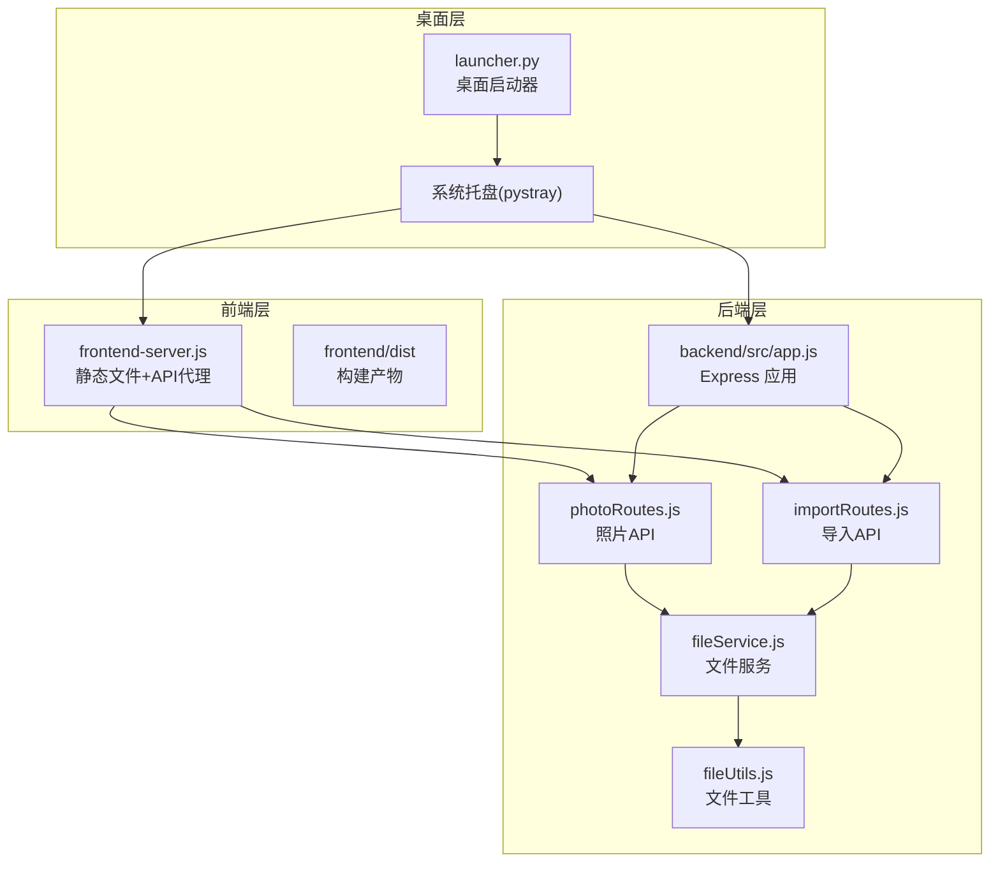
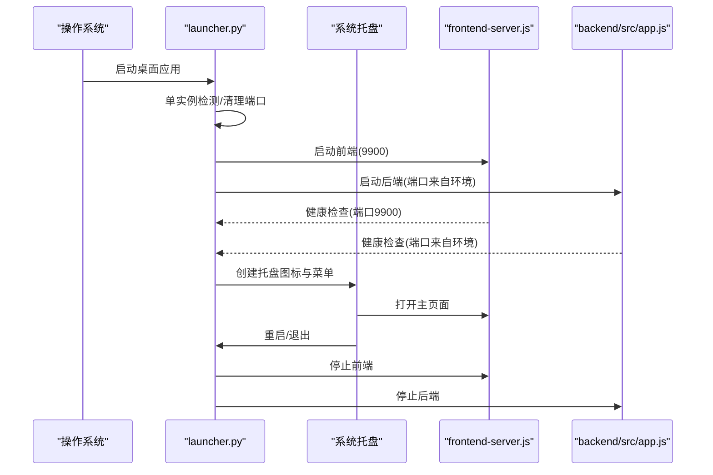
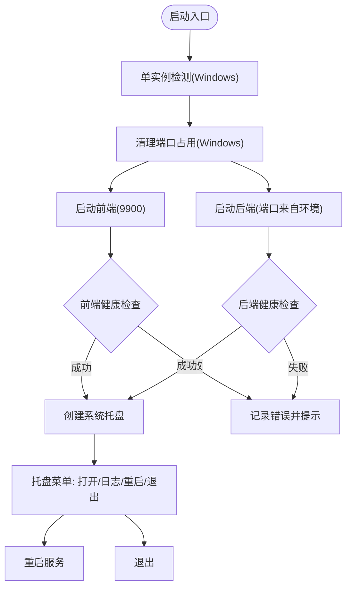
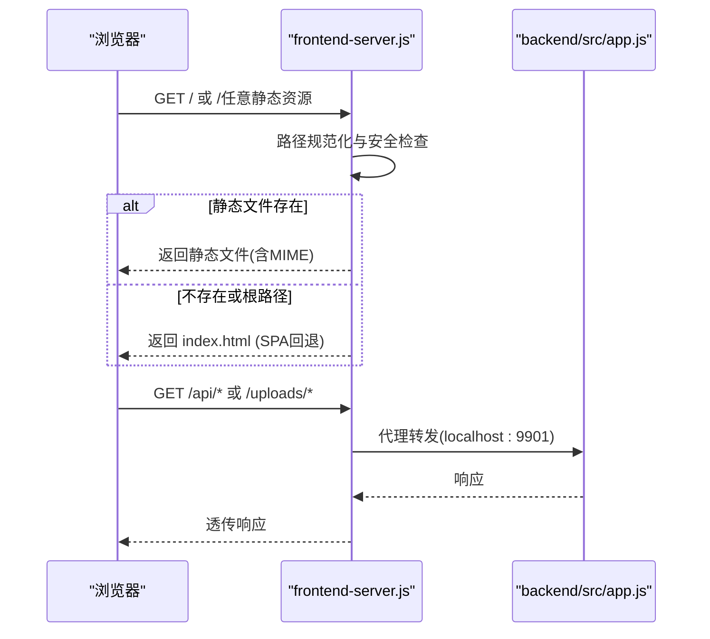
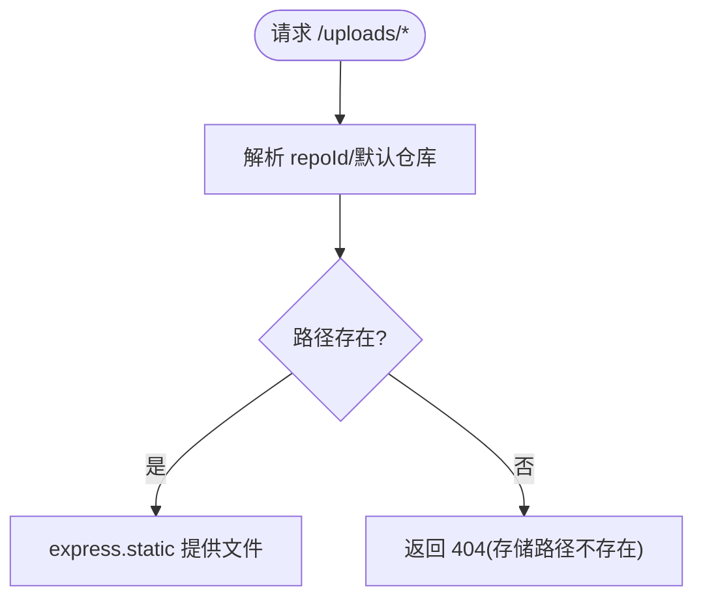
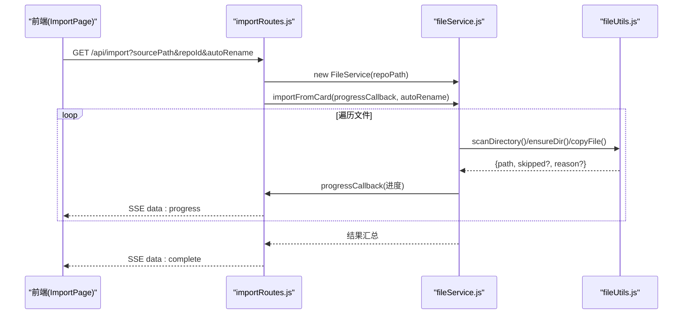
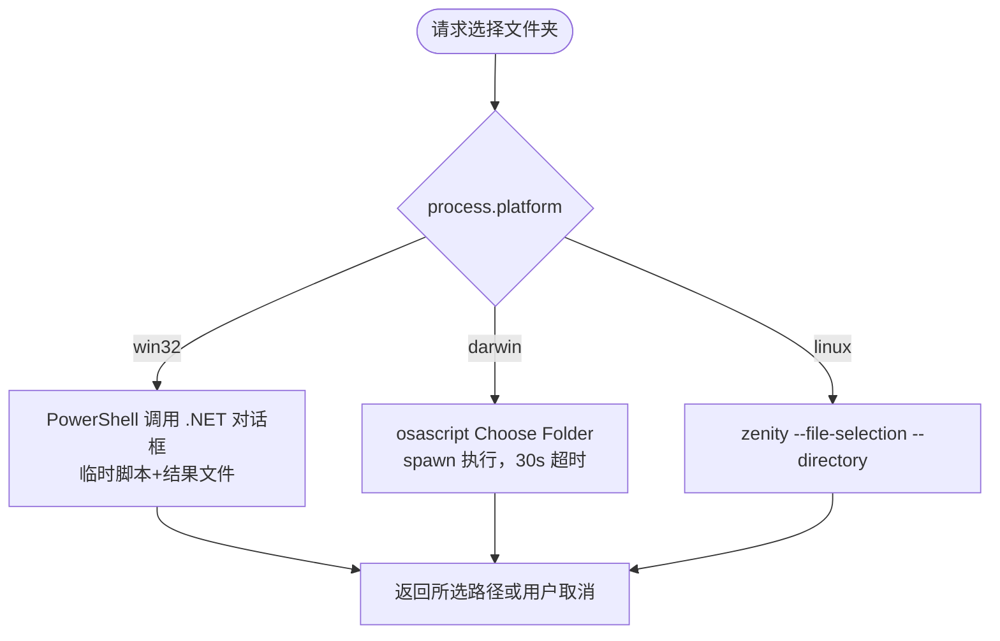
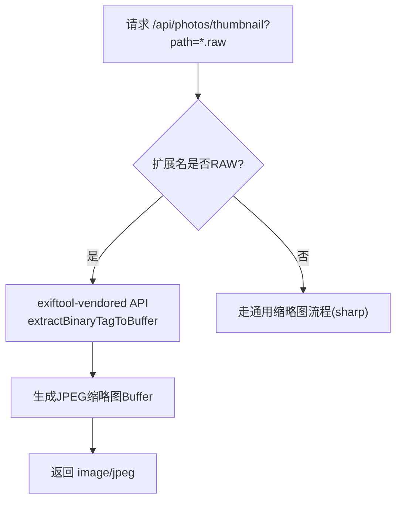
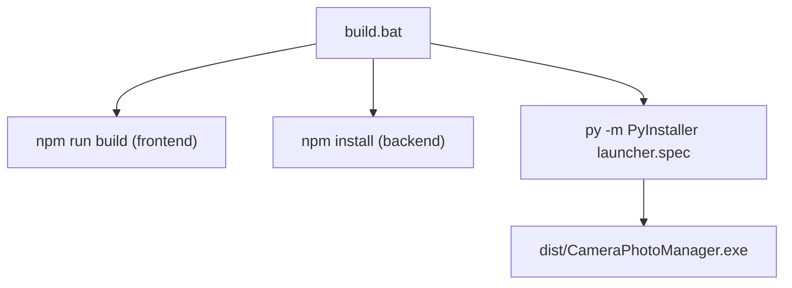
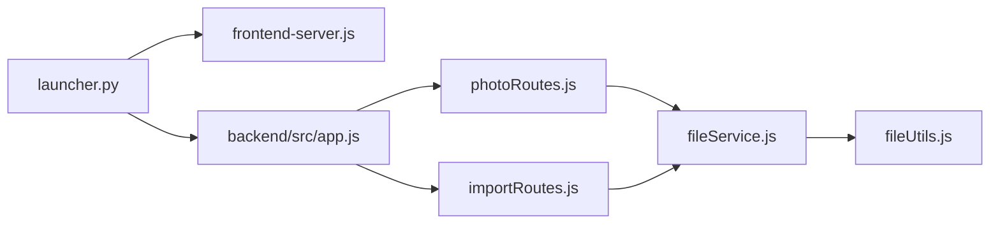

# 跨平台支持

<cite>
**本文档引用的文件**
- [README.md](file://README.md)
- [launcher.py](file://launcher.py)
- [launcher.spec](file://launcher.spec)
- [build.bat](file://build.bat)
- [frontend-server.js](file://frontend-server.js)
- [backend/src/app.js](file://backend/src/app.js)
- [backend/src/services/fileService.js](file://backend/src/services/fileService.js)
- [backend/src/utils/fileUtils.js](file://backend/src/utils/fileUtils.js)
- [backend/src/routes/photoRoutes.js](file://backend/src/routes/photoRoutes.js)
- [backend/src/routes/importRoutes.js](file://backend/src/routes/importRoutes.js)
- [backend/RAW_THUMBNAIL_FIX.md](file://backend/RAW_THUMBNAIL_FIX.md)
- [backend/select-folder.ps1](file://backend/select-folder.ps1)
- [IMPORT_PROGRESS_TEST.md](file://IMPORT_PROGRESS_TEST.md)
</cite>

## 目录
1. [简介](#简介)
2. [项目结构](#项目结构)
3. [核心组件](#核心组件)
4. [架构总览](#架构总览)
5. [详细组件分析](#详细组件分析)
6. [依赖关系分析](#依赖关系分析)
7. [性能考量](#性能考量)
8. [故障排查指南](#故障排查指南)
9. [结论](#结论)
10. [附录](#附录)

## 简介
本项目是一个跨平台的摄影管理应用，采用桌面启动器统一启动前后端服务，并通过系统托盘进行运行态管理。项目在 Windows、macOS 和 Linux 三大平台上实现了统一的文件导入、预览与管理能力，同时针对各平台的文件系统、路径处理、权限管理与用户界面进行了差异化适配。

## 项目结构
项目采用“桌面启动器 + 前后端分离”的架构：
- 桌面启动器使用 Python，负责单实例检测、服务启动/停止、系统托盘集成与日志管理。
- 前端使用 Node.js 内置 HTTP 服务器提供静态资源与 API 代理。
- 后端使用 Express 提供照片管理 API，包括导入、预览、缩略图、RAW 处理、仓库管理等。
- 构建流程通过批处理脚本与 PyInstaller 规范打包为独立可执行文件。

**图表来源**
- [launcher.py:487-513](file://launcher.py#L487-L513)
- [frontend-server.js:1-139](file://frontend-server.js#L1-L139)
- [backend/src/app.js:1-146](file://backend/src/app.js#L1-L146)
- [backend/src/routes/photoRoutes.js:1-739](file://backend/src/routes/photoRoutes.js#L1-L739)
- [backend/src/routes/importRoutes.js:1-627](file://backend/src/routes/importRoutes.js#L1-L627)
- [backend/src/services/fileService.js:1-443](file://backend/src/services/fileService.js#L1-L443)
- [backend/src/utils/fileUtils.js:1-167](file://backend/src/utils/fileUtils.js#L1-L167)

**章节来源**
- [README.md:1-3](file://README.md#L1-L3)
- [launcher.py:1-513](file://launcher.py#L1-L513)
- [frontend-server.js:1-139](file://frontend-server.js#L1-L139)
- [backend/src/app.js:1-146](file://backend/src/app.js#L1-L146)

## 核心组件
- 桌面启动器与系统托盘
  - 单实例检测（Windows 命名互斥量，其他平台忽略）
  - 自动清理端口占用（Windows 使用 netstat/taskkill）
  - 并行启动前后端服务，健康检查与错误聚合
  - 系统托盘菜单：打开页面、查看日志、重启服务、退出
- 前端静态服务器
  - 提供 SPA 静态资源，代理 /api 与 /uploads 到后端
  - 端口 9900，内置 MIME 映射与安全路径校验
- 后端 Express 应用
  - CORS、日志中间件、健康检查
  - 动态静态文件服务（按仓库参数切换路径）
  - 跨平台默认路径策略（Windows/macOS/Linux）
- 文件服务与工具
  - 递归扫描、增量复制、同文件判断、重命名策略
  - 分类目录初始化（jpg/raw/video）
  - 并发控制与进度回调（SSE）
- 平台特定功能
  - 存储卡检测：Windows PowerShell、macOS AppleScript、Linux Zenity
  - RAW 缩略图：exiftool-vendored API，自动跨平台
  - 视频缩略图：ffmpeg 提取首帧
  - 打开文件/文件夹：根据平台调用 open/explorer/xdg-open

**章节来源**
- [launcher.py:23-36](file://launcher.py#L23-L36)
- [launcher.py:175-199](file://launcher.py#L175-L199)
- [launcher.py:200-354](file://launcher.py#L200-L354)
- [frontend-server.js:63-84](file://frontend-server.js#L63-L84)
- [backend/src/app.js:38-65](file://backend/src/app.js#L38-L65)
- [backend/src/app.js:93-112](file://backend/src/app.js#L93-L112)
- [backend/src/services/fileService.js:23-167](file://backend/src/services/fileService.js#L23-L167)
- [backend/src/utils/fileUtils.js:22-167](file://backend/src/utils/fileUtils.js#L22-L167)
- [backend/src/routes/importRoutes.js:342-624](file://backend/src/routes/importRoutes.js#L342-L624)
- [backend/src/routes/photoRoutes.js:395-466](file://backend/src/routes/photoRoutes.js#L395-L466)

## 架构总览
下图展示了桌面启动器如何在不同平台下启动并管理前后端服务，以及平台差异对路径、权限与 UI 的影响。

**图表来源**
- [launcher.py:200-354](file://launcher.py#L200-L354)
- [frontend-server.js:135-139](file://frontend-server.js#L135-L139)
- [backend/src/app.js:129-131](file://backend/src/app.js#L129-L131)

## 详细组件分析

### 桌面启动器与系统托盘（跨平台）
- 单实例检测：Windows 使用命名互斥量；其他平台忽略，避免非 Windows 平台的 ctypes 依赖。
- 端口清理：Windows 使用 netstat/taskkill 清理占用端口 9900/9901，避免旧进程残留。
- 服务启动：并行启动前端与后端，分别写入独立日志文件，健康检查通过 /api/health。
- 系统托盘：使用 pystray，菜单包含打开页面、查看日志、重启服务、退出；状态栏标题随运行状态变化。
- 日志：线程安全写入，支持立即刷新与控制台输出。

**图表来源**
- [launcher.py:23-36](file://launcher.py#L23-L36)
- [launcher.py:175-199](file://launcher.py#L175-L199)
- [launcher.py:200-354](file://launcher.py#L200-L354)
- [launcher.py:406-482](file://launcher.py#L406-L482)

**章节来源**
- [launcher.py:23-36](file://launcher.py#L23-L36)
- [launcher.py:175-199](file://launcher.py#L175-L199)
- [launcher.py:200-354](file://launcher.py#L200-L354)
- [launcher.py:406-482](file://launcher.py#L406-L482)

### 前端静态服务器（跨平台）
- 作用：提供 SPA 静态资源，代理 /api 与 /uploads 到后端（9901），SPA 回退至 index.html。
- 安全：路径规范化与目录遍历防护，403/404 处理。
- 错误处理：端口占用时进程退出，便于上层启动器感知。

**图表来源**
- [frontend-server.js:86-122](file://frontend-server.js#L86-L122)
- [frontend-server.js:124-133](file://frontend-server.js#L124-L133)

**章节来源**
- [frontend-server.js:1-139](file://frontend-server.js#L1-L139)

### 后端应用与仓库管理（跨平台）
- 跨平台默认路径：Windows 使用用户图片目录，macOS 使用 Library/Application Support，Linux 使用 XDG 数据目录。
- 动态静态文件服务：根据 repoId 与 AUTO 模式切换实际物理路径。
- 健康检查：/api/health。
- 全局错误处理：未捕获异常与未处理 Promise 拒绝不中断服务。

**图表来源**
- [backend/src/app.js:67-91](file://backend/src/app.js#L67-L91)
- [backend/src/app.js:93-112](file://backend/src/app.js#L93-L112)

**章节来源**
- [backend/src/app.js:38-65](file://backend/src/app.js#L38-L65)
- [backend/src/app.js:67-91](file://backend/src/app.js#L67-L91)
- [backend/src/app.js:93-112](file://backend/src/app.js#L93-L112)
- [backend/src/app.js:118-146](file://backend/src/app.js#L118-L146)

### 文件服务与导入流程（跨平台）
- 分类目录：jpg/raw/video，按需初始化。
- 增量导入：扫描源目录，按类型复制到目标分类目录，避免覆盖同名同内容文件。
- 并发控制：最多 3 个文件并发处理，避免内存压力。
- 进度回调：通过 SSE 推送实时进度，前端使用 EventSource 接收。
- 超时保护：前端设置 5 分钟超时，避免长时间阻塞。

**图表来源**
- [backend/src/routes/importRoutes.js:82-182](file://backend/src/routes/importRoutes.js#L82-L182)
- [backend/src/services/fileService.js:23-167](file://backend/src/services/fileService.js#L23-L167)
- [backend/src/utils/fileUtils.js:22-100](file://backend/src/utils/fileUtils.js#L22-L100)
- [IMPORT_PROGRESS_TEST.md:14-23](file://IMPORT_PROGRESS_TEST.md#L14-L23)

**章节来源**
- [backend/src/services/fileService.js:23-167](file://backend/src/services/fileService.js#L23-L167)
- [backend/src/utils/fileUtils.js:22-100](file://backend/src/utils/fileUtils.js#L22-L100)
- [backend/src/routes/importRoutes.js:82-182](file://backend/src/routes/importRoutes.js#L82-L182)
- [IMPORT_PROGRESS_TEST.md:1-138](file://IMPORT_PROGRESS_TEST.md#L1-L138)

### 平台特定功能

#### 存储卡检测与文件夹选择
- Windows：调用 PowerShell 脚本，使用 .NET FolderBrowserDialog，临时文件写入结果并通过 UTF-8 BOM 编码脚本。
- macOS：使用 osascript 调用 AppleScript 的 Choose Folder，spawn 方式执行，30 秒超时。
- Linux：使用 zenity --file-selection --directory。

**图表来源**
- [backend/src/routes/importRoutes.js:342-624](file://backend/src/routes/importRoutes.js#L342-L624)
- [backend/select-folder.ps1:1-9](file://backend/select-folder.ps1#L1-L9)

**章节来源**
- [backend/src/routes/importRoutes.js:342-624](file://backend/src/routes/importRoutes.js#L342-L624)
- [backend/select-folder.ps1:1-9](file://backend/select-folder.ps1#L1-L9)

#### RAW 缩略图生成（跨平台）
- 使用 exiftool-vendored 的 Node.js API，避免命令行调用与路径错误。
- 修复前使用错误 API 导致参数错误；修复后使用 extractBinaryTagToBuffer 直接返回 Buffer。
- 自动处理 Windows/macOS/Linux 的 exiftool 进程池。

**图表来源**
- [backend/src/routes/photoRoutes.js:395-425](file://backend/src/routes/photoRoutes.js#L395-L425)
- [backend/RAW_THUMBNAIL_FIX.md:14-21](file://backend/RAW_THUMBNAIL_FIX.md#L14-L21)

**章节来源**
- [backend/src/routes/photoRoutes.js:395-425](file://backend/src/routes/photoRoutes.js#L395-L425)
- [backend/RAW_THUMBNAIL_FIX.md:1-100](file://backend/RAW_THUMBNAIL_FIX.md#L1-L100)

#### 视频缩略图与预览（跨平台）
- 视频文件使用 ffmpeg 提取首帧作为缩略图；失败时返回 SVG 占位图。
- 预览接口支持 Range 请求，实现视频流式播放与断点续传。

**章节来源**
- [backend/src/routes/photoRoutes.js:322-392](file://backend/src/routes/photoRoutes.js#L322-L392)
- [backend/src/routes/photoRoutes.js:226-280](file://backend/src/routes/photoRoutes.js#L226-L280)

#### 打开文件/文件夹（跨平台）
- 打开文件夹：macOS 使用 open，Windows 使用 explorer，Linux 使用 xdg-open。
- 打开文件：macOS 使用 open，Windows 使用 start，Linux 使用 xdg-open。

**章节来源**
- [backend/src/routes/photoRoutes.js:606-625](file://backend/src/routes/photoRoutes.js#L606-L625)

### 构建与打包（跨平台）
- 构建脚本 build.bat：依次执行前端构建、后端依赖安装、PyInstaller 打包。
- PyInstaller 规范 launcher.spec：打包前端 dist、后端 backend、静态资源与图标；隐藏导入 PIL/pystray 等模块；排除科学计算相关包；设置图标与控制台模式。

**图表来源**
- [build.bat:1-43](file://build.bat#L1-L43)
- [launcher.spec:1-59](file://launcher.spec#L1-L59)

**章节来源**
- [build.bat:1-43](file://build.bat#L1-L43)
- [launcher.spec:1-59](file://launcher.spec#L1-L59)

## 依赖关系分析
- 启动器依赖：pystray、PIL、urllib（隐式导入）、Windows ctypes（单实例）。
- 前端服务器：纯 Node.js 内置模块，无外部依赖。
- 后端依赖：express、cors、sharp、exiftool-vendored、multer、dotenv 等。
- 导入流程：fileService 依赖 fileUtils；photoRoutes/importRoutes 依赖 FileService；RAW 缩略图依赖 rawThumbnail（间接）。

**图表来源**
- [launcher.py:487-513](file://launcher.py#L487-L513)
- [frontend-server.js:1-139](file://frontend-server.js#L1-L139)
- [backend/src/app.js:1-146](file://backend/src/app.js#L1-L146)
- [backend/src/routes/photoRoutes.js:1-739](file://backend/src/routes/photoRoutes.js#L1-L739)
- [backend/src/routes/importRoutes.js:1-627](file://backend/src/routes/importRoutes.js#L1-L627)
- [backend/src/services/fileService.js:1-443](file://backend/src/services/fileService.js#L1-L443)
- [backend/src/utils/fileUtils.js:1-167](file://backend/src/utils/fileUtils.js#L1-L167)

**章节来源**
- [backend/src/app.js:1-146](file://backend/src/app.js#L1-L146)
- [backend/src/routes/photoRoutes.js:1-739](file://backend/src/routes/photoRoutes.js#L1-L739)
- [backend/src/routes/importRoutes.js:1-627](file://backend/src/routes/importRoutes.js#L1-L627)
- [backend/src/services/fileService.js:1-443](file://backend/src/services/fileService.js#L1-L443)
- [backend/src/utils/fileUtils.js:1-167](file://backend/src/utils/fileUtils.js#L1-L167)

## 性能考量
- 导入并发：最多 3 个文件并发处理，避免内存峰值与磁盘争用。
- SSE 进度：相比轮询显著降低服务器负载，前端每文件处理后推送一次进度。
- 缩略图生成：RAW 使用 exiftool-vendored API，避免命令行开销；视频使用 ffmpeg 提取首帧；通用图像使用 sharp。
- 预览流式传输：使用 fs.createReadStream 支持 Range，避免一次性加载大文件到内存。
- 端口占用清理：Windows 下优先清理，减少启动失败概率。

[本节为通用性能讨论，不直接分析具体文件，故无章节来源]

## 故障排查指南
- 启动失败
  - 检查 Node.js 是否安装与可用；查看后端/前端日志文件路径。
  - Windows 端口占用：确认 netstat/taskkill 清理是否生效。
- 前端 404/SPA 回退
  - 检查路径规范化与目录遍历防护逻辑；确认静态资源是否存在。
- 导入无进度或超时
  - 确认前端 EventSource 超时设置为 5 分钟；检查后端 SSE 推送是否正常。
- RAW 缩略图失败
  - 确认 exiftool-vendored API 使用正确方法；检查文件存在性与权限。
- 存储卡检测失败
  - Windows：检查 PowerShell 执行策略与 UTF-8 BOM 脚本；确认临时文件读写权限。
  - macOS：确认 osascript 权限与 Finder 可见性；注意 30 秒超时。
  - Linux：确认已安装 zenity。

**章节来源**
- [launcher.py:200-354](file://launcher.py#L200-L354)
- [frontend-server.js:106-121](file://frontend-server.js#L106-L121)
- [IMPORT_PROGRESS_TEST.md:116-131](file://IMPORT_PROGRESS_TEST.md#L116-L131)
- [backend/RAW_THUMBNAIL_FIX.md:74-86](file://backend/RAW_THUMBNAIL_FIX.md#L74-L86)
- [backend/src/routes/importRoutes.js:342-624](file://backend/src/routes/importRoutes.js#L342-L624)

## 结论
该项目通过桌面启动器统一管理前后端服务，结合平台特定的 UI 与系统调用，在 Windows、macOS 与 Linux 上实现了稳定的跨平台体验。其关键优势在于：
- 明确的平台差异适配（UI、路径、权限、工具链）
- 健壮的服务启动与健康检查机制
- 高效的导入与预览能力（并发、SSE、流式传输）
- 可靠的构建与打包流程

建议在后续迭代中进一步完善断点续传、批量导入与自动更新等高级功能，持续提升用户体验与稳定性。

[本节为总结性内容，不直接分析具体文件，故无章节来源]

## 附录

### 平台差异与适配要点
- 文件系统与路径
  - 默认仓库路径：Windows 使用用户图片目录，macOS 使用 Application Support，Linux 使用 XDG share。
  - 跨平台路径拼接与安全校验：统一使用 path.join 与 path.normalize。
- 权限管理
  - 导入与复制：使用 fs.access 检查文件存在性；同名同内容文件跳过，避免覆盖。
  - 打开文件/文件夹：根据平台调用系统命令，确保用户可见性。
- 用户界面
  - 系统托盘：统一菜单项与状态提示；Windows 使用 MessageBox 提示。
  - 存储卡检测：平台专用对话框，超时与取消处理一致化。

**章节来源**
- [backend/src/app.js:38-65](file://backend/src/app.js#L38-L65)
- [backend/src/app.js:93-112](file://backend/src/app.js#L93-L112)
- [backend/src/routes/photoRoutes.js:606-625](file://backend/src/routes/photoRoutes.js#L606-L625)
- [launcher.py:129-136](file://launcher.py#L129-L136)

### 安装包制作与系统集成
- 安装包制作
  - 使用 PyInstaller 将 Python 启动器与资源打包为独立可执行文件，设置图标与控制台模式。
  - 排除科学计算相关包，减小体积。
- 自动更新与系统集成
  - 当前未实现自动更新机制；可在桌面启动器中扩展版本检查与下载流程。
  - 系统集成可通过平台原生方式（Windows 注册表/快捷方式、macOS LaunchAgents、Linux Desktop Entry）实现开机自启与文件关联。

**章节来源**
- [launcher.spec:1-59](file://launcher.spec#L1-L59)
- [build.bat:1-43](file://build.bat#L1-L43)

### 平台特定功能实现细节
- 存储卡检测
  - Windows：PowerShell 调用 .NET 对话框，UTF-8 BOM 脚本与临时结果文件。
  - macOS：AppleScript Choose Folder，spawn 执行与 30 秒超时。
  - Linux：zenity --file-selection --directory。
- 文件关联与系统托盘
  - 系统托盘菜单项与图标生成；打开页面、查看日志、重启服务、退出。
  - 文件预览与打开位置：根据平台调用系统命令。

**章节来源**
- [backend/src/routes/importRoutes.js:342-624](file://backend/src/routes/importRoutes.js#L342-L624)
- [launcher.py:389-482](file://launcher.py#L389-L482)
- [backend/src/routes/photoRoutes.js:575-640](file://backend/src/routes/photoRoutes.js#L575-L640)

### 跨平台开发挑战与最佳实践
- 挑战
  - 平台差异：UI 对话框、文件系统、命令行工具、路径分隔符与权限模型。
  - 依赖与工具链：ffmpeg、exiftool、PowerShell、AppleScript、zenity。
  - 端口与进程：Windows 端口占用清理、进程生命周期管理。
- 最佳实践
  - 明确平台分支与条件编译，集中管理平台差异。
  - 使用跨平台库（如 exiftool-vendored）替代命令行调用。
  - 统一日志与错误处理，保证一致性。
  - 通过 SSE 与流式传输优化大文件处理性能。

[本节为通用指导，不直接分析具体文件，故无章节来源]