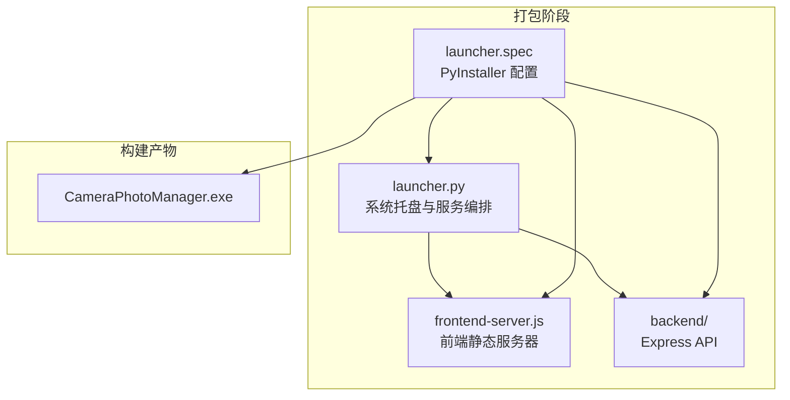
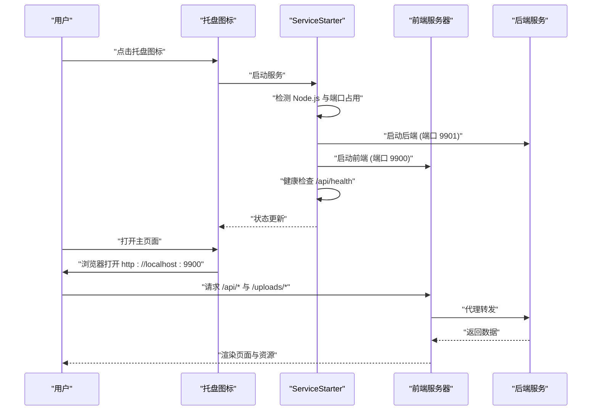
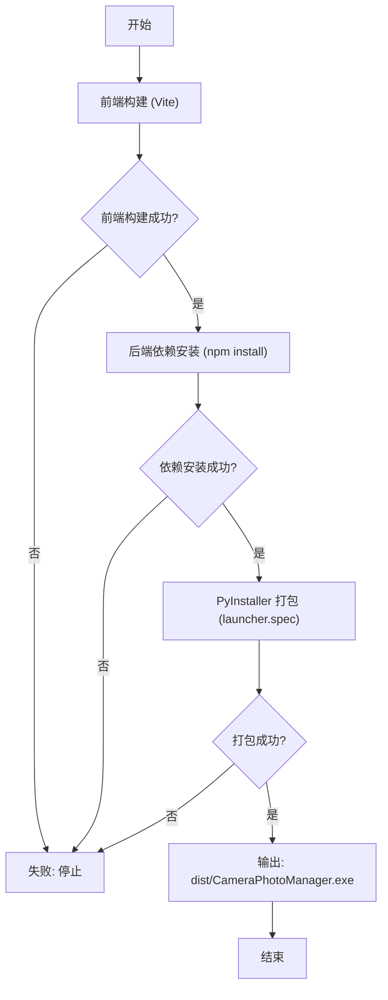
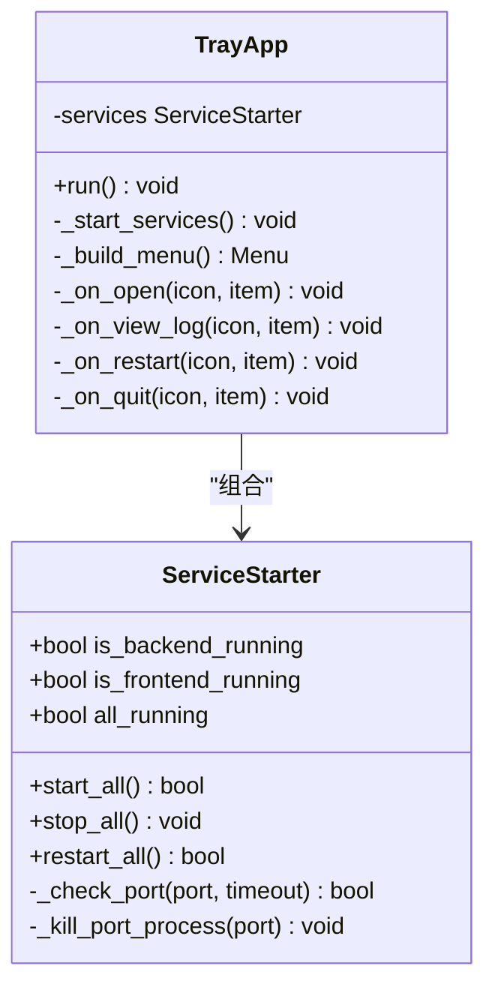
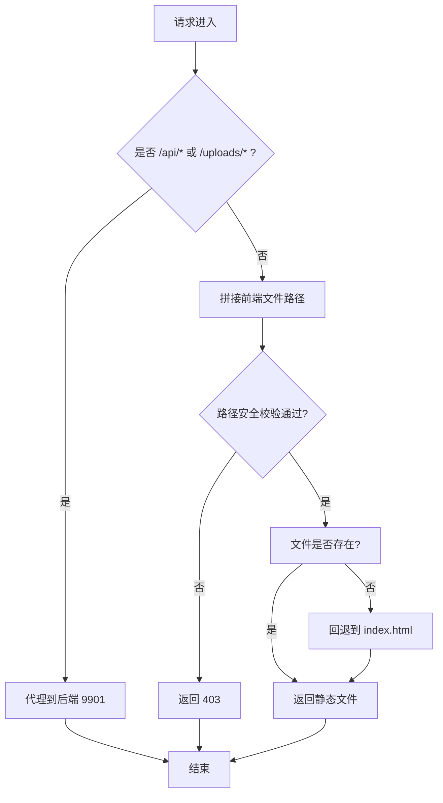
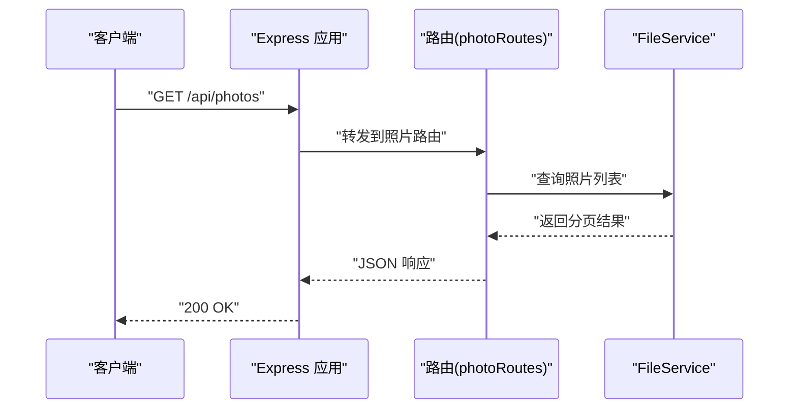
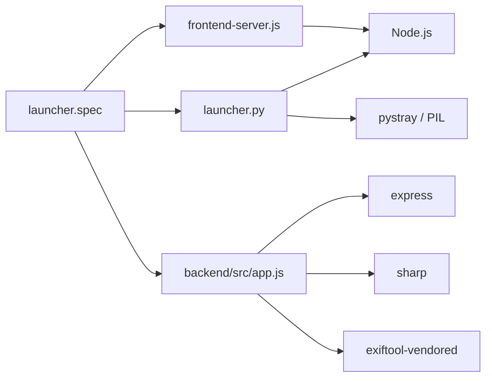

# 部署与打包

<cite>
**本文引用的文件**
- [README.md](file://README.md)
- [build.bat](file://build.bat)
- [frontend/package.json](file://frontend/package.json)
- [backend/package.json](file://backend/package.json)
- [frontend/vite.config.js](file://frontend/vite.config.js)
- [frontend-server.js](file://frontend-server.js)
- [launcher.spec](file://launcher.spec)
- [CameraPhotoManager.spec](file://CameraPhotoManager.spec)
- [launcher.py](file://launcher.py)
- [backend/src/app.js](file://backend/src/app.js)
- [backend/src/routes/photoRoutes.js](file://backend/src/routes/photoRoutes.js)
- [backend/src/services/fileService.js](file://backend/src/services/fileService.js)
</cite>

## 目录
1. [简介](#简介)
2. [项目结构](#项目结构)
3. [核心组件](#核心组件)
4. [架构总览](#架构总览)
5. [详细组件分析](#详细组件分析)
6. [依赖关系分析](#依赖关系分析)
7. [性能考虑](#性能考虑)
8. [故障排查指南](#故障排查指南)
9. [结论](#结论)
10. [附录](#附录)

## 简介
本文件面向运维与开发团队，提供摄影管理项目的部署与打包指南。内容涵盖：
- Electron 风格的桌面应用打包流程与签名要点
- 不同平台安装包制作方法（Windows EXE）
- 自动化构建脚本使用与可选配置项
- 应用更新机制与版本管理策略
- 应用商店发布准备与流程
- 生产环境部署与运维建议

## 项目结构
该项目采用“前端 + 后端 + 打包器”的混合架构：
- 前端使用 Vite 构建，通过本地静态服务器对外提供资源，并代理 API 到后端
- 后端基于 Express，提供照片管理、缩略图与 RAW 处理等能力
- 打包阶段使用 PyInstaller 将前端、后端与启动器整合为单文件可执行程序（Windows）

图表来源
- [launcher.spec:10-58](file://launcher.spec#L10-L58)
- [launcher.py:200-383](file://launcher.py#L200-L383)
- [frontend-server.js:86-138](file://frontend-server.js#L86-L138)

章节来源
- [README.md:1-3](file://README.md#L1-L3)
- [frontend/package.json:1-33](file://frontend/package.json#L1-L33)
- [backend/package.json:1-30](file://backend/package.json#L1-L30)
- [frontend/vite.config.js:1-21](file://frontend/vite.config.js#L1-L21)
- [frontend-server.js:1-139](file://frontend-server.js#L1-L139)
- [launcher.spec:1-59](file://launcher.spec#L1-L59)
- [CameraPhotoManager.spec:1-40](file://CameraPhotoManager.spec#L1-L40)
- [launcher.py:1-513](file://launcher.py#L1-L513)

## 核心组件
- 启动器（launcher.py）：负责单实例检测、前后端服务启动与托盘交互；在 Windows 上清理端口占用并进行健康检查
- 前端静态服务器（frontend-server.js）：提供前端构建产物访问与 API 代理
- 后端服务（backend/src/app.js）：Express 应用，提供照片管理、缩略图、RAW 处理与健康检查接口
- 打包配置（launcher.spec / CameraPhotoManager.spec）：定义 PyInstaller 分析、打包与 EXE 生成规则

章节来源
- [launcher.py:23-36](file://launcher.py#L23-L36)
- [launcher.py:200-383](file://launcher.py#L200-L383)
- [frontend-server.js:86-138](file://frontend-server.js#L86-L138)
- [backend/src/app.js:10-131](file://backend/src/app.js#L10-L131)
- [launcher.spec:10-58](file://launcher.spec#L10-L58)
- [CameraPhotoManager.spec:4-39](file://CameraPhotoManager.spec#L4-L39)

## 架构总览
下图展示应用启动与服务交互的关键流程。

图表来源
- [launcher.py:200-383](file://launcher.py#L200-L383)
- [frontend-server.js:63-84](file://frontend-server.js#L63-L84)
- [backend/src/app.js:119-121](file://backend/src/app.js#L119-L121)

## 详细组件分析

### 打包与构建流程
- 自动化脚本（build.bat）顺序执行：
  1) 前端构建（Vite）
  2) 后端依赖安装（npm install）
  3) 使用 PyInstaller 打包（launcher.spec）
- 打包产物：dist/CameraPhotoManager.exe（Windows）

图表来源
- [build.bat:8-41](file://build.bat#L8-L41)
- [launcher.spec:10-58](file://launcher.spec#L10-L58)

章节来源
- [build.bat:1-43](file://build.bat#L1-L43)
- [launcher.spec:1-59](file://launcher.spec#L1-L59)
- [CameraPhotoManager.spec:1-40](file://CameraPhotoManager.spec#L1-L40)

### 启动器与服务编排（launcher.py）
- 单实例保护：Windows 下使用命名互斥量
- 端口占用清理：Windows 下通过 netstat/taskkill 清理 9900/9901
- 健康检查：轮询 /api/health 确认服务就绪
- 日志：写入用户数据目录，便于排障
- 托盘菜单：打开页面、查看日志、重启服务、退出

图表来源
- [launcher.py:141-383](file://launcher.py#L141-L383)
- [launcher.py:406-482](file://launcher.py#L406-L482)

章节来源
- [launcher.py:23-36](file://launcher.py#L23-L36)
- [launcher.py:175-198](file://launcher.py#L175-L198)
- [launcher.py:200-383](file://launcher.py#L200-L383)
- [launcher.py:406-482](file://launcher.py#L406-L482)

### 前端静态服务器（frontend-server.js）
- 提供 frontend/dist 静态资源
- 将 /api/* 与 /uploads/* 代理到后端（9901）
- SPA 回退：非文件路由返回 index.html
- 端口占用容错：EADDRINUSE 时记录并退出

图表来源
- [frontend-server.js:86-138](file://frontend-server.js#L86-L138)

章节来源
- [frontend-server.js:1-139](file://frontend-server.js#L1-L139)

### 后端服务（backend/src/app.js）
- CORS、JSON 解析、请求日志中间件
- 动态静态文件服务：根据 repo 参数提供不同仓库路径
- 健康检查 /api/health
- 数据目录：支持 DATA_DIR 环境变量，确保目录存在

图表来源
- [backend/src/app.js:10-131](file://backend/src/app.js#L10-L131)
- [backend/src/routes/photoRoutes.js:68-92](file://backend/src/routes/photoRoutes.js#L68-L92)
- [backend/src/services/fileService.js:169-224](file://backend/src/services/fileService.js#L169-L224)

章节来源
- [backend/src/app.js:1-146](file://backend/src/app.js#L1-L146)
- [backend/src/routes/photoRoutes.js:1-739](file://backend/src/routes/photoRoutes.js#L1-L739)
- [backend/src/services/fileService.js:1-443](file://backend/src/services/fileService.js#L1-L443)

### 打包配置（launcher.spec / CameraPhotoManager.spec）
- Analysis 阶段：收集 launcher.py、frontend-server.js、backend、frontend/dist、icon 等资源
- PYZ/EXE 阶段：禁用控制台、UPX 压缩、设置图标
- Windows 签名字段：codesign_identity、entitlements_file（当前为空）

章节来源
- [launcher.spec:10-58](file://launcher.spec#L10-L58)
- [CameraPhotoManager.spec:4-39](file://CameraPhotoManager.spec#L4-L39)

## 依赖关系分析
- 启动器依赖 Node.js 可执行文件与 Python 第三方库（pystray、Pillow）
- 前端静态服务器依赖 Node.js 内置模块
- 后端依赖 Express、sharp、exiftool-vendored 等
- 打包器 PyInstaller 依赖 Python 环境与 UPX（如启用）

图表来源
- [launcher.spec:10-33](file://launcher.spec#L10-L33)
- [launcher.py:14-24](file://launcher.py#L14-L24)
- [backend/src/app.js:1-11](file://backend/src/app.js#L1-L11)
- [backend/src/services/fileService.js:1-3](file://backend/src/services/fileService.js#L1-L3)

章节来源
- [launcher.spec:1-59](file://launcher.spec#L1-L59)
- [launcher.py:1-513](file://launcher.py#L1-L513)
- [backend/src/app.js:1-146](file://backend/src/app.js#L1-L146)

## 性能考虑
- 前端静态服务器对大文件采用流式传输，避免内存峰值
- 视频预览支持 Range 请求，实现断点续传与低延迟
- 缩略图生成优先使用专用 RAW 处理与 sharp，失败时回退占位图
- 导入流程并发限制为 3，避免内存与磁盘压力过大
- 打包阶段启用 UPX 压缩以减小体积

章节来源
- [frontend-server.js:246-280](file://frontend-server.js#L246-L280)
- [backend/src/routes/photoRoutes.js:294-466](file://backend/src/routes/photoRoutes.js#L294-L466)
- [backend/src/services/fileService.js:75-156](file://backend/src/services/fileService.js#L75-L156)
- [launcher.spec:48-48](file://launcher.spec#L48-L48)

## 故障排查指南
- 启动失败
  - 检查 Node.js 是否安装并可执行
  - 查看用户数据目录下的日志文件（launcher.log、backend.log、frontend.log）
  - 确认端口 9900/9901 未被占用，必要时手动清理
- 健康检查失败
  - 轮询 /api/health 无响应，检查后端进程是否正常启动
- 前端无法访问
  - 确认前端静态服务器端口占用与代理配置
  - 检查 SPA 回退逻辑与路径安全校验
- 打包失败
  - 检查 PyInstaller 依赖与资源路径
  - 确认 launcher.spec 中的数据项与隐藏导入正确

章节来源
- [launcher.py:205-221](file://launcher.py#L205-L221)
- [launcher.py:327-342](file://launcher.py#L327-L342)
- [frontend-server.js:124-133](file://frontend-server.js#L124-L133)
- [frontend-server.js:106-121](file://frontend-server.js#L106-L121)
- [launcher.spec:14-28](file://launcher.spec#L14-L28)

## 结论
本项目通过启动器统一编排前后端服务，结合 PyInstaller 实现一键打包与分发。建议在生产环境中：
- 明确版本号与变更日志，配合自动化脚本进行构建与打包
- 在 Windows 上为 EXE 配置代码签名证书与权限文件
- 部署时固定 DATA_DIR，确保数据持久化与备份策略
- 对外发布前完成应用商店审核准备与合规性检查

## 附录

### 平台与安装包制作
- Windows EXE
  - 使用 launcher.spec 进行打包，产物位于 dist/CameraPhotoManager.exe
  - 如需签名，请在 launcher.spec 中配置 codesign_identity 与 entitlements_file 字段
- macOS/Linux
  - 当前未提供 DMG/AppImage 的构建脚本与配置
  - 若需发布，请参考 PyInstaller 官方文档添加相应平台配置

章节来源
- [build.bat:28-41](file://build.bat#L28-L41)
- [launcher.spec:55-57](file://launcher.spec#L55-L57)
- [CameraPhotoManager.spec:36-38](file://CameraPhotoManager.spec#L36-L38)

### 自动化构建脚本与配置
- 构建脚本（build.bat）
  - 自动执行前端构建、后端依赖安装与 PyInstaller 打包
  - 输出路径：dist/CameraPhotoManager.exe
- 打包配置（launcher.spec / CameraPhotoManager.spec）
  - 数据项：frontend-server.js、backend、frontend/dist、icon
  - 隐藏导入：PIL、pystray、urllib 等
  - 控制台：禁用（静默启动）
  - UPX：启用压缩

章节来源
- [build.bat:1-43](file://build.bat#L1-L43)
- [launcher.spec:14-28](file://launcher.spec#L14-L28)
- [launcher.spec:44-57](file://launcher.spec#L44-L57)

### 应用更新机制与版本管理
- 当前代码未实现内置自动更新逻辑
- 建议策略
  - 版本号：在前端 package.json 与后端 package.json 中维护统一版本
  - 更新通道：发布新版本后，引导用户下载最新 EXE
  - 自动更新（可选）：可在 launcher.py 中集成外部更新器或应用商店更新机制

章节来源
- [frontend/package.json:1-33](file://frontend/package.json#L1-L33)
- [backend/package.json:1-30](file://backend/package.json#L1-L30)
- [launcher.py:1-513](file://launcher.py#L1-L513)

### 应用商店发布准备
- Windows
  - 准备应用商店清单与元数据
  - 通过 Microsoft Store 审核流程提交
- macOS / Linux
  - 本仓库未提供 DMG/AppImage 的构建配置
  - 需补充相应打包配置与签名流程

章节来源
- [launcher.spec:55-57](file://launcher.spec#L55-L57)
- [CameraPhotoManager.spec:36-38](file://CameraPhotoManager.spec#L36-L38)

### 生产环境部署与运维建议
- 环境变量
  - PORT：后端监听端口（默认 9901）
  - DATA_DIR：用户数据目录（repos.json、日志等）
  - PHOTO_BASE_PATH：照片仓库默认路径（可选）
- 日志
  - 用户数据目录下生成 launcher.log、backend.log、frontend.log
- 端口
  - 前端：9900；后端：9901
  - 启动前自动清理占用端口的进程（Windows）

章节来源
- [backend/src/app.js:11-31](file://backend/src/app.js#L11-L31)
- [backend/src/app.js:134-143](file://backend/src/app.js#L134-L143)
- [launcher.py:41-42](file://launcher.py#L41-L42)
- [launcher.py:245-248](file://launcher.py#L245-L248)
- [frontend-server.js:15-16](file://frontend-server.js#L15-L16)