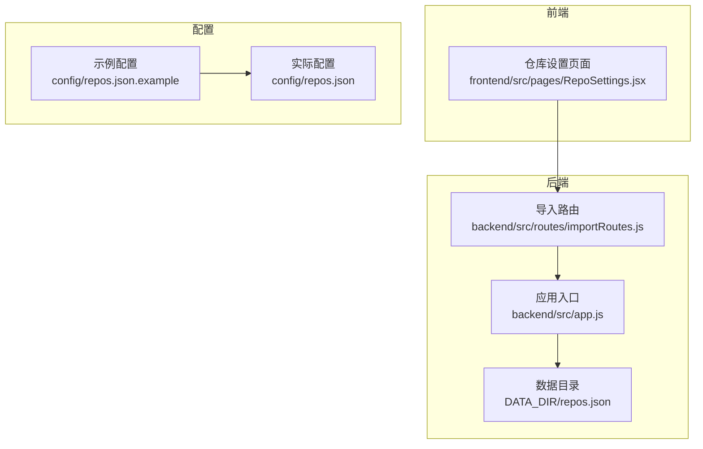
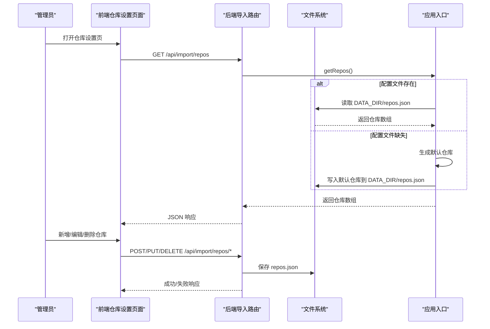
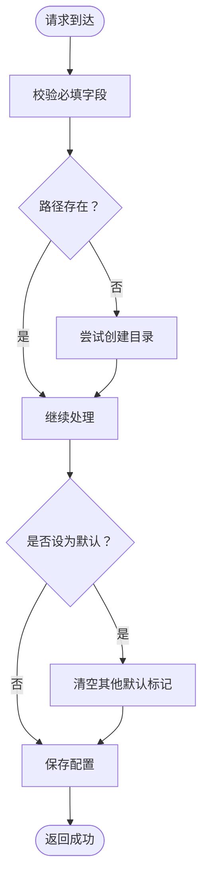
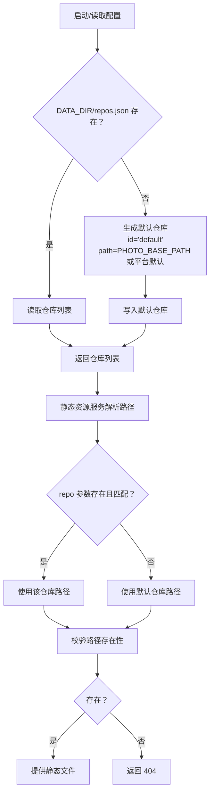
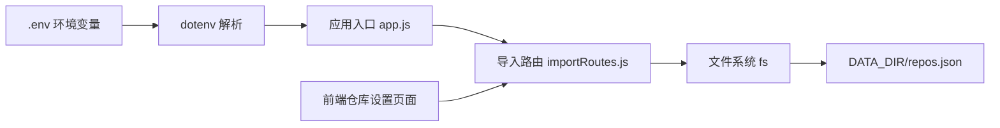

# 配置管理

<cite>
**本文引用的文件**
- [config/README.md](file://config/README.md)
- [config/repos.json](file://config/repos.json)
- [config/repos.json.example](file://config/repos.json.example)
- [backend/src/app.js](file://backend/src/app.js)
- [backend/src/routes/importRoutes.js](file://backend/src/routes/importRoutes.js)
- [frontend/src/pages/RepoSettings.jsx](file://frontend/src/pages/RepoSettings.jsx)
- [backend/package.json](file://backend/package.json)
</cite>

## 目录
1. [简介](#简介)
2. [项目结构](#项目结构)
3. [核心组件](#核心组件)
4. [架构总览](#架构总览)
5. [详细组件分析](#详细组件分析)
6. [依赖关系分析](#依赖关系分析)
7. [性能考量](#性能考量)
8. [故障排查指南](#故障排查指南)
9. [结论](#结论)
10. [附录](#附录)

## 简介
本文件面向管理员与运维人员，系统化梳理摄影管理项目的配置管理体系，重点围绕 repos.json 仓库配置文件的结构、字段定义、验证规则、多仓库管理策略、默认仓库与路径配置、环境变量、配置迁移与备份恢复、安全性与权限管理以及最佳实践进行说明。目标是帮助团队在不同环境下正确部署与维护系统。

## 项目结构
配置相关的关键位置与职责如下：
- config 目录：存放个人化的配置文件，包含示例与实际配置，且被 Git 忽略，避免泄露敏感路径信息。
- backend 数据持久化：通过环境变量 DATA_DIR 指定数据目录，默认位于 backend/src/data；repos.json 即该目录下的仓库配置文件。
- 前端界面：提供仓库设置页面，支持增删改默认仓库、查看与编辑路径等操作。
- 后端路由：提供仓库查询、新增、删除、设置默认等接口，并负责读写 repos.json。

图表来源
- [backend/src/app.js:28-36](file://backend/src/app.js#L28-L36)
- [backend/src/routes/importRoutes.js:55-59](file://backend/src/routes/importRoutes.js#L55-L59)
- [frontend/src/pages/RepoSettings.jsx:29-54](file://frontend/src/pages/RepoSettings.jsx#L29-L54)

章节来源
- [config/README.md:1-47](file://config/README.md#L1-L47)
- [backend/src/app.js:28-36](file://backend/src/app.js#L28-L36)
- [backend/src/routes/importRoutes.js:55-59](file://backend/src/routes/importRoutes.js#L55-L59)
- [frontend/src/pages/RepoSettings.jsx:29-54](file://frontend/src/pages/RepoSettings.jsx#L29-L54)

## 核心组件
- repos.json 配置文件：以 JSON 数组形式存储多个仓库条目，每个条目包含 id、name、path、isDefault 字段。
- 后端配置读写：通过 getRepos/saveRepos 函数读取与写回配置；当配置缺失时生成默认仓库。
- 前端仓库设置界面：提供仓库列表展示、新增、删除、设为默认等交互。
- 环境变量：PORT、PHOTO_BASE_PATH、DEFAULT_IMPORT_PATH、DATA_DIR 等影响运行行为与默认路径。

章节来源
- [config/README.md:7-20](file://config/README.md#L7-L20)
- [backend/src/app.js:38-65](file://backend/src/app.js#L38-L65)
- [backend/src/routes/importRoutes.js:23-59](file://backend/src/routes/importRoutes.js#L23-L59)
- [frontend/src/pages/RepoSettings.jsx:29-54](file://frontend/src/pages/RepoSettings.jsx#L29-L54)

## 架构总览
下图展示了从配置文件到运行时的行为映射，包括默认仓库生成、路径解析与静态资源服务。

图表来源
- [backend/src/app.js:38-65](file://backend/src/app.js#L38-L65)
- [backend/src/routes/importRoutes.js:219-340](file://backend/src/routes/importRoutes.js#L219-L340)

## 详细组件分析

### repos.json 结构与字段定义
- 结构：JSON 数组，元素为仓库对象。
- 字段：
  - id：字符串，唯一标识仓库，用于路由参数与默认仓库切换。
  - name：字符串，仓库显示名称。
  - path：字符串，仓库物理路径或特殊值 AUTO（由后端解析）。
  - isDefault：布尔值，标记是否为默认仓库。
- 数据类型与约束：
  - id：非空字符串，建议使用稳定标识符。
  - name：非空字符串，建议具有可读性。
  - path：必须为有效可访问路径；若不存在，后端会尝试创建。
  - isDefault：单个仓库为 true，其余自动置为 false；删除默认仓库时自动选择首个仓库为默认。

章节来源
- [config/repos.json:1-20](file://config/repos.json#L1-L20)
- [config/repos.json.example:3-16](file://config/repos.json.example#L3-L16)
- [backend/src/routes/importRoutes.js:234-281](file://backend/src/routes/importRoutes.js#L234-L281)
- [backend/src/routes/importRoutes.js:283-316](file://backend/src/routes/importRoutes.js#L283-L316)
- [backend/src/routes/importRoutes.js:318-340](file://backend/src/routes/importRoutes.js#L318-L340)

### 多仓库配置管理
- 查询：GET /api/import/repos 返回当前所有仓库。
- 新增：POST /api/import/repos 校验必填字段，自动创建不存在的路径，支持设置默认仓库。
- 删除：DELETE /api/import/repos/:id 删除指定仓库，若删除默认仓库则自动选择下一个仓库为默认。
- 设为默认：PUT /api/import/repos/:id/default 切换默认仓库，保证仅一个默认。

图表来源
- [backend/src/routes/importRoutes.js:234-281](file://backend/src/routes/importRoutes.js#L234-L281)

章节来源
- [backend/src/routes/importRoutes.js:219-340](file://backend/src/routes/importRoutes.js#L219-L340)

### 默认仓库与路径配置策略
- 默认仓库生成：
  - 若 DATA_DIR 下无 repos.json，则生成单个默认仓库，id 固定，name 为“默认仓库”，path 来源于 PHOTO_BASE_PATH 或按平台推导的用户图片目录。
- 路径解析优先级：
  - 显式配置：优先使用 repos.json 中的 path。
  - 环境变量：PHOTO_BASE_PATH 可覆盖默认路径。
  - 平台默认：Windows/macOS/Linux 分别指向用户图片目录下的“相机照片”子目录。
- 静态资源服务：
  - /uploads 路由根据查询参数 repo 选择仓库路径，若未找到或不可达则返回 404。

图表来源
- [backend/src/app.js:38-65](file://backend/src/app.js#L38-L65)
- [backend/src/app.js:67-91](file://backend/src/app.js#L67-L91)

章节来源
- [backend/src/app.js:38-65](file://backend/src/app.js#L38-L65)
- [backend/src/app.js:67-91](file://backend/src/app.js#L67-L91)

### 环境变量配置
- PORT：后端监听端口，默认 3001。
- PHOTO_BASE_PATH：默认照片存储路径，优先于平台默认路径。
- DEFAULT_IMPORT_PATH：存储卡默认导入路径，用于导入流程的默认提示。
- DATA_DIR：数据目录，用于持久化 repos.json，默认 backend/src/data。

章节来源
- [config/README.md:22-28](file://config/README.md#L22-L28)
- [backend/src/app.js:28-31](file://backend/src/app.js#L28-L31)
- [backend/src/routes/importRoutes.js:189-216](file://backend/src/routes/importRoutes.js#L189-L216)

### 配置文件的创建、编辑与验证
- 创建步骤：
  - 复制示例文件为实际配置：repos.json.example → repos.json。
  - 编辑 repos.json，填写 id、name、path、isDefault。
- 编辑步骤：
  - 通过前端仓库设置页面进行增删改与默认仓库切换。
  - 或直接编辑 config/repos.json（不推荐，除非紧急修复）。
- 验证方法：
  - 启动后端，调用 GET /api/import/repos 校验返回内容。
  - 访问 /uploads?repo=<id> 验证静态资源路径可用性。
  - 检查 DATA_DIR 是否存在并可写。

章节来源
- [config/README.md:30-40](file://config/README.md#L30-L40)
- [frontend/src/pages/RepoSettings.jsx:29-54](file://frontend/src/pages/RepoSettings.jsx#L29-L54)
- [backend/src/routes/importRoutes.js:219-232](file://backend/src/routes/importRoutes.js#L219-L232)

### 配置迁移与备份恢复
- 迁移策略：
  - 将旧环境的 DATA_DIR 复制到新环境的相同路径，或通过 DATA_DIR 环境变量指向同一共享目录。
  - 在新环境中先放置 config/repos.json.example，再复制为 repos.json 并调整路径。
- 备份：
  - 定期备份 DATA_DIR 下的 repos.json。
  - 对比 config/repos.json 与示例文件差异，记录自定义变更。
- 恢复：
  - 停止服务，替换 repos.json，重启服务。
  - 若丢失默认仓库，可通过前端设置或手动编辑恢复。

章节来源
- [backend/src/app.js:28-36](file://backend/src/app.js#L28-L36)
- [config/README.md:42-47](file://config/README.md#L42-L47)

### 安全性考虑与权限管理
- 敏感信息隔离：
  - 配置文件被 Git 忽略，避免泄露路径与环境变量。
- 最小权限原则：
  - 后端进程仅需对 DATA_DIR 具备读写权限。
  - 静态资源路径需对服务进程可见，避免对外暴露。
- 环境变量安全：
  - 不在日志中打印敏感配置；生产环境通过进程管理器注入环境变量。
- 前端交互安全：
  - 仓库路径变更需经后端校验与创建，防止无效路径导致服务异常。

章节来源
- [config/README.md:42-47](file://config/README.md#L42-L47)
- [backend/src/routes/importRoutes.js:234-252](file://backend/src/routes/importRoutes.js#L234-L252)

### 最佳实践
- 统一命名规范：id 使用稳定标识符，name 具有可读性。
- 路径策略：优先使用绝对路径；避免使用易变的相对路径。
- 默认仓库：始终保留一个默认仓库，便于导入与浏览。
- 版本控制：仅提交 config/repos.json.example；个人配置放入 config/repos.json。
- 监控与告警：关注 /uploads 路由返回 404 的情况，及时修复路径问题。

章节来源
- [config/README.md:7-20](file://config/README.md#L7-L20)
- [backend/src/routes/importRoutes.js:283-316](file://backend/src/routes/importRoutes.js#L283-L316)

## 依赖关系分析
- 后端依赖 dotenv 解析 .env；依赖 fs 读写配置文件；依赖 path 组合路径。
- 前端通过 API 与后端交互，实现仓库配置的可视化管理。
- 配置文件与运行时行为的耦合点集中在 DATA_DIR、PHOTO_BASE_PATH、DEFAULT_IMPORT_PATH。

图表来源
- [backend/src/app.js:5](file://backend/src/app.js#L5)
- [backend/package.json:10-18](file://backend/package.json#L10-L18)
- [backend/src/app.js:28-31](file://backend/src/app.js#L28-L31)
- [backend/src/routes/importRoutes.js:55-59](file://backend/src/routes/importRoutes.js#L55-L59)

章节来源
- [backend/src/app.js:5](file://backend/src/app.js#L5)
- [backend/package.json:10-18](file://backend/package.json#L10-L18)
- [backend/src/app.js:28-31](file://backend/src/app.js#L28-L31)
- [backend/src/routes/importRoutes.js:55-59](file://backend/src/routes/importRoutes.js#L55-L59)

## 性能考量
- 配置读取：repos.json 为小型 JSON 文件，读写成本低；建议避免频繁重写，批量更新更优。
- 路径校验：新增仓库时尝试创建目录，建议在导入前预检路径，减少运行时 IO。
- 静态资源：/uploads 路由每次请求都会校验路径存在性，建议确保仓库路径稳定，避免频繁变更。

## 故障排查指南
- 无法加载仓库列表：
  - 检查 DATA_DIR 是否存在且可读；确认 repos.json 格式合法。
  - 查看后端日志中的异常堆栈，定位具体错误。
- 静态资源 404：
  - 确认 /uploads?repo=<id> 中的 id 正确；检查对应仓库路径是否存在。
  - 若路径为平台默认，确认 PHOTO_BASE_PATH 是否覆盖正确。
- 新增仓库失败：
  - 确认请求体包含 name 与 path；检查后端是否具备目录创建权限。
- 默认仓库丢失：
  - 通过前端设置或手动编辑恢复；删除默认仓库时系统会自动选择下一个仓库为默认。

章节来源
- [backend/src/app.js:123-143](file://backend/src/app.js#L123-L143)
- [backend/src/app.js:67-91](file://backend/src/app.js#L67-L91)
- [backend/src/routes/importRoutes.js:234-281](file://backend/src/routes/importRoutes.js#L234-L281)
- [backend/src/routes/importRoutes.js:283-316](file://backend/src/routes/importRoutes.js#L283-L316)

## 结论
通过明确的 repos.json 结构、严格的验证规则、清晰的默认仓库策略与环境变量配置，摄影管理项目实现了灵活而可靠的多仓库管理能力。配合前端可视化界面与后端稳健的读写机制，管理员可在不同平台上快速完成部署、迁移与维护工作。建议遵循本文的最佳实践与安全要求，确保系统长期稳定运行。

## 附录
- 首次使用步骤：复制示例配置与环境变量文件，编辑为实际路径，启动服务即可。
- 配置文件清单：repos.json（仓库配置）、.env（环境变量），均位于 config 目录，且被 Git 忽略。

章节来源
- [config/README.md:30-40](file://config/README.md#L30-L40)