# 项目概述

<cite>
**本文档引用的文件**
- [README.md](file://README.md)
- [frontend/package.json](file://frontend/package.json)
- [backend/package.json](file://backend/package.json)
- [frontend/src/App.jsx](file://frontend/src/App.jsx)
- [backend/src/app.js](file://backend/src/app.js)
- [backend/src/routes/photoRoutes.js](file://backend/src/routes/photoRoutes.js)
- [backend/src/routes/importRoutes.js](file://backend/src/routes/importRoutes.js)
- [backend/src/services/fileService.js](file://backend/src/services/fileService.js)
- [backend/src/utils/fileUtils.js](file://backend/src/utils/fileUtils.js)
- [backend/src/utils/rawThumbnail.js](file://backend/src/utils/rawThumbnail.js)
- [frontend/src/pages/PhotoGallery.jsx](file://frontend/src/pages/PhotoGallery.jsx)
- [frontend/src/pages/ImportPage.jsx](file://frontend/src/pages/ImportPage.jsx)
- [frontend/src/api/index.js](file://frontend/src/api/index.js)
- [config/repos.json.example](file://config/repos.json.example)
</cite>

## 目录
1. [引言](#引言)
2. [项目结构](#项目结构)
3. [核心组件](#核心组件)
4. [架构概览](#架构概览)
5. [详细组件分析](#详细组件分析)
6. [依赖关系分析](#依赖关系分析)
7. [性能考虑](#性能考虑)
8. [故障排除指南](#故障排除指南)
9. [结论](#结论)
10. [附录](#附录)

## 引言

Camera Photo Manager 是一个基于 Electron 的跨平台桌面应用程序，专为摄影师设计的照片管理系统。该项目旨在解决摄影师在管理大量照片文件时面临的挑战，特别是来自相机存储卡的照片导入、管理和预览需求。

### 项目核心目标

- **一站式照片管理**：提供从存储卡导入到本地管理的完整解决方案
- **多格式支持**：支持 JPG、RAW、视频等多种格式的照片文件
- **智能导入机制**：实现增量导入，避免覆盖现有文件
- **高效预览体验**：提供流畅的照片浏览和预览功能
- **跨平台兼容**：支持 Windows、macOS 和 Linux 三大主流操作系统

### 主要功能特性

1. **存储卡照片导入**
   - 实时进度跟踪（SSE）
   - 自动重命名避免冲突
   - 增量导入模式

2. **多格式照片管理**
   - JPG 照片浏览和管理
   - RAW 底片处理和预览
   - 视频文件支持

3. **智能存储管理**
   - 多仓库配置支持
   - 分类存储结构
   - 孤立 RAW 文件检测

4. **高效预览系统**
   - 实时缩略图生成
   - RAW 文件嵌入预览提取
   - 流式视频播放支持

## 项目结构

该项目采用前后端分离的架构设计，结合 Electron 实现跨平台桌面应用：

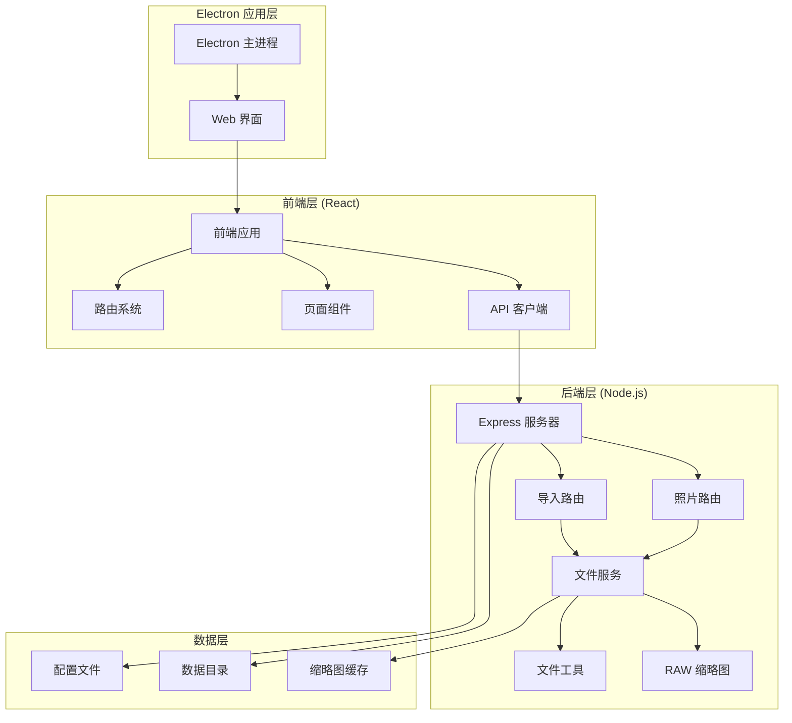

**图表来源**
- [frontend/src/App.jsx:1-41](file://frontend/src/App.jsx#L1-L41)
- [backend/src/app.js:1-146](file://backend/src/app.js#L1-L146)
- [backend/src/routes/photoRoutes.js:1-739](file://backend/src/routes/photoRoutes.js#L1-L739)
- [backend/src/routes/importRoutes.js:1-627](file://backend/src/routes/importRoutes.js#L1-L627)

### 目录组织结构

项目采用模块化的目录结构，每个主要功能领域都有独立的目录：

- **`frontend/`** - React 前端应用
  - `src/pages/` - 页面组件
  - `src/components/` - 可复用组件
  - `src/api/` - API 客户端封装
  - `src/assets/` - 静态资源

- **`backend/`** - Node.js 后端服务
  - `src/routes/` - HTTP 路由处理
  - `src/services/` - 业务逻辑服务
  - `src/utils/` - 工具函数库
  - `data/` - 运行时数据存储

- **`config/`** - 配置文件模板
- **`electron/`** - Electron 特定资源

**章节来源**
- [frontend/package.json:1-33](file://frontend/package.json#L1-L33)
- [backend/package.json:1-30](file://backend/package.json#L1-L30)

## 核心组件

### 技术架构组件

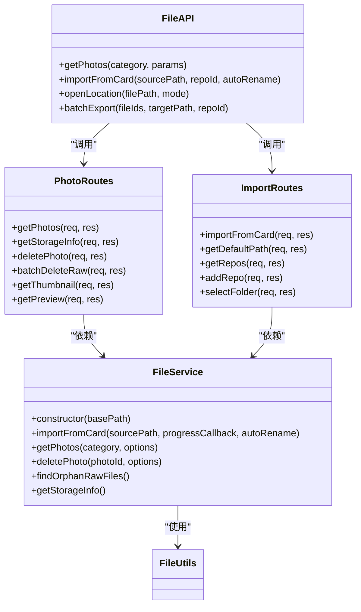

**图表来源**
- [backend/src/services/fileService.js:1-443](file://backend/src/services/fileService.js#L1-L443)
- [backend/src/routes/photoRoutes.js:1-739](file://backend/src/routes/photoRoutes.js#L1-L739)
- [backend/src/routes/importRoutes.js:1-627](file://backend/src/routes/importRoutes.js#L1-L627)
- [frontend/src/api/index.js:1-168](file://frontend/src/api/index.js#L1-L168)

### 核心业务流程

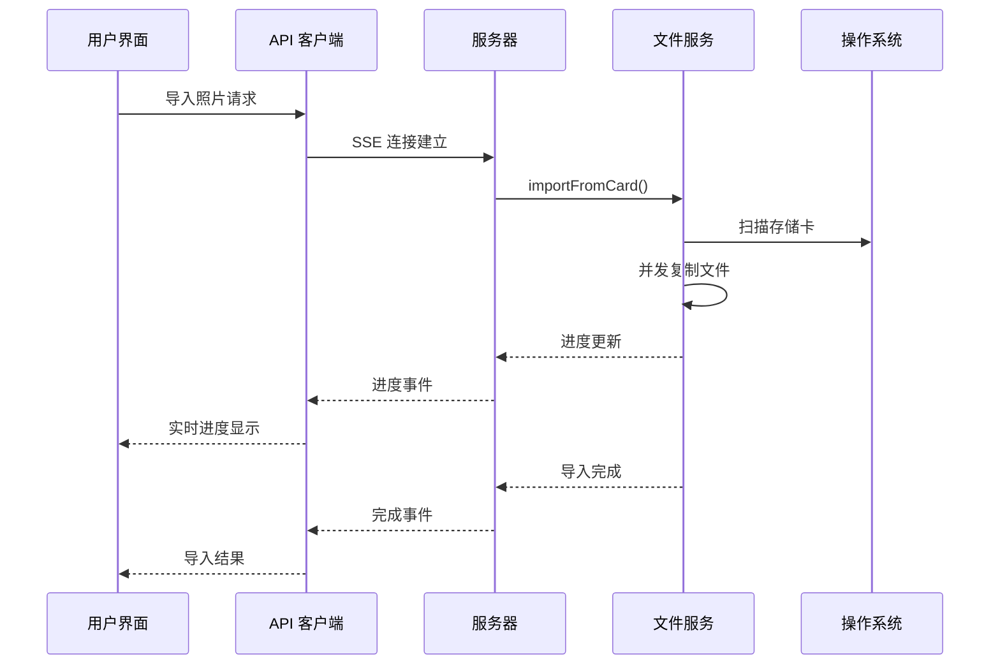

**图表来源**
- [frontend/src/pages/ImportPage.jsx:212-260](file://frontend/src/pages/ImportPage.jsx#L212-L260)
- [backend/src/routes/importRoutes.js:83-182](file://backend/src/routes/importRoutes.js#L83-L182)
- [backend/src/services/fileService.js:24-167](file://backend/src/services/fileService.js#L24-L167)

**章节来源**
- [backend/src/services/fileService.js:1-443](file://backend/src/services/fileService.js#L1-L443)
- [backend/src/utils/fileUtils.js:1-167](file://backend/src/utils/fileUtils.js#L1-L167)

## 架构概览

### 整体架构设计

Camera Photo Manager 采用现代 Web 技术栈构建，结合 Electron 实现桌面应用：

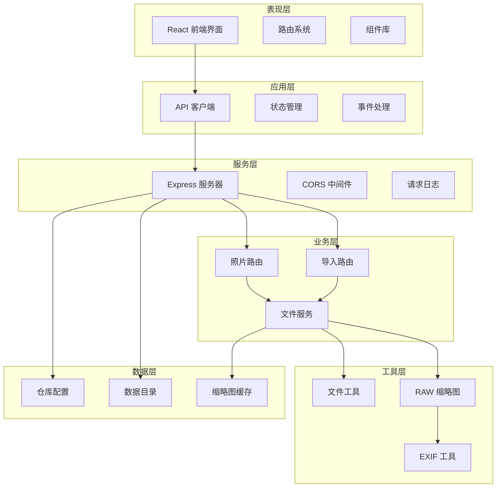

**图表来源**
- [backend/src/app.js:1-146](file://backend/src/app.js#L1-L146)
- [backend/src/routes/photoRoutes.js:1-739](file://backend/src/routes/photoRoutes.js#L1-L739)
- [backend/src/routes/importRoutes.js:1-627](file://backend/src/routes/importRoutes.js#L1-L627)

### 技术选型决策

#### 前端技术栈
- **React 19**: 选择最新版本获得更好的性能和开发体验
- **Ant Design**: 提供丰富的 UI 组件和一致的设计规范
- **React Router DOM**: 支持单页应用的路由管理
- **Axios**: 强大的 HTTP 客户端，支持拦截器和取消请求

#### 后端技术栈
- **Express**: 轻量级 Web 框架，适合 API 服务
- **Sharp**: 高性能图像处理库，支持多种格式
- **EXIFTool**: 专业的 EXIF 元数据处理工具
- **Multer**: 文件上传中间件

#### Electron 集成
- **跨平台桌面应用**: 统一的用户体验
- **系统集成**: 访问文件系统和硬件设备
- **原生功能**: 系统对话框和通知

**章节来源**
- [frontend/package.json:12-20](file://frontend/package.json#L12-L20)
- [backend/package.json:10-18](file://backend/package.json#L10-L18)

## 详细组件分析

### 照片管理系统

#### 核心功能实现

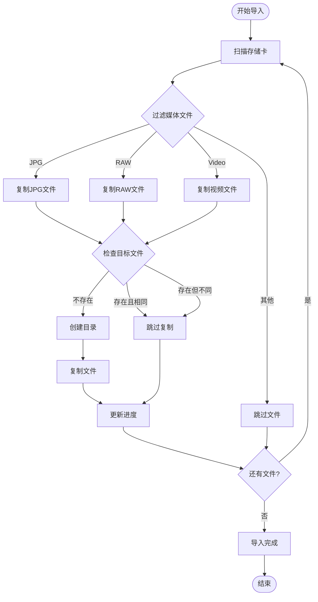

**图表来源**
- [backend/src/services/fileService.js:24-167](file://backend/src/services/fileService.js#L24-L167)
- [backend/src/utils/fileUtils.js:78-100](file://backend/src/utils/fileUtils.js#L78-L100)

#### 照片浏览组件

PhotoGallery 组件提供了完整的照片浏览和管理功能：

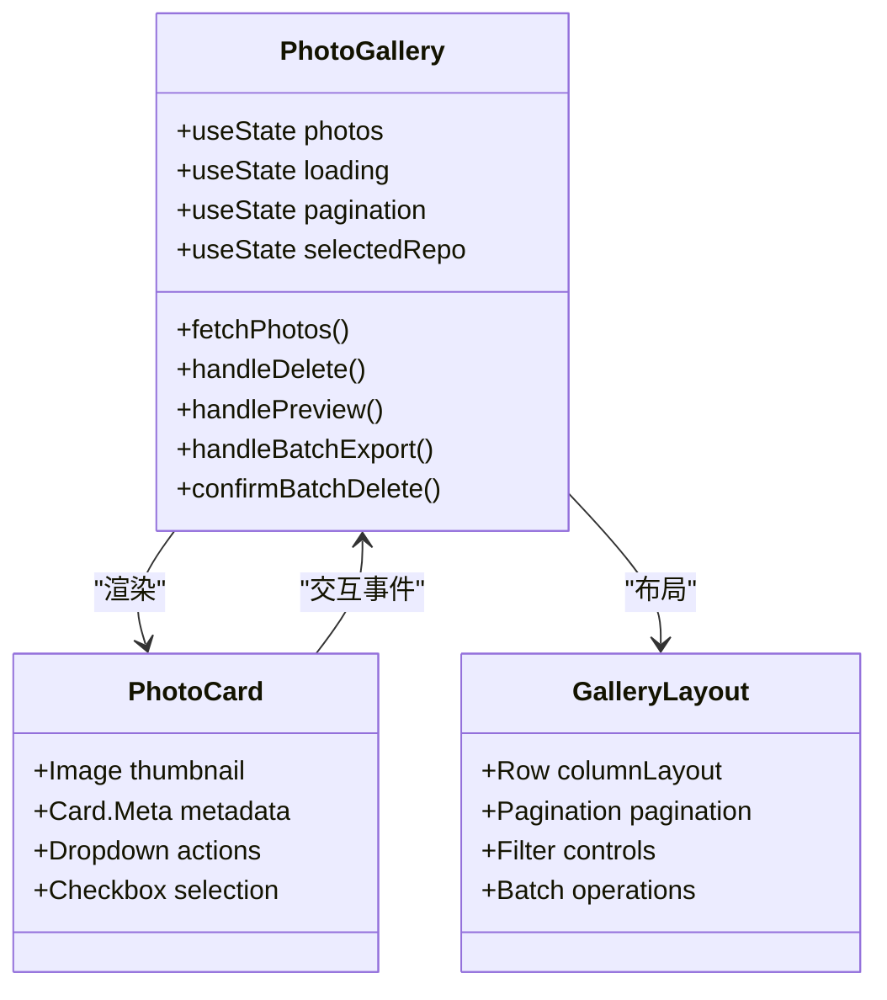

**图表来源**
- [frontend/src/pages/PhotoGallery.jsx:43-794](file://frontend/src/pages/PhotoGallery.jsx#L43-L794)

**章节来源**
- [frontend/src/pages/PhotoGallery.jsx:1-794](file://frontend/src/pages/PhotoGallery.jsx#L1-L794)

### 导入系统

#### 实时导入流程

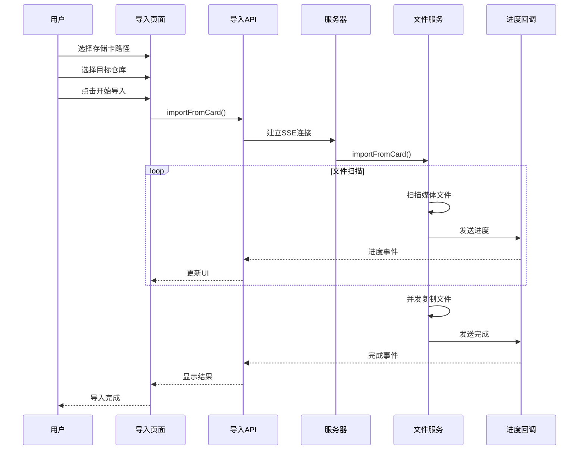

**图表来源**
- [frontend/src/pages/ImportPage.jsx:212-260](file://frontend/src/pages/ImportPage.jsx#L212-L260)
- [backend/src/routes/importRoutes.js:83-182](file://backend/src/routes/importRoutes.js#L83-L182)

#### 存储仓库管理

系统支持多仓库配置，提供灵活的存储管理：

| 功能特性 | 描述 | 实现方式 |
|---------|------|----------|
| 多仓库支持 | 支持多个照片存储位置 | JSON 配置文件 |
| 默认仓库 | 设置默认导入目标 | 标识字段标记 |
| 路径验证 | 自动检查路径有效性 | 文件系统访问 |
| 动态切换 | 运行时切换仓库 | 参数传递 |

**章节来源**
- [backend/src/routes/importRoutes.js:219-340](file://backend/src/routes/importRoutes.js#L219-L340)
- [config/repos.json.example:1-17](file://config/repos.json.example#L1-L17)

### RAW 文件处理系统

#### RAW 缩略图生成策略

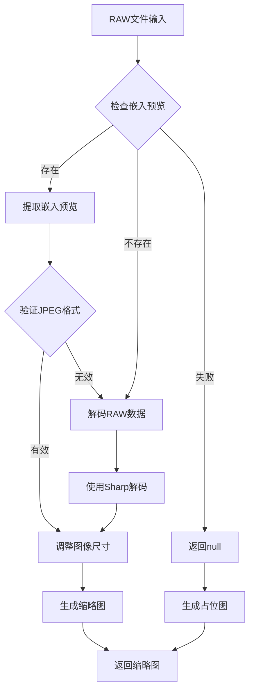

**图表来源**
- [backend/src/utils/rawThumbnail.js:79-132](file://backend/src/utils/rawThumbnail.js#L79-L132)

#### RAW 文件关联管理

系统能够智能识别和管理 RAW 文件与其对应的 JPG 文件关系：

| 文件类型 | 扩展名 | 处理方式 |
|---------|--------|----------|
| Canon RAW | .cr2, .cr3 | 嵌入预览提取 |
| Sony ARW | .arw | 嵌入预览提取 |
| Nikon NEF | .nef | 嵌入预览提取 |
| Adobe DNG | .dng | 标准RAW处理 |
| 其他RAW | .orf, .raf, .rw2, .raw | Sharp解码 |

**章节来源**
- [backend/src/utils/rawThumbnail.js:1-132](file://backend/src/utils/rawThumbnail.js#L1-L132)
- [backend/src/utils/fileUtils.js:4-9](file://backend/src/utils/fileUtils.js#L4-L9)

## 依赖关系分析

### 核心依赖关系

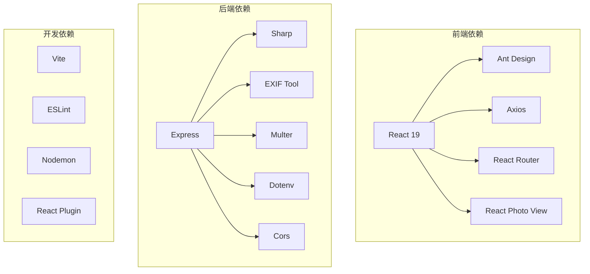

**图表来源**
- [frontend/package.json:12-31](file://frontend/package.json#L12-L31)
- [backend/package.json:10-21](file://backend/package.json#L10-L21)

### 外部工具集成

系统集成了多个专业工具来增强功能：

| 工具名称 | 用途 | 版本 | 依赖关系 |
|---------|------|------|----------|
| ffmpeg | 视频处理和帧提取 | 任意 | 系统安装 |
| EXIFTool | EXIF元数据处理 | 35.17.0 | 独立进程 |
| Sharp | 图像处理和缩放 | 0.34.5 | Node.js绑定 |
| Dialog | 系统对话框 | 0.3.1 | 跨平台支持 |

**章节来源**
- [backend/package.json:10-18](file://backend/package.json#L10-L18)

## 性能考虑

### 并发处理优化

系统采用了多层并发控制来确保性能和稳定性：

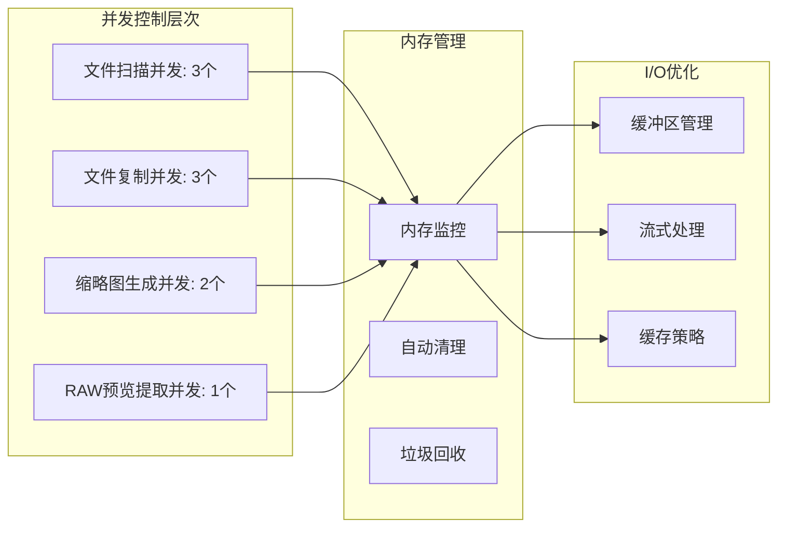

### 性能优化策略

1. **流式文件处理**: 大文件采用流式读取，避免内存溢出
2. **并发限制**: 控制同时处理的文件数量，平衡性能和资源
3. **缓存机制**: 缩略图和预览图缓存减少重复计算
4. **增量导入**: 避免重复复制已存在的文件

## 故障排除指南

### 常见问题诊断

#### 导入过程问题

| 问题症状 | 可能原因 | 解决方案 |
|---------|----------|----------|
| 导入进度停滞 | 网络连接不稳定 | 检查网络状态，重试导入 |
| 文件复制失败 | 权限不足 | 检查目标目录权限 |
| RAW文件无法预览 | EXIF工具缺失 | 安装EXIF工具或使用备用方案 |
| 进度更新延迟 | 服务器负载过高 | 减少同时处理的文件数量 |

#### 系统兼容性问题

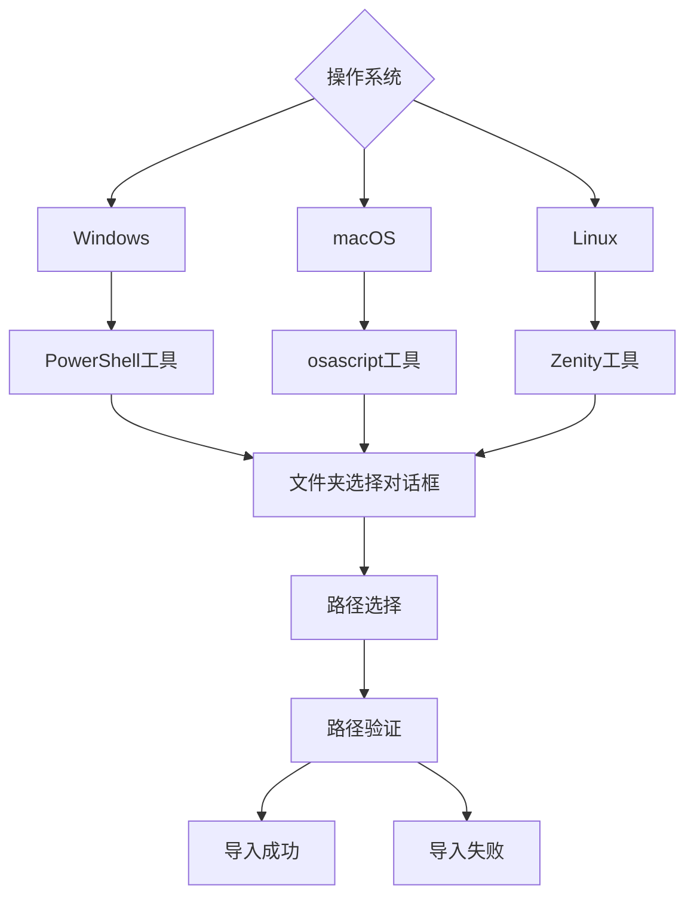

**图表来源**
- [backend/src/routes/importRoutes.js:343-624](file://backend/src/routes/importRoutes.js#L343-L624)

**章节来源**
- [backend/src/routes/importRoutes.js:343-624](file://backend/src/routes/importRoutes.js#L343-L624)

### 日志和调试

系统提供了详细的日志记录机制：

- **请求日志**: 记录所有HTTP请求的详细信息
- **进度日志**: 导入过程的实时进度跟踪
- **错误日志**: 异常情况的详细错误信息
- **性能日志**: 关键操作的执行时间和资源使用

## 结论

Camera Photo Manager 是一个功能完整、架构清晰的照片管理解决方案。通过采用现代 Web 技术栈和 Electron 框架，该项目实现了跨平台兼容性和优秀的用户体验。

### 项目优势

1. **技术先进性**: 使用最新的 React 19 和 Express 技术栈
2. **功能完整性**: 覆盖从导入到管理的完整工作流程
3. **性能优化**: 多层并发控制和流式处理机制
4. **扩展性强**: 模块化设计便于功能扩展和维护

### 技术特色

- **实时导入**: 基于 SSE 的实时进度反馈
- **智能处理**: RAW 文件嵌入预览提取和智能重命名
- **跨平台**: Electron 实现统一的桌面应用体验
- **多格式支持**: 完整的 JPG、RAW、视频文件处理能力

### 未来发展

项目具备良好的扩展基础，未来可以在以下方面进一步发展：

1. **云同步功能**: 支持云端备份和同步
2. **AI 辅助**: 利用机器学习进行智能分类和搜索
3. **协作功能**: 多用户协作和共享管理
4. **移动端支持**: 响应式设计适配移动设备

## 附录

### 版本信息

- **前端框架**: React 19.x
- **后端框架**: Express 4.x
- **Electron**: 最新稳定版
- **Node.js**: 18.x LTS

### 安装和部署

1. **环境要求**: Node.js 18+, npm 8+
2. **依赖安装**: `npm install` (在 frontend 和 backend 目录分别执行)
3. **开发启动**: `npm run dev` (分别启动前端和后端)
4. **生产构建**: `npm run build` (构建 Electron 应用)

### 配置选项

系统支持多种配置选项来适应不同的使用场景：

- **数据目录**: 通过环境变量 `DATA_DIR` 指定
- **默认导入路径**: 通过环境变量 `DEFAULT_IMPORT_PATH` 指定
- **照片基础路径**: 通过环境变量 `PHOTO_BASE_PATH` 指定
- **端口配置**: 通过环境变量 `PORT` 指定