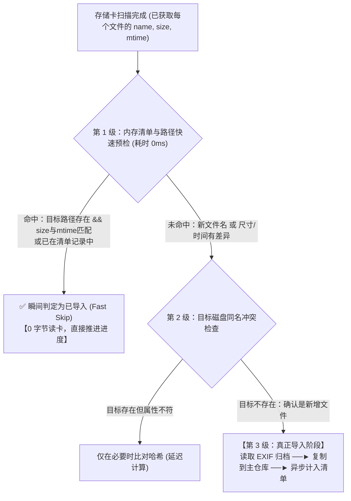

# 拾光舱 · 极速增量导入与实时速率监控体系 PRD 与技术设计方案（v1.0.5）

> **状态**：Review · **版本**：v1.0.5 · **负责人**：核心开发 / 架构设计 · **最后更新**：2026-11-02  
> **关联模块**：文件导入服务（`fileService`）、任务管理器（`taskManager`）、导入路由（`importRoutes`）、导入页面（`ImportPage`）

---

## 0. 需求背景与痛点陈述

拾光舱作为面向摄影师的高速相机资产管理工具，核心操作之一便是**“存储卡导入”**。在实际摄影工作流中，摄影师通常不会在每次拍摄后格式化存储卡，而是维持存储卡内积累数百至数千张历史照片（包含数十 GB 的 RAW/JPG/视频），每次插入电脑仅需增量导入最新拍摄的数十张照片。

### 1.1 现状与用户痛点
1. **千张历史照片导入极其缓慢（核心痛点）**：
   * 用户存储卡内有 1000+ 张照片（历史已导入），本次新增仅 30~40 张。
   * 点击导入后，系统需要耗费 **8 ~ 15 分钟** 逐张扫描比对，严重阻断摄影师的工作流，体验极差。
2. **缺乏读写速率与数据量反馈**：
   * 进度条仅显示文件个数（如 `第 15 / 1000 个`）和百分比，用户无法感知当前雷电 4 / UHS-II 高速读卡器与 SSD 的实际工作性能。
   * 剩余时间仅通过 `平均单张耗时 × 剩余张数` 粗暴估算，当遇到大文件（视频、高像素 RAW）时剩余时间剧烈跳动，参考价值极低。

### 1.2 技术瓶颈深度根因分析（Root Cause）

```
[现有代码缺陷链路]
导入开始 ──► scanDirectory (获取1000个文件)
                 │
                 ▼
       runWithConcurrency(8并发)
                 │
                 ├─► 💥 1. 未做任何快速预检，直接对存储卡每个文件执行 computeFileHash()
                 │      全量流式读取 30MB~60MB 原图计算 SHA-256，1000 张图 = 读卡 40GB+！
                 │
                 ├─► 💥 2. 8 并发读卡导致闪存总线严重多线程寻道争抢，卡速从 100MB/s 暴跌至 10MB/s！
                 │
                 └─► 💥 3. 冷清单条目为 hash:null，导致必须再去读目标磁盘上的原图算哈希做兜底比对
                        耗费数十 GB 的磁盘与 CPU 开销，仅仅为了得出“文件已存在”这一句话！
```

---

## 1. 方案目标（Goals）与收益预期

| 维度 | 改造前（v1.0.4） | 改造后（v1.0.5 目标） |
| :--- | :--- | :--- |
| **增量跳过耗时**（1000张历史图） | **8 ~ 15 分钟**（全量读卡 40GB+ 算 SHA-256） | **< 200 毫秒**（内存级元数据短路检查，0 字节读卡） |
| **存储卡 I/O 负担** | 100% 全量数据流式遍历读卡 | **仅读取新增加的 30~40 张照片**，存储卡 0 无效磨损 |
| **传输性能可视化** | 无任何速率指标，仅张数进度 | **实时显示复制速率**（如 `⚡ 185.4 MB/s`）与平滑的 EMA 滤波 |
| **传输数据量统计** | 无数据量维度 | **双轨统计**：同时展示 `张数` 与 `数据量`（如 `1.8 GB / 24.5 GB`） |
| **剩余时间准确度** | 单张均时线性估算，遇到大文件频繁跳变 | 基于**剩余未传总字节数 ÷ 动态滑动速度**计算，平滑稳定 |

---

## 2. 核心架构与技术方案设计

### 2.1 分级快速短路筛选机制（Fast-Bailout Pipeline）

在处理存储卡中的文件时，彻底推翻“一上来就读卡算哈希”的串行设计，引入**三级漏斗式过滤体系**：



#### 规则细化：
1. **零 I/O 短路比对**：
   * 存储卡扫描器 `scanDirectory` 已经通过系统 `stat` 获取了每个文件的 `size` 与 `mtime`。
   * 若不启用智能重命名（即标准导入模式）：
     * 直接计算标准目标路径：`targetPath = path.join(repoPath, category, file.name)`。
     * 若 `manifest.files` 已存在同名同尺寸记录，或本地文件 `targetPath` 存在且 `targetSize === file.size && targetMtime === file.mtime`：
     * **直接短路标记为跳过**，计数器累加，向前端反馈进度，**存储卡读取流量为 0**。
2. **延迟哈希（Lazy Hash Calculation）**：
   * 只有确认为**新增文件**，在真正复制落盘时，才随流计算 SHA-256 并持久化写入清单；
   * 历史老照片绝不发起哈希计算。
3. **读卡并发度优化**：
   * 快筛阶段：内存单线程极速比对，1000 个文件遍历在 10ms 内完成；
   * 真正传输阶段：将存储卡读并发控制在 `2~4`（闪存读取的最优吞吐并发，避免过高寻道开销导致降速）。

---

### 2.2 实时硬盘读写速度与体积监控引擎

#### 1. 速度采样器算法（Sliding Window with EMA Smoothing）
为了保证速率展示既灵敏反映当前物理读写状态，又不会因为每 100ms 的文件切换产生刺眼的跳跃抖动，采用**滑动时间窗口 + 指数移动加权平均（EMA）**：

* **采样窗口**：维护过去 $T = 1.5$ 秒内的瞬时传输样本队列 `[{ timestamp, bytesTransferred }]`。
* **瞬时速率计算**：
  $$\text{RawSpeed} = \frac{\Delta \text{Bytes}}{\Delta t}$$
* **平滑滤波**：
  $$\text{SmoothSpeed}_t = \alpha \times \text{RawSpeed}_t + (1 - \alpha) \times \text{SmoothSpeed}_{t-1} \quad (\alpha = 0.35)$$
* **单位自适应格式化**：
  * $< 1 \text{ MB/s}$：显示 `xxx KB/s`
  * $\ge 1 \text{ MB/s}$：显示 `xxx.x MB/s`
  * $\ge 1024 \text{ MB/s}$：显示 `x.xx GB/s`

#### 2. 精准剩余时间估算（Dynamic ETA）
* **计算逻辑**：
  * 总字节数：$V_{\text{total}} = \sum \text{file.size}$（需复制的新文件总大小）
  * 已传输字节：$V_{\text{done}} = \sum \text{copiedFile.size}$
  * 剩余字节：$V_{\text{remain}} = V_{\text{total}} - V_{\text{done}}$
  * 剩余估算秒数：
    $$\text{ETA (seconds)} = \begin{cases} \left\lceil \frac{V_{\text{remain}}}{\text{SmoothSpeed}} \right\rceil & (\text{SmoothSpeed} > 0) \\ 0 & (\text{未开始或已完成}) \end{cases}$$

#### 3. 任务状态自适应联动
* **快筛去重阶段**：瞬时速度显示为 `--` 或 `极速快筛中`，不产生误导性的虚假复制速率；
* **真正复制阶段**：启动速度采样，实时输出真实 I/O 吞吐率；
* **暂停（Paused）状态**：速率立刻平滑归零（`0 B/s`），防止暂停时显示上一秒的残存速率；
* **双盘镜像备份阶段**：独立计算从主仓库写入镜像盘的复制速率。

---

## 3. 前后端数据契约与接口升级

### 3.1 后端推送进度数据结构扩展（SSE 协议）

`taskManager` 推送的 `progress` 对象升级扩充如下字段：

```typescript
interface ImportTaskProgress {
  // 原有字段保持向后兼容
  total: number;                 // 总文件数
  processed: number;             // 已处理文件数 (含跳过与已复制)
  remaining: number;             // 剩余文件数
  currentFile: string;           // 当前正在操作的文件名
  percentage: number;            // 整体百分比 (0-100)
  estimatedTimeRemaining: number;// 精准剩余预估秒数

  // 新增：实时速率与数据量监控字段
  totalBytes: number;            // 待导入文件的总物理字节数
  formattedTotalBytes: string;   // 格式化总大小 (如 "42.5 GB")
  transferredBytes: number;      // 实际已复制的物理字节数
  formattedTransferred: string;  // 格式化已传大小 (如 "12.8 GB")
  speed: number;                 // 当前实时速率 (bytes/s)
  formattedSpeed: string;        // 格式化实时速率 (如 "185.6 MB/s")
  skippedCount: number;          // 秒级跳过的已导入文件数
  importedCount: number;         // 真正新增复制的文件数
  stage: 'scanning' | 'fast_checking' | 'transferring' | 'mirroring' | 'completed';
}
```

---

## 4. 前端交互界面设计（UI/UX）

在 `ImportPage.jsx` 的导入执行与进度监控区域进行全面升级：

### 4.1 进度看板多维卡片重构

在原先的单行 `Statistic` 基础上，重构为专业摄影工作流看板：

```
┌─────────────────────────────────────────────────────────────────────────────────┐
│  任务状态：正在导入 (第 985 / 1024 个文件)                耗时: 00:01:23         │
├──────────────┬──────────────┬──────────────┬──────────────┬─────────────────────┤
│   待处理文件  │  已跳过历史  │   新增导入   │   实时传输速率│     预估剩余时间     │
│   1,024 张   │  980 张 ⚡   │    44 张     │ 186.4 MB/s 🚀│       18 秒         │
│  (42.8 GB)   │  (40.2 GB)   │   (2.6 GB)   │ (雷电/SSD跑满)│ (基于剩余字节精准测算)│
└──────────────┴──────────────┴──────────────┴──────────────┴─────────────────────┘
```

### 4.2 智能提示与细节体验
1. **快筛完成横幅提示**：
   * 检测到秒级跳过大量历史文件后，展示轻量提示条：  
     *“⚡ 已快速识别并跳过 980 张历史导入照片（用时 0.2 秒），正在极速传输其余 44 张新增照片...”*
2. **双进度指示**：
   * 主进度条：展示实际字节传输进度与当前传输文件名；
   * 动态速率指示徽章：随着实际读取吞吐变化显示动态光效与速率数值。

---

## 5. 详细开发任务清单（Task Breakdown）

### 阶段一：后端增量快筛与测速引擎
- [ ] **Task 1: 重构 `fileService.js` 预检逻辑，实现零 I/O 快速短路**
  - 在扫描完成后优先基于 `manifest` 索引与目标文件系统属性比对 `size` 和 `mtime`。
  - 命中已知老照片时直接记录 `skipped` 并跳过，彻底切断对存储卡的 SHA-256 流式读取。
- [ ] **Task 2: 实现实时测速与字节累加器（`SpeedTracker`）**
  - 维护时间戳滑动窗口队列，实现 EMA 速率平滑计算。
  - 计算全量 `totalBytes` 与已复制 `transferredBytes`。
  - 将剩余时间计算模型重构为基于剩余字节与动态速率的除法估算。
- [ ] **Task 3: 优化 `taskManager.js` 与 SSE 推送管道**
  - 在任务状态变更与进度更新中无缝封装并节流推送速率字段。
  - 确保暂停、恢复、取消、终态时速率平滑归零与恢复。

### 阶段二：前端看板升级与视觉呈现
- [ ] **Task 4: `ImportPage.jsx` 进度看板视觉重构**
  - 增加“实时速率”、“已跳过历史”、“传输体积”卡片。
  - 将进度条文案扩展为张数与数据量双轨呈现。
- [ ] **Task 5: 异常与边界场景处理**
  - 存储卡拔出异常容错。
  - 0 字节文件与非标准时间戳文件的容错。
  - 纯老照片导入时瞬间完成的平滑收尾交互。

---

## 6. 验收标准与测试用例

1. **增量跳过耗时**：
   * 准备包含 1,000 张旧照片与 30 张新照片的测试目录；
   * 执行导入，前 1,000 张照片在 **0.5 秒内** 全部跳过，总导入流程在 5 秒内完成。
2. **速率展示真实度**：
   * 在高速 NVMe 硬盘盒与 SD 卡之间传输时，速度准确反映在 `80 ~ 300 MB/s` 区间，数字更新平滑无剧烈跳跃，暂停时立即显示 `0 B/s`。
3. **数据一致性验证**：
   * 导出的照片数据完整无损坏，哈希清单正确补全，无文件被误跳过或重复导入。
